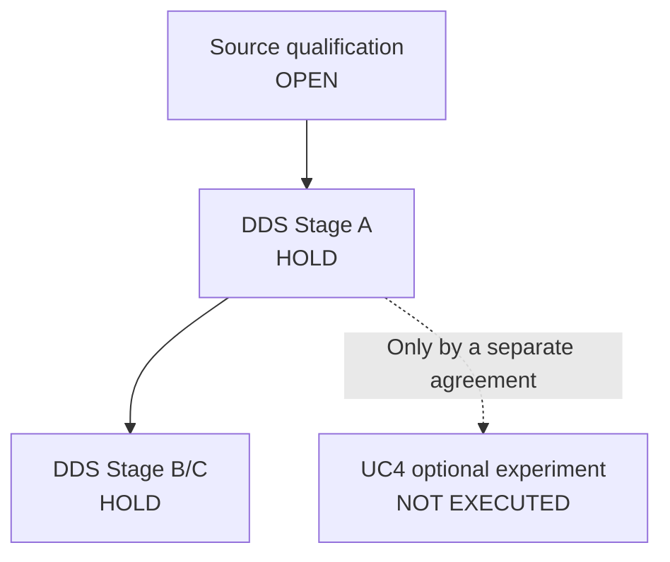

# DDS/UC4 experimental integration — execution-readiness, not execution

<!-- EDITORIAL_READING_AID_BEGIN: presentation only; not historical source content -->

> [!WARNING]
> **Quick assessment: all execution stages remain on HOLD.** This is an implementation-oriented checklist, **not** a report of an admitted or completed DDS/UC4 run. The detailed preconditions, matrices and evidence fields continue below without changed criteria.

### Stage / evidence readiness

| Track | What a reviewer would need | State reported in this record |
|---|---|---|
| **Source and permissions** | Versioned rights statement, parties, lawful access/usage and source provenance | OPEN |
| **DDS Stage A** | Frozen Challenge, fixtures, fair comparator, independent rubric and disclosure limits | HOLD — not jointly frozen/scored |
| **DDS Stage B / C** | Architecture, observation and implementation conditions in addition to Stage A | HOLD — separate admission |
| **Optional UC4** | Independent owner agreement, synthetic/permitted fixtures, measurement and controlled observers | NOT ADMITTED / NOT EXECUTED |

*This diagram records dependencies and unresolved gates only.*

---

<!-- EDITORIAL_READING_AID_END -->

> **READINESS REVIEW / ALL STAGES HOLD.** The [full existing DDS/UC4 work](./PANO-06_DDS_UC4_UC21_REUSE_ROADMAP.md), [Stage A evaluation contract](./PANO-04_DDS_STAGE_A_EVALUATION_EVIDENCE_CONTRACT.md), [T-UC3 evidence contract](./PANO-03_TUC3_EVIDENCE_EXECUTION_Q3_INTERFACE.md) and [completeness audit](./PANO-07_COMPLETENESS_AUDIT_OPEN_FINDINGS.md) are retained in full. This is an additive implementer route, not new source-native gates or identifiers.

## 1. Test environment and interfaces

| Layer | Input | Operation / observation | Output | Admission |
|---|---|---|---|---|
| Source/Challenge | Source-owned PAN-S1–S14, actual rights and Notice versions, actor roles and delegation facts | Confirm each fact's owner and permitted use; separate public, private and synthetic | Provenanced statement + scope + time + licensing/consent | **Open** |
| DDS Stage A — specification | One Challenge; T-UC1/2/3; exact request, legitimate transfer and prohibited effects | Freeze candidate, strong peer, positive and negative fixtures, Q0–Q5/E1–E5 semantic interfaces; reviewer rubric | One versioned assessment packet, not a PASS | **HOLD — not jointly frozen/scored** |
| DDS Stage B — architecture | Completed Stage A criteria plus current candidate/peer architecture | Trace issuance → agent/actor → resolver/index/receiver → decision, authority and provenance, costs and dependencies | Bounded architecture assessment | **HOLD — no B admission** |
| UC4 Stage-0 — optional adapter preflight | Synthetic and permitted records only; source/receiver/rights version and negative controls | Check harness isolation, observer controls, deterministic logging, replay, source-to-claim projection, CI artefacts and assessor custody | Preflight record separate from DDS score | **HOLD — adapter and owner permission not agreed** |
| UC4 Stage-1 / DDS Stage C — only when separately authorized | Frozen eligible test, pinned software/fixture, evaluation team, resource and disclosure permissions | Native candidate vs strongest admitted comparator, matched costs/horizon; rerun only affected `Δ/κ` tests | Observed outputs, logs, cost/effect record and bounded result | **NOT EXECUTED / NO PASS** |

Methods: [DDS canonical index](../../../DDS_CANONICAL_METHOD_INDEX_v0.1.md), [Stage A profile](../../../DDS_CHALLENGE_TRAJECTORY_PROFILE_v0.1.md), [Stage B](../../../DDS_GATE_B_ARCHITECTURE_VERIFICATION_v0.1.md) and [Stage C](../../../DDS_GATE_C_IMPLEMENTATION_PROBLEM_VALIDATION_v0.1.md). UC4 remains a distinct experimental programme, not an automatic consequence of DDS.

## 2. Three trajectories and observable checkpoints

| Trajectory | Required contrasted facts | Core observation | Preserved versus newly tested |
|---|---|---|---|
| **T-UC1** — authority & permission through lifecycle | grant/change/revoke, purpose, version, legitimate continuity, prior/current mandate | Was narrow source permission `q` promoted to unauthorized `q+` before receiver decision? | Preserve proven 00J `q` checks when truly matched; newly test lifecycle and timing |
| **T-UC2** — identity & organizational / delegated authority | human author/rightsholder, publisher, agent, provider, delegating principal, organizational scope, effective-time policy | Did an actor/mandate record enable a stronger unsupported authority claim? | Possible projected 00J claim only, plus new identity/mandate/authority controls |
| **T-UC3** — evidence of authority versus evidence of execution | E1 source, E2 handoff, E3 receiving record, E4 attempt/command/effect, E5 scoped conclusion | Distinguish authentic declaration, receipt, interpretation, actual command and observed effect | Q3 = claim; Q5 = decision; neither substitutes for native E4/E5 evidence |

Test new material differences via [DT-01–DT-12 proposals](./PANO-08_PARTIAL_ISOMORPHISM_EVIDENCE_TRANSFER.md), covering grant/revoke, legitimate transfer, missing receipt, RAG/training/indexing, changed dependency/horizon, correlated sources, reviewer dispute and strong peer. These identifiers belong to the extension design, **not** canonical UC20 T01–T10 or UC21 frozen tests.

## 3. Preconditions that cannot be skipped

1. **Source/data permissions:** source owner confirms which Panodyssey facts, logos, sensitive records, licensing assertions and raw traces may be used for a private trial and which could later be publicly cited. No contact, software or third-party participation is deemed authorized here.
2. **Candidate and peers:** identify implementation/version/hash, conventional comparator and strongest reasonable defended peer, rationale and test parity; do not invent their performance. Distinguish historical Panodyssey-A01 H0/H1/H2 from the three current source trajectories and any DDS R1/R2/R3 labels.
3. **Evaluator contract:** identify assessors, independence/interests, roles, scoring custody, allowed sources and conflict escalation. Require equal evidence, resources, repair opportunities, assessment time and fallback limits for comparators.
4. **Acceptance criteria:** freeze substantive decision predicates, positive-control coverage (legitimate rights transfer, independent creation, current valid permission), negative controls, not-applicable vs not-established vs fail conditions, cost/time/latency/per-claim denominator, and assessment version.
5. **Provenance and observation:** preserve separate (a) document/spec evidence, (b) independently preserved findings, (c) native execution logs, and (d) observed downstream effect. One does not imply another.
6. **Disagreement procedure:** each reviewer submits evidence-located finding and qualification independently; reconcile against frozen rule with independent adjudicator; retain dissent and mark **NOT ESTABLISHED** for unresolved material difference. No forced PASS.
7. **Reevaluation:** if a hidden dependency, wrong projection, new material version or observer blind spot appears, open a successor assessment of affected claims/fixtures. Preserve historic original results and explain which new fact changed sufficiency.
8. **Legal references:** Doc02 maps EU, technical and international sources **conditionally**: exact legal trigger, when outside/not established, and what technical evidence would be needed. This programme does not assert regulatory compliance or create a separate legal-advisory workstream.

## 4. Minimal reproducible hand-off record, all currently unfilled

| Field | Initial state |
|---|---|
| Approved source/actor/version/licence and release scope | OPEN |
| Challenge specification, exact claim and fixture snapshot | OPEN |
| Candidate vs strongest peer / parity & costs | OPEN |
| Evaluators, decision authority, conflicts, separate findings | OPEN |
| TI transfer ledger and delta/coupling tests | OPEN |
| Expected vs observed, raw logs, version hashes, negative controls | NOT EXECUTED |
| Stage A, B, C and UC4-specific admission | HOLD |
| Product/legal/FG-TIDA endorsement | NONE ESTABLISHED |
