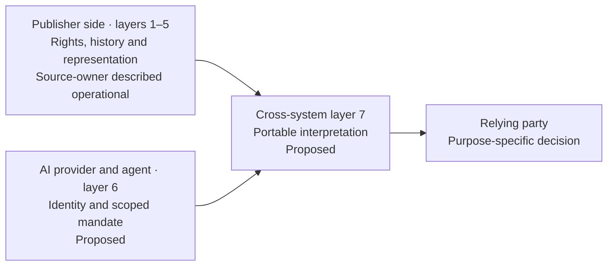
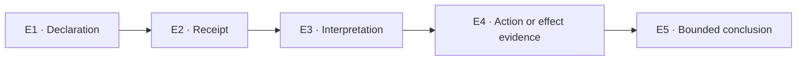

<!--
WORKING DRAFT v0.4 — PRESENTATION EDITION FOR ALEXANDRE LEFORESTIER AND OLENA PAVLENKO.
Not yet approved, submitted or endorsed by FG-TIDA.
Prepared against the actual FG-TIDA use-case issue template, observed 25 October 2026:
https://github.com/FG-TIDA/use-cases/blob/main/.github/ISSUE_TEMPLATE/fg-tida-use-case-proposal.md
The ten numbered sections below are designed for direct transfer into a new issue.
-->

# Agent Identity and Rights Evidence for Published Text

*Proposed FG-TIDA use case · Presentation edition for Alexandre Leforestier and Olena Pavlenko review · 26 October 2026 · Not yet submitted*

## 1. Identification

**Title:** Agent Identity and Rights Evidence for Published Text

**Submitting organization:** Panodyssey (proposed; to be confirmed by its source owner before filing)

**Contact name:** Alexandre Leforestier (proposed case owner and submitter)

**Contact email:** a.leforestier@panodyssey.com

**Contributors to this working case and its research mapping:** Alexandre Leforestier (operational source), Olena Pavlenko (joint Challenge and evidence-to-decision work), Iván Abril Palma (FG-TIDA/DDS/UC21 interface). They must confirm the public attribution and permission to submit. This is one proposed Panodyssey-led use case, not three separate filings.

**Sector** *(tick all that apply)*:

- [ ] Education
- [ ] Displaced persons / humanitarian
- [ ] Health
- [ ] Financial services
- [ ] Telecom
- [x] Media and publishing
- [ ] Logistics
- [ ] Energy
- [ ] Critical infrastructure
- [ ] Smart home / IoT
- [x] Other (specify): Cultural and creative industries. Any later cross-sector transfer would require a separate equivalence review.

## 2. The situation

**Plain language description** *(3 sentences)*: Panodyssey and its authors publish text with attributable, machine-readable rights declarations and, where appropriate, a route to licensing. When an AI crawler or agent accesses a work, the publisher can provide those declarations but still needs to know which accountable organisation the software represents, whether the agent is authorised for that specific use, and whether the terms reached the party making the decision. This use case examines how independent systems can establish the agent's identity and mandate, make a justified decision, and distinguish its stated intention from evidence of its subsequent conduct.

**Illustrative decision point (constructed, not a reported incident):** A rights profile distinguishes permitted discovery or indexing from training that is reserved or licensed. A crawler requests an article under a self-declared agent name. The publisher knows the article's recorded conditions, but the crawler's label alone cannot establish which provider is accountable, whether that provider is authorised for this use, or whether it later complied with those conditions. A lawful exception or valid licence, if established, must be respected rather than automatically blocked. This example tests the evidence available for a decision; it does not establish the current release status of each Panodyssey use channel.

**Actors** *(every material party)*: The author or another verified rightsholder; Panodyssey as publisher or authorised representative; and the publisher-side declaration and audit services. Other parties are the AI provider or accountable organisation, if identified; its crawler or agent instance; and the party making the rights, licensing or compliance decision. An attestor or authorised human reviewer may also be involved. Downstream indexing, retrieval-augmented generation (RAG) and training are **distinct purposes**, not one assumed deployment. A user-agent string is a self-declared technical label, not proof of legal or organisational identity.

**Action:** The rightsholder or authorised publisher publishes or updates a declaration for a work. An AI service accesses or requests that work for a stated purpose. The relying party checks the current declaration, the identities of the provider and agent, and the mandate for that use. Under its own authority, it then allows or restricts the use, requests more evidence, or refers the decision for human review. A separate licensing discussion may follow if the rights and terms support it. Any later claim that a party complied, stopped, removed content or paid requires its own evidence.

**Decision required:** *At the point of access, can the relying party identify the organisation responsible for this agent, verify its authority for this work and intended use, and reach an evidence-supported ALLOW, RESTRICT, HOLD or REQUEST EVIDENCE decision?*

**Problem encountered:** In its public [Theme #17](https://github.com/FG-TIDA/themes/issues/17), Panodyssey describes five production layers for publisher-side rights information, attribution and audit. Alexandre identifies what is missing on the other side: a verifiable identity and accountable representation for the AI actor across the publisher/provider boundary. Even when a rights notice is published correctly, this does not establish that a particular agent received it, interpreted it or acted in accordance with it. **The unresolved question concerns interoperability and accountability. It is not an allegation against a named AI provider or a claim that Panodyssey's product has failed.**

**Current mitigation:** Panodyssey reports that its publisher-side controls are in production and describes a rights-portability use case in [TEMS Trial 7](https://tems-dataspace.eu/tems-trial-7-how-rights-travel-across-systems/). Its account in [Theme #17](https://github.com/FG-TIDA/themes/issues/17) covers domain-level AI access rules, machine-readable discovery for each publication, structured declarations of rights for individual works (including TDM-related terms), timestamped declaration history, and certified author or representative identities. Alexandre also describes how recorded author choices can lead to licensing. These are **descriptions by the source owner**, not independent findings about performance or legal compliance.

| Boundary | Function | Status in this proposal |
|---|---|---|
| Publisher side, layers 1–5 | Rights governance, discovery, work-specific declarations, history and certified representation | Panodyssey describes these layers as operational; Alexandre must confirm the exact release and which use channels each layer covers. |
| Agent side, proposed layer 6 | Verifiable accountable provider/principal, acting agent and current mandate | An identity and representation interface to investigate, **not** an implementation that has already been verified. |
| Cross-system interface, proposed layer 7 | Portable interpretation with IETF AI-usage preference work and other relevant standards | An interoperability question for future assessment; **not** a claim that every standard, use or endpoint has been deployed. |

**Figure 1 — Proposed decision boundary (conceptual).**

*The arrows identify evidence interfaces to assess. They do not assert a deployed exchange, receipt by an AI provider or verified enforcement.*

The current version and implementation scope of training, RAG and indexing/citation **must each be confirmed separately**. A declaration may express a use category without proving that the category is enforced in production. Likewise, Panodyssey's existing TEMS interoperability does not itself establish receipt, mandate or downstream-effect evidence from an AI provider.

**Residual gap:** What remains missing is a cross-organisation evidence chain linking a specific work and its current rights conditions to the responsible AI provider, the acting agent, its scoped mandate, receipt of the terms, a purpose-specific decision and any conduct that can actually be observed. The chain must handle changes to rights, revocation, conflicting or missing evidence, lawful uses, and challenges or corrections without creating false certainty. This matters for author control and attribution, fair access by legitimate users, enforceable licensing where applicable, and distinguishing a dispute about permission from proven misuse. FG-TIDA is not being asked to determine infringement or set payment tariffs.

**Scope of one use case:** The jointly developed Panodyssey Challenge is examined through three trajectories: **T-UC1**, how rights and permissions change over time; **T-UC2**, the agent's identity, accountable organisation and delegated authority; and **T-UC3**, evidence of declaration, receipt, interpretation, decision and subsequent action. They are three perspectives within **one FG-TIDA filing**, not three separate official use cases. The broader fourteen-dimension Challenge and preliminary Terms of Reference mapping remain in the [source register](https://github.com/dakleyer/structural-awareness-contributions/blob/ee4e16965fa66b158fe41c081d494ef364a3980b/research/ecosystem-awareness/baseline/00J-extensions/PANODYSSEY-EXT-01/SOURCE-00_ORIGINAL_CHALLENGE_AND_TOR_MAP.md); untested dimensions are not presented as established requirements.

**Three trajectories within one use case — reader's guide:**

| Trajectory | Core question | Evidence to examine |
|---|---|---|
| **T-UC1 — Rights over time** | Which declaration and permissions apply to this work, use and moment? | Work-level rights source, versions, changes, expiry and revocation. |
| **T-UC2 — Agent identity and authority** | Who is accountable for the agent, and what is it authorised to do? | Provider/principal identity, agent binding and current scoped mandate. |
| **T-UC3 — Evidence and subsequent action** | What was published, received, interpreted, decided, attempted and actually observed? | Separate evidence at each step, with explicit unknowns and limits. |

*These are views of the same proposed Challenge, not additional FG-TIDA submissions or completed tests.*

## 3. Actors and context

**Taxonomy roles involved:**

- [x] Principal — the rightsholder, for rights it actually holds; separately, the organisation that authorises the agent to act.
- [x] Relying party — the publisher, content service, or licensing or compliance decision-maker assessing access, use or their consequences.
- [x] Builder — relevant AI-agent or rights-service builder when identified.
- [x] Deployer / Owner — Panodyssey or the publishing service and, separately, the provider operating the accessing service.
- [x] Agent instance — crawler or downstream AI service acting on a defined request and purpose.
- [x] User — author, publisher representative or human requester, as applicable.
- [x] Infra provider — the hosting, discovery, registry or access infrastructure where it affects the evidence.
- [x] Attestor — if an identity, mandate or integrity assertion is independently issued and relied on.
- [x] Other (specify): Authorised rights administrator, commercial licensor, independent observer and reviewer.

**Mandates in this case** *(required; only actual authority may be treated as established)*:

| Grantor | Grantee | What is conferred | Governing regime |
|---|---|---|---|
| Author/rightsholder, if verified | Publisher/Panodyssey or authorised rights representative | Only the particular publication, rights-management or representation powers actually granted. The precise contract and the rightsholder's standing must be verified. | Applicable national copyright and contract law, and the relevant signed agreement. A publication record alone does not prove title or agency. |
| AI-service provider or accountable organisation, if identified | Its identified crawler/agent instance | An operating mandate limited by action, purpose, scope and time, if such a delegation exists. A user-agent label does not establish that grant. | The provider's legally effective organisational delegation, service rules and applicable contract. Its status and acceptance by the relying party remain open. |
| Rightsholder or authorised licensing party, if competent to grant it | Identified AI provider / licensee | Specific uses, such as training or retrieval, on agreed conditions and with remuneration if negotiated. No licence is presumed in this case. | Applicable copyright law, exceptions and reservations, and a concluded licence where relevant. Territory, purpose, period and national implementation require case-specific review. |
| Receiving organisation, under its internal approval policy | Identified human reviewer or delegated compliance agent | Authority to make the relevant ALLOW, RESTRICT, HOLD, REQUEST EVIDENCE or escalation decision, without extending any upstream rights in the content. | The receiving organisation's mandate and policy, subject to legal constraints; to be declared before testing. |

**Cross-border?**

- [x] Yes — access and reliance may cross EU and non-EU service boundaries. Each assessment must specify source and provider jurisdictions, national copyright implementation and territorial effects.
- [ ] No

**Embodied (physical actuation or sensing)?**

- [ ] Yes
- [x] No

**Agent action type** *(most consequential governs the selected run)*:

- [x] Read-only — discovery or retrieval alone, without claiming it is legally unregulated.
- [x] Consequential (reversible) — access, licence request, temporary restriction or remediable use decision.
- [x] Irreversible — where actual dissemination, training or another effect cannot practically be undone; applicability to a specific run must be proven, not assumed.

**Crosses organisational boundary?**

- [x] Yes — author/publisher or rights representative, AI-service provider and independent downstream receiver may be separately governed.
- [ ] No

**Risk level** *(provisional case-assessment choice)*:

- [ ] Low
- [ ] Medium
- [x] High — rights, attribution and commercial consequences may be materially affected, especially if later removal or compensation is disputed. This is not a claim that a production incident has been measured.

## 4. Theme relevance

| Theme | Yes | Primary | Justification (required if checked) |
|---|---|---|---|
| Dynamic Identity | [x] | [x] | A technical agent label must be tied over time to an identifiable, accountable provider/principal at the action point. |
| Continuous Trust and Attestation | [x] | [ ] | Assertions about rights, actors and mandates need a known source, freshness and status, plus later requalification rather than a one-time check. |
| Delegation | [x] | [ ] | A provider's instruction to a crawler and a publisher's authority to speak for a rightsholder are distinct, bounded grants. |
| Discovery and Cross-Border Trust | [x] | [ ] | Rights signals and identity/mandate evidence must remain interpretable between independently operated, possibly cross-border services. |
| Runtime Enforcement (Control Plane) | [x] | [ ] | The decision must connect the relevant evidence to a particular permitted or restricted action. An acknowledgement alone does not prove an effect. |
| Embodied AI Identity and Trust | [ ] | [ ] | No physical actuation is part of the proposed text case. |

**Related theme proposals:** [FG-TIDA Theme #17 — Digital Rights Infrastructure for Text](https://github.com/FG-TIDA/themes/issues/17) (Alexandre Leforestier / Panodyssey; source of the operational description); [UC21/S6](https://github.com/FG-TIDA/use-cases/issues/21) (a related, constructed scenario concerning inversion of rights provenance, not this Panodyssey case); and [UC4](https://github.com/FG-TIDA/use-cases/issues/4) (a possible future experimental interface with limited scope, if separately agreed). Theme #17 is a theme issue; it is not itself a dedicated Panodyssey use-case submission.

## 5. Requirements

The entries below are *proposed requirements for reaching a decision*. They do not imply that every provider lacks these capabilities or that FG-TIDA has adopted them. The legal item depends on the applicable legal regime. The source Challenge dimensions `PAN-S1…PAN-S14` are distinct from the `EA-S1…EA-S14` requirements in the linked research corpus. The detailed mapping and test contract still require source-owner and reviewer agreement.

| # | Type (choose one) | Requirement description | Criticality |
|---|---|---|---|
| R01 | Technical | Bind every operative work-level declaration to a source, work ID, asserted holder/representative, purpose, scope, version and time; distinguish identity authentication from actual rightsholder standing. T-UC1. | Must |
| R02 | Legal | Carry a statement of applicable rights, reservations, exceptions or licence terms that has been qualified outside the technical system, with explicit limits by purpose, territory, role and time. The system must not infer legal entitlement from a rights signal or identity credential alone. | Must |
| R03 | Technical | Preserve the history of grants, changes, restrictions, expiry and revocation. Reassess only affected future reliance without changing the historical evidence. T-UC1. | Must |
| R04 | Technical | Bind the observed crawler/agent identifier to an accountable provider/principal, with issuer, assurance, validity and limits; a user-agent string or certificate alone is not sufficient mandate evidence. T-UC2. | Must |
| R05 | Technical | Establish the current delegation chain for each action: who authorised whom, for which work and use, within what scope, and whether the receiving party can rely on that authority. T-UC2. | Must |
| R06 | Technical | Keep separate evidence of the published notice, receipt by an identified party, interpretation for the stated purpose, decision, attempted action and externally supportable effect. Evidence from one stage must not be treated as proof of a later one. T-UC3. | Must |
| R07 | Technical | Decide for the specific purpose. Training, indexing/citation, retrieval/RAG or another identified activity must not inherit permission from a different use unless a justified rule allows it. T-UC1/T-UC3. | Must |
| R08 | Technical | Record each ALLOW, RESTRICT, HOLD or REQUEST EVIDENCE decision with its responsible actor, time limits, reasons for uncertainty and a legitimate way to revisit the decision. T-UC3. | Must |
| R09 | Technical | When a party claims compliance, removal, non-use, payment or enforcement, require evidence of the downstream action or effect claimed. Record what cannot be independently observed. T-UC3. | Must |
| R10 | Technical | Retain privacy-minimised provenance, source/version references, relevant attestations, reviewer dissent and correction history for an auditable cross-organisation decision. T-UC1/2/3. | Should |
| R11 | Technical | Preserve lawful positive cases, valid licences and authorised continued use alongside negative, revoked, stale, forged, unsupported or ambiguous cases. A policy that always blocks access is not a satisfactory solution. All trajectories. | Must |
| R12 | Business | Preserve the source owner's existing route to licensing and support a licence inquiry attributable to its requester or negotiated remuneration **where legally and contractually appropriate**; do not infer a price, compulsory payment or permission from technical identity alone. | Should |
| R13 | Technical | If evidence, a mandate, a use channel or an external actor changes materially, reopen only affected assessments. Record what dependency changed and preserve the original result and its limits. All trajectories. | Must |

## 6. Assessment criteria

**Success criteria:** For a work, actor, purpose, time and applicable regime fixed in advance, a defensible approach must meet the conditions below. These are proposed **assessment criteria**, not demonstrated results:

1. **T-UC1 — Rights over time:** The decision uses the correct declaration, its source and the current rights and licensing status. A change or revocation triggers reassessment of affected reliance without erasing history.
2. **T-UC2 — Identity and authority:** The acting agent is linked to an accountable provider and a valid mandate limited to the relevant scope. If this cannot be established, the decision explicitly records what remains unverified.
3. **T-UC3 — Evidence and action:** Publication, receipt, interpretation, decision, attempted action and observed effect remain separate stages. Neither an acknowledgement nor silence is treated as proof of compliance or infringement.
4. **Fair positive and negative outcomes:** Authorised, licensed and otherwise lawful uses remain possible. Stale, forged, contradictory or out-of-mandate claims are not treated as authorised by default.
5. **Independent review:** An external reviewer can reproduce the basis for a decision, disagree with it, correct a finding and trace the facts and rules behind it. Strong existing controls that meet the same criteria remain valid solutions.

**Illustrative assessment probes (not executed and not a proposed verdict):**

| Trajectory | Example to examine | What the assessment must preserve |
|---|---|---|
| **T-UC1** | A rights declaration changes between two decisions about the same work. | Reassess affected future reliance without rewriting the earlier record. |
| **T-UC2** | A crawler declares a provider name but supplies no verifiable, current mandate for the requested use. | Do not infer authority from the label alone; record what remains unverified. |
| **T-UC3** | A provider acknowledges a notice, but no independently supported evidence of later conduct is available. | Receipt alone establishes neither compliance nor infringement. |

**Measurable metrics:** First freeze the test cases and independent reference decisions (the test oracle). Report both counts and rates for each purpose and trajectory. Report unknown or unobservable outcomes separately; do not count them as compliance or failure.

| Measure | Proposed calculation or report |
|---|---|
| Mandate binding coverage | Decisions with sufficient evidence of principal, agent and mandate ÷ decisions requiring that evidence. Count explicit UNKNOWN/HOLD outcomes separately. |
| Decision correctness | Decisions agreeing with the independent test oracle ÷ all scored decisions. Report false authorisations and false restrictions separately, including lawful or licensed positive controls. |
| Evidentiary reach | Cases with evidence at E1–E3 for source publication, receipt by a specific receiver and interpretation. Separately count E4 claims about observed effects that have independent support, naming the observer and limits. |
| Change and revocation | Incorrect continued authorisations after an admitted material change ÷ applicable change cases; requalification completeness, time and affected-scope accuracy. |
| Contestability and feasibility | Reviewer disagreement/correction counts; end-to-end time, effort and cost versus a capable conventional comparator with equal information and resources. |

This proposal supplies no target values, sample sizes, observations or comparative scores. Before any test, register the oracle, mix of positive, negative and boundary cases, time horizon, thresholds, evidence producers, cost envelope, evaluator independence and permitted disclosure of data.

**Prospective evaluation route:** The supporting corpus proposes a **documentary Simplified DDS Stage A** exercise to identify and challenge candidate requirements. This is not a completed product test. Alexandre and Olena would first review and freeze the source facts, rights to use evidence, three trajectories and applicable legal predicates. Candidate solutions, including capable existing industry approaches, would then be compared using equivalent facts, authority, time and resources, against an independent reference.

Within T-UC3, the local **E1–E5** checkpoints address declaration, receipt, interpretation, evidence of action or effect, and a conclusion bounded by that evidence. They are not approved FG-TIDA gates.

**Figure 2 — What the evidence checkpoints separate.**

*A link is a question to verify, not an inference of proof. The decision and any attempted action must also be recorded separately; E4 counts only effects supportable by evidence.*

Later architecture verification (DDS B), implementation and problem validation (DDS C), and any experimental assessment through [UC4](https://github.com/FG-TIDA/use-cases/issues/4) each require a separately agreed scope, environment, evidence and resources.

**Boundary to UC21/S6:** The synthetic [UC21 scenario S6 and 00J](https://github.com/FG-TIDA/use-cases/issues/21) examines how a narrow, valid statement of rights could be expanded into an unsupported, broader authorisation. That **specific** failure pattern may share a structurally equivalent component (an isomorphic sub-part) with this case. The complete Panodyssey rights lifecycle and agent-side interfaces, however, are not equivalent to S6.

Existing test evidence may be referenced **only if** the A25/A26 criteria for transferring evidence establish that the relevant property and its dependencies have been preserved. Identity, mandate, receipt, new use channels and observed effects still require their own tests. **This proposal claims no PanO v6 PASS, executed evidence transfer, UC4 run, DDS score or Panodyssey product failure.** It is a distinct Panodyssey-led use case.

## 7. Duplication check

**Existing standards or SDOs:** [W3C Community Group TDMRep Final Report (2024)](https://www.w3.org/community/reports/tdmrep/CG-FINAL-tdmrep-20240510/) and its TDM-policy declarations (**not** a W3C Recommendation); [W3C ODRL Information Model 2.2](https://www.w3.org/TR/odrl-model/); [W3C PROV-O](https://www.w3.org/TR/prov-o/); [W3C Verifiable Credentials Data Model 2.0](https://www.w3.org/TR/vc-data-model-2.0/); [IETF RFC 9309 (Robots Exclusion Protocol)](https://www.rfc-editor.org/rfc/rfc9309); [IETF RFC 9334 (Remote ATtestation procedureS)](https://www.rfc-editor.org/rfc/rfc9334); [IETF draft-ietf-aipref-vocab-08](https://datatracker.ietf.org/doc/draft-ietf-aipref-vocab/08/) (**work in progress**, not a published RFC); and, where applicable, [EU Copyright DSM Directive 2019/790, Articles 3–4](https://eur-lex.europa.eu/eli/dir/2019/790/oj/eng) and [EU AI Act, Article 53(1)(c)](https://ai-act-service-desk.ec.europa.eu/en/ai-act/article-53). These sources have distinct technical and legal standing.

**Overlap notes:** Rights and preference formats express conditions, but cannot by themselves identify the accountable agent or prove what it subsequently did. The [aipref draft](https://datatracker.ietf.org/doc/draft-ietf-aipref-vocab/08/) explicitly distinguishes the expression of preferences from their enforcement. Credentials and attestations may identify or assess technical entities without proving the provider's current legal or organisational mandate.

FG-TIDA can assess how these elements work **together at the moment of action**: the work, intended use, applicable authority, identity, delegated scope, the receiving party's interpretation and any supportable consequence. Alexandre has also raised MCP as a **possible** test interface, not an established answer to legal identity. The outcome may show that an existing combination is sufficient, that a gap remains, or that the evidence is inconclusive. The work should avoid duplicating W3C/IETF efforts or trying to decide copyright disputes.

## 8. Maturity

**Pilot status** *(classification of the proposed end-to-end case, not of every underlying component)*:

- [x] Hypothetical — no integrated pilot has been reported for the proposed **end-to-end assessment across organisations** of agent identity, delegation, rights decisions and downstream evidence. The underlying Panodyssey publication service is **not** being described as hypothetical.
- [ ] Pilot in progress — no integrated joint pilot is attested here.
- [ ] Deployed in production — **Panodyssey's source owner describes the publisher-side capabilities as operational in Theme #17**. This does **not** establish that the full reciprocal agent-side identity/effect case or the synthetic S6 extension is deployed. This proposal does not independently verify production status.

**Reference implementation:** For the publisher-side environment, see the [Panodyssey production account in Theme #17](https://github.com/FG-TIDA/themes/issues/17) and the [TEMS Trial 7 rights-portability account](https://tems-dataspace.eu/tems-trial-7-how-rights-travel-across-systems/). The related [00J-A01 Panodyssey/TEMS documentary profile](https://github.com/dakleyer/structural-awareness-contributions/blob/main/research/ecosystem-awareness/baseline/00J_A01_PANODYSSEY_TEMS_RIGHTS_PORTABILITY_IMPLEMENTATION_PROFILE_v0.1_DRAFT.md) is a research document, **not** a verified implementation on the agent side or a passed assessment. Before filing, Alexandre must confirm the current Notice release and the status of each training, RAG and indexing capability.

## 9. IP and confidentiality

**Confidentiality level** *(proposed classification; publication still requires approval)*:

- [x] Public — intended for the FG-TIDA public use-case issue **only after** Alexandre and Olena confirm the source facts, attribution and permission to publish. Selecting this option does not mean they have approved publication.
- [ ] FG-internal only
- [ ] Redact before publication — reconsider this classification if the source-owner review identifies material that should not be released. This draft cites public sources and contains **no** private commercial correspondence, unpublished logs or allegations against named counterparties.

**IP notes:** The Panodyssey product, public Challenge and research mapping each retain their own provenance and contributor rights. A machine-readable reservation, an applicable statutory exception, a negotiated licence and remuneration are distinct legal or operational facts. A technical identifier alone does not prove ownership, legal representation, infringement or entitlement to payment. The document includes only approved public product facts and traceable research links; it does not use confidential correspondence or unpublished logs as evidence. Any later operational pilot or use of restricted material requires separate permissions from its owners, a defined scope and resources, and agreed disclosure terms.

## 10. Assets

**Link to assets:**

- [ ] Dataset — no private operational dataset included or released.
- [ ] Code — no executed Panodyssey agent-side or UC4 implementation supplied.
- [x] Protocol — working documentary specification and documents on evidence and test readiness, not a completed or frozen assessment.
- [x] Other — source Theme #17; the canonical 00J extension reader; three trajectories; source and legal traceability; and the method and transfer ledgers.

**Canonical versioned research packet (commit `ee4e16965fa66b158fe41c081d494ef364a3980b`, 25 October 2026):**

The main reader provides the entry point. The other documents preserve the original Challenge, define the three trajectories, set out the evaluation approach and record the limits on reusing evidence.

1. [Main reader — `00J-EXT-PANO-01`](https://github.com/dakleyer/structural-awareness-contributions/blob/ee4e16965fa66b158fe41c081d494ef364a3980b/research/ecosystem-awareness/baseline/00J-extensions/PANODYSSEY-EXT-01/README.md). Defines source coverage, ownership limits, namespaces, evidence inheritance and readiness.
2. [Original fourteen-dimension Challenge and FG-TIDA ToR map](https://github.com/dakleyer/structural-awareness-contributions/blob/ee4e16965fa66b158fe41c081d494ef364a3980b/research/ecosystem-awareness/baseline/00J-extensions/PANODYSSEY-EXT-01/SOURCE-00_ORIGINAL_CHALLENGE_AND_TOR_MAP.md). Records the preliminary PAN-S1…PAN-S14 dimensions and their links to the Terms of Reference; these are not acceptance scores.
3. [Expanded single Challenge and three specific trajectories](https://github.com/dakleyer/structural-awareness-contributions/blob/ee4e16965fa66b158fe41c081d494ef364a3980b/research/ecosystem-awareness/baseline/00J-extensions/PANODYSSEY-EXT-01/PANO-01_EXPANDED_CHALLENGE_THREE_TRAJECTORIES.md). Explains the hierarchy of sources, T-UC1/2/3 and the decisions still open.
4. [Conditional legal and technical reference register](https://github.com/dakleyer/structural-awareness-contributions/blob/ee4e16965fa66b158fe41c081d494ef364a3980b/research/ecosystem-awareness/baseline/00J-extensions/PANODYSSEY-EXT-01/PANO-02_CONDITIONAL_LEGAL_TECHNICAL_TRACEABILITY.md). Tracks the applicable references without claiming compliance with any statute.
5. [T-UC3 evidence checkpoints E1–E5](https://github.com/dakleyer/structural-awareness-contributions/blob/ee4e16965fa66b158fe41c081d494ef364a3980b/research/ecosystem-awareness/baseline/00J-extensions/PANODYSSEY-EXT-01/PANO-03_TUC3_EVIDENCE_EXECUTION_Q3_INTERFACE.md). Separates declaration, receipt, interpretation, observation of action or effect, and the resulting bounded conclusion.
6. [Documentary DDS Stage A evaluation and reviewer contract](https://github.com/dakleyer/structural-awareness-contributions/blob/ee4e16965fa66b158fe41c081d494ef364a3980b/research/ecosystem-awareness/baseline/00J-extensions/PANODYSSEY-EXT-01/PANO-04_DDS_STAGE_A_EVALUATION_EVIDENCE_CONTRACT.md). Covers candidate solutions, fair comparisons, test oracles, conflicts, changes and release conditions.
7. [DDS / UC4 / UC21 reuse roadmap](https://github.com/dakleyer/structural-awareness-contributions/blob/ee4e16965fa66b158fe41c081d494ef364a3980b/research/ecosystem-awareness/baseline/00J-extensions/PANODYSSEY-EXT-01/PANO-06_DDS_UC4_UC21_REUSE_ROADMAP.md). Explains possible future links between the workstreams; tests remain conditional and no execution is promised.
8. [Partial-isomorphism and claim-by-claim transfer method](https://github.com/dakleyer/structural-awareness-contributions/blob/ee4e16965fa66b158fe41c081d494ef364a3980b/research/ecosystem-awareness/baseline/00J-extensions/PANODYSSEY-EXT-01/PANO-08_PARTIAL_ISOMORPHISM_EVIDENCE_TRANSFER.md). Defines when evidence can be reused for properties actually preserved across cases.

**Companion records for the overall research packet:**

- [Transfer ledger](https://github.com/dakleyer/structural-awareness-contributions/blob/ee4e16965fa66b158fe41c081d494ef364a3980b/research/ecosystem-awareness/baseline/00J-extensions/PANODYSSEY-EXT-01/TRANSFER_LEDGER.md): records claims and decisions on evidence transfer; no transferred PASS is registered.
- [UC4 readiness](https://github.com/dakleyer/structural-awareness-contributions/blob/ee4e16965fa66b158fe41c081d494ef364a3980b/research/ecosystem-awareness/baseline/00J-extensions/PANODYSSEY-EXT-01/DDS_UC4_READINESS.md): records the conditions for any later experimental work.
- [Open findings](https://github.com/dakleyer/structural-awareness-contributions/blob/ee4e16965fa66b158fe41c081d494ef364a3980b/research/ecosystem-awareness/baseline/00J-extensions/PANODYSSEY-EXT-01/PANO-07_COMPLETENESS_AUDIT_OPEN_FINDINGS.md): identifies unresolved review and completeness items.

**External FG-TIDA anchors:** [Panodyssey's Theme #17](https://github.com/FG-TIDA/themes/issues/17) is the source-owner account, and [Alexandre's comment](https://github.com/FG-TIDA/themes/issues/17#issuecomment-5542576491) endorses the Case Study → Challenge → Use Case structure. [TEMS Trial 7](https://tems-dataspace.eu/tems-trial-7-how-rights-travel-across-systems/) provides the public rights-portability context. [UC21](https://github.com/FG-TIDA/use-cases/issues/21) is a related but distinct case; [UC4](https://github.com/FG-TIDA/use-cases/issues/4) is a possible experimental interface. The [official submission template](https://github.com/FG-TIDA/use-cases/blob/main/.github/ISSUE_TEMPLATE/fg-tida-use-case-proposal.md) and [FG-TIDA Terms of Reference](https://www.itu.int/en/ITU-T/focusgroups/tida/Pages/ToR.aspx) provide the formal FG-TIDA framework.

**IP notes (optional):** The linked research packet is public in its owning corpus, but that does not release private third-party material or authorise a new FG-TIDA filing. The source owner must still review the text, confirm current capabilities and versions, approve attribution, and decide what may be disclosed publicly. **Status of this submission text: proposed / for review / not yet filed.**
