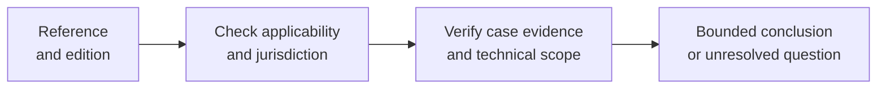

<!-- PRESENTATION COPY, derived from PANO-02_CONDITIONAL_LEGAL_TECHNICAL_TRACEABILITY.md; archival mirror at ../PANO-02_CONDITIONAL_LEGAL_TECHNICAL_TRACEABILITY.md remains unchanged. Do not use this copy for SOURCE_MANIFEST mirror hashes. -->

<!--
Source-preserving Markdown mirror of a Google Doc historically labelled INTERNAL. The corpus owner expressly authorized public research-corpus promotion on 25 October 2026. Historical source labels remain quoted faithfully; this does not grant rights in third-party underlying evidence, endorse the case, or constitute an experimental result.
Google Docs title: 02 — S1–S14 Traceability Addendum (EU Legislation / Technical and International References)
Google Docs source: https://docs.google.com/document/d/1mLp2Sb1q2dD67FKBqQMiZ9hR__t2snyitFIwcwpi78Y/edit
Observed Google Docs revision: AHj4eMQrZpZZO1N0z6UHSlm9Rm3Oqv7mEE0-2R9d7MSl1SfpkLIlUFjsw4Zmx6zKoUU97LueL-w7yo6L3qv24Ci5FV2a_Mv16SbOqPMqWI0
Captured: 2026-10-25 (Europe/Madrid)
Status: historical/working source; not an executed validation, a legal conformity assessment, or FG-TIDA endorsement.
-->

# LEGAL / TECHNICAL REFERENCE LEGEND — INTERNAL v0.6 — 25 October 2026 — INTERNAL / NOT FOR EXTERNAL CIRCULATION

<!-- EDITORIAL_READING_AID_BEGIN: presentation only; not historical source content -->

> [!WARNING]
> **Reader orientation — presentation layer only.** This is a **conditional legal/technical reference register**, not legal advice, a determination that a provision applies, or a certification of conformity. See the [unchanged original register](../PANO-02_CONDITIONAL_LEGAL_TECHNICAL_TRACEABILITY.md) and its historical source scope.

### How to interpret a reference

| Layer | What the document identifies | What it does not establish |
|---|---|---|
| **Panodyssey Challenge** | An S1–S14 source requirement/question and provisional ToR anchor | Its adoption as a frozen test condition |
| **EU legislation** | Potentially relevant article and stated applicability conditions | That a particular AI provider/system falls within that legal regime |
| **Standards and guidance** | Possible technical terms, models, attestations or controls | Independent implementation, enforcement or legal compliance |
| **Case-specific conclusion** | Questions and evidence still needed to reach a bounded conclusion | A finding of infringement, entitlement to payment or product failure |

**Conditional reading sequence**

*Every link is a required question to resolve, not a claim that its outcome has been established.*

---

<!-- EDITORIAL_READING_AID_END -->

The original map is extended in place with two additional normative-reference columns. This document explains their differing legal/technical status and preserves the existing 14-row S1–S14 identity and preliminary ToR anchors.

Existing source: https://docs.google.com/document/d/1qA8XG_L7ZJbwBOlOb37r4Qm7J6nG_AcSCddnzEAAPi8/edit

Provisional mapping, not legal applicability finding:

S1 — Authority provenance and current applicability

EU AI Act reference: 53(1)(c), conditional on an in-scope GPAI provider's copyright-policy duty; no general authority-validation duty inferred.

Other technical/international references: ODRL 2.2: Policy/Rule/Constraint; PROV-O: attribution/history. Expressions and provenance do not establish legal standing.

S2 — Preference fidelity and reviewable decision basis

EU AI Act reference: No direct article-level duty established for this challenge.

Other technical/international references: ODRL 2.2: parties, actions, constraints and profiles. Encoding does not establish fidelity to unexpressed intent.

S3 — Regime and context qualification

EU AI Act reference: No direct article-level duty established; use context is an input to later applicability review.

Other technical/international references: NIST AI RMF 1.0 MAP/MANAGE: context and change, voluntary guidance; not legal or product conformance.

S4 — Human oversight authority and capacity

EU AI Act reference: 14(1)–(4), only if the relevant high-risk AI-system requirements apply; not presumed for this publishing case.

Other technical/international references: NIST AI RMF GOVERN/MEASURE, voluntary oversight guidance. ISO/IEC 42001:2023 is management-system context only; no clause-to-gate claim.

S5 — Operational indeterminacy and containment

EU AI Act reference: No direct article-level duty established; missing evidence is not proof of legal infringement.

Other technical/international references: NIST AI RMF MEASURE/MANAGE: assess uncertainty and response. Local unknown/HOLD semantics must be specified separately.

S6 — Interoperable, privacy-preserving trust determination

EU AI Act reference: No direct article-level duty established.

Other technical/international references: W3C VC Data Model 2.0: issuer/holder/verifier, trust model and privacy. Data exchange does not establish issuer trust or permission.

S7 — Identity and representation link

EU AI Act reference: No direct article-level duty established; no AI legal-personhood conclusion.

Other technical/international references: W3C VC 2.0 claims and issuer/subject binding; RFC 9334 RATS roles/appraisal. Attestation state is not organisational mandate or legal representation.

S8 — Bounded subdelegation and non-amplification

EU AI Act reference: No direct article-level duty established.

Other technical/international references: ODRL 2.2 Policy Inheritance and Rule Composition are expression mechanisms; mandate non-amplification needs an explicit application contract.

S9 — Multi-principal composition, non-substitution and conflict

EU AI Act reference: No direct article-level duty established.

Other technical/international references: ODRL 2.2 parties and Rule Composition; independent constraints/conflicts require declared receiver semantics, not an assumed universal hierarchy.

S10 — Commitment state and material change

EU AI Act reference: No direct article-level duty established.

Other technical/international references: PROV-O wasRevisionOf / invalidatedAtTime: version and invalidation history. Provenance alone does not execute revalidation.

S11 — Policy integrity across domains and jurisdictions

EU AI Act reference: 53(1)(c) only for an in-scope GPAI provider's copyright policy; not a general cross-jurisdiction policy-harmonisation requirement.

Other technical/international references: ODRL 2.2 profiles/constraints; TDMRep Community Group specification and aipref-vocab-08 draft as distinct signal references. Neither is evidence of compliance.

S12 — Accountability, challenge and repair

EU AI Act reference: No direct article-level duty established; this is not a statutory remedy assessment.

Other technical/international references: PROV-O derivation/attribution and version history; NIST AI RMF MANAGE supports response planning, not legal repair.

S13 — Authority history versus intervention history

EU AI Act reference: No direct article-level duty established.

Other technical/international references: PROV-O entities, activities, agents and revisions can distinguish grant history from later intervention; source semantics must remain explicit.

S14 — Evidence-to-decision assessment

EU AI Act reference: No direct article-level duty established; a reference is not an applicability or sufficiency finding.

Other technical/international references: PROV-O evidence links; RFC 9334 Evidence, Attestation Results and appraisal policy. ISO/IEC 42001 is contextual only; no clause-level conformance asserted.

No normative reference is a compliance verdict. Exact gate-to-provision applicability and equivalence remain PENDING REVIEW. Original preliminary ToR anchors are preserved, not certified or elevated to obligations.

EU AI Act: https://ai-act-service-desk.ec.europa.eu/en/ai-act/article-53

Directive: https://eur-lex.europa.eu/eli/dir/2019/790/oj

W3C ODRL: https://www.w3.org/TR/odrl-model/

# REFERENCE STATUS, EDITION AND EVIDENCE LIMIT

Legal references and technical specifications have different status. ToR clauses describe FG-TIDA work scope; they are not a company's compliance checklist. Technical standards may support a mechanism without satisfying an entire challenge.

Official live ToR, checked 25 October 2026: https://www.itu.int/en/ITU-T/focusgroups/tida/Pages/ToR.aspx

Case-level 3.3/4.1; challenge-level 3.4, 4.1–4.5, A.1.1/A.1.2/A.1.5, A.2.1/A.2.2/A.2.4/A.2.5/A.2.7/A.2.8 were checked for relevance. These Annex A items are examples of possible deliverables. The historical row links remain preliminary, selective relevance judgments. Scope clause 2 excludes general AI governance, agentic-AI protocols and national digital-ID content. Do not turn the rights scenario into a national law or protocol-standardisation proposal.

# EU LAW — CONDITIONAL REFERENCE LAYER

AI Act, Regulation (EU) 2024/1689, Article 53(1)(c): an in-scope GPAI provider must maintain a Union-copyright compliance policy that uses state-of-the-art technologies to identify copyright reservations and comply with them as expressed under DSM Directive Article 4(3). This is not a universal duty imposed on every crawler/publisher or proof that a reservation is legally effective. Official Commission text: https://ai-act-service-desk.ec.europa.eu/en/ai-act/article-53

Article 14(1)–(4): relevant human-oversight requirements for in-scope high-risk systems. A publishing/Notice case is not classified as high-risk by this audit. https://ai-act-service-desk.ec.europa.eu/en/ai-act/article-14

DSM Directive (EU) 2019/790, Article 4(1), (3), (4): lawful-access TDM exception, express reservation by appropriate means for online material, and preservation of Article 3. Do not turn a technical training-channel design into a claim that the Directive universally governs training only, all RAG identically, or that any opt-out proves infringement. Legal applicability, exceptions, actor role, current law/application dates and national implementation require qualified review outside the technical trajectory. Official text/PDF: https://eur-lex.europa.eu/legal-content/EN/TXT/PDF/?uri=CELEX:32019L0790

The Commission's article pages identify their consolidated-law basis. This audit verified reference text and conditional relevance, not a complete current-law/national applicability opinion. EUR-Lex live HTML and PDF retrieval were challenge-blocked; the official indexed Article 4 text was checked, including paragraphs 1, 3 and 4. A full live legal-source verification remains pending.

# TECHNICAL AND INTERNATIONAL REFERENCE REGISTER

ODRL Information Model 2.2 — W3C Recommendation, 15 February 2018: Policy, Party, Constraint, Permission/Prohibition/Duty, Rule Composition, Inheritance and profiles. It expresses usage policies; it does not determine legal validity or prove that actors complied. https://www.w3.org/TR/2018/REC-odrl-model-20180215/

PROV-O — W3C Recommendation, 30 April 2013: Entity/Activity/Agent, wasDerivedFrom, wasAttributedTo, actedOnBehalfOf, wasRevisionOf and invalidatedAtTime. Useful for attribution, derivation and changed evidence; it does not make assertions true, demonstrate a rights transfer or prove execution. https://www.w3.org/TR/2013/REC-prov-o-20130430/

Verifiable Credentials Data Model 2.0 — W3C Recommendation, 15 May 2025: claims and issuer/holder/verifier relationships, trust/privacy considerations. Credential verification does not independently establish issuer trust, claim truth or a legal mandate. https://www.w3.org/TR/2025/REC-vc-data-model-2.0-20250515/

RFC 9334 — IETF RATS Architecture, January 2023, Informational RFC, not an Internet Standards Track specification: Attester/Verifier/Relying Party, Evidence, Attestation Results and appraisal policies. Not proof of AI identity, ownership or rights enforcement. https://www.rfc-editor.org/info/rfc9334/

NIST AI RMF 1.0 — NIST AI 100-1, 26 January 2023, voluntary US risk framework: GOVERN/MAP/MEASURE/MANAGE. It is guidance, not an international certification standard. https://www.nist.gov/publications/artificial-intelligence-risk-management-framework-ai-rmf-10

ISO/IEC 42001:2023 — International Standard, first edition December 2023, AI management system. Only the official catalogue/scope was verified here. Full licensed clauses, amendments and exact clause-to-gate mapping were not verified; keep S4/S14 contextual and pending, not a PASS basis. https://committee.iso.org/cms/live/live/en/sites/isoorg/contents/data/standard/08/12/81230.html

TDM Reservation Protocol — W3C Community Group specification, living text checked 25 October 2026; not a W3C Standard or Standards Track Recommendation. It communicates TDM reservations and licensing-policy links; downstream reception/interpretation/enforcement require separate evidence. https://w3c-cg.github.io/tdm-reservation-protocol/spec/

IETF draft-ietf-aipref-vocab-08 — issued 14 September 2026, expiring 18 March 2027: Internet-Draft / work in progress, intended Standards Track status; the draft states that its contents do not reflect Working Group consensus in whole or in part and it is not an RFC. Sections 3.2/4 distinguish preference expression from following/enforcing it and training, AI-use and search categories. It is not a RAG-specific enforcement or legal-compliance protocol. https://www.ietf.org/archive/id/draft-ietf-aipref-vocab-08.html

# TRACEABILITY AND NEXT DEPTH GATE

Read the additive native matrix in the original source: https://docs.google.com/document/d/1qA8XG_L7ZJbwBOlOb37r4Qm7J6nG_AcSCddnzEAAPi8/edit

Technical chain: local gate → T-UC trajectory → specific UC → the single Panodyssey Challenge / expanded UC. Separate reference chain: challenge dimension → preliminary ToR point → conditional legal/technical source. A shared row or similar wording establishes relevance only.

For the next review record each proposed link as: local gate/version; exact source edition/provision; supported proposition; relevant actors/conditions; applicability rationale; evidence required; known exclusions; reviewer and status. This is a pending traceability task, not a new executed test matrix. No legal scope, territory or member-state verdict is embedded in technical E1–E5.

Historical title crosswalk (not a rename): S3 “Regime and context qualification” / Annex III “Regime, context, escalation & bounded escape path”; S4 “Human oversight authority and capacity” / “Human-inclusive oversight authority & capacity”; S10 “Commitment state and material change” / “Commitment state, material change & normal escalation”; S11 “Policy integrity across domains and jurisdictions” / “Policy, objective & preference integrity across domains”.

Shared S numbers do not establish semantic equivalence. Canonical title authority remains PENDING. Annex III v1.3, blob 58cd3f780919d14ab785e56ba537b4e3d7922b47: https://github.com/dakleyer/structural-awareness-contributions/blob/e79cae15cbf0f015021718f1b1a95b561643d8da/submissions/itu-fg-tida/2026-theme-contributions/delegated-authority-os-under-context-change/04_ANNEX_III_Challenges_Exposed_by_the_Case.md

Technical file references identify the verified audit commits; source-owner approval of the full study manifest at RM5 remains pending. Legal applicability/national-law and licensed ISO clause review remain open. Suggested Code of Practice and ai-input sources are not admitted requirements.

Revision v0.5 — 25 October 2026. Authentic v0.2 restored with scoped audit corrections under Iván's instruction; AI-assisted. Source authorship retained; joint reviewer acceptance NOT RECORDED. Baseline: https://docs.google.com/document/d/1hICChWQQduSQMVbqSIA3VG4InihNb68MNvz-SW2cFd4 · Preserved pre-restoration v0.4: [https://docs.google.com/document/d/1n9groVmcu_Cy0vNqStDOkZ934iGyQj4TL4hZ6h4LgEc/edit](https://docs.google.com/document/d/1n9groVmcu_Cy0vNqStDOkZ934iGyQj4TL4hZ6h4LgEc/edit?usp=drivesdk)[?usp=drivesdk](https://docs.google.com/document/d/1n9groVmcu_Cy0vNqStDOkZ934iGyQj4TL4hZ6h4LgEc/edit?usp=drivesdk)

# ADDITIVE v0.6 — EU LEGISLATION AND TRACE/CHECKPOINT REGISTER — 25 October 2026

The original 15×5 S1–S14 table now keeps its historical dimensions, coverage and ToR anchors while broadening column B from AI Act alone to conditional EU legislation (DSM / AI Act / GDPR / eIDAS). Column C continues to distinguish voluntary and technical sources. This is relevance mapping only; actor/use/territory/date/applicability review is not yet performed.

Additional EU sources: GDPR (EU) 2016/679, Arts. 5, 6, 24, 32, only if processing personal data in identity, proof or logs: https://eur-lex.europa.eu/eli/reg/2016/679/oj

eIDAS Regulation (EU) 910/2014, Arts. 35 and 41 on electronic seal/timestamp effects where such evidence is actually used; these do not establish rightsholder status or delegated authority: https://eur-lex.europa.eu/eli/reg/2014/910/

DSM Directive (EU) 2019/790, Art. 4(1),(3), conditional TDM exception and reservation of rights; must assess implementation, rightsholder, lawful access, use, timing and territory: https://eur-lex.europa.eu/legal-content/EN/ALL/?uri=celex%3A32019L0790

AI Act Regulation (EU) 2024/1689, Art. 53(1)(c), copyright-policy duty only for in-scope GPAI model providers; Art. 14 only if high-risk system conditions apply: https://ai-act-service-desk.ec.europa.eu/en/ai-act/article-53

RFC 9309 (Standards Track) defines the Robots Exclusion Protocol, not access authorization or proof of copyright compliance: https://www.rfc-editor.org/rfc/rfc9309.html

TDMRep was issued as a W3C Community Group Final Report (3 September 2026), not a W3C Recommendation. It expresses TDM reservations; reception/interpretation/effect are separate propositions: https://www.w3.org/community/reports/tdmrep/CG-FINAL-tdmrep-20260903/

Per-trajectory/checkpoint native 8×5 crosswalk: T-UC1 and T-UC2 (NO FROZEN GATES) and T-UC3 draft E1–E5, with preliminary ToR, conditional EU provision, technical status and evidence/uncertainty limit: https://docs.google.com/document/d/12ekNFP1pfe1eC6uxqN2t5lbbaPzVazL064Ytrz9DWEw/edit

Next review still requires provision/edition verification, exact actor and territorial applicability, legal reviewer, candidate evidence, gate/metric admission and approval; no product or legal PASS is inferred.

ADDITIVE v0.7 — CONDITIONAL EU-LEGAL RELEVANCE MATRIX (25 OCTOBER 2026)

This is an evidence and source-traceability aid, NOT a finding that a named law applies to Panodyssey, TEMS, any crawler, RAG service or GPAI provider, and NOT a legal compliance or infringement assessment. The technical programme does not commission a separate legal-applicability review. An unresolved legal trigger is UNKNOWN / OUTSIDE TECHNICAL CONCLUSION; it cannot be converted into PASS, FAIL or N/A. The existing S1–S14 map and its two normative columns remain unchanged. Each legal link below is relevance-only until actor, role, protected object, actual processing/use, place, date and any national implementation are established elsewhere.

Five-column applicability matrix: exact provision; conditional positive trigger; non-applicability/limit; trace to existing dimensions/trajectories; documentary evidence/uncertainty required. The matrix does not create new E gates or supersede the S1–S14 source.

| **EU source / exact provision** | **Conditional trigger** | **Not established / outside this link** | **Relevant S / trajectory** | **Technical evidence and uncertainty** |
| --- | --- | --- | --- | --- |
| DSM 2019/790 Art. 3(1)–(4) (L1) | TDM for scientific research by research organisations or cultural-heritage institutions with lawful access; national implementation matters. | Not a general permission for every commercial crawler or every RAG/indexing/training use; does not remove all applicable security/rights conditions. | S3, S11; T-UC1, E3 | Record actor category, purpose, access basis, actual use and applicable exception; trigger NOT DETERMINED here. |
| DSM 2019/790 Art. 4(1)–(4) (L1) | Reproductions/extractions of lawfully accessible content for TDM; Art. 4(3) requires checking an express appropriate rights reservation; Art. 4(4) preserves Art. 3. | Not a general duty to obey any text file in all contexts; notice publication does not prove receipt, interpretation, infringement or compliance; non-TDM uses are not classified here. | S1, S3, S10, S11; T-UC1, E1–E3 | Pin work, claimed rightholder, reservation medium/version/time, act/use, access and applicable national implementation. Legal effect UNDETERMINED. |
| AI Act 2024/1689 Art. 53(1)(c); Arts. 111/113 (L2) | A provider of an in-scope general-purpose AI model within the Regulation’s territorial/temporal scope; the provision concerns a Union-copyright policy and identification of Art. 4(3) reservations. | Not imposed simply because an actor is Panodyssey, a crawler or an unspecified RAG receiver; not proof a specific reservation was effective/received. Transitional timing may matter. | S1, S11; T-UC1; E1, E3 | Identify actual GPAI provider/model/placement and effective date; distinguish policy existence, signal processing and downstream observed act. Trigger UNKNOWN. |
| AI Act 2024/1689 Art. 14(1)–(4) + Art. 6 (L3) | Only if the selected system meets applicable high-risk classification, with relevant operational/temporal scope. | No blanket human-oversight duty for this publishing case, and no inference of actual human capacity from a governance statement. | S4; T-UC3 E5 when applicable | Record classification basis, overseer/authority and observable capacity. High-risk status NOT ESTABLISHED. |
| GDPR 2016/679 Arts. 4(1),5,6,24,32 (L4) | Personal data of an identified/identifiable natural person are processed by a relevant actor; roles, purpose, legal basis and security conditions need definition. | No GDPR gate for genuinely non-personal/anonymised data merely because credentials or logs exist; ID binding alone does not prove delegated rights. | S4, S6, S7, S14; T-UC2; E2/E4 if logs | Record data-category, identifiability, controller/processor, purpose, legal basis, retention/access limits. Processing/applicability UNKNOWN. |
| eIDAS 910/2014 as amended, Art. 35 (L5) | An electronic seal is actually used as part of evidence; qualified-seal status matters to statutory presumptions. | Seal proves neither copyright ownership nor present mandate/permission or that a remote actor acted as directed. | S7, S13; T-UC2; E1 | Record seal issuer/status, signed payload, subject-to-organisation claim and validity. No standing/mandate PASS inferred. |
| eIDAS 910/2014 as amended, Art. 41 (L5) | An electronic time stamp is used; qualified status matters to statutory date/time/integrity presumptions. | Timestamp is neither receiver-bound notice receipt nor proof of interpretation, downstream execution or rightholder title. | S1, S10, S13; T-UC1; E1/E5 | Record timestamp status, hash/object, claimed event, source and clock. Receipt/execution NOT ESTABLISHED. |

SOURCE LOCATORS AND CONDITION STATUS FOR v0.7 MATRIX

L1 — DSM Directive (EU) 2019/790, official EUR-Lex text, especially Articles 3 and 4: https://eur-lex.europa.eu/eli/dir/2019/790/oj/eng

L2 — AI Act Regulation (EU) 2024/1689, Article 53(1)(c), with scope/timing checked separately via Articles 111 and 113 (consolidated Commission explorer): https://ai-act-service-desk.ec.europa.eu/en/ai-act/article-53 ; https://ai-act-service-desk.ec.europa.eu/en/ai-act/article-111 ; https://ai-act-service-desk.ec.europa.eu/en/ai-act/article-113

L3 — AI Act Articles 6 and 14, high-risk classification and oversight, conditional: https://ai-act-service-desk.ec.europa.eu/en/ai-act/article-6 ; https://ai-act-service-desk.ec.europa.eu/en/ai-act/article-14

L4 — GDPR Regulation (EU) 2016/679, Arts. 4(1), 5, 6, 24, 32: https://eur-lex.europa.eu/eli/reg/2016/679/oj/eng

L5 — eIDAS Regulation (EU) 910/2014, consolidated text including Regulation (EU) 2024/1183 amendments; Arts. 35 and 41: https://eur-lex.europa.eu/legal-content/EN/TXT/?uri=CELEX:02014R0910-20241018

Source access note: the Commission AI Act article text and official indexed EUR-Lex provisions were checked on 25 October 2026. Some live EUR-Lex HTML endpoints display an anti-bot/JavaScript challenge; their presence is not disguised as a full fresh legal reading. This matrix states conservative provision summaries and exact official sources, not a current national-law opinion or legal applicability decision.

TECHNICAL REPORTING RULE — LAW NOT A GATE

For each trace row record source locator and edition, actor/model role, protected subject/work, activity (training / RAG / indexing / TDM / publication / credential logging), relevant territorial and application-date assumption, known exclusions, required evidence, reviewer of the technical proposition and status. Use CONDITIONAL_REFERENCE / TRIGGER_UNKNOWN / OUTSIDE_DECLARED_SCOPE / FACT_LINKED, never LEGAL_PASS.

A legal uncertainty can limit a technical conclusion but is not automatically a criterion failure; if legal validity itself is the asserted outcome, this technical-only package cannot conclude it. No dedicated legal applicability review, appointment or compliance certification is part of this work package. ISO clause-level conformance and national transposition remain outside its deliverables. Existing original map/row definitions remain authoritative for source coverage.
