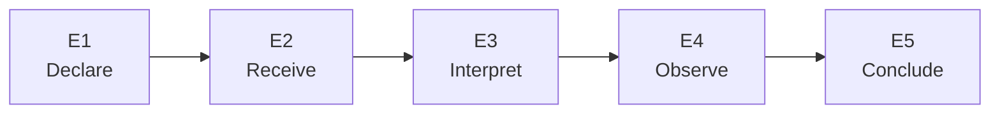

<!-- PRESENTATION COPY, derived from PANO-03_TUC3_EVIDENCE_EXECUTION_Q3_INTERFACE.md; archival mirror at ../PANO-03_TUC3_EVIDENCE_EXECUTION_Q3_INTERFACE.md remains unchanged. Do not use this copy for SOURCE_MANIFEST mirror hashes. -->

<!--
Source-preserving Markdown mirror of a Google Doc historically labelled INTERNAL. The corpus owner expressly authorized public research-corpus promotion on 25 October 2026. Historical source labels remain quoted faithfully; this does not grant rights in third-party underlying evidence, endorse the case, or constitute an experimental result.
Google Docs title: 03 — T-UC3 Trajectory and UC21 Q3 Interface
Google Docs source: https://docs.google.com/document/d/12ekNFP1pfe1eC6uxqN2t5lbbaPzVazL064Ytrz9DWEw/edit
Observed Google Docs revision: AHj4eMQGxP5xVXxDqjr7dumVADdK-HFjJAQ56oMVbYb0kTGTcymrh7YmnvU-HbMGsZjNL5VYCzv3vvHc187-1n7IFhl5U9H-cmMMY-B_0-w
Captured: 2026-10-25 (Europe/Madrid)
Status: historical/working source; not an executed validation, a legal conformity assessment, or FG-TIDA endorsement.
-->

# UC3 — EVIDENCE OF AUTHORITY VERSUS EVIDENCE OF EXECUTION — v0.5 — 25 October 2026 — INTERNAL / NOT FOR EXTERNAL CIRCULATION

<!-- EDITORIAL_READING_AID_BEGIN: presentation only; not historical source content -->

> [!IMPORTANT]
> **Reader orientation — presentation layer only.** T-UC3 separates statements of authority from evidence of action. Its **E1–E5 checkpoints are local, provisional documentary definitions**, not executed gates or FG-TIDA-adopted tests. The [unchanged source mirror](../PANO-03_TUC3_EVIDENCE_EXECUTION_Q3_INTERFACE.md) governs exact source wording.

### Evidence must not be promoted across steps

| Checkpoint | Question | Boundary |
|---|---|---|
| **E1 — Declaration** | What was published, by whom, for which version and scope? | Publication alone proves no receipt. |
| **E2 — Reception** | Did a specified actor receive the relevant notice? | Receipt alone proves no interpretation. |
| **E3 — Interpretation** | How was that actor's purpose-specific decision qualified? | A decision is not an observed effect. |
| **E4 — Execution / effect** | What later action or effect is independently supportable? | Stage A defines the evidence requirement; it does not execute it. |
| **E5 — Conclusion** | What exact finding is warranted, with what uncertainty? | No broader rights or compliance claim may be inferred. |

*Arrows mark questions for verification, not proof of the next stage. UC21/S6 Q3 is a distinct downstream-claim boundary; it is not equivalent to E4.*

---

<!-- EDITORIAL_READING_AID_END -->

UC3 addresses evidenced rights-holder intent where actual AI compliance cannot be established.

Provisional documentary trajectory (not frozen test IDs):

E1 Declaration: provenance, owner, version, scope.

E2 Reception: specified proof that relevant actor received notice.

E3 Interpretation: specified decision logic for authorized use.

E4 Execution: required observable evidence of applying decision (not actual execution at Stage A).

E5 Conclusion: exact claim supported and explicit uncertainty.

UC21/S6-Q3 and canonical 00J/Q3 concern evidence and authority for a downstream rights claim. They are one related boundary inside the extreme synthetic 00J rights-inversion scenario; Q3 is not the whole UC3 and is not an execution-confirmation gate. The final licensing/payment/blocking decision is Q5. No pass equivalence is inferred.

This package's documentary Simplified Stage A can assess a candidate specification against declared evidence/uncertainty requirements. It cannot establish real-world actor behaviour. Stage A in general is not limited to documentary evidence.

UC21: https://github.com/FG-TIDA/use-cases/issues/21

00J: https://github.com/dakleyer/structural-awareness-contributions/blob/e79cae15cbf0f015021718f1b1a95b561643d8da/research/ecosystem-awareness/baseline/00J_FAILURE_MODE_RIGHTS_PROVENANCE_INVERSION_v0.1_DRAFT.md

# LOCAL E1–E5 EVIDENCE CONTRACT — PROPOSED / NOT FROZEN

The local E1–E5 documentary sequence was introduced as G1–G5 in the initial working Doc 03 and expanded in v0.2; it is an AI-assisted draft, not an original Pack gate sequence or frozen canonical test IDs. Initial working Doc 03 preserved at: https://docs.google.com/document/d/1NSAq7HWgoaCyMZFuS6ZgUav8svUNno_33RhqYGj7l0w/edit. It must identify the receiving actor, exact proposition/action, scope/version/time and evidence ceiling before assessment. Roadmap milestones use RM0–RM7; canonical Q0–Q5 is unchanged.

E1 Declaration: specify source, issuer/rights-holder, work/object, permission version, asserted use and freshness. Positive condition: an attributable, scoped declaration and its limits are recorded. Falsifier: valid signature is promoted to proof of rights beyond the declared source authority. Missing source authority stays NOT ESTABLISHED.

E2 Reception: specify what would demonstrate which receiver received which signal/version and when. Positive condition: the specification distinguishes publication/availability from receiver-bound receipt. Falsifier: a publicly accessible Notice or crawler visit is treated as proof of receipt of the operative permission. At Stage A we review the requirement; no receipt is manufactured.

E3 Interpretation: specify how that recipient binds declared permissions to the proposed action/use and how conflicts/unknown terms are handled. Positive condition: a proposition-scoped, reviewable decision rule. Falsifier: training permission silently becomes RAG/indexing permission, or AI-provider name becomes proof of the crawler's mandate.

E4 Execution evidence: specify observable action/outcome evidence, source independence, time/version binding and observation limits needed to support the execution claim. Positive condition: the contract requires adequate evidence before asserting execution. Falsifier: declaration, acknowledgement, appraisal or decision output is accepted as proof that the downstream action occurred. The present package does not collect or claim product execution.

E5 Bounded conclusion/revalidation: specify the supported claim, unknowns, authorised disposition, validity window, monitoring owner and material-change trigger. Positive condition: absent execution evidence leaves execution NOT ESTABLISHED while permitting a justified bounded decision. Falsifier: unknown becomes compliance, infringement, zero activity or an automatic indefinite block.

A correctly specified abstention/HOLD can satisfy the documentary criterion for uncertainty handling; it does not make the unknown real-world proposition true. Valid continuity and legitimate changed-evidence/re-entry paths must also be specified, so “always block” cannot win by construction.

# EXACT RELATION TO UC21/S6/00J

00J is the extreme motivating failure: an original author may face a downstream licensing/payment/blocking claim over material derived from their own work. It is fictional, not a Panodyssey/TEMS incident. The new UC3 is more granular and includes ordinary declaration-to-observation gaps that need no rights inversion.

Canonical 00J route: Q0 source/right frame → Q1 access authority → Q2 transformation/source dependence → Q3 downstream claim → Q4 propagation/correlation → Q5 enforcement. Keep these source gates unchanged.

Local E1 relates principally to Q0/Q1. E2/E3 receipt/interpretation have no automatic one-to-one Q-gate equivalence. E4 execution-observation evidence is additional to Q3's rights-claim evidence. E5 may connect to Q3–Q5 only for the selected downstream-rights decision. Exact equivalence/admission remains pending.

Positive overlap with UC1 is current source permission; overlap with UC2 is actor/principal/claim attribution. No fourth UC or new pilot category is introduced.

# REUSE RULE AND HISTORICAL STATUS

Reference the canonical gate/fixture and source edition; record the reused proposition, subject, evidence mode, authority/freshness, admissible outcomes and retained limits. Reuse only the demonstrated overlap; assess missing UC3 requirements separately. No cloned Q3 test or inherited PASS.

Historical finding, explicitly bounded: the UC21 case-status register reports source-side support for S6-Q0 and publisher-side Q1; agent-side Q1 and downstream Q2–Q5 remain unestablished. This is a source-confirmed documentary classification, not executed product validation, independent reproduction or acceptance of the new three-case package. The 00J-A01 profile itself records no executed result. UC21 case-status register, Status record 1.3 (19 October 2026), §11.1; checked 25 October 2026. Preserved body SHA256 be8ec62db737dd7a947e21282d9ce585123e866a54da7e17cf0b776dbe182842 (issue updated 2026-10-25T07:58:19Z): https://github.com/FG-TIDA/use-cases/issues/21

Public confirmation: https://github.com/FG-TIDA/use-cases/issues/21#issuecomment-6192128304

Olena's separate-source/experimental-layer boundary: https://github.com/FG-TIDA/use-cases/issues/21#issuecomment-6202826500

00J source: https://github.com/dakleyer/structural-awareness-contributions/blob/e79cae15cbf0f015021718f1b1a95b561643d8da/research/ecosystem-awareness/baseline/00J_FAILURE_MODE_RIGHTS_PROVENANCE_INVERSION_v0.1_DRAFT.md

00J-A01: https://github.com/dakleyer/structural-awareness-contributions/blob/e79cae15cbf0f015021718f1b1a95b561643d8da/research/ecosystem-awareness/baseline/00J_A01_PANODYSSEY_TEMS_RIGHTS_PORTABILITY_IMPLEMENTATION_PROFILE_v0.1_DRAFT.md

UC21 S6 source slot: https://github.com/dakleyer/use-cases/blob/724d69f9cf69aaadd2f84f50934db9cf77fcc1f1/contributions/when-controls-work-system-fails/annexes/scenarios/S6.md

Method: https://github.com/dakleyer/structural-awareness-contributions/blob/e79cae15cbf0f015021718f1b1a95b561643d8da/research/ecosystem-awareness/DDS_CHALLENGE_TRAJECTORY_PROFILE_v0.1.md

Outcome/metric contract: https://docs.google.com/document/d/1QgCwAZORVivQXyH8kmrudbRVbzldV7qogy9OWvWxRPg/edit?usp=drivesdk

Pending: owner review, precise G-to-source mapping, positive/negative criteria, source freeze and assessment. No E1–E5 results are asserted here.

The T-UC3 documentary specification/conclusion decision owner remains UNASSIGNED / OPEN by Iván's instruction. Specifying a gate is not a criterion result; candidate, peers, reviewed acceptance rule and evidence freeze are required before assessment.

Revision v0.5 — 25 October 2026. Authentic v0.2 restored with scoped audit corrections under Iván's instruction; AI-assisted. Source authorship retained; joint reviewer acceptance NOT RECORDED. Baseline: https://docs.google.com/document/d/1RNaQCcS86kzlL7DUQOVT6EbnbsdO_-mJPlILK1Inu0k · Preserved pre-restoration v0.4: [https://docs.google.com/document/d/19jqJn2d_ZUsmgUuO7vwntZS0UOBzZoyki2Nf7z-kWJM/edit](https://docs.google.com/document/d/19jqJn2d_ZUsmgUuO7vwntZS0UOBzZoyki2Nf7z-kWJM/edit?usp=drivesdk)[?usp=drivesdk](https://docs.google.com/document/d/19jqJn2d_ZUsmgUuO7vwntZS0UOBzZoyki2Nf7z-kWJM/edit?usp=drivesdk)

# ADDITIVE v0.6 — PROVISIONAL LEGAL / TECHNICAL TRACEABILITY BY TRAJECTORY AND CHECKPOINT

This is a source/provision relevance crosswalk, not a finding of applicable law, legal conformity, executed test or acceptance. The original Challenge Pack, T-UC trajectory identities and local E1–E5 contract remain unchanged. T-UC1/T-UC2 are trajectory-level entries with test gates NOT YET DEFINED; E1–E5 are local proposed checkpoints of T-UC3, not UC21 Q0–Q5 or UC20 frozen IDs.

Legal shorthand: DSM = Directive (EU) 2019/790 (Art. 4); AI Act = Regulation (EU) 2024/1689 (Arts. 14/53); GDPR = Regulation (EU) 2016/679; eIDAS = Regulation (EU) 910/2014. Every legal mapping is conditional on actor, role, action, work, territory, date, applicable national law and reviewer. Technical references (including W3C Community Group and IETF draft items) are not presumed binding.

Preliminary FG-TIDA ToR relevance is shown for navigation only. Evidence availability, presentation, sufficiency, independently observed effect and current decision applicability must be recorded separately. Proposed links, gate admissibility, acceptance criteria, owner, evidence freeze and legal review: PENDING.

Source and reference register: https://docs.google.com/document/d/1mLp2Sb1q2dD67FKBqQMiZ9hR__t2snyitFIwcwpi78Y/edit

Original S1–S14 map with the EU law column: https://docs.google.com/document/d/1qA8XG_L7ZJbwBOlOb37r4Qm7J6nG_AcSCddnzEAAPi8/edit

| **Trace / status** | **S / ToR (prelim.)** | **EU provision (conditional)** | **Technical reference (status)** | **Evidence proposition / limit** |
| --- | --- | --- | --- | --- |
| T-UC1 — lifecycle authority; gates TBD | S1,S10,S13; ToR 4.3, A.2.2, A.2.7 | [DSM](https://eur-lex.europa.eu/legal-content/EN/ALL/?uri=celex%3A32019L0790) Art.4(3) if TDM reservation; [AI Act](https://ai-act-service-desk.ec.europa.eu/en/ai-act/article-53) Art.53(1)(c) if GPAI provider; [eIDAS](https://eur-lex.europa.eu/eli/reg/2014/910/) Art.41 if timestamp used. | [ODRL 2.2](https://www.w3.org/TR/odrl-model/); [PROV-O](https://www.w3.org/TR/prov-o/); [TDMRep](https://www.w3.org/community/reports/tdmrep/CG-FINAL-tdmrep-20260903/) (W3C CG Final Report). | Authority holder, scope, permission version, change/expiry and freshness. Source record alone ≠ downstream compliance. |
| T-UC2 — identity/delegation; gates TBD | S6,S7,S14; ToR 3.4, 4.2, 4.4 | [GDPR](https://eur-lex.europa.eu/eli/reg/2016/679/oj) Arts.5,6,32 only if personal data; [DSM](https://eur-lex.europa.eu/legal-content/EN/ALL/?uri=celex%3A32019L0790) Art.4(3) if TDM reservation. No general EU agent-mandate gate. | [W3C VC Data Model 2.0](https://www.w3.org/TR/vc-data-model-2.0/); [RFC 9334](https://www.rfc-editor.org/rfc/rfc9334); [ODRL 2.2](https://www.w3.org/TR/odrl-model/). | Bind crawler ID to accountable principal, mandate, recipient and allowed action. Technical identity ≠ legal representation. |
| E1 — declaration (T-UC3 draft) | S1,S13; ToR 4.3 | [DSM](https://eur-lex.europa.eu/legal-content/EN/ALL/?uri=celex%3A32019L0790) Art.4(3); [AI Act](https://ai-act-service-desk.ec.europa.eu/en/ai-act/article-53) Art.53(1)(c) only for in-scope GPAI provider; [eIDAS](https://eur-lex.europa.eu/eli/reg/2014/910/) Art.41 if timestamp evidence. | [TDMRep](https://www.w3.org/community/reports/tdmrep/CG-FINAL-tdmrep-20260903/) (CG); [ODRL 2.2](https://www.w3.org/TR/odrl-model/); [PROV-O](https://www.w3.org/TR/prov-o/). | Source/holder/work/use/version/time. Signed declaration ≠ rightsholder standing or downstream action. |
| E2 — receipt (T-UC3 draft) | S6,S7; ToR 4.2, 4.4 | [DSM](https://eur-lex.europa.eu/legal-content/EN/ALL/?uri=celex%3A32019L0790) Art.4(3) expression context; [AI Act](https://ai-act-service-desk.ec.europa.eu/en/ai-act/article-53) Art.53(1)(c) does not establish an individual receipt event. | [RFC 9309](https://www.rfc-editor.org/rfc/rfc9309.html) REP (Standards Track); [TDMRep](https://www.w3.org/community/reports/tdmrep/CG-FINAL-tdmrep-20260903/) (CG); [AIPREF-08](https://www.ietf.org/archive/id/draft-ietf-aipref-vocab-08.html) (IETF draft). | Receiver-bound notice/version/time; publication ≠ receipt. Robots.txt rules are not access authorization. |
| E3 — interpretation (T-UC3 draft) | S2,S9,S11; ToR 3.4, 4.4 | [DSM](https://eur-lex.europa.eu/legal-content/EN/ALL/?uri=celex%3A32019L0790) Art.4(1),(3): assess TDM use/exceptions/reservation; [AI Act](https://ai-act-service-desk.ec.europa.eu/en/ai-act/article-53) Art.53(1)(c) only for applicable GPAI roles. | [ODRL 2.2](https://www.w3.org/TR/odrl-model/); [TDMRep](https://www.w3.org/community/reports/tdmrep/CG-FINAL-tdmrep-20260903/) (CG); [AIPREF-08](https://www.ietf.org/archive/id/draft-ietf-aipref-vocab-08.html) (draft). | Reviewable action-specific decision; training/RAG/indexing and unresolved constraints remain distinct. |
| E4 — execution evidence (T-UC3 draft) | S5,S12,S14; ToR 3.4, 4.5 | No EU provision cited treats notice/ack as proof of downstream effect; [GDPR](https://eur-lex.europa.eu/eli/reg/2016/679/oj) Art.32 only if personal-data telemetry. | [PROV-O](https://www.w3.org/TR/prov-o/); [RFC 9309](https://www.rfc-editor.org/rfc/rfc9309.html) REP; [NIST AI RMF](https://www.nist.gov/itl/ai-risk-management-framework) (voluntary). | Independently observable outcome, actor, time/version and negatives. Stage A specifies; does not execute. |
| E5 — bounded decision/requalification (T-UC3 draft) | S3,S10,S14; ToR 4.3, 4.5 | Territory, use, actor and national implementation need legal review; [eIDAS](https://eur-lex.europa.eu/eli/reg/2014/910/) Art.41 only if relied on. | [PROV-O](https://www.w3.org/TR/prov-o/); [NIST AI RMF](https://www.nist.gov/itl/ai-risk-management-framework) (voluntary); DDS local outcome semantics. | Evidence presented vs available; sufficiency; owner, dissent, unknowns, validity, monitors, unrepresented change. No PASS. |

ADDITIVE v0.7 — E1–E5 INTERFACE TO EVALUATION AND REQUALIFICATION (25 OCTOBER 2026)

This is a prospective documentary evidence contract, not observed execution or legal applicability. Each E checkpoint consumes only its own declared evidence state and outputs a scoped proposition for the next checkpoint; it cannot infer any later state.

E1 declaration → evidence of issuer/holder, work, reservation/permission, version, source and scope. Pass-through to E2 is the ASSERTED SIGNAL plus source limitations; no rightsholder-standing or recipient-acknowledgement claim.

E2 reception → evidence of named actor/receiver, operative signal version, delivery/read semantics and time. If no receiver-bound observation, receipt remains NOT ESTABLISHED; published Notice/robots.txt can still be true source facts.

E3 interpretation → receiving policy, actor/principal/mandate, requested action and use-specific constraints. Training, RAG and indexing must remain separate channels unless the source author supplies their proven common semantics. Divergent reviewers of meaning use Doc04 ADJ procedure.

E4 effect-observation contract → required instrument/source for attempt, decision, action, externally observable effect, rejection and valid continuation. Current documentary profile specifies those observations; it does not claim they occurred.

E5 bounded decision and requalification → evidence appraisal, authorized permitted choices, responsible receiving decision owner, validity scope/window, monitoring and DEP trigger. Actual legal rights or downstream behavior beyond evidence remain undecided.

When an unrepresented resolver, downstream consumer, changed permission channel or other dependency appears, use Doc04 DEP-01–06: log the source, map affected E/S/T-UC propositions, hold only unjustified claims, preserve earlier bounded results, then prospectively freeze changed criteria. Retain old dissent/decisions and current unknowns. No new E1–E5 acceptance ID is frozen by this note.

Conditional EU provisions and explicit non-applicability questions live in Doc02: https://docs.google.com/document/d/1mLp2Sb1q2dD67FKBqQMiZ9hR__t2snyitFIwcwpi78Y/edit

Evaluation contract EC-01–EC-17, reviewer disagreements and dependency requalification live in Doc04: https://docs.google.com/document/d/1QgCwAZORVivQXyH8kmrudbRVbzldV7qogy9OWvWxRPg/edit

ADDITIVE v0.8 — UC3 E1–E5 DDS → UC4 OBSERVATION BOUNDARY (25 OCTOBER 2026)

For prospective DDS Stage A, E1–E5 specify what a defensible candidate mechanism MUST distinguish, not observations that have occurred. An optional UC4 adapter can encode E1: authority assertion+source revision; E2: a receiver- and version-bound receipt (or explicit unknown); E3: receiver's own permitted-use/mandate/appraisal state; E4: decision, attempted action, acknowledgement, actual effect and independently observed target state as distinct events;

E5: scoped authorised conclusion, legitimate continuation, later material-change trigger and prior outcome preserved. At UC4 Stage-0, those can be synthetic known-answer fixtures; the resulting PASS, if any, is only for the frozen fixture/architecture object under test, not real reception or effect. UC4 Stage-1 remains separately subject to proven capabilities and mutual admission; DDS Stage C requires a pinned native candidate and independent downstream observation.

Cross-boundary negative control: publication or a web-crawler sighting cannot prove which agent received the operative edition. Falsifier: training status silently treated as RAG/indexing authorisation. Valid continuity: a currently permitted actor may act within bounds. Material-change control: newly detected consumer triggers selective DEP-01–06 requalification without rewriting historic findings. These tests are PROPOSED, not frozen or run. UC21/00J Q3 remains a distinct downstream-rights-claim boundary, not E4 execution verification.

Full UC4 field contract and row-level test mapping: https://docs.google.com/document/d/1RG6NjkPl5d8y3NjB6wA_iFHePsyTTQereQhGumeCcnw/edit

Local evidence/assessor/adjudication contract: https://docs.google.com/document/d/1QgCwAZORVivQXyH8kmrudbRVbzldV7qogy9OWvWxRPg/edit
