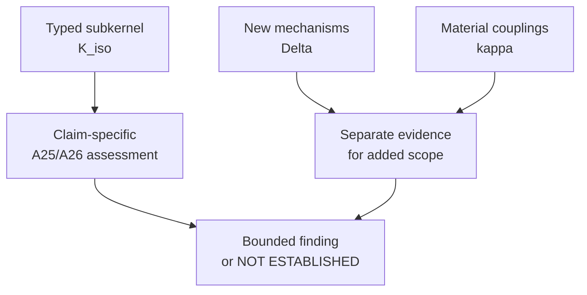

<!-- PRESENTATION COPY, derived from PANO-08_PARTIAL_ISOMORPHISM_EVIDENCE_TRANSFER.md; archival mirror at ../PANO-08_PARTIAL_ISOMORPHISM_EVIDENCE_TRANSFER.md remains unchanged. Do not use this copy for SOURCE_MANIFEST mirror hashes. -->

<!--
Source-preserving Markdown mirror of a Google Doc historically labelled INTERNAL. The corpus owner expressly authorized public research-corpus promotion on 25 October 2026. Historical source labels remain quoted faithfully; this does not grant rights in third-party underlying evidence, endorse the case, or constitute an experimental result.
Google Docs title: 08 — Panodyssey / S6-00J — Partially Isomorphic Extension & Evidence Transfer v0.2
Google Docs source: https://docs.google.com/document/d/1Oo-HsO6gfj7cY4M1Qe0YgyVjP86kCcJ9_163ZQEXTks/edit
Observed Google Docs revision: AHj4eMQX0s77eSxuzAfJ3k0Y6fshTcMkOcHvKw4Oc-AyvCaZV_p2qdZHubmee8AUr0ZhKFyDh4MXUTbqwd2xiqgJIdA16alWJX9ald2lMIg
Captured: 2026-10-25 (Europe/Madrid)
Status: historical/working source; not an executed validation, a legal conformity assessment, or FG-TIDA endorsement.
-->

# PANODYSSEY / OLENA — S6 / 00J PARTIALLY ISOMORPHIC EXTENSION AND EVIDENCE TRANSFER — v0.2

<!-- EDITORIAL_READING_AID_BEGIN: presentation only; not historical source content -->

> [!WARNING]
> **Reader orientation — presentation layer only.** The proposed relation to UC21 S6/00J is a **partially isomorphic extension**, not equivalence of the whole Panodyssey Challenge. The [unchanged source mirror](../PANO-08_PARTIAL_ISOMORPHISM_EVIDENCE_TRANSFER.md) retains the proposed method, original matrices and historical status statements.

### What might transfer, and what cannot transfer automatically

| Component | Meaning | Evidence consequence |
|---|---|---|
| **K_iso — preserved typed subkernel** | Exact bounded proposition, state/trace mapping and relevant preserved assumptions | Previously executed evidence may be referenced **only if** the claimed property passes the applicable A25/A26 conditions. |
| **Δ — new mechanisms** | Additional rights, actors, permissions, use channels, time/version and system states | Each materially new mechanism needs its own justified assessment. |
| **κ — couplings** | Dependencies and feedback between the mapped part and the new mechanisms | Couplings cannot silently invalidate the transferred property's assumptions. |

**Critical interpretation:** The packet currently verifies **no executed PanO-v6 baseline result** eligible for inheritance. The E = (K_iso, Δ, κ) notation is a proposal for targeted proof and tests, not an observed success.

---

<!-- EDITORIAL_READING_AID_END -->

25 October 2026 | INTERNAL WORKING / NOT FOR EXTERNAL CIRCULATION | NOT ADMITTED / NOT EXECUTED / NOT MERGED

## 1. DECISION AND PRECISE SCOPE

This is the additive proposed corpus-integration path for the existing Panodyssey Expanded UC / single Challenge / three specific UCs and their three documentary DDS Stage A trajectories. The original Pack 00–07, source-owned S1–S14 working map, T-UC1/2/3 and T-UC3 E1–E5, legal reference boundaries, comparator/evaluator contracts, discrepancy handling, UC4 preflight and open audit findings remain intact. No source evidence, original text or earlier negative/non-established finding is superseded by this candidate.

The parent is the UC21 S6 structural failure CASE FAMILY represented by canonical 00J ('The Author Pays for Their Own Work'). This is a technical case-family extension proposal, not a new formal UC21 scenario, not a rewrite of canonical S6/00J, not a new canonical S15, and not a merger of UC21 and Panodyssey Challenge identities. The expanded Panodyssey Challenge may be a COMPOSITE extension: a mapped 00J-derived subkernel plus additional non-isomorphic mechanisms and interfaces.

Only a claim of inherited 00J-family evidence is subject to the specific A25 X1–X7 / A26 Y1–Y7 projection admission; the added delta remains part of the extension and is evaluated separately. The earlier Doc06 sentence that the NEW Panodyssey formal use case is not automatically an extension of the institutionally owned UC21, or of its outcomes, remains correct.

Working extension key (provisional, not frozen): 00J-EXT-PANO-01. Existing 00J-A01 Panodyssey/TEMS rights-portability implementation profile is a separate ancestor/source comparator and must not be overwritten. The source-owned Panodyssey broad Challenge remains complete. The proposed 00J child records: (i) the part that projects to S6/00J, (ii) parameter movements, (iii) additional non-isomorphic Panodyssey mechanisms, and (iv) the interfaces/couplings between the two. Evidence inheritance is restricted to proved/verified mapped statements; the entire extension need not be isomorphic.

## 2. FAMILY KERNEL AND NON-TRANSFER BOUNDARY

Canonical 00J kernel K_J = <valid narrow record; source/lineage relation; downstream transformation; stronger proposition; receiving enforcement/decision>. Failure F_J requires valid(record,q) AND use(record,q+) AND q does not entail q+ AND a downstream decision based on q+. Copyright/payment is the extreme illustrative consequence, not a required legal judgment or the only possible enforcement effect.

For a claim of S6/00J inheritance, state exactly: producer/issuer and authenticated record; proposition q actually proved (e.g., that a Notice exists, a machine generated an object, or a bounded licence/permission was recorded); graph or transformation to the receiver; claimed q+ (e.g., broad source rights, authority to act, or enforcement entitlement); receiving decision and observable boundary; time, version, purpose and scope.

A missing q→q+ overclaim or a missing receiving decision prevents reuse of the S6 same-family proof/test for THAT subcase. It does not expel the rest of the Panodyssey extension: receipt, mandate, RAG or downstream effect may be non-isomorphic delta mechanisms requiring their own tests.

Distinguish source-native namespaces: PAN-S1..PAN-S14 = Panodyssey Challenge labels; EA-S1..EA-S14 / T1–T4 = canonical requirements; UC21-S6 = sixth UC21 scenario, not EA-S6; 00J-Q0..Q5 = case-study gates; PAN-TUC1/2/3 and E1..E5 = Panodyssey trajectories/checkpoints; DDS Stage A/B/C = method objects; UC4 Stage-0/1 = experimental envelope. Never reuse identical identifiers as evidence of equivalence.

00J Q0 original rights; Q1 bounded access/use; Q2 transformation/dependency; Q3 downstream rights/authority claim; Q4 propagation/composition; Q5 downstream enforcement. PAN-TUC3 E4 records proposal/attempt/command/effect and E5 bounded conclusion; neither E4 nor E5 is a synonym for 00J Q3 or Q5. A Q3 claim can exist without any executed effect; Q5 is not evidence of a receiver's observed E4 action unless the native observations match.

Source-case status and testbed status are separate: current rights/Notice facts or Alexandre's bounded documentary confirmation are source evidence, not synthetic negative-test outcomes; a 00J synthetic extreme is not a Panodyssey product incident; a future UC4 adapter PASS is not a product or legal-compliance certificate.

## 3. THREE DIRECTIONS — STRONG VERSUS CANDIDATE VERSUS NEIGHBOUR

Upward/vertical: multiple owners, licensing terms, intermediaries, crawler/provider principals, RAG consumers, metadata aggregators, time windows, policy versions and propagated downstream recipients. Preserve the same record→proposition promotion, receiving decision and finite observability; mere organizational size does not admit the variant.

Downward: one legitimate source work W, one derived object D or notice/grant record, one producing principal, one receiving delegated actor, one downstream unsupported stronger rights claim and one consequential receiver decision. If the same predicate disappears when scale shrinks, it is not a proven 00J kernel.

Horizontal: publishing, dataset licensing, model/artifact provenance and permitted RAG versus training/use where a narrow technically valid provenance statement is promoted into a stronger unsupported rights/authority/enforcement claim. A pure missing receipt, a pure actor/mandate error, a forged record, or a valid wider permission without that lineage/proposition inversion is NOT itself an isomorphic S6 subcase. It may nonetheless be an expressly declared non-isomorphic part of the COMPOSITE Panodyssey extension, potentially mapping to another family for a separate property; its own tests and interface checks remain required.

Branch classification is assessed per proposition/property, not by all-or-nothing Challenge membership. T-UC1 may project to 00J when a narrow valid permission record is promoted to unsupported broader/current authority; ordinary grant/revoke management remains a separate non-isomorphic delta within the Panodyssey extension. T-UC2 may project where actor/principal/mandate substitution causes the unsupported downstream q+; other authorization behaviour is an additional mechanism, possibly related to 00H/P4.

T-UC3 has the strongest proposed projection when E1–E5 reveal evidence promotion into a receiving decision, but its native receipt, attempted action, measured effect and E5 conclusion must not be replaced by Q3/Q5 labels. An entire trajectory can contain both inherited and newly tested segments.

## 4. EXTENSION ADMISSION — A25 X1–X7 / A26 Y1–Y7

Family admission of a specific inherited claim is prior to candidate scoring. Apply A25 X1 to the COMPLETE CLAIMED ISOMORPHIC SUBKERNEL, not automatically to every state and mechanism of the Panodyssey expansion. X2 preserves that subkernel's decision boundary; X3 establishes failure reflection under its typed trace projection; X4 preserves inherited EA-S/T requirements for those propositions; X5 valid positive controls;

X6 matched finite resources, observation horizon and fallback; X7 accounts for new primitives. A26 Y1–Y7 applies to the corresponding SUCCESS subpath. New mechanisms outside the projection are registered and tested in a separate DELTA LANE; when they feed back into the inherited subkernel, a coupling/parameter reproof or targeted regression is mandatory. Neither full-system isomorphism nor an all-or-nothing three-trajectory identity is required.

Inherited 00J material requirement surfaces to check by source version: EA-S1/S5/S7/S9/S11/S12/S14, T1–T4 as applicable; EA-S6/S8 for access/delegation, EA-S10 for material change, EA-S13 for intervention/history. The actual clause mapping must be supplied, not inferred from matching numbering or familiar vocabulary. Extra EXISTING S/T clauses may activate; never silently issue S15 or assert universal completeness.

Result categories are PER CLAIM, not one verdict for the whole Challenge: (1) EXACT/REPRESENTATIONAL CORRESPONDENCE — reduced evidence may transfer after complete checks; (2) PARAMETERIZED CORRESPONDENCE — transfer only to the effective frozen parameter point or with sensitivity/error bounds; (3) NON-ISOMORPHIC DELTA — new evidence required for added mechanism; (4) COUPLED FRAGMENT — a previously mapped result needs interface/feedback checks; (5) NOT-MAPPED/OUTSIDE-S6-KERNEL — retained as Panodyssey extension content but no S6 evidence inheritance; (6) NOT ESTABLISHED / NOT EXECUTED — no PASS source to import; (7) BOUNDED EXECUTED RESULT only if actually executed. A mixed three-trajectory Challenge remains one Challenge, not three wholly isomorphic claims.

Do not claim inherited conformance, newly observed product behaviour or universal transfer merely because a finite base fixture passed. A25's universal family guarantee explicitly needs a separately established base guarantee plus failure reflection and conformance preservation; A23 former all-six closure remains under semantic revision. For already proved/verified BASE statements with exact scoped correspondence, one may reuse that result without repeating its whole source test; this is a LOCAL transfer with the original evidence ID, version, assumptions, horizon, limits and evaluator attached, not a new native extension execution.

Statistical contrasts additionally require matched arms/coupling or stated uncertainty/error bounds. New Panodyssey effects, interfaces and feedback receive delta or coupling tests. The source result is cited once, never counted as an independent replication.

## 5. DDS AND UC4 — WHAT WOULD ACTUALLY RUN

Documentary Simplified DDS Stage A: freeze the Challenge/source set, source-owner release permissions, scenario and proposition mapping, Panodyssey T-UC-specific acceptance criteria, current right/time/use predicates, strong conventional reference comparator(s), candidate specification, equal admissible evidence, evaluator identities/interests, arbitration, qualified PASS/FAIL/NOT ESTABLISHED/OUT-OF-FAMILY rules, observable positive/negative/continuity controls, audit logs, change/reassessment rules, and separate legal-unknown ceiling. Stage A scores a SPECIFICATION, not an implementation.

DDS Stage B, if separately authorized, maps an approved Stage A specification into an ARCHITECTURE manifest/requirements/verification trace. DDS Stage C only compares an identified, pinned EXECUTABLE IMPLEMENTATION. UC4 is Nelson Trasatti's separate experimental/testbed envelope, with hypothetical deterministic Stage-0 harness and prospective Stage-1 federation, not part of an automatic Panodyssey Stage A run.

Execution would require own source→UC4 adapter schema 1.1.0, independently reviewed fixture/observer/oracle, available capabilities, source permission, instrument qualification, parity, protected release terms and Nelson/testbed-owner acceptance. These are HOLD conditions, not claims of runtime availability or accepted assignment.

Prospective illustrative negative fixture: a true narrow Notice or provenance/permission q is observed; an intermediary builds an unsupported q+ entitlement; the receiver makes or prepares a consequential downstream rights/use decision relying on q+. Preserve separate E1 identity, E2 receipt, E3 interpretation/authority, E4 attempted and actually observed effect, E5 scope-bounded conclusion and 00J Q0–Q5, including missing/UNKNOWN observations.

Required paired controls: (a) valid scoped licence/transfer and independent creation succeed without universal blocking; (b) current unchanged allowed RAG/use remains allowed; (c) revoke/expire/change after valid observation triggers targeted affected requalification while preserving historical decisions; (d) correlated copies do not become independent rights evidence; (e) authentic approval without missing source lineage does not cure scope; (f) erroneous downstream claim is repaired prospectively while source/generation/history stay reconstructable; (g) after-freeze previously unknown downstream RAG consumer causes a new impact map and successor evaluation, not retroactive erasure of unaffected conclusions; (h) a strong ordinary governance/compliance baseline gets the same facts, resources, time and cost accounting; (i) falsifiers show out-of-family pure authenticity failure or pure present-mandate failure without q/q+ proposition promotion.

Evaluation remains human/reviewer-bounded: two evaluators may disagree on observation, relevance, applicability or outcome; record both judgments with evidence IDs, impact and conflicts, seek independent adjudication using the frozen rule, allow NOT ESTABLISHED if unresolved; retain originals and successor reassessment. A newly found material dependency reopens only affected predicates, gates and conclusions under a new version; it does not silently alter past scores or imply the entire Challenge failed.

## 6. LEGAL / RIGHTS AND ACTOR BOUNDARIES

The source working normative matrix (Doc02) links applicable EU and other references conditionally by actor, activity, territorial reach, time and material facts. This extension adds NO assertion of EU/ISO conformance, legal sufficiency, rights clearance, universally applicable rule, or legal-applicability review workstream. Source-defined contract/permission facts can be frozen as test predicates; when legal characterization determines an actual result and is unresolved, mark outside the technical conclusion / NOT ESTABLISHED, with no invented N/A.

Separate: permission to read source artefacts, licence to build test fixtures, permission to expose redacted evidence, permission to use Panodyssey name/product facts, approval by source custodian, consent to run a testbed, attribution of contributor, evaluator impartiality, and approval for public FG-TIDA publication. Alexandre's production/source knowledge and Olena's proposed methodology contribution do not themselves supply all those authorizations or make either an independent arbiter.

## 7. PROPOSED CORPUS STRUCTURE (NO GITHUB WRITE YET)

Preserve canonical S6 and 00J files where they currently live; no moves or rewrites. Add a visible child from the 00J extensibility profile and the baseline/README to a NEW, clearly status-labelled prospective subtree:

research/ecosystem-awareness/baseline/00J-extensions/

  README.md                                     [candidate registry/status; parent 00J]

  PANODYSSEY-EXT-01/

    README.md                                   [purpose, source owners, version, status]

    EXTENSION_CASE_PROFILE_v0.1_DRAFT.md       [q→q+ / K_J / F_J / receiver boundary]

    ADMISSION_A25_X1_X7_A26_Y1_Y7.md           [evidence, signatures, falsifiers, decisions]

    Q0_Q5_TO_PANO_TUC1_TUC2_TUC3_CROSSWALK.md   [non-bijective, source-native gates]

    DDS_STAGE_A_UC4_READINESS.md                [spec/architecture/run separation]

    SOURCE_PERMISSION_AND_RELEASE_REGISTER.md    [source IDs, grants, limits, no legal PASS]

    TEST_ORACLE_POSITIVE_NEGATIVE_CONTROLS.md    [strong peers, costs, UNKNOWN, mutations]

    ADJUDICATION_CHANGE_AND_AUDIT_REGISTER.md   [disagreement / requalification history]

    fixtures/README.md                         [future synthetic-only, no run claimed]

Readme links: (i) canonical 00J negative/failure, (ii) 00J positive-success companion, (iii) 00J A25 extensibility profile, (iv) A25/A26, (v) existing 00J-A01 Panodyssey/TEMS profile, (vi) UC21/S6 source, (vii) Panodyssey original Pack/source map, (viii) DDS canonical method and UC4 contractual profile, with git commit + blob SHA and version. Link out of PANODYSSEY_THEME17_00J_UC21_TRACEABILITY_WORKING only AFTER the candidate is reviewed. Do not replace that bridge with this document.

R01 is a substantive methodological PRECEDENT, not merely a naming analogy: its extension-family proof separates the isomorphic functional kernel, parameter transformation, behavioral projection, additional non-isomorphic variables/mechanisms and preserved-result limits (E1–E7 where applicable in R01). Its equations and trilemma are R01-specific and are not imported as S6 theorems.

For this S6 child, A25/A26 govern membership/positive-path transfer of the projected rights-provenance predicate, while an explicit correspondence/delta/coupling ledger governs reuse of reduced evidence and new tests. A new semantic primitive can be included as a declared extension delta for research, but cannot silently become an admitted canonical S6 requirement or receive inherited PASS; unresolved requirement-normalization questions go to A21/Requirements-vNext.

## 8. PHASED ACCEPTANCE AND CHANGE CONTROL

PW0 Preserve: read back existing 00–07 paragraphs and original S1–S14 map; retain exact source links, prior findings and 'not executed' status.

PW1 Freeze candidate prospectively: agree Panodyssey material/source permissions, exact source versions and claims, q/q+ projections, branch membership proposals, positive controls, legal-unknown ceiling, evaluation/independent adjudication roles, fixed comparator parity and budgets; do not invent collaborators' acceptance.

PW2 Audit the PARTIAL TRANSFER: an independent reviewer applies A25 X1–X7 / A26 Y1–Y7 to each claimed S6-isomorphic subkernel and its positive path, then separately classifies parameter changes, delta mechanisms, coupling and related but nonmapped issues. Reuse evidence only after source-pinned proof obligations and identity of the tested proposition; do not infer membership or a source PASS from candidate outcomes. Admit the composite Challenge as a PROPOSED extension with explicitly non-isomorphic additions, rather than rejecting its whole identity because one subcase does not map.

PW3 DDS review: run DOCUMENTARY Stage A only if source-owner and method/evaluation contract hold points close. Publish bounded outcome per trajectory/proposition, with UNKNOWN and separate failure/admission statuses.

PW4 Optional execution: present a separate UC4 Stage-0 admission request with adapter, synthetic fixture, instrument qualification, source permission and resources. Run only when owner accepts; Stage-1 federated and product claims remain independently conditional.

PW5 GitHub proposal: create new add-on subtree on review branch, add minimal parent 00J-profile/baseline-index links, run link/reference/source-gate/ID/positive-control checks, seek content and source-owner review, merge only through ordinary change-control/PR. Retain original source, commit pins, evidence status and a rejection/adjacency path; no approval/public submission is implied.

Status as of methodological v0.2: Composite partially isomorphic extension DESIGN documented. No new S6 projection/admission proof has been completed, no base PanO v6 executed outcome has been independently verified for transfer here, no newly scored Panodyssey DDS Stage A, no UC4 run or owner acceptance, no legal result, no GitHub write, no external release. Previously documented source findings retain their own historical status and could be reused later only through the new ledger.

## 9. SOURCE PIN REGISTER — PRIMARY REFERENCES

Canonical S6-family minimum instantiation: https://github.com/dakleyer/structural-awareness-contributions/blob/f89565fabcc1a256aa7619a6e7fb7df9c1e41a75/research/ecosystem-awareness/baseline/00J_FAILURE_MODE_RIGHTS_PROVENANCE_INVERSION_v0.1_DRAFT.md

00J family extension profile: https://github.com/dakleyer/structural-awareness-contributions/blob/f89565fabcc1a256aa7619a6e7fb7df9c1e41a75/research/ecosystem-awareness/baseline/00J_CASE_STUDY_EXTENSIBILITY_PROFILE_v0.1.md

00J paired positive success: https://github.com/dakleyer/structural-awareness-contributions/blob/f89565fabcc1a256aa7619a6e7fb7df9c1e41a75/research/ecosystem-awareness/baseline/00J_SUCCESS_MODEL_CASE_PROPOSITION_SCOPED_PROVENANCE_v0.1.md

Case-family admission A25 X1–X7: https://github.com/dakleyer/structural-awareness-contributions/blob/f89565fabcc1a256aa7619a6e7fb7df9c1e41a75/research/ecosystem-awareness/baseline/00K_A25_FAILURE_CASE_STUDY_EXTENSIBILITY_AND_CONFORMANCE_TRANSFER_v0.1.md

Success-case transfer A26 Y1–Y7: https://github.com/dakleyer/structural-awareness-contributions/blob/f89565fabcc1a256aa7619a6e7fb7df9c1e41a75/research/ecosystem-awareness/baseline/00K_A26_FAILURE_TO_SUCCESS_MODEL_CASE_AND_EXTENSIBILITY_v0.1.md

Existing 00J-A01 Panodyssey/TEMS profile: https://github.com/dakleyer/structural-awareness-contributions/blob/f89565fabcc1a256aa7619a6e7fb7df9c1e41a75/research/ecosystem-awareness/baseline/00J_A01_PANODYSSEY_TEMS_RIGHTS_PORTABILITY_IMPLEMENTATION_PROFILE_v0.1_DRAFT.md

Existing Panodyssey / UC21 traceability: https://github.com/dakleyer/structural-awareness-contributions/blob/f89565fabcc1a256aa7619a6e7fb7df9c1e41a75/research/ecosystem-awareness/fg-tida/cases/PANODYSSEY_THEME17_00J_UC21_TRACEABILITY_WORKING.md

R01 extension protocol, COMPARATIVE ONLY: https://github.com/dakleyer/structural-awareness-contributions/blob/f89565fabcc1a256aa7619a6e7fb7df9c1e41a75/research/ecosystem-awareness/baseline/reductions/00G-R01/extensions/TECHNOLOGY_EXTENSION_PROTOCOL.md

Canonical DDS method: https://github.com/dakleyer/structural-awareness-contributions/blob/f89565fabcc1a256aa7619a6e7fb7df9c1e41a75/research/ecosystem-awareness/DDS_CANONICAL_METHOD_INDEX_v0.1.md

Panodyssey index: https://docs.google.com/document/d/1lwMj3JcMRSgOBM4CNjVws_MJFAQxp9SsEWFnhz97w-M/edit

Panodyssey expanded UC / terminology: https://docs.google.com/document/d/1lU4zfSA1I5RMPxjoPrRMtp4ZXMIKvebCPko47ZgUMIk/edit

Panodyssey conditional legal & source mapping: https://docs.google.com/document/d/1mLp2Sb1q2dD67FKBqQMiZ9hR__t2snyitFIwcwpi78Y/edit

T-UC3 / Q3 interface: https://docs.google.com/document/d/12ekNFP1pfe1eC6uxqN2t5lbbaPzVazL064Ytrz9DWEw/edit

DDS evaluation, discrepancy and requalification contract: https://docs.google.com/document/d/1QgCwAZORVivQXyH8kmrudbRVbzldV7qogy9OWvWxRPg/edit

Alexandre rights/Notice source boundary: https://docs.google.com/document/d/11GzD425qTaxXiUW0cx0xrvA5Z2QY5yKZVfoSjpFOC3Y/edit

DDS/UC4 operational preflight and roadmap: https://docs.google.com/document/d/1RG6NjkPl5d8y3NjB6wA_iFHePsyTTQereQhGumeCcnw/edit

Open audit and verification: https://docs.google.com/document/d/1YMWi8c4b6k49Om-4vNhNZqEAJRynoKlYYRPk8sQ5Ae4/edit

UC4 owning public issue: https://github.com/FG-TIDA/use-cases/issues/4

UC21/S6 owning public issue: https://github.com/FG-TIDA/use-cases/issues/21

## ANNEX A — CROSSWALK BY PANODYSSEY SOURCE TRAJECTORY (NATIVE TABLE FOLLOWS)

## ANNEX B — A25/A26 ADMISSION CHECKLIST (NATIVE TABLE FOLLOWS AFTER ANNEX A)

| **Panodyssey branch** | **00J gate interface** | **Required q→q+ transfer** | **DDS/UC4 design probe** | **Status / failure boundary** |
| --- | --- | --- | --- | --- |
| T-UC1 permissions | Q0/Q1 → Q3/Q5 only if material | Narrow valid permission promoted to unsupported wider/current right. | Grant/change/revoke + valid continuity + receiving decision. | CANDIDATE; lifecycle error alone is adjacent. |
| T-UC2 actors/mandate | Q1/Q2 → Q3/Q5 conditional | Actor or mandate record substituted for broader principal authority. | Separate identity, provider, principal, role, time and final act. | CANDIDATE; pure mandate error is not 00J. |
| T-UC3 evidence chain | Q2/Q3/Q4/Q5 vs E1–E5 | Evidence lineage consumed for unsupported downstream proposition. | Capture receipt, interpretation, claim, observed effect and scoped finding. | CANDIDATE; Q3 ≠ E4; Q5 ≠ E5. |
| Neighbour/falsifier | No Q3+Q5 or no q→q+ | Missing receipt, forgery or valid broader entitlement does not prove F_J. | Hold outside family; route to proper Challenge/family. | OUT-OF-FAMILY; retain original 3 trajectories. |

| **A25 / A26** | **00J base invariant** | **Panodyssey evidence to supply** | **Control / falsifier** | **Decision now** |
| --- | --- | --- | --- | --- |
| X1 + Y1 | K_J; same success proposition | Map narrow record, lineage, q+, receiver decision; typed h. | Any relation absent = hold membership. | OPEN — no frozen h. |
| X2 + Y5 | Same decision boundary | Name receiver, subject, policy, time, version, effect/disposition. | Distinguish Q3/Q5 and E4/E5. | OPEN — map per T-UC. |
| X3 | F_J; failure reflection | Construct alpha_h of failing Panodyssey trace; prove projected parent F_J. | Pure forgery/mandate error = outside. | OPEN — no tested trace. |
| X4 + Y2 | Inherited S/T route and conformance | Map exact material EA-S/T clauses, current vs extra existing clauses. | No weakened inherited duties or auto-S15. | OPEN — clause crosswalk. |
| X5 + Y4 | Legitimate positive controls | Valid rights transfer, independent creation, permitted continuity, repairs. | Universal deny/HOLD fails; strong peer can tie. | OPEN — criteria not frozen. |
| X6 + Y3 + Y6 | Finite response; no privileged oracle | Equal evidence, clock, reviewer/compute/latency/cost budgets and fallback. | After-freeze omniscience or gratis extra tool invalidates. | OPEN — parity/cost register. |
| X7 + Y7 | No hidden new requirement primitive | Normalise typed obligations through A21; log non-fit and losses. | Non-normalisable object -> vNext / neighbour. | OPEN — A21 review. |

## 10. METHODOLOGICAL REVISION v0.2 — COMPOSITE EXTENSION AND PROPORTIONATE EVIDENCE INHERITANCE

PURPOSE. Correct the former all-or-nothing framing: extension does not mean complete equivalence. An EXTENSION may contain a proven/verified isomorphic subkernel, mapped parameter movements, and new non-isomorphic mechanisms. A reduction retains a smaller kernel; an upward/vertical extension adds scale or depth; a horizontal extension changes domain; a composite extension can combine these moves. The term ISOMORPHIC must be qualified by the exact typed projection, property, scope and horizon. The scientific value is that verified outcomes of the reduced case need not be rediscovered at every enlarged use case, while new mechanisms still face falsifiable tests.

### 10.1. TWO-LANE CONTRACT (CORRESPONDENCE + MECHANISMS), WITH A THIRD INTERFACE CHECK

Let B_θ be a frozen reduced 00J/S6 test object; E be the Panodyssey expanded Challenge; K_E^iso be its decision-material subkernel; Δ_E its additional objects and mechanisms; and κ the interfaces/couplings between K_E^iso and Δ_E. Define a typed projection p from declared covered extension traces and states of K_E^iso to an effective B_{θ*}. Parameter movement θ* = Φ(θ,η) is recorded before evaluation; it need not preserve the base numerical result at θ. The entire E is not assumed bijective to B, and Δ_E may add actors, notices, delegated mandates, RAG ingestion, downstream propagation, human review, new observations, phase horizons or external effects.

Lane C — correspondence: enumerate mapped objects, principals, valid source/permission record, q and q+, evidence lineage, allowed operations, policy/authority, receiving decision, observations, history, outcome predicate, budget/cost and time; give h and inverse only for the isomorphic kernel. State whether the link is exact representation isomorphism, parameterized correspondence, simulation in a stated direction, approximate correspondence with proved error bounds, or mere design analogy. 'Same label', 'similar bad outcome' and 'both concern rights' are not proof.

Lane M — additional mechanisms: inventory every new relation, data feed, actor/mandate, context change, notice-receipt-interpretation distinction, training/RAG/indexing-citation difference, social/organizational path, lawful positive route, independent observer, legacy memory or irreversible effect. For each specify what it adds, which previous assumptions it changes, whether new test evidence exists, and whether the mechanism alters any projected kernel property.

Interface I — coupling: test information leaking from Δ to the receiver, new source-owner or review authority, changed reachability/enablement, revised probabilities, waived costs, phase and deadline shifts, newly available actions, source revocations, observer instrumentation and downstream effects. If the coupling changes a material projected transition, observation, policy, cost or outcome, inherited equivalence does NOT hold for that interaction without reparameterization, restricted-scope proof, or new test. Keep the previously valid source result intact.

### 10.2. TRANSFER OBLIGATIONS FOR REDUCED RESULTS — EXACTLY WHICH CLAIM CAN MOVE?

TI-01 SOURCE RESULT: identify canonical source ID/path/commit/blob SHA, source case/technology/configuration, reviewer, executed/proved status, sample/set/seed, source proposition or metric and decision, plus frozen negative and positive branches. A planned or unexecuted design supplies no PASS to transfer.

TI-02 STRUCTURAL MAP: exhibit typed subject, q/q+, relation, operations, authority, receiving decision, provenance/time and inverse or honest one-way abstraction, with per-clause S/T and Q0–Q5 mapping. X1/X2/X3 and Y1/Y5 apply to claimed inherited property, not all of E.

TI-03 BEHAVIOURAL CONSERVATION: for claimed trace/result equivalence check matched initial worlds, events and enablement, observations/agent knowledge versus evaluator truth, transition/effect law, policy, current authority, cost and timing, all endings and legitimate positives. If these differ, state whether only a conditional implication or a quantitative error bound survives. R01's E1–E7 give the methodological illustration; they do not become a 00J theorem.

TI-04 PARAMETER AND HORIZON: declare θ* and whether source bounds actually cover the changed actor population, rights window, transaction count, monitor/reviewer capacity, latency, human burden and deadline. A changed horizon or phase is NOT a cosmetic extension: new versions, delayed use or post-freeze retraction may require recomputing the bound or testing a new region.

TI-05 PROPERTY-SPECIFIC TRANSPORT: source PASS/FAIL/NOT ESTABLISHED and its confidence/uncertainty can be referenced only for the exact preserved assertion at the exact covered condition. A proof of 'q does not justify q+' may be reused as a structural property if its premises carry; a measured rate, run success, provider behavior or business effect is not automatically identical in the extension. A full comparative EA-vs-conventional contrast requires correspondence for BOTH closed-system arms, same cost accounting, and the relevant paired distribution if paired differences are claimed.

TI-06 DELTA AND COUPLING TESTS: identify the smallest new falsifiers and positive controls for every non-isomorphic mechanism and every feedback path; run targeted interface/contract regressions when needed, not a duplicated full source campaign. A new severe counterexample can invalidate the EXTENSION claim for the coupled configuration without rewriting historical base results.

TI-07 ADJUDICATION AND STATUS: record assessor interest, version, admissible evidence, independent dispute resolution, decision and exact transfer direction. Inherited base evidence, new delta observation and complete extension outcome are DIFFERENT ledger rows; imported evidence is never counted as independent replicate or a new 'native Panodyssey execution'.

### 10.3. REUSE WITHOUT WHOLE-TECHNOLOGY RETEST — PANODYSSEY/PanO v6 ILLUSTRATION

If there is a genuinely executed and source-verifiable PanO v6 (or other candidate) reduced-case test of a frozen 00J predicate, and TI-01..TI-07 establish the same predicate in K_E^iso with matching effective configuration and material conditions, the preserved result may be imported by reference. There is NO default requirement to execute PanO v6 against the ENTIRE expanded Panodyssey Challenge merely to repeat that SAME reduced predicate. Import the source test once, retain its original status/limitations, and state 'inherited for mapped subkernel' rather than 'passed the enlarged Challenge'.

Conversely, no current source in this Pack establishes an executed native PanO v6 result eligible for that transfer. Until a pinned result/trace is supplied, the row is 'POTENTIALLY REUSABLE DESIGN/NO TRANSFERRED PASS'. Even where a reduced test is available, a lightweight projection/adapter parity check and the new Δ/κ tests may be necessary; they are NOT a redundant rerun of the unchanged source technology. If a changed configuration, rights graph, horizon, observer or actor authority affects K_E^iso, rerun only the affected subset or derive a new parameterized/approximate proof. Full rerun is reserved for genuinely unmatched, coupled or independently required end-to-end claims.

Concrete bounded example: 00J Q0–Q1 may already establish which narrow producer-side right/Notice proposition q is supported at version/time t. That source finding is referenced, not re-scored, when identical q and authority are used by the extension. T-UC1 adds grant/change/revoke and current applicability; T-UC2 adds agent/principal/mandate; T-UC3 adds receiver E1–E5. Those new pieces require separate tests. If new RAG ingestion or a consumer changes the rights proposition into q+ and downstream Q3/Q5, test that promotion and receiving decision; do not infer Q5 enforcement or observed E4 effect from Q0/Q1 source status.

### 10.4. THREE TRANSFER TYPES PLUS AN EXPLICIT STOP

TYPE A — EXACT REPRESENTATIONAL TRANSFER: a bijective normalized kernel with conserved closed-system observables, policies, costs, horizon, outcomes, and positive controls supports reuse of the frozen property under its original scope. Do not extend to unobserved native behavior.

TYPE B — PARAMETERIZED / BOUNDED TRANSFER: a complete projection to B_{θ*} with changed radius/time/volume/review-cost/authority version may reuse a theorem/formula valid at θ* or a verified sensitivity bound, not a numerical PASS from the old θ. An approximate simulation transfers only the property and direction warranted by its quantified error bound; do not invent a tolerance.

TYPE C — NEW MECHANISM / COUPLED TRANSFER: Δ_E has no isomorphic source analogue, or κ changes material base conditions. Source tests remain reference context; delta, oracle, positive/negative, and targeted integration tests supply new evidence. This is still a valid COMPOSITE EXTENSION design, not necessarily a different standalone formal UC.

STOP / NO TRANSFER: source unexecuted, invalid or missing pin, missing h/p, changed proposition, hidden perfect oracle, unaccounted cost/authority/phase, non-preserved decision semantics, or failed positive control. Label the precise affected claim NOT ESTABLISHED / REASSESS; retain any unaffected historical evidence.

### 10.5. EXECUTION AND EVALUATION CONTRACT — DELTA INSTEAD OF DUPLICATION

Stage A DDS evaluates specifications and claimed extension correspondence. Its admission/acceptance matrix is assembled from: (i) source evidence reused by pin where eligible, (ii) parameter changes to be recomputed, (iii) new mechanisms and Δ tests, (iv) κ coupling/interaction checks, (v) full-instance disposition only where the composed question is in scope.

A Stage A result remains a specification result; Stage B architecture and Stage C pinned implementation claims require their own objects, even when source evidence is inherited. UC4, if independently agreed by Nelson's team, can execute the NEW delta/interaction fixtures and qualified adapters; UC4 is not needed to rerun a base proof merely for editorial inheritance.

Candidate test catalogue: DT-01 versioned grant/change/revoke and unchanged positive; DT-02 principal/delegate/mandate and permission-vs-token; DT-03 Notice issued vs receiver receipt/interpretation; DT-04 RAG vs training vs indexing/citation and allowed-use limits; DT-05 late previously unrepresented consumer/dependency; DT-06 current/historical rights under new time horizon; DT-07 correlated copies versus independent authority;

DT-08 Q3 unsupported downstream claim, Q5 downstream disposition versus T-UC3 E4 observed native effect; DT-09 repair preserving earlier evidence and targeted reassessment; DT-10 reviewer disagreement, legal-UNKNOWN ceiling and authorised decision; DT-11 strong conventional peer matched on tools, costs, human help and response horizon; DT-12 falsifiers outside q→q+ (authenticity-only error, valid transfer, pure mandate failure). These are proposed fixtures, not executed results. Freeze oracle, outcomes, costs, sample/denominator and stop rules before any campaign.

Transfer must be bidirectionally FAIR in comparisons: if source proof/test supplies a preserved predicate to one candidate, every eligible strong peer is allowed the same frozen source facts and reused method under its own claimed correspondence. A new mechanism may legitimately eliminate a previously found impossibility or confer advantage to the conventional baseline; record that finding, do not force a retained differential.

### 10.6. ECONOMIC AND SCIENTIFIC VALUE OF THE EXTENSION

The extension creates a REUSE REGISTER across related Challenges, models, UCs and technologies. Each frozen base test has one canonical evidentiary identity and may be linked to multiple mapped target propositions with separate validity checks. This reduces duplicate data collection, vendor runs, evaluator hours and conflicting reinterpretations. The measurable saving is: eligible full retests avoided minus necessary projection checks, delta and coupling tests; do not report a numeric saving without that ledger.

Scope discipline is the price of reuse: a reused reduced PASS is not a new complete-Challenge PASS; a theorem about a subkernel is not a theorem about the extra world; a failure to preserve a mapping is useful research evidence, not a reason to discard the extension. This aligns source-owned Panodyssey, canonical S6/00J, DDS, optional UC4 and other related use cases without conflating their owners, evaluation status, normative IDs or experimental layers.

### 10.7. PROPOSED ADDITIONS TO THE CORPUS CHILD (STILL NO GITHUB WRITE)

Add to the proposed 00J-extensions/PANODYSSEY-EXT-01/ directory: ISOMORPHIC_KERNEL_AND_PARTIAL_PROJECTION.md (domain of h/p, E1–E7 as comparative method, X/Y obligations); PARAMETER_AND_HORIZON_CHANGE_REGISTER.md (θ→θ*, costs, phases, affected metrics); EVIDENCE_TRANSFER_LEDGER.md (source tests/proofs, exact claim, transfer type/status, non-duplication); DELTA_MECHANISMS_AND_INTERFACE_TESTS.md (DT-01..DT-12 with owner and oracles); COUPLING_REGRESSION_AND_REASSESSMENT.md (κ, falsifiers, impact map, successor versions). Existing parent 00J files remain canonical, and old Doc08 sections 1–9 remain as the initial scope and source-reference record, qualified by this v0.2 correction.

Primary method sources (25 October 2026 check; underlying pinned Git commit is b056bd621262edc3a026fd21780c866afb22b1d5, not a replacement for source ownership):

https://github.com/dakleyer/structural-awareness-contributions/blob/b056bd621262edc3a026fd21780c866afb22b1d5/research/ecosystem-awareness/baseline/reductions/00G-R01/extensions/family/KERNEL_AND_PROOF.md

https://github.com/dakleyer/structural-awareness-contributions/blob/b056bd621262edc3a026fd21780c866afb22b1d5/research/ecosystem-awareness/baseline/reductions/00G-R01/extensions/METHODOLOGICAL_FOUNDATIONS.md

https://github.com/dakleyer/structural-awareness-contributions/blob/b056bd621262edc3a026fd21780c866afb22b1d5/research/ecosystem-awareness/baseline/reductions/00G-R01/extensions/TECHNOLOGY_EXTENSION_PROTOCOL.md

00J A25/A26 sources in §9 remain controlling for the 00J family; this addendum only adds the partially isomorphic evidence-reuse discipline, not an R01 mathematical theorem for Panodyssey.

## ANNEX C — SOURCE RESULT REUSE / DELTA / COUPLING DECISION MATRIX (NATIVE TABLE FOLLOWS)

| **Claim / element** | **Inherited from reduced source?** | **Proof / pinned evidence needed** | **New delta or coupling test** | **Present status** |
| --- | --- | --- | --- | --- |
| 00J Q0–Q1 / source q | YES, if same right, issuer, version, scope. | Source record, base outcome, h/p and time match. | New T-UC1 grant/revoke after freeze. | ELIGIBLE BY DESIGN; no imported PASS. |
| 00J Q2–Q3 / q→q+ | ONLY if same unsupported proposition jump. | Failure reflection and receiver claim/evidence. | New RAG/training/index and mandate substitution. | CANDIDATE, requires mapped assertion. |
| 00J Q4–Q5 / receiving act | ONLY if same composition and decision semantics. | Trace, authority, costs, disposition and positive. | Additional propagation + native observed effect. | NOT TRANSFERRED by Q3 or E4 label. |
| T-UC1 / rights lifecycle | Partial q/permission core; not entire trajectory. | Matching versioned source and accepted use. | Grant/change/revoke + unchanged continuity. | DELTA test; retain source results. |
| T-UC2 / principal/mandate | Partial only if a q+ rights-claim substitution. | Map actual actor, mandate and q+ decision. | Identity vs technical token vs authority. | DELTA test; may fit adjacent family. |
| T-UC3 / E1–E5 effects | Evidence semantics MAY correspond, not gate ID. | E1–E3 receiver evidence; Q3/Q5 separately. | E4 attempt versus effect, E5 conclusion, repair. | COUPLING + native-effect probe required. |
| RAG / phase / horizon | Parameterized only if covered at θ* and window. | Time, resources, actor set, current source validity. | Late consumer, changed dependence, observer leak. | REPARAMETERIZE or new scoped run. |
| Strong peer / positive | Reusable only with both arms conserved. | Identical facts, policies, cost/limits and valid rights. | Adjudicator, false positive, valid transfer. | NO differential imported without both arms. |
