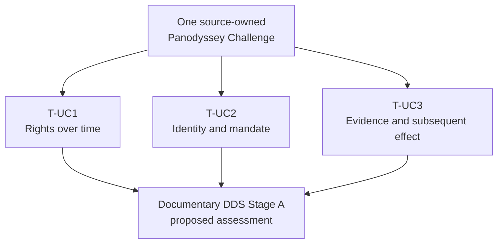

# Panodyssey — complete reader edition for technical and industry review

> [!IMPORTANT]
> **Purpose:** an accessible presentation layer over the *existing* canonical Panodyssey research package, prepared for Alexandre Leforestier, Olena Pavlenko, FG-TIDA reviewers and possible technology providers. This is **not** a new logical canonical case, an approved external submission, a completed DDS/UC4 trial, a Panodyssey product-failure finding or a legal-conformity assertion.
>
> **Source authority:** [00J-EXT-PANO-01 canonical research entry](../README.md). Its **ten Google Docs source mirrors and their hashes remain unchanged**. These presentation copies add navigation, tables, diagrams and paragraph spacing; the original wording and the source records retain precedence whenever exact source fidelity matters. The [source manifest](../SOURCE_MANIFEST.json) authenticates the unchanged mirrors, **not** these editorial copies.

## 1. Start with the decision, then follow the evidence

| Reader's question | First document | Supporting route |
|---|---|---|
| **What is the proposed FG-TIDA use case?** | [Agent Identity and Rights Evidence for Published Text — presentation v0.4](./FG_TIDA_Panodyssey_Agent_Rights_Use_Case_PRESENTATION_v0.4.md) | Source-owned [Challenge](./PANO-01_EXPANDED_CHALLENGE_THREE_TRAJECTORIES.md) and [original S1–S14 map](./SOURCE-00_ORIGINAL_CHALLENGE_AND_TOR_MAP.md) |
| **What is described as working today?** | [Alexandre's version/channel reconciliation](./PANO-05_ALEXANDRE_NOTICE_RAG_DISCREPANCY.md) | [Conditional legal/technical register](./PANO-02_CONDITIONAL_LEGAL_TECHNICAL_TRACEABILITY.md); current capabilities require dated source-owner confirmation |
| **What would a candidate need to evidence?** | [T-UC3 evidence checkpoints](./PANO-03_TUC3_EVIDENCE_EXECUTION_Q3_INTERFACE.md) | [DDS Stage A fair assessment and outcome contract](./PANO-04_DDS_STAGE_A_EVALUATION_EVIDENCE_CONTRACT.md) |
| **Can older UC21/S6 evidence avoid repetition?** | [Partial-isomorphism and transfer method](./PANO-08_PARTIAL_ISOMORPHISM_EVIDENCE_TRANSFER.md) | [Original transfer ledger](../TRANSFER_LEDGER.md); no eligible passed run has been established |
| **What can happen next, and what is on hold?** | [DDS/UC4/UC21 roadmap](./PANO-06_DDS_UC4_UC21_REUSE_ROADMAP.md) | [Execution-readiness](../DDS_UC4_READINESS.md), [completeness audit](./PANO-07_COMPLETENESS_AUDIT_OPEN_FINDINGS.md) |

**One case, three evidence perspectives**

*This is a reader map, not an executed, frozen or approved test flow.*

## 2. All ten original working documents — readable companions

The files below contain the source wording in its original order, with an explicitly marked presentation guide and whitespace-only paragraph breaks for longer prose. Their archival counterparts remain unchanged.

| Original record | Reader copy | Exact source mirror |
|---|---|---|
| Source 00 · Original Industry Challenge and ToR map | [Reader copy](./SOURCE-00_ORIGINAL_CHALLENGE_AND_TOR_MAP.md) | [Mirror](../SOURCE-00_ORIGINAL_CHALLENGE_AND_TOR_MAP.md) |
| 00 · Index and decisions | [Reader copy](./PANO-00_INDEX_AND_DECISIONS.md) | [Mirror](../PANO-00_INDEX_AND_DECISIONS.md) |
| 01 · Expanded Challenge and three trajectories | [Reader copy](./PANO-01_EXPANDED_CHALLENGE_THREE_TRAJECTORIES.md) | [Mirror](../PANO-01_EXPANDED_CHALLENGE_THREE_TRAJECTORIES.md) |
| 02 · Conditional legal/technical traceability | [Reader copy](./PANO-02_CONDITIONAL_LEGAL_TECHNICAL_TRACEABILITY.md) | [Mirror](../PANO-02_CONDITIONAL_LEGAL_TECHNICAL_TRACEABILITY.md) |
| 03 · E1–E5 and Q3 evidence boundary | [Reader copy](./PANO-03_TUC3_EVIDENCE_EXECUTION_Q3_INTERFACE.md) | [Mirror](../PANO-03_TUC3_EVIDENCE_EXECUTION_Q3_INTERFACE.md) |
| 04 · Documentary Stage A evaluation contract | [Reader copy](./PANO-04_DDS_STAGE_A_EVALUATION_EVIDENCE_CONTRACT.md) | [Mirror](../PANO-04_DDS_STAGE_A_EVALUATION_EVIDENCE_CONTRACT.md) |
| 05 · Alexandre Notice/RAG discrepancy note | [Reader copy](./PANO-05_ALEXANDRE_NOTICE_RAG_DISCREPANCY.md) | [Mirror](../PANO-05_ALEXANDRE_NOTICE_RAG_DISCREPANCY.md) |
| 06 · DDS/UC4/UC21 work and reuse roadmap | [Reader copy](./PANO-06_DDS_UC4_UC21_REUSE_ROADMAP.md) | [Mirror](../PANO-06_DDS_UC4_UC21_REUSE_ROADMAP.md) |
| 07 · Completeness audit and open findings | [Reader copy](./PANO-07_COMPLETENESS_AUDIT_OPEN_FINDINGS.md) | [Mirror](../PANO-07_COMPLETENESS_AUDIT_OPEN_FINDINGS.md) |
| 08 · Partially isomorphic extension and transfer method | [Reader copy](./PANO-08_PARTIAL_ISOMORPHISM_EVIDENCE_TRANSFER.md) | [Mirror](../PANO-08_PARTIAL_ISOMORPHISM_EVIDENCE_TRANSFER.md) |

## 3. Complementary current controls

These are **maintained research-corpus controls**, not additional Google Docs source mirrors.

| Record | Why it matters to a reviewer |
|---|---|
| [Canonical package README](../README.md) | Ownership, parent scenario, nomenclature and primary status |
| [Source manifest](../SOURCE_MANIFEST.json) | Source revision IDs, mirror hashes, original text/table/link custody |
| [Evidence-transfer ledger](../TRANSFER_LEDGER.md) | How a specific prior finding could be admitted, or explicitly not admitted |
| [DDS/UC4 readiness](../DDS_UC4_READINESS.md) | Separate method, environment, evidence and owner prerequisites |
| [Completeness/migration QA](../MIGRATION_QA_REPORT.md) | Historical source-fidelity checks, links and open gates |
| [Promotion decision](../PROMOTION_REVIEW.md) | Canonical documentary promotion versus unresolved experimental and disclosure gates |

## 4. A potential technology provider's review route

This is a **reading checklist extracted from the existing research contracts**, not a new requirement set or an invitation to execute a test without agreement.

1. **Bound the proposal.** Identify the exact work, rightsholder or representative, use purpose, version, time, legal/jurisdictional assumptions and requester.
2. **Show the actor chain.** Provide what can actually be verified about provider/principal identity, agent instance and present delegated mandate; distinguish a self-declared user-agent label from accountability.
3. **Keep evidence steps separate.** Supply or identify the intended E1 declaration, E2 recipient receipt, E3 interpretation, E4 independently supportable action/effect and E5 bounded conclusion. Say explicitly when any element is unknown or unavailable.
4. **Specify a fair comparison.** Agree on the documentary Stage A candidate, capable peer, positive and negative controls, independent oracle/reviewer, acceptance conditions and unresolved disagreements **before** any score.
5. **Keep optional experimentation conditional.** DDS B/C, UC4 and reuse of UC21/S6 results require their own permissions, preserved assumptions, fixtures, cost/observation boundaries and exact proof scope. Do not infer that publishing this packet starts a trial.

**Permitted outputs of a future documented assessment** include a justified bounded decision, failure, partial coverage, not-established finding or well-supported non-applicability. No default payment duty, infringement determination, live enforcement or technological insufficiency is presumed.

## 5. Status and provenance safeguard

- The **source** is one broad Panodyssey Challenge with three specific documentary trajectories, **not three official FG-TIDA cases**.
- The ten archival mirrors retain their historical **INTERNAL / NOT FOR EXTERNAL CIRCULATION** labels and exact source wording. Owner-accepted research publication does not authorize distribution of underlying private correspondence or commercial records.
- Panodyssey publisher-side operational descriptions are **source-owner assertions** with version/channel details pending renewed verification; no agent-side verified deployed implementation is asserted.
- **Not yet established:** completed A25/A26 admission, inherited PanO-v6 PASS, DDS Stage A/B/C score, UC4 execution, EU-law compliance, FG-TIDA/ITU endorsement or formal submission.
- The draft FG-TIDA use case requires Alexandre's and Olena's source/attribution/external-use review before filing. GitHub commits provide technical provenance, not those approvals.

For source authority, start again at the [canonical research entry](../README.md).