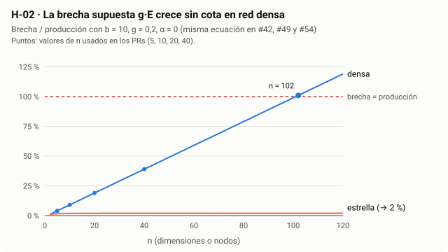
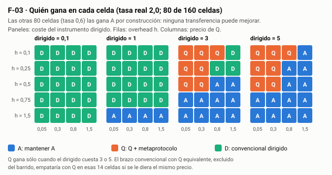

# Auditoría científica incremental — ACC, Conscientia y reducción agéntica

> **Actualización de lectura — ronda16:** el [suplemento actual](#ronda-16) reconfirma los cierres numéricos en main, recibe la corrección de dominio en la rama60 y examina la nueva§15 del puente62. La guía conserva su estado tras la ronda15; esta actualización añade sus consecuencias y seis propuestas concretas sin reabrir los defectos corregidos.

> **Lectura vigente — 28 octubre 2026, tras la ronda 14:** para orientarse, empiece por la [guía de lectura](incremental-audit-2026-10-26/GUIA_DE_LECTURA.md): estado vigente de los 71 registros, ideas clave en lenguaje llano, mapa de rondas y glosario. I-01 está **cerrado** (corregido en `main` por PR #64 y reconfirmado en la [ronda 13](#ronda-13)). Los encabezados de cada hallazgo conservan el estado que tenían al escribirse; el estado vigente está en la guía y en [`STATUS_LEDGER_2026-10-28.json`](incremental-audit-2026-10-26/STATUS_LEDGER_2026-10-28.json).
>
> *Lectura anterior, previa a la ronda 13 (se conserva):* **Lectura vigente — 28 octubre 2026:** la [ronda12](#ronda-12--relectura-del-corpus-y-estado-real-de-la-auditoría-28-octubre-2026) actualiza mejoras, observaciones y pendientes. PR60 recibió D3-A y nombres UC21/DDS; PR64 repara los ejemplos originales pero conserva un problema numérico nuevo; P5/Python3.9 ya tiene sucesor correcto en main. Los encabezados históricos se leen con las delimitaciones9–11: no expresan una valoración general del programa matemático. Las propuestas IP siguen pendientes de incorporación.

**Estado:** abierta, incremental. Cada ronda añade hallazgos; ninguno se borra. Un hallazgo sólo cambia de estado (`ABIERTO` → `RESPONDIDO` → `CERRADO` / `RECHAZADO`) con una nota que diga quién lo decidió y por qué. Además se usan `VERIFICADO` (revisado y correcto), `PROPUESTA` (mejora, no defecto), `RETIRADO` (el revisor retira su crítica) e `INFORMATIVO` (aclaración); las variantes que aparecen en rondas posteriores («corrección propuesta en fuente», «recibido», «confirmada») se normalizan a estos siete estados en la [guía de lectura](incremental-audit-2026-10-26/GUIA_DE_LECTURA.md#3-cómo-está-todo-ahora) (ronda 14).
**Revisor:** Claude (Anthropic), asistido por IA, a petición del propietario. **No es la revisión científica humana independiente** que solicita la nota de revisión externa; es una auditoría previa para preparar esa revisión.
**Método:** lectura del código y de los documentos en los commits fijados abajo; desde la ronda 5, cálculos independientes en `audit_companion.py`. En la ronda 2 no se pudo ejecutar el código (el entorno del revisor bloqueó la ejecución de código externo); las cifras se derivaron analíticamente del código y coinciden con las declaradas en los PRs.

## Anexo y ayudas visuales

El [anexo](incremental-audit-2026-10-26/ANNEX.md) reúne lo que hace utilizable cada hallazgo en el PR auditado: mapa de hallazgos, diagramas, figuras con su vista en tabla, bocetos de corrección ejecutables, una tabla de enriquecimiento por PR, referencias bibliográficas por hallazgo y un glosario provisional. Las cifras se recalculan de forma independiente con [`audit_companion.py`](incremental-audit-2026-10-26/audit_companion.py), que reproduce los recuentos publicados por los PRs (por ejemplo, 107/14/39 en el barrido de #57) sin importar su código.

## Commits auditados

| Objeto | Commit |
|---|---|
| `main` | [`3e58fc6`](https://github.com/dakleyer/structural-awareness-contributions/tree/3e58fc6997a439b9783fd6b92ccee3f4292772dd) |
| PR #54 (abierto) | [`c332dfa`](https://github.com/dakleyer/structural-awareness-contributions/tree/c332dfac84d66f58ed424cee20ad6ad40060aec7) |
| PR #57 (abierto) | [`fb79df2`](https://github.com/dakleyer/structural-awareness-contributions/tree/fb79df2ce93c0730ed49c3454a6ebef033ebbe5e) |

Si cualquiera de estos commits cambia, los hallazgos afectados deben revalidarse antes de cerrarse.

**Revalidación (ronda 6):** el PR #57 avanzó a [`7b45341`](https://github.com/dakleyer/structural-awareness-contributions/tree/7b45341). Entre `fb79df2` y `7b45341` sólo cambian tres documentos (`README.md`, `SOURCE_MAP.md` y un nuevo anexo de linaje matemático y «Given Universe»); el código no cambia, así que F-01 a F-05 siguen vigentes. **El nuevo anexo no está cubierto por esta auditoría.**

## Registro de rondas

| Ronda | Fecha | Objeto | Hallazgos |
|---|---|---|---|
| 1 | 2026-10-26 | Nota «Solicitud de revisión científica independiente» (borrador del 26-10-2026) | N-01 a N-09 |
| 2 | 2026-10-26 | Código de PR #57 y PR #54 | F-01 a F-07 |
| 3 | 2026-10-26 | Campaña de PR #48/#49 en `main` (`conscientia-campaign-v0.1`) | G-01 a G-06 |
| 4 | 2026-10-26 | Modelo social: PR #42 (`bounded-traps-v0.1`) y PR #43 (`nested-composition-suffering-v0.1`) | H-01 a H-06 |
| 5 | 2026-10-26 | Ayudas visuales, cálculos independientes, propuestas ejecutables, referencias y glosario ([anexo](incremental-audit-2026-10-26/ANNEX.md)) | Sin hallazgos nuevos; confirma de forma independiente F-03, F-04, G-01, G-02, H-02 y H-03 |
| 6 | 2026-10-26 | Contraste con la revisión diaria del corpus (PR #59) y el comentario de revisión de Codex en este PR; `qualify` de PR #45 | I-01; cambios de estado de F-01, F-03, G-01 y G-05 |
| 7 | 2026-10-27 | Reconciliación de Codex con PR #59, TAX26 y la promoción a VNext propietarias ([sección al final](#corpus-reconciliation-and-promotion-review-27-october-2026); [anexo §7](incremental-audit-2026-10-26/ANNEX.md#7-corpus-reconciliation-and-promotion-readiness-27-october-2026)) | Sin hallazgos nuevos; revisa los bocetos de corrección |
| 8 | 2026-10-27 | Corpus matemático, revisión de Codex ([sección al final](#ronda-8); [anexo §8](incremental-audit-2026-10-26/ANNEX.md#8-mathematical-review-and-development-opportunities)) | M27-01 a M27-19 y oportunidades M27-O1 a M27-O5; M27-20 (alcance del argumento de Cantor en «The Given Universe» §6) registrado en un [comentario del PR](https://github.com/dakleyer/structural-awareness-contributions/pull/58#issuecomment-6446350643) |
| 9 | 2026-10-27 | Claridad de comparaciones y reparación transversal de lectura ([ronda 9](#ronda-9), [guía y fichas](incremental-audit-2026-10-26/INTERPRETATION_AND_COMPARISON_REPAIR_2026-10-27.md)) | Desarrolla M27-09: 36 unidades propuestas en 24 fuentes/ediciones; no aplica cambios canónicos |
| 10 | 2026-10-27 | [Alcance H01/H03 y respuesta del autor](#ronda-10--alcance-de-h-01-y-h-03-y-prevención-de-extrapolaciones-27-10-2026); candidato63 | Preserva críticas locales; diferencia ausencia en test y ausencia en corpus |
| 11 | 2026-10-27 | [Recepción64/comparadores/casos54](#ronda-11--resolución-técnica-de-i-01-delimitación-de-comparadores-y-clasificación-de-casos-27-10-2026) | Respuesta a I01/M27-01/02, G01/F01 y F06; sin cierre por publicación |
| 12 | 2026-10-28 | [Relectura y cola vigente](#ronda-12--relectura-del-corpus-y-estado-real-de-la-auditoría-28-octubre-2026); [anexo10](incremental-audit-2026-10-26/ANNEX.md#10-corpus-refresh-and-open-audit-work--28-october-2026) | M28-01…07; oportunidadesO1/O2; revalidación IP01–36 y propuestas IP37–42 |
| 13 | 2026-10-28 | [Reconfirmación de I-01 en `main`](#ronda-13--reconfirmación-de-i-01--m27-01--m28-01-en-main-28-10-2026) tras fusionar PR #64 | I-01 `CERRADO`; M27-01/M28-01 reconfirmados |
| 14 | 2026-10-28 | [Revisión formal del expediente y guía de lectura](#ronda-14) | J-01 a J-08; [guía](incremental-audit-2026-10-26/GUIA_DE_LECTURA.md), registro de estados y 74 anclas estables |
| 15 | 2026-10-28 | [Reconfirmación de M28-02 en la rama de #60](#ronda-15) | M28-02 `RESPONDIDO` (implementado en rama, pendiente de `main`) |
| 16 | 2026-10-28 | [Relectura de cambios y cinco mecanismos](#ronda-16); [propuestas](incremental-audit-2026-10-26/ANNEX.md#11-ronda-16--recepción-y-propuestas-acotadas) | Cierres numéricos recibidos, dominio60 reconfirmado, próximos controles matemáticos y recepción59 |
| 17 | 2026-10-28 | [Modelo social #44, #45 (resto) y #46](#ronda-17) | K-01 a K-08 |
| 18 | 2026-10-28 | [Precisión de alias en la guía (D28-C03)](#ronda-18) | Sin hallazgos nuevos; precisión añadida a la guía |
| 19 | 2026-10-28 | [Oportunidades de mejora y recepción de R16-P01/P06/P07 e IP-43](#ronda-19) | OP-01 a OP-13; evidencia nueva para K-02 y K-04 |
| 20 | 2026-10-28 | [Kit de edición premium: 01 README del modelo auxiliar](#ronda-20) | 9 propuestas de visuales, edición, diseño y conexión |
| 21 | 2026-10-28 | [Kit de edición premium: 02 `MODEL.md`](#ronda-21) | 12 propuestas; cifra de pruebas del toy desfasada en `MODEL.md` |
| 22 | 2026-10-28 | [Scripts de verificación al expediente](#ronda-22) | Sin hallazgos nuevos; 7 scripts reproducibles y cifras reconfirmadas |
| 23 | 2026-10-28 | [Recepción de la nota de Codex sobre PR #60: M28-03, M28-04 y F1/D1](#ronda-23) | M28-03 reparado en la rama; L-01 y L-02 nuevos; testigos F1/D1 verificados (L-03) |
| 24 | 2026-10-28 | [Recepción de M28-04 (#60), K-02 (#65), K-01 (#66), DG1–DG4 y oportunidades de EP](#ronda-24) | M28-04, L-02, K-01 y K-02 respondidos; L-04 nuevo; L-05 y L-06 verificados |
| 25 | 2026-10-28 | [Recepción de K-03 (PR #67)](#ronda-25) | K-03 respondido; refactorización equivalente en 11 600 comparaciones |
| 26 | 2026-10-29 | [Recepción de G-03 (PR #68)](#ronda-26) | G-03 respondido; L-07 nuevo |
| 27 | 2026-10-29 | [Recepción de L-04 (#66) y L-07 (#68); #69 recibido](#ronda-27) | L-04 y L-07 respondidos |
| 28 | 2026-10-29 | [Recepción de G-04 (PR #70)](#ronda-28) | G-04 respondido; L-08 nuevo |
| 29 | 2026-10-30 | [Recepción de G-06 (PR #71)](#ronda-29) | G-06 respondido; sin hallazgos nuevos |
| 30 | 2026-10-30 | [Recepción de L-08 (PR #72)](#ronda-30) | L-08 respondido; cifras reproducidas de forma independiente |
| 31 | 2026-10-31 | [Recepción de G-02 (PR #73)](#ronda-31) | G-02 respondido; L-09 nuevo |
| 32 | 2026-11-01 | [Recepción de L-09 (PR #75)](#ronda-32) | L-09 respondido; gemelos sin fuga reproducidos de forma independiente |
| 33 | 2026-11-01 | [Recepción de H-01 (PR #76)](#ronda-33) | H-01 respondido; L-10 nuevo |
| 34 | 2026-11-01 | [Diagnóstico complementario de H-01 (PR #76)](#ronda-34) | Sin cambio de estado; condiciones analíticas reproducidas; forma cerrada de L-10 |
| 35 | 2026-11-01 | [Corrección de fidelidad dimensional (PR #76)](#ronda-35) | Sin cambio de estado; recuento R/C reproducido; precisiones a H-01, L-10 y L-05 |
| 36 | 2026-11-20 | [Informes sin compensación de unidades (PR #81 y #82)](#ronda-36) | Sin cambio de estado; F-05 (b) atendido en rama; L-05 se sostiene en unidades físicas |
| 37 | 2026-11-20 | [Recepción de L-01 (PR #83)](#ronda-37) | L-01 respondido |
| 38 | 2026-11-20 | [Óptimos repetidos en #69 (PR #84)](#ronda-38) | Defecto de #69 encontrado por su autor y corregido; sin registro nuevo |
| 39 | 2026-11-20 | [Indicadores de evidencia no booleanos en #60 (PR #85)](#ronda-39) | Defecto encontrado por el autor y corregido; sin registro nuevo |
| 40 | 2026-11-21 | [Fe de erratas de la ronda 36 y seis correcciones técnicas (#86–#91)](#ronda-40) | La ronda 36 llamó «producción» a un valor sintético; seis defectos de comparación corregidos por el autor; sin registros nuevos |
| 41 | 2026-11-21 | [Identidad de las dimensiones en #92](#ronda-41) | Nombres ambiguos o en blanco ahora se rechazan; informe H-01 idéntico; sin registros nuevos |
| 42 | 2026-11-21 | [M28-07 en #93](#ronda-42) | El acompañante matemático ya no reescribe su JSON de referencia ni deja caché; M28-07 pasa a respondido |
| 43 | 2026-11-21 | [Precisión de la ronda 41: intercambio, no compensación](#ronda-43) | Las 92 celdas son intercambios incomparables sin compensación inferida; sin cambios de cifras ni estados |
| 44 | 2026-11-21 | [Indicadores explícitos en la cartografía (#94) y L-11](#ronda-44) | #94 exige `True` explícito en captura y enlace; nuevo L-11: un tiempo de llegada NaN o infinito pasa la puerta de llegada |
| 45 | 2026-11-21 | [Rejillas de sensibilidad, no dimensiones de K (#95)](#ronda-45) | Cambio de nombres en `sensitivity_grid`; AST idéntico salvo un mensaje; informe H-01 idéntico; sin registros nuevos |
| 46 | 2026-11-21 | [L-11 respondido en #96](#ronda-46) | Horas de llegada enteras y nombres de evento de texto obligatorios; L-11 pasa a respondido |
| 47 | 2026-11-21 | [Fe de erratas de la ronda 42; código de salida en #97](#ronda-47) | Un fallo real ya salía con código 1; lo que salía con 0 era un resumen incoherente, y #97 lo corrige; sin registros nuevos |
| 48 | 2026-11-21 | [Inventario #81–#97 contrastado; mapa visual](#ronda-48) | 17 borradores abiertos, cabeceras y dependencias coinciden; nuevo mapa del lote en la guía; sin registros nuevos |
| 49 | 2026-11-21 | [Ámbitos de fuente con nombre (#98)](#ronda-49) | Ámbitos sin nombre ya no califican una región conjunta; información local conservada; sin registros nuevos |
| 50 | 2026-11-21 | [F-07 respondido en #99](#ronda-50) | Se elimina la variable `loc` que nunca se leía; 26 324 casos y la campaña completa idénticos; F-07 pasa a respondido |
| 51 | 2026-11-21 | [Premisas explícitas en los casos adicionales (#100) y L-12](#ronda-51) | #100 deja de aceptar «UNKNOWN» en cuatro premisas; nuevo L-12: el mismo patrón sigue en `mission`, `q_cost` y `knowledge` |
| 52 | 2026-11-21 | [M28-05, parte técnica, en #101](#ronda-52) | Dos pruebas dejan de llamarse «peer»: reproducen la misma función; parte documental pendiente; sin cambio de estado |
| 53 | 2026-11-21 | [L-12 respondido en #102](#ronda-53) | `mission`, `q_cost`, `knowledge` y también `attribution` exigen premisas explícitas; L-12 pasa a respondido |
| 54 | 2026-11-21 | [Inventario #81–#102 contrastado](#ronda-54) | 22 borradores abiertos con las cabeceras declaradas; ninguna corrección cambia una cifra publicada; sin registros nuevos |
| 55 | 2026-11-21 | [Precisión de autoría](#ronda-55) | «El autor» de las rondas 38–53 es Codex, asistencia de IA, no una revisión manual de Iván; sin cambios de estado |
| 56 | 2026-11-21 | [Operandos finitos (#103)](#ronda-56) | Un NaN en un coste ya no cambia la opción ganadora; utilidades infinitas y desbordamientos se rechazan; sin registros nuevos |
| 57 | 2026-11-21 | [Muestras finitas en `closure` (#104) y L-13](#ronda-57) | #104 rechaza muestras no finitas; nuevo L-13: una constante de Lipschitz negativa certifica el predicado |
| 58 | 2026-11-21 | [Recuentos de evidencia (#105)](#ronda-58) | Un recuento infinito ya no autoriza un cambio de misión; `True` deja de valer como entero en `kl`; L-13 sigue abierto |
| 59 | 2026-11-21 | [L-13 respondido en #106](#ronda-59) | `closure` exige L ≥ 0, como el contrato canónico `Frame`; L-13 pasa a respondido |
| 60 | 2026-11-21 | [Viabilidad conjunta y umbrales exactos en `closure` (#107)](#ronda-60) | El fixture repetía I-01 y M28-01; ahora coincide con un oráculo exacto en 3 200 casos; sin registros nuevos |
| 61 | 2026-11-21 | [Inventario #81–#107 contrastado](#ronda-61) | 27 borradores abiertos con las cabeceras declaradas; ninguna corrección cambia una cifra publicada; sin registros nuevos |

Pendiente: modelo social #44–#46 (de #45 sólo se ha revisado `qualify`, I-01), anexo matemático nuevo de #57, núcleo #28/#40/#51, #21/#22 (00M_VNext) y los diferidos #5/#18 (linaje A/B/C/D).

---

## Ronda 6 — Contraste con la revisión diaria (PR #59) y defecto en PR #45

**Origen.** Comentario de revisión de **Codex** en este PR (26-10-2026): auditoría asistida por IA solicitada por Iván y publicada desde la cuenta del repositorio. No es una declaración personal de Iván ni una decisión de implementación. Contrasta esta auditoría con la revisión diaria publicada en [PR #59](https://github.com/dakleyer/structural-awareness-contributions/pull/59). Cada afirmación se ha recomprobado aquí contra el código; la recomprobación aritmética la hace Claude, también asistida por IA, y **no es una validación humana ciega**.

### Cambios de estado

| Hallazgo | Nuevo estado | Motivo |
|---|---|---|
| F-01 | `RESPONDIDO` | La revisión de Codex confirma que el brazo equivalente comparte rama de decisión. Pendiente de corrección o de reencuadre en #57. |
| F-03 | `RESPONDIDO` | Confirmada la ausencia del brazo equivalente en el barrido de tres brazos. |
| G-01 | `RESPONDIDO` | Confirmado: los 48 veredictos adjudicables del peer están estipulados como correctos. |
| G-05 | `RESPONDIDO` | Confirmado el solapamiento de 8 celdas de red con #49. |

Ningún hallazgo pasa a `CERRADO`: la confirmación del diagnóstico no es todavía su corrección. «Confirmado» significa aquí coincidencia entre dos revisiones asistidas por IA (Codex y Claude), no validación humana independiente.

### Precisiones de alcance aceptadas

- **Ámbito positivo.** Los argumentos finitos de fibras y conteo (H-06) y los de valor de la información son sólidos bajo sus supuestos. Ningún hallazgo de esta auditoría exige que un algoritmo sea imposible para código convencional; F-01 sólo pide que la comparación no se presente como evidencia de un diferencial.
- **F-02 no es evidencia.** Un `h` por brazo, como propone el anexo, hace explícita la hipótesis; no la apoya. Cualquier inferencia económica exige medir `h_convencional − h_agéntico` fuera del modelo.
- **Frontera de #57.** El anexo matemático nuevo y la reutilización externa de versiones Rxx no quedan cubiertos por haber revisado el código en `fb79df2` (ver revalidación arriba).
- **PR #22.** La revisión diaria señala una celda de reproducibilidad en Python 3.9 no ejecutada por configuración del runner. No se ha verificado aquí; es una cuestión de reproducibilidad, independiente de la validez matemática.

### I-01 · Alta · `CERRADO` (ronda 13, 28-10-2026) — `qualify` puede declarar «verdadero» con un intervalo vacío

**Identificado en:** revisión de Codex en PR #59 (D26-F01, propuesta D26-C01). **Recomprobado aquí** por Claude leyendo el código y reproduciendo la aritmética en [`audit_companion.py`](incremental-audit-2026-10-26/audit_companion.py) (`I01_empty_intersection_PR45`).

**Evidencia.** `.../studies/scoped-closure-metacognition-v0.1/metacognition.py` en `3e58fc6`, l. 171–187: `lo = max(lows)`, `hi = min(highs)`; la incoherencia sólo se declara si `lo > hi + 1e-12` (l. 178) y después se decide con `lo >= threshold` (l. 182). Contraejemplo: dos puntos atestiguados en x = 0 con intervalos [1e-13, 1e-13] y [0, 0], L = 0, umbral 5e-14. Resultado: lo = 1e-13 > hi = 0 (intersección vacía), la tolerancia absoluta lo deja pasar y el estado es `LOCALLY_SUPPORTED_TRUE`.

**Consecuencia.** Es un defecto real de implementación en el borde numérico, no una refutación de la inferencia de Lipschitz ni del modelo. Con una tolerancia absoluta fija, la decisión depende de la escala de los datos: cualquier par de evidencias contradictorias separado por menos de 1e-12 puede producir apoyo positivo. Las pruebas de regresión actuales no cubren este caso.

**Acción propuesta.** Rechazar cualquier `lo > hi` antes de decidir (con la regla estricta, el contraejemplo devuelve `EVIDENCE_OR_ASSUMPTIONS_INCONSISTENT`). Si se quiere tolerancia numérica, que sea relativa a la escala de los datos y que el caso dentro de la tolerancia nunca produzca `SUPPORTED_*`. Añadir el contraejemplo como prueba de regresión y revisar si cambia algún resultado congelado.

---

## Ronda 4 — Modelo social: PR #42 y PR #43

Rutas abreviadas: `BT/` = `.../studies/bounded-traps-v0.1/`; `NC/` = `.../studies/nested-composition-suffering-v0.1/`.

### H-01 · Alta · `ABIERTO` — «Subóptimo racional» no está modelado: la trampa es de factibilidad, no de elección

> **Precisión posterior (ronda 10):** hallazgo válido para el toy binario, NO ausencia de teoría de coordinación en ACC. El modelo integrado ya documenta saturación de recursos, dimensión operativa de coordinación, codependencia, transferencias y NO GO. [Recepción y propuesta de precisión en PR #63](https://github.com/dakleyer/structural-awareness-contributions/pull/63).

**Evidencia.** `BT/bounded_traps.py`, `coupled_trap` (l. 74–99): las restricciones `x1 ≤ x2` y `x2 ≤ x1` (l. 80–82) hacen infactibles los estados intermedios (1,0) y (0,1). Desde (0,0) ningún paso unilateral es admisible (`reachable_by_unilateral_additions`, l. 51–71). Las utilidades (4,4) → (5,5) se escriben a mano (l. 86–87), no se derivan del estado. `NC/nested_model.py`, `agent_unilateral_reachability` (l. 45–58) repite el mismo caso.

**Consecuencia.** El resultado es correcto, pero muestra que un estado Pareto-dominado puede ser inalcanzable por pasos unilaterales cuando los intermedios están prohibidos. No muestra que permanecer sea *racional*: no hay agentes que elijan, ni pagos por agente, ni incentivos a desviarse. Un subóptimo racional exige que la desviación unilateral sea posible pero no rentable (equilibrio de Nash Pareto-inferior, como en la caza del ciervo). Además, el resultado es conocido (fallos de coordinación, equilibrios Pareto-inferiores, dependencia de trayectoria); el revisor pedirá situarlo en esa literatura.

**Acción propuesta.** Añadir una forma de juego mínima: dos agentes, pagos por perfil, desviación unilateral factible pero perjudicial, y verificar que (0,0) es equilibrio y (1,1) lo domina. Declarar qué aporta ACC frente a la literatura de coordinación.

### H-02 · Alta · `ABIERTO` — La brecha creciente con n es un supuesto reutilizado en tres PRs

**Evidencia.** `BT/bounded_traps.py`, `relative_gap` (l. 144–167): producción `b·n + α·E`, brecha `g·E` (l. 160). La misma especificación reaparece en `network_gap` de #49 (G-05) y en la familia `network` de #54 (F-06). En red densa con b = 10, g = 0,2, α = 0, la brecha relativa es `0,01·(n − 1)`: crece sin cota y supera el 100 % de la producción a partir de n = 102.

**Consecuencia.** La «acumulación de brechas» que la nota pide revisar (punto crítico 1) no la produce el modelo: es la hipótesis de que cada enlace aporta una ganancia conjunta no realizada y la producción realizada sólo escala con n. Que se ejecute en tres sitios no la convierte en tres evidencias; es la misma ecuación tres veces.

**Acción propuesta.** Derivar la brecha de un mecanismo (por ejemplo, coste de coordinación por enlace frente a ganancia por enlace) con parámetros que permitan que la brecha se cierre, y declarar en un único lugar que las tres apariciones comparten supuesto.

### H-03 · Alta · `ABIERTO` — En #43 la pérdida informacional no viene de la composición anidada

> **Precisión posterior (ronda 10):** separar origen local de la censura en el código #43 y profundidad/perímetro de exploración desde el receptor. La primera crítica continúa válida; no refuta por sí misma la segunda tesis arquitectónica. [Propuesta explicativa y prueba pendiente en PR #63](https://github.com/dakleyer/structural-awareness-contributions/pull/63).

**Evidencia.** `NC/nested_model.py`: `hierarchical_current_output` (l. 112–126) devuelve exactamente la suma plana de `current_nested_output` (l. 105–109); el propio código lo afirma con `assert` (l. 162). La pérdida procede de la censura en las hojas: cada rama entrega `min(8, capacidad)` = 8 tanto si su capacidad es 8 como 10.

**Consecuencia.** El modelo demuestra no identificabilidad de la capacidad bajo observación censurada por la demanda. Eso ocurriría igual con n ramas que informaran por separado, sin anidamiento. La afirmación del título de #43 («composición anidada → pérdida informacional») no está sustentada por este código.

**Acción propuesta.** Añadir un caso sin censura donde el anidamiento por sí mismo pierda información (el padre sólo ve sumas de salidas distintas) y compararlo con informes planos al mismo ancho de banda. Si no se distingue de la censura, retitular el resultado.

### H-04 · Media · `ABIERTO` — «Sufrimiento estructural» es una brecha de contribución con nombre de bienestar

**Evidencia.** `NC/nested_model.py`, `structural_suffering_proxy` (l. 72–95): el indicador es `max(0, z − a)` cuando cuatro booleanos estipulados son verdaderos, y 0 en otro caso. El caso del informe (l. 185–191) los fija todos a verdadero.

**Consecuencia.** La magnitud no tiene contenido de bienestar: se mide en unidades de contribución y su valor depende sólo de la brecha estipulada. El código marca `subjective_suffering: NOT_MEASURED`, pero el término «sufrimiento» en títulos y documentos atraerá la objeción principal del revisor.

**Acción propuesta.** Llamarlo «brecha de desarrollo estructural» en el modelo y reservar «sufrimiento» para cuando exista un instrumento humano.

### H-05 · Media · `ABIERTO` — Utilidades no monótonas estipuladas, no derivadas

**Evidencia.** `BT/bounded_traps.py`, `apple_utility` (l. 118–123): la curva `(0, 4, 7, 8, 7, 5, 5, 9, 10)` es un literal. El docstring atribuye el valle a costes de almacenamiento y el pico a un umbral de mercado, pero ninguno de los dos está modelado.

**Consecuencia.** Es un ejemplo de existencia válido (una búsqueda local se detiene en q = 3 con máximo global en q = 8), y conocido. No sustenta afirmaciones sobre cuándo aparecen valles en economías reales.

**Acción propuesta.** Presentarlo como ejemplo de existencia, o derivar la curva de una función de ingreso con umbral menos una de coste de almacenamiento para que sus parámetros sean auditables.

### H-06 · Informativo · `VERIFICADO` — Cotas de información de #43 correctas

**Evidencia.** `NC/nested_model.py`, l. 129–169: con n ramas de capacidad 8 o 10 y salida actual constante 8n, hay 2ⁿ estados ocultos; responder exactamente a las n consultas por rama exige n bits, y una única consulta agregada exige ⌈log₂(n + 1)⌉ bits (`n.bit_length()`, correcto para n ≥ 1). `cnf_satisfiable` es búsqueda exhaustiva finita correcta.

**Consecuencia.** El argumento de conteo es sólido dentro del mundo finito declarado; su alcance real lo delimita H-03 (la causa es la censura).

---

## Ronda 3 — Campaña de PR #48/#49 (`main`)

Ruta abreviada: `CEC/` = `research/ecosystem-awareness/baseline/01I-artifacts/acc-auxiliary-model-v0.1/studies/conscientia-campaign-v0.1/`. La tabulación de `CASE_REGISTRY.json` se hizo leyendo el JSON, sin ejecutar el código del repositorio.

**Respuesta a la pregunta pendiente de F-06:** sí, el patrón se repite, y en la matriz de decisiones es más fuerte, porque la exactitud de los comparadores no se calcula: se estipula caso a caso.

### G-01 · Alta · `RESPONDIDO` (ronda 6) — La matriz 60 × 5 mide el diseño del fixture, no las estrategias

**Evidencia.** `CEC/campaign.py`, `public_policy` (l. 53–110): cada brazo copia un veredicto escrito en el caso (`q["verdict"]`, `peer["verdict"]`, `full["verdict"]`) o la acción base. Tabulación de `CEC/CASE_REGISTRY.json`:
- `CONVENTIONAL_TARGETED`: `has_direct_evidence = true` y `verdict == verdad privada` en los 48 casos adjudicables. Es un oráculo con coste; su resultado 48 correctas / 0 equivocadas está escrito en los datos.
- `EXPANDED_A`: cuando está disponible, su veredicto coincide con la verdad en todos los casos.
- Los brazos Q son los únicos con error inyectado: en las 12 variantes `FALSE_Q` el veredicto de Q es `ALLOW` con verdad `BLOCK`.
- Precios: el peer cuesta 0,5 o 1,6; Q cuesta 1,0 o 2,2 (más 0,3 de auditoría). Utilidades idénticas en los 60 casos.

**Consecuencia.** El ranking de `RUN_SUMMARY.md` (convencional 200,40; Q −52,80; A completo −262,00) se sigue directamente de qué brazo recibió veredictos correctos y de los precios asignados. El diseño está sesgado contra Q (honesto como control negativo) y, a la vez, no informa sobre Q: ningún brazo decide a partir de la información que tendría disponible.

**Acción propuesta.** Que el veredicto de cada comparador se derive de la información que ese comparador observa (misma restricción informativa para todos los brazos), con una tasa de error explícita también para el peer convencional. Mientras tanto, describir la tabla como «comprobación de que la función de puntuación aplica correctamente las pérdidas», no como resultado comparativo.

### G-02 · Media · `ABIERTO` — La «auditoría independiente» de Q es un booleano del fixture

**Evidencia.** `PARTIAL_Q_AUDIT_GATED` (l. 77–85) acepta una Q `CURRENT_BUT_FALSE` si `q["independent_audit"]` es verdadero. En 4 de los 12 casos `FALSE_Q`, ese indicador está activado: son exactamente las 4 equivocadas de ese brazo.

**Consecuencia.** El brazo no modela ninguna auditoría; modela que alguien declaró que hubo una. Su mejor resultado frente a `QUALIFIED_Q` (4 frente a 12 equivocadas) es el número de casos en que el fixture desactivó el indicador.

**Acción propuesta.** Modelar la auditoría con una probabilidad de detección y un coste, o renombrar el brazo para que no sugiera un mecanismo.

### G-03 · Media · `ABIERTO` — Varios «microexperimentos» son literales, no cálculos

**Evidencia.**
- `finite_information` (l. 225–238): define dos mundos, pero las entropías salen de distribuciones escritas a mano (`[0.5, 0.5]`, `[1.0, 0.0]`, l. 229); los mundos no se usan en el cálculo.
- `FINITE_XOR_SYNERGY` (l. 331–334): la información mutua (0, 0, 1 bits) es un literal. El valor es correcto, pero no se calcula.
- `IQ03_EFFICIENCY_GAP` (l. 248–251): la brecha 20 → 45 es resta de constantes; «el servicio aumenta y la brecha aumenta» está en los datos de entrada.
- Varias entradas (naranjas, educación, ministerios, oficios, liceo) son diccionarios de etiquetas `NOT_ESTABLISHED` / `NOT_OBSERVED`: puertas de evidencia, no ensayos.

**Consecuencia.** «Doce microexperimentos» y «61 pruebas» sobreafirman. Lo que se reproduce es la tabla de valores escrita por el autor.

**Acción propuesta.** Calcular las cantidades informativas a partir de los mundos definidos (por ejemplo, entropía condicional desde la tabla de mundos) y renombrar el bloque como «ilustraciones y puertas de evidencia».

### G-04 · Media · `ABIERTO` — Factorial y ablaciones FH-C son tautológicos por construcción

**Evidencia.** `factorial_joint_information` (l. 163–174): la salida es `atomic_joint and (q_available or not proof_required)`; la conclusión «Q sin mecanismo físico no genera recursos» es la propia fórmula. `fh_c_competing_ablations` (l. 177–205): los indicadores de cada perfil se fijan a mano para producir predicciones opuestas, y el resumen lo reconoce.

**Consecuencia.** Son especificaciones ejecutables, útiles para documentar la regla, pero no pruebas de nada que no esté en la regla.

**Acción propuesta.** Etiquetarlos como especificación; si se quiere poner a prueba FH-C, el comparador tiene que poder fallar por razones que no fije el autor del caso.

### G-05 · Baja · `RESPONDIDO` (ronda 6) — PR #54 duplica parcialmente la red de #49

**Evidencia.** `network_gap` (`CEC/campaign.py`, l. 208–222) usa densa/estrella, n = 5/10/20/40, b = 10, g = 0,2, α = 0. La rejilla `network` de `CAC/sensitivity.py` (PR #54) es un superconjunto: las 8 celdas con g = 0,2 y α = 0 reproducen exactamente las de #49.

**Consecuencia.** La afirmación de #54 de que «no duplica» la campaña anterior no es exacta para esta familia; 8 de sus 88 barridos ya estaban.

**Acción propuesta.** Declarar el solapamiento o eliminar esas celdas.

### G-06 · Baja · `ABIERTO` — Recuento de fuentes «cribadas»

**Evidencia.** `build_campaign` (l. 441) informa `source_documents_screened = len(SOURCE_REGISTER["sources"])`, que hoy es 23. El número cuenta entradas del registro, no documentos efectivamente cribados.

**Consecuencia.** Se suma a la discrepancia histórica 17/19 ya señalada (N-03): hay al menos tres cifras de «documentos cribados» en el corpus.

**Acción propuesta.** Distinguir en el registro «registrado», «leído» y «usado como fuente de un caso», y reconciliar 17/19/23 en un único lugar.

---

## Ronda 2 — Código de PR #57 y PR #54

Rutas abreviadas: `AGR/` = `research/ecosystem-awareness/baseline/01I-artifacts/acc-auxiliary-model-v0.1/studies/agentic-ecosystem-reduction-v0.1/` (PR #57); `CAC/` = `.../studies/conscientia-additional-cases-v0.1/` (PR #54).

### F-01 · Alta · `RESPONDIDO` (ronda 6) — En v0.1 el metaprotocolo es, en código, el brazo convencional con Q equivalente

**Evidencia.** `AGR/agentic_reduction.py`, `plan_public` (l. 129 y ss.): `Q_META_PROTOCOL` y `CONVENTIONAL_EQUIVALENT_Q` recorren la misma rama (l. 144); la única diferencia es el precio (`equivalent_Q_cost`, l. 147). Las compuertas de liberación, consentimiento, autoridad y protocolo conjunto (l. 182) se aplican igual a todos los brazos que transfieren, incluidos los convencionales. En `AGR/make_cases.py` el precio equivalente por defecto es igual al de Q (0,3; l. 21 y 24); sólo AG22 lo abarata (l. 71).

**Consecuencia.** El modelo no puede producir una ventaja del metaprotocolo sobre un sistema convencional con la misma Q: por construcción empata (mismo precio) o pierde (convencional más barato). La frase «un peer convencional con Q equivalente empata o gana» no es un resultado ni un falsador superado; es una identidad del código.

**Lo que ya reconoce el PR.** `ISOMORPHISM_AND_BOUNDARY_AUDIT.md` §2 (AG-R3) admite que un sistema no agéntico con la misma Q puede ejecutar el mismo algoritmo y que el diferencial queda en parámetros no probados. El hallazgo no contradice eso: lo confirma en código y señala que la descripción del PR y la nota de revisión siguen presentando la comparación de brazos como si fuera informativa.

**Acción propuesta.** Presentar #57 como **prueba de reducción completa en v0.1** (el metaprotocolo es una parametrización de ACC), no como evaluación del metaprotocolo. Para que la hipótesis agéntica sea falsable hace falta un operador o estado que no sea un precio, con un caso pareado donde el peer convencional con igual información y permisos no pueda replicarlo (criterio 2 de la propia auditoría de isomorfismo, §3).

### F-02 · Alta · `ABIERTO` — La única vía hacia un diferencial agéntico es H5, que no está probada y además no compara arquitecturas

**Evidencia.** El overhead `h` (`overhead_resources`) es un parámetro público del mundo, común a todos los brazos (`physical_response`, l. 100). AG23/AG24 cambian `h` para todos, no para una arquitectura frente a otra.

**Consecuencia.** Aun en el mejor caso, AG23/AG24 no pueden mostrar que una arquitectura agéntica tenga menor coste de reconfiguración: el mundo cambia, no el comparador. El PR ya declara H5 «no probada»; el problema es que, tras F-01, H5 es la **única** hipótesis que sostendría el diferencial agéntico.

**Acción propuesta.** Hacer `h` dependiente del brazo (p. ej. `h_agentic`, `h_conventional`) y declarar explícitamente que la ventaja agéntica, si existe, es exactamente la diferencia de esos dos parámetros, que debe medirse fuera del modelo.

### F-03 · Media · `RESPONDIDO` (ronda 6) — Los conteos del barrido (107/14/39 de 160) son artefactos del diseño de la rejilla

**Evidencia.** `AGR/sensitivity.py`:
- l. 17: la mitad de la rejilla usa `true_rate = 0,6`, menor que `donor_marginal_rate = 1`. Ninguna transferencia puede mejorar la producción, y los brazos con información pagan su coste aunque no actúen (`plan_public`, l. 175). Resultado: A-only es ganador exclusivo **por construcción** en esas 80 celdas.
- l. 31–32: el barrido compara sólo `A_ONLY`, `Q_META_PROTOCOL` y `CONVENTIONAL_DIRECTED`; **excluye** `CONVENTIONAL_EQUIVALENT_Q`.
- Derivación analítica de las 14 victorias exclusivas de Q+meta: con `true_rate = 2`, Q (cota 1,6, tope 2) sólo propone transferir si `h ∈ {0,1; 0,25; 0,5}` y su precio está por debajo de la ganancia condicional (7 configuraciones). Gana exclusivamente sólo cuando el instrumento dirigido cuesta 3 o 5, es decir, cuando no actúa o apenas gana: 7 × 2 = 14. Coincide con el PR.

**Consecuencia.** Las cifras describen la rejilla, no el mecanismo. Con el brazo convencional equivalente incluido al mismo precio, las 14 victorias serían empates (F-01).

**Acción propuesta.** No citar los conteos como resultado. Incluir el brazo equivalente en el barrido, separar las celdas sin mejora posible y reportar las regiones del espacio de parámetros (fronteras de decisión) en lugar de recuentos.

### F-04 · Media · `ABIERTO` — En el caso insignia AG01 el convencional dirigido alcanza el óptimo técnico

**Evidencia.** Con los valores por defecto (`make_cases.py`, l. 50): A-only 10; Q+meta transfiere 2 → producción 11,5, neto 11,2; dirigido (tasa medida 2,0, tope 4, coste 1,2) transfiere 4 → producción 13,5 (el óptimo técnico), neto 12,3; A completo descartado por coste (cota 5,375 < 8).

**Consecuencia.** El PR resume AG01 como «Q+meta permite 11,5 frente al óptimo técnico 13,5» sin decir que, en el mismo caso, el comparador convencional lo alcanza y le gana en neto.

**Acción propuesta.** Reportar AG01 con todos los brazos.

### F-05 · Media · `ABIERTO` — Modelo lineal y conmensurabilidad no justificada

**Evidencia.** `physical_response`, l. 100: la producción es lineal en la transferencia; el óptimo cae siempre en una esquina (0 o máximo). `score_after_plan`, l. 219: el valor neto resta el coste informacional (utilidad sintética) de la producción física.

**Consecuencia.** (a) Los puntos de la nota sobre rendimientos decrecientes y no linealidad no aplican a #57 (el propio PR lo excluye en su alcance, pero la nota no lo dice). (b) Restar utilidad de producción exige una tasa de conversión explícita; hoy está fijada implícitamente en 1.

**Acción propuesta.** Declarar la conversión como parámetro y añadir un caso con rendimientos decrecientes del receptor para comprobar que las conclusiones cualitativas sobreviven.

### F-06 · Alta · `ABIERTO` — PR #54: casos trabajados, no experimentos

**Evidencia.** `CAC/campaign.py`, función `result`: cada «experimento» aplica una regla cerrada a entradas estipuladas en `CASES.json`.
- `distribution` (l. 38): comprueba `suma(mínimos) ≤ total`.
- `q_cost` (l. 94): asume el mismo beneficio realizado en todos los modos; el mejor modo es siempre el instrumento más barato. Las 24 variaciones `qualification` de `sensitivity.py` son, por tanto, triviales.
- `network` (l. 110): la brecha hipotética se define como `g × número de enlaces`; su crecimiento cuadrático en red densa es un supuesto, no un hallazgo.
- `kl` (l. 80): `log2(m/n)` es la divergencia KL correcta sólo para distribuciones uniformes; el supuesto no se declara.
- `closure` (l. 99) es la excepción: las cotas de Lipschitz producen inferencia no trivial a partir de muestras.
- Las 65 pruebas comparan la salida con `REFERENCE_RESULTS.json` / `REFERENCE_SWEEPS.json`: son pruebas de regresión, no de validación.

**Consecuencia.** El término «experimento» sobreafirma. El resultado de cada caso es consecuencia aritmética de su entrada; lo que se pone a prueba es la regla de clasificación, no una hipótesis sobre el mundo. Encaja exactamente en el riesgo de circularidad que la nota pide revisar.

**Acción propuesta.** Renombrar como «casos trabajados» o «fixtures de especificación»; declarar el supuesto de uniformidad en `kl`; destacar `closure` como el único mecanismo inferencial. Verificar si #48/#49 comparten el patrón (pendiente).

### F-07 · Baja · `ABIERTO` — Código muerto en `nonmonotone`

**Evidencia.** `CAC/campaign.py`, l. 45: la variable `loc` se calcula y no se usa.

**Acción propuesta.** Eliminarla o usarla; no afecta a resultados.

---

## Ronda 1 — Nota de solicitud de revisión externa

### N-01 · Alta · `ABIERTO` — Inventario incompleto
La auditoría #50 integra 11 PRs, incluidos #21 y #22; #22 añade 188 líneas a `00M_VNext`, que #47 vincula con el modelo social. La nota no los menciona, ni a los diferidos #5 y #18 (#5 es el linaje histórico de A/B/C/D, objeto del punto crítico 3), ni a #53, fusionado después.

### N-02 · Media · `ABIERTO` — Alcance de #50 sobredeclarado
#50 no audita #54 ni #57, que son posteriores. La sección E de la nota sugiere lo contrario.

### N-03 · Alta · `ABIERTO` — Limitaciones conocidas no declaradas
Los propios PRs declaran: evaluación asistida por IA sin revisión humana independiente (#50); discrepancia de procedencia 17/19 documentos cribados en #48/#49 sin reconciliar; H5 no probada (#57); 19 referencias a Google Docs pendientes de derechos/visibilidad; los 9 documentos que sustentan directamente los casos de #54 son Google Docs. La nota debe darlas de entrada.

### N-04 · Alta · `ABIERTO` — Autoría y procedencia
Buena parte del código, campañas y auditorías se ha generado con agentes (Codex aparece en #54; #50 menciona «otro bot»). La nota debe distinguir la autoría del propietario (hipótesis, modelo, IP) de lo producido con asistencia.

### N-05 · Alta · `ABIERTO` — Falta registro de afirmaciones
Se pide identificar «afirmaciones válidas» sin listarlas. Hace falta un registro H1…Hn con documento y sección.

### N-06 · Alta · `ABIERTO` — Encuadre de #57 y #54
Tras F-01 a F-06: #57 debe presentarse como prueba de reducción, no como evaluación del metaprotocolo; los conteos del barrido no deben citarse como resultado; #54 debe describirse como casos trabajados.

### N-07 · Media · `ABIERTO` — Objetivo móvil
`main` ya iba siete commits por delante del merge de #50 (`1f662a6`) al abrir esta auditoría. La nota debe fijar commits (ver tabla de arriba).

### N-08 · Media · `ABIERTO` — Siglas sin definir
ACC, 00M, UC21, DDS, HID, Q, A/B/C/D, Stage A/C. Hace falta glosario mínimo o enlace al índice.

### N-09 · Baja · `ABIERTO` — Logística y forma
Quitar el encabezado del agente; convertir el párrafo final en «Orden de lectura» (omite #40, #50, #51); añadir plazo, esfuerzo estimado, honorario, conflicto de intereses, confidencialidad, instrucciones de reproducción y formato de entrega; valorar dividir la revisión en matemático-económica (#28–#47) y experimental (#48–#57); idioma según el revisor.

## Corpus reconciliation and promotion review (27 October 2026)

**Contributor:** Codex, AI-assisted review requested by Iván. This continuation joins the existing finding log with the source-owned VNext work; it is not an independent human validation or a seventh global scientific pass.

The [annex promotion discussion](./incremental-audit-2026-10-26/ANNEX.md#7-corpus-reconciliation-and-promotion-readiness-27-october-2026) is the common receiving view. Exact source edits remain in their one existing owning VNext, transported by PR59. Earlier evidence, objections and finding states remain complete. A candidate passing software tests does not close a defect still present in published source.

- **I-01 / D26-C01:** unchanged baseline passes 60 unit tests. The private predicate-plus-test candidate passes 61 tests, including 18adverse gap/threshold subcases; generated synthetic_report dictionaries are equal. The full literal test companion is now published in 01I VNext with the original predicate pair.
- **First documentary promotion selection:** TAX26-02/04. All nine TAX26 source pairs still match the actual main source blobs and are not already applied. Their full original/proposed texts remain in their owners.
- **Current corpus cut:** main cc4f94605c329963747221a231c108bda0a61e20 is carried unchanged into this branch. New Structural Awareness mathematics, PR57 residual-cartography overlay and PR60 Theme18 annex/fixture are additional material; previous core findings do not automatically audit these extensions. The core studied functions and the nine TAX26 sources retain their original blobs.
- **PR60 integration:** its new annex uses A-conditioned supplementary evidence, but source 02/03 and 05/06 retain the passages targeted by D26-C04–07. This is a useful explicit response, not an applied source correction. Its workflow addition is a separate selection from the research-note content.
- **One reader-route repair:** a new mathematical citation omits one hyphen in its intended heading fragment. Source and target were read; the complete literal pair is in EP README VNext. This does not change the theorem or promote the working note.

No historical result, source, code, fixture, workflow, authority setting, earlier finding or proposal is removed or applied by this continuation. Actual canonical promotion remains the named source-wave decision and its verified execution.

Publication revalidation: current main 2d9e4509447910a8541827edfc82c592d42e3520 retains the nine TAX26 target blobs and the interval-study source/test blobs unchanged. Its concurrent research additions/edits are inherited without modification; this continuation does not certify their scientific content.

## Ronda 8

**Corpus matemático: hallazgos, correcciones de revisión y oportunidades · 27 octubre 2026.** Codex, revisión asistida por IA solicitada por Iván. Instrucción de recepción: todos los fallos y oportunidades encontrados en esta revisión se incorporan a este PR de auditoría compartida. Esta ronda agrega registros; no aplica las correcciones a las fuentes ni cambia los estados históricos de otros revisores.

### Lectura humana del resultado

El núcleo de factorización por fibras, preservación de distinciones, expresividad relativa, argumentos finitos de información y reutilización cualificada conserva contenido matemático bajo sus hipótesis. La revisión encontró un problema adicional de **consistencia conjunta** que el control del intervalo vacío no resuelve, varias integraciones documentales pendientes y condiciones que deben hacerse explícitas al extender el corpus a dinámica temporal.

Las nuevas líneas con más desarrollo son suficiencia de una representación durante una evolución, cotas de error ligadas a una pregunta y horizonte, renovación de poblaciones, carga de revisión con plazos y estabilidad de anclajes. Se registran como oportunidades matemáticas, separadas de los defectos. Las bases de proyección de campos vectoriales, Grönwall y transporte por edades son clásicas; su posible contribución aquí requiere precisar composición, evidencia y contratos.

**Corrección de esta propia revisión:** mi resumen en el chat generalizó indebidamente un control de reproducción de mecanismo a una valoración general de la aportación. Retiro esa extrapolación (M27-09). Un ejecutor que recibe la solución ya elegida no evalúa su descubrimiento, selección o adaptación; la Parte I §8 ya distingue estas actividades. La identidad de código de F-01 sigue siendo un hecho local del fixture, sin convertirse en una objeción automática a todo el corpus.

### Corte, cobertura y recepción

- Corte de la primera revisión: main `891af45a75b245082859147c0f7233cf85dd9035`; PR57 `553678e15e1ee3591736a4b8428abd4af4efc6fd`; PR60 `29ad055e107f40bdb458995f6b473ab50fe0ea0f`; PR54 `c332dfac84d66f58ed424cee20ad6ad40060aec7`.
- Revalidación de recepción: main `86cd02fe06ecfb7de883375a1952b73b5fa27150`; rama de auditoría antes de esta incorporación `92db1660167cf7bdde954652da821bf163a5b17b`. Los cuatro blobs usados por el nuevo acompañante se comprueban por su hash Git. El blob de `metacognition.py` coincide en el corte inicial y en la rama auditora.
- Ocho notas matemáticas de la primera revisión; anexos y código pertinentes de PR57/60; relectura focal de R01/R04/R05/R09/R10/R12/R19, dos manuscritos Semantic Window y fuentes D28/D34/D37. D08/D19 se consultaron mediante sus expedientes. Las compilaciones largas y las 60 entradas del catálogo no se presentan como 60 lecturas integrales nuevas.
- Entre los cambios posteriores al primer corte hay rutas/editorial y una nota/fixture de promoción de residual colectivo. Esa nota nueva `SA_COLLECTIVE_RESIDUAL_INTERSECTION_AND_EVENT_PROMOTION_v0.1.md` no hereda la cobertura de esta ronda. No se incorporan sus cambios a esta rama.
- Las pasadas efectivamente realizadas son focales de argumento y evidencia, más notación/legibilidad donde se indica. No se declaran completas las cuatro pasadas de cada documento ni la conciliación de todo el corpus.
- Los candidatos de corrección de fuente siguen en sus VNext propietarios, especialmente 01I y DDS en PR59. Esta ronda es su recepción en el registro de auditoría; no abre VNext competidoras ni aplica propuestas.

### Registro consolidado

| ID | Clase / estado de esta ronda | Evidencia y consecuencia | Acción o oportunidad |
|---|---|---|---|
| **M27-01** | Alta · ABIERTO · nuevo diagnóstico | [qualify, PR45](https://github.com/dakleyer/structural-awareness-contributions/blob/891af45a75b245082859147c0f7233cf85dd9035/research/ecosystem-awareness/baseline/01I-artifacts/acc-auxiliary-model-v0.1/studies/scoped-closure-metacognition-v0.1/metacognition.py): con L=1, fuentes distintas f(0)=0 y f(0)=2 y pregunta f(1)≥1, devuelve `LOCALLY_SUPPORTED_TRUE`, [1,1]. No existe una función conjunta compatible. | Añadir una obligación de factibilidad conjunta o limitar explícitamente el significado de la cualificación local. El rechazo estricto del intervalo vacío no resuelve este caso. Prueba y control consistente en el anexo y acompañante. |
| **M27-02** | Alta · ABIERTO · conocido I-01 / D26-F01 | La tolerancia admite [1e-13,0] y una respuesta positiva; reproducción del fallo ya registrado. | Mantener el único candidato D26-C01 y sus controles en 01I VNext; agregar M27-01 como caso adicional, sin cerrar I-01 por haber preparado un parche. |
| **M27-03** | Alta · ABIERTO · conocido D26-F08 | [PR60 D3](https://github.com/dakleyer/structural-awareness-contributions/blob/29ad055e107f40bdb458995f6b473ab50fe0ea0f/research/ecosystem-awareness/baseline/01I-artifacts/acc-auxiliary-model-v0.1/studies/mathematical-lineage-social-agentic-v0.1/02_FORMAL_CORE_AND_PROOFS.md) caracteriza bien Q sola; la selección suplementaria debe conservar A/o ya disponible. Cuatro mundos: seis pares totales, dos tras A; Q sola deja dos sin separar, A+Q no deja ninguno. | Mantener D3 en su alcance y usar conflictos condicionados por o para su aplicación suplementaria. Reconciliar fuente 02/03 con los anexos más recientes; candidatos D26-C04/05 ya propietarios de la propuesta. |
| **M27-04** | Alta · ABIERTO · conocido D26-F09 | PR60 05/06 mezcla la numeración nativa UC21 R0/R1/R2 con DDS prospectivo R1/R2/R3. | Distinguir nombres de espacio y preservar fallo real, reparación y predecesor aprobado; continuar D26-C06/07, sin duplicar el arreglo. |
| **M27-05** | Clarificación de fuente · confirmada | R12 enlaza a `primitiva-entropica.tex`, 10.822 bytes; el expediente ya declara el PDF temporal compilado por el revisor. El original no es un PDF histórico ni el manuscrito R11 firmado. La aplicación a certificados es una reconstrucción posterior. | Preservar la distinción TeX original / render posterior / adaptación. La fórmula espectral necesita una construcción de pesos dependiente del estado; el contraejemplo con Ω fija no debe confundirse con una refutación de toda asignación posible. No hay un nuevo fallo de MIME en el expediente que ya lo declara. |
| **M27-06** | Corrección del revisor · alegación retirada | DC-GH-01 v1.0.3 permite rutas subordinadas/opcionales y registro progresivo. La ausencia de una fila explícita no prueba por sí sola una infracción de las nuevas notas. | Se retira la inferencia de incumplimiento. Resolver identidad/propietario en la conciliación del registro; no convertir el predecesor genérico en una segunda política vigente. |
| **M27-07** | Baja · ABIERTO · procedencia | [Overlay PR57](https://github.com/dakleyer/structural-awareness-contributions/blob/553678e15e1ee3591736a4b8428abd4af4efc6fd/research/ecosystem-awareness/baseline/01I-artifacts/acc-auxiliary-model-v0.1/studies/agentic-ecosystem-reduction-v0.1/residual_cartography_stage.py): `first_capture_observer_id=None` permite regla de etapa III y salida 11,5. | Precisar si el identificador es obligatorio. Si lo es, comprobarlo; si se admite ausencia, informar procedencia incompleta y no atribuir el primer captor. El evento puede conservarse; no es una refutación de De Morgan ni de la mejora condicional. |
| **M27-08** | Baja · ABIERTO · notación | En el núcleo económico, la expresión de segunda diferencia de M0 coincide con una convención central, mientras §9 usa una atrasada y M3 otra indexación. Para n=19,q=.9: central≈0 y atrasada≈.001853. | Rotular índice y convención en cada fórmula y consumidor; no presentar la diferencia de índices como una refutación algebraica. |
| **M27-09** | Corrección del revisor · retirada la extrapolación | SA-O2, última frase de §3, abrevia una equivalencia informativa. Mi resumen la convirtió en una conclusión general; PR57 entrega la misma Q y el mismo planificador al control. Parte I §8 distingue descubrir, seleccionar, compilar y ejecutar. | Corregir la lectura del revisor y precisar aquella frase si se acepta una edición. Misma información no implica igualdad de procedimientos, coste, tiempo o adaptación. Propuesta literal acotada en el anexo. |
| **M27-10** | Alta · ABIERTO · ecuación fuente R19 | Original §4.1, ecuación (4): Ṡ=(r+q)S−qH. Para r,q,H>0, la derivada lineal es positiva y [0,H] no es invariante. | Distinguir equilibrio de estabilidad. El cambio Ṡ=q(H−S)−rS es otro modelo de realimentación; demostrar sus propiedades y volver a justificar cualquier lectura física. |
| **M27-11** | Media · ABIERTO · alcance de la ventana | Las formulaciones de ambos Semantic Window pasan de información refinada/mejor política posible a mejora de todo estimador. Una media de diez datos actuales tiene MSE=.1; mezclar noventa de otro régimen con Δ=.1 da .0181 aunque introduce sesgo. | Formular el resultado sobre políticas elegibles/óptimas o una clase de estimadores y pérdida especificada. Conservar el resultado cualificado ya utilizado por la Parte II actual. |
| **M27-12** | Media · ABIERTO · suficiencia exacta y práctica | A2 permite agrupar instancias anteriores del mismo tipo. Esa historia puede cambiar el posterior de θ de .75 a .9 frente a una sola muestra actual: la ventana contigua actual no es automáticamente suficiente respecto de toda H. | Separar representación ordenada de historia, ventana contigua, suficiencia posterior exacta y adecuación bajo tolerancia. A3 ya supone estimabilidad; no presentarla como una prueba independiente de que se dispone de suficientes muestras hoy. |
| **M27-13** | Media · ABIERTO · estabilidad del anclaje | Prop.5 y construcción multiescala: una cota de la señal primaria no da automáticamente una cota del indicador ni controla reinicios. En tiempo discreto la cota de permanencia puede ser un solo paso. | Acotar el indicador real, especificar reinicios y probar Δt≥(θon−θoff)/v. Excluir cambios en cada muestra exige una condición adicional sobre el salto máximo o permanencia mínima. |
| **M27-14** | Media · ABIERTO · D28 Prop.3 | No-inferioridad frente a inacción no prueba dominancia sobre otra acción. En dos estados: inacción=(0,0), segura=(0,1), alternativa=(−1,100). La primera es segura; la segunda tiene mayor esperanza con probabilidades iguales. | Mantener el contrato de seguridad y retirar la inferencia de dominancia entre competidores salvo hipótesis adicionales. Diferenciar esos dos criterios. |
| **M27-15** | Media · ABIERTO · D34 | Haber salido una vez de d(P0,Pt)≤ε no implica permanecer fuera. Bernoulli(.5)→Bernoulli(.7)→Bernoulli(.5), ε=.1 en variación total, sale y vuelve. | Indexar la validez por tiempo; para afirmar no retorno hace falta otra hipótesis. La pérdida y recuperación para una pregunta puntual no borra un incumplimiento histórico. |
| **M27-16** | Media · ABIERTO · D34 / R09 / D08 | λ>μ durante un episodio no implica divergencia. λ=4,μ=2 por tres unidades; λ=0 después: carga máxima 6 y cola vacía en t=6. | Separar sobrecarga persistente, episodio y plazo perdido; usar llegadas brutas y servicio en unidades comunes, y llevar ahorro contrafactual en otro balance. |
| **M27-17** | Contraste de versión · aclaración ya presente | La fuente web D37 leída ya escribe P(A)P(P∣A)=P(A∩P), explica la independencia si se sustituye una marginal y separa severidad. | No reabrir como fallo vigente la lectura abreviada anterior. Conservar versión y procedencia al reutilizar el resultado. |
| **M27-18** | Media · ABIERTO · D37 | Podar/amplificar nodos define configuraciones candidatas; no establece por sí solo atractores estables de una dinámica. | Definir campo/mapa de evolución, dominio, equilibrio y criterio de estabilidad, o mantener la descripción como hipótesis operacional. |
| **M27-19** | Oportunidad de especificación · PROPUESTA · D37 | D_i=a_i+b_ix y S_i=c_i−d_ix, o extensión cuadrática, necesitan dominio y selección de raíz para producir un precio interpretable. | Para el caso afín, x*=(c−a)/(b+d) si b+d≠0; comprobar admisibilidad, unidades y significado presión/precio. Si b+d=0 puede no haber solución o haber muchas. |
| **M27-O1** | Desarrollo matemático · PROPUESTA | Extender R01/R04 y la Parte I a proyección de una dinámica. | Criterio DhF constante por fibra de h, con regularidad y dominio; ejemplo estable donde la observación actual deja de determinar una pregunta futura. |
| **M27-O2** | Desarrollo matemático · PROPUESTA | Extender SA-O5 y el horizonte de R19 a adecuación aproximada. | Cota de Grönwall y envolvente exacta del ejemplo; margen de decisión y pregunta/horizonte explícitos. |
| **M27-O3** | Desarrollo matemático · PROPUESTA | Extender la distinción de cohortes R10 y residual colectivo. | Transporte por edades: mejora individual e influjo exponencial pueden producir media residual γ/(γ+β); llegada constante produce media tendente a cero. |
| **M27-O4** | Desarrollo de capacidad · PROPUESTA | R09/D08/D34 y balance de R05. | Cola fluida reflejada, plazos útiles y contabilidad por incidencia sin sumar dos veces el mismo flujo; mantener separadas las magnitudes físicas y de esfuerzo. |
| **M27-O5** | Desarrollo de ventana · PROPUESTA | Semantic Window, D28 y D37. | Familia finita factible, error cualificado, coste y plazo; lema de histéresis con velocidad del indicador y tratamiento de reinicios. |

### Evidencia y siguiente acción

El [anexo §8](incremental-audit-2026-10-26/ANNEX.md#8-mathematical-review-and-development-opportunities) contiene los detalles, demostraciones internas y propuesta literal. El [acompañante estándar](incremental-audit-2026-10-26/math_audit_companion_2026-10-27.py) verifica cuatro blobs fijados y reproduce los defectos y controles seleccionados. Sus [resultados](incremental-audit-2026-10-26/MATH_AUDIT_RESULTS_2026-10-27.json) registran 32/32 comprobaciones internas; no son 32 estudios independientes.

La reproducción anterior de la primera revisión pasó 85 pruebas de PR57, seis de PR60, 65 de PR54 y 60 de PR45; los nueve programas matemáticos ejecutaron 10.062 aserciones finitas. Es una evidencia reproducible de esos cortes y ejemplos. Esta ronda no vuelve a ejecutar ni suma esos recuentos como nuevas observaciones.

Prioridad de corrección: M27-01/02, seguida de la integración M27-03/04. Prioridad de desarrollo: M27-O1/O2 como una línea conjunta de suficiencia temporal; M27-O5 para concretar ventanas; M27-O3 como línea distinta de renovación poblacional. Los cambios de fuentes y admisión DDS permanecen pendientes de sus decisiones y verificaciones propias.

## Ronda 9

**Claridad de comparaciones y prevención de extrapolaciones en todo el corpus · 27 de octubre de 2026.** Codex, asistencia de IA, por instrucción expresa de Iván. Esta ronda desarrolla M27-09 como un problema de redacción, lectura y traslado entre fuentes que puede afectar a cualquier autor o revisor. La propuesta se formula de manera asertiva sobre lo demostrado y conserva las críticas y resultados desfavorables que sí corresponden a una afirmación concreta.

**Entregable principal:** [Interpretar comparaciones sin borrar la aportación ni exagerarla](incremental-audit-2026-10-26/INTERPRETATION_AND_COMPARISON_REPAIR_2026-10-27.md). Contiene 36 fichas literales, verificadas en 24 fuentes/ediciones, con texto antes/después, dimensión de la comparación, explicación del riesgo, resultado que se conserva y ruta de incorporación. Dos fichas conservan una formulación ya correcta y aportan una pauta para citarla; las disposiciones históricas se añaden sin borrar la entrada anterior.

### Pauta de lectura vigente para F-01 y M27-09

Una reproducción de la decisión con el mismo procedimiento suministrado es un resultado de esa ejecución. La igualdad de información se refiere a las distinciones disponibles; requiere además un decodificador pertinente para hablar de decisiones, y costes/etapas definidos para hablar de utilidad neta. Ninguna de esas observaciones decide por sí sola el trabajo de descubrimiento, adquisición, selección, adaptación o mantenimiento.

Se mantiene el contenido positivo: un contrato enriquecido puede conservar una distinción necesaria que otro contrato perdió; una guarda cualificada puede ahorrar comprobaciones bajo su desigualdad de costes; las operaciones metasyntácticas son implementables en software ordinario. Cada proposición conserva su pregunta, clase y condiciones al trasladarse a índices, matrices, gráficos o resúmenes.

Un incumbente independiente que realmente alcanza el resultado con igual o menor carga completa sigue siendo evidencia contra el diferencial que se contrastaba. Su semejanza funcional con las operaciones propuestas no lo excluye de la comparación. A su vez, la programabilidad de una operación no demuestra que el método ya existiera ni que carezca de aportación. La guía desarrolla ambos límites sin convertirlos en una reserva automática tras cada resultado.

### Alcance y evidencia editorial

- Main fijado en `43203858893325b9cbc1c3e3b75f72a7d35e6f1d` y cambios fijados de los ocho PR abiertos 5/18/54/56/57/58/59/60. Se procesaron 2.725 archivos/ediciones (2.509 blobs distintos); 7.830 coincidencias amplias en 1.157 archivos/ediciones. Son coincidencias de búsqueda, no un recuento de fallos.
- La cobertura incluye texto de 6 PDF, 6 PPTX, 13 DOCX y 40 SVG entre las instantáneas. Veinte archivos de main —rasteres y evidencia/paquetes comprimidos— quedan identificados fuera de extracción textual. No se declara una revisión visual exhaustiva ni una nueva lectura de todos los originales privados.
- [Cobertura y exclusiones](incremental-audit-2026-10-26/INTERPRETATION_COVERAGE_2026-10-27.json), [índice completo por archivo](incremental-audit-2026-10-26/INTERPRETATION_COVERAGE_INDEX_2026-10-27.csv.gz) y [fichas estructuradas](incremental-audit-2026-10-26/INTERPRETATION_REPAIR_CANDIDATES_2026-10-27.json).
- El [verificador de propuestas](incremental-audit-2026-10-26/verify_interpretation_repair_2026-10-27.py) comprueba blob, unidad literal, localización, conservación individual y combinación de candidatos sobre una misma fuente. [36/36 fichas verificadas](incremental-audit-2026-10-26/INTERPRETATION_REPAIR_VERIFICATION_2026-10-27.json), cero ediciones de fuentes aplicadas.
- La propuesta cubre tesis/resúmenes, teoremas, código/datos, fixtures, tablas/figuras, README, matrices/linaje, auditorías, VNext, históricos, presentaciones e informes. Incluye plantillas, primera ola sugerida, rutas propietarias y una prueba de comprensión propuesta para nuevos lectores; esa prueba humana no se presenta como ya realizada.

Las fichas son propuestas para sus fuentes y propietarios. Esta publicación amplía la recepción del PR58, conserva los resultados y estados anteriores y no aplica cambios a los estudios, canon o datos. La incorporación posterior se selecciona por unidad y se verifica en su fuente y receptores.

## Ronda 10 — alcance de H-01 y H-03 y prevención de extrapolaciones (27-10-2026)

**Origen:** observaciones y corrección conceptual del autor, Iván Abril Palma, en diálogo con Codex; revisión documental asistida por IA, no arbitraje científico humano independiente. **Recepción documental propuesta:** [PR #63](https://github.com/dakleyer/structural-awareness-contributions/pull/63), sin merge ni promoción a Canonical a la fecha de esta ronda. Se preservan íntegros los hallazgos originales y su trazabilidad; las siguientes son **precisiones de alcance**, no borrados ni pruebas nuevas.

### R10-H01 — El bloqueo binario no agota la teoría multidimensional ACC

- **Hecho local válido que conserva H-01:** en `bounded_traps.py/coupled_trap`, las restricciones `x1≤x2` y `x2≤x1` excluyen desviaciones unilaterales. El ejemplo comprueba inaccesibilidad de (1,1) desde (0,0) por esos pasos; no comprueba un equilibrio de Nash Pareto-inferior.
- **Alcance indebidamente ampliado:** inferir que ACC «no explica por qué» se bloquea una mejora o que debe inventarse la coordinación como dimensión futura. `MODEL.md`, «Del caso de una dimensión al modelo abierto», «Mecanismo primario de bloqueo: saturación y codependencia» y «Propuestas aceptación y reajuste», ya caracterizan recursos, límites de coordinación, codependencia, transferencias factibles, autoridad y NO GO. `ECONOMIC_MODEL_TECHNICAL_CORE_v0.1.md` contiene la misma línea de investigación.
- **Criterio anti-regresión:** ninguna nueva dimensión se añade por conveniencia analítica. Debe existir una restricción o función operativa identificable, recursos propios/transferidos/externos, efectos de transferencia y condición de continuidad. «Oportunidad», «capacidad», «coste» y «brecha» pueden ser variables o salidas; no son cuatro dimensiones nuevas. Si una dimensión indispensable no puede mantenerse, la transición es NO GO bajo el régimen actual.
- **Tratamiento:** conservar H-01 abierto exclusivamente para corregir el rótulo y/o añadir, si se desea esa afirmación adicional, un modelo de elección con desviaciones factibles y pagos; **no** exigir reconstruir un modelo de coordinación que ya existe en ACC. [Propuesta source-owned](https://github.com/dakleyer/structural-awareness-contributions/pull/63) deja la lectura explícita para cualquier auditor posterior.

### R10-H03 — Lugar de la pérdida, profundidad de la causa y alcance de exploración son preguntas distintas

- **Hecho local válido que conserva H-03:** el runner v0.1 de #43 tiene `hierarchical_current_output == current_nested_output` y censura capacidades en las hojas con `min(8,capacidad)`. Ese runner no demuestra una pérdida adicional de bits causada *únicamente* por la suma jerárquica frente a una interfaz plana con la misma observabilidad.
- **Mecanismo arquitectónico que la crítica local no descarta:** el agente receptor observa una interfaz de su proveedor, que a su vez consume inputs y depende de restricciones de otros proveedores. El origen de una distinción perdida puede hallarse a varios niveles de distancia, más allá del ecosistema accesible para el receptor. Conocer todo el A que efectivamente expone el proveedor inmediato no otorga acceso a la capacidad de los proveedores de ese proveedor. El número de saltos relevantes, las facultades de acceso y el coste de inspección pueden ser desconocidos para ese agente.
- **Apertura simulada, no metafísica:** un árbol **finito y conocido por el simulador**, con revelación selectiva por nivel y límites de consulta, puede presentar un **exterior abierto relativo al receptor**. Ello no demuestra infinitud física, pérdida estricta en cada capa, complejidad intratable universal o indecidibilidad turingiana. Si todo el árbol y los fundamentos relevantes son accesibles con tiempo suficiente, la exploración exhaustiva del toy puede resolver la pregunta.
- **Contrato de falsación pendiente:** (i) fijar actor, pregunta, acceso, permisos, presupuesto y horizonte; (ii) controlar dónde se retienen/ocultan distinciones en varias capas; (iii) construir mundos `w0,w1` con el mismo transcript para todas las consultas disponibles al receptor hasta profundidad `k` y respuestas reales diferentes; (iv) variar profundidad/origen y coste, registrar si se descubre la fuente; (v) comparar con control plano de información y coste equiparables y un control con certificado suficiente. Si el control de información completa resuelve, debe constar. Este protocolo todavía **no se ha ejecutado en #43**.
- **Fuentes ya existentes:** `nested-composition-suffering-v0.1/README.md` §§2–3, `intrinsic-abcd-economics-v0.1/README.md` §§1–4 y `MODEL.md` §«A/B/C/D como frontera intrínseca...» distinguen fuente, interfaz, pregunta y ruta de adquisición. [PR #63](https://github.com/dakleyer/structural-awareness-contributions/pull/63) añade el puente explícito para que esa distinción sea visible en el punto auditado.

### Regla transversal para futuras rondas

Antes de etiquetar una «ausencia conceptual» se deben contrastar **(a)** la función efectivamente implementada, **(b)** el alcance del caso, **(c)** los documentos integradores y ejemplos de la misma familia, y **(d)** los estudios arquitectónicos/matemáticos conexos. Reportar explícitamente «falta en esta prueba» frente a «falta en el corpus». Las medidas de un mecanismo no generan dimensiones operativas arbitrarias. Una crítica a un toy no debe promoverse como refutación del programa general sin una prueba que conecte ambos alcances.

**Estados y promoción:** H-01/H-03 permanecen `ABIERTO` en su alcance ejecutable. R10-H01/R10-H03 documentan la respuesta del autor y la delimitación; PR #63 contiene propuestas en tres documentos vivos y permanece separado de esta auditoría. No hay cierre, aprobación de evidencia independiente, ejecución de los nuevos controles ni merge automático.

---

## Ronda 11 — resolución técnica de I-01, delimitación de comparadores y clasificación de casos (27-10-2026)

**Recepción del propietario.** Iván Abril Palma autoriza la corrección técnica del cuarto hallazgo; solicita aclarar la premisa del quinto sin oponer artificialmente ABCD a los procedimientos convencionales; acepta reclasificar los 46 casos del sexto como ejemplos sintéticos, de manera sobria. Esta respuesta está documentada por Codex, asistente de IA; **no sustituye** validación científica independiente. Se mantienen los hallazgos y estados anteriores para conservar la secuencia.

### R11-I01/M27-01/M27-02 — Corrección de fuente propuesta en PR #64

**Nueva propuesta de implementación:** [PR #64](https://github.com/dakleyer/structural-awareness-contributions/pull/64) (draft) modifica sólo `metacognition.py`, sus pruebas y el README propietario de `scoped-closure-metacognition-v0.1`. El control estricto de `lo > hi` impide que la tolerancia absoluta `1e-12` produzca un falso `LOCALLY_SUPPORTED_TRUE` sobre un intervalo vacío (I-01/M27-02). Además, la intersección local **no es prueba de consistencia global**: para L=1, fuentes f(0)=0 y f(0)=2 generan una intersección aparente [1,1] al preguntar por x=1, pero no admiten una función conjunta. La nueva guarda contrasta desigualdades entre todos los pares elegibles antes de declarar apoyo TRUE/FALSE.

- Coordenadas exactas e intervalos de valores: la condición por pares es suficiente y necesaria para una selección finita Lipschitz-compatible, extensible al dominio bajo el supuesto de regularidad declarado.
- Coordenadas inciertas: separación mínima certifica compatibilidad robusta; separación máxima puede probar inconsistencia. Si el análisis no certifica ninguno de ambos extremos, la salida es `JOINT_CONSISTENCY_NOT_ESTABLISHED`, sin apoyo positivo/negativo ni permiso de actuar.
- **Evidencia de revisión:** 66/66 tests del módulo superados en ejecución local contra el candidato (base 60; seis nuevos), incluidos dos contraejemplos negativos y controles positivos; [Documentation integrity del head 19072ab](https://github.com/dakleyer/structural-awareness-contributions/actions/runs/40557800724) concluyó `success`.
- **Relación con PR #59:** su D26-C01 original proponía únicamente el arreglo de tolerancia; el PR #64 es su candidato **de fuente** ampliado para la consistencia conjunta. No aplicar ambos parches como propuestas separadas ni interpretar PR #59 como incorporación al código.
- **Límites:** compatibilidad formal de testimonios elegibles en el marco finito, no autenticidad empírica de declaraciones, licitud de recursos, validez externa de L ni cierre de B/C/D.

**Estado editorial:** I-01/M27-01/M27-02 quedan `RESPONDIDO — CORRECCIÓN PROPUESTA EN FUENTE`, **no `CERRADO`** hasta revisión del propietario, comprobación CI y promoción explícita del PR #64. No se altera el estado original de las tablas por sobrescritura.

### R11-G01/F01 — El quinto hallazgo no exige un falso adversario «convencional sin ABCD»

**Rectificación de interpretación:** ACC/ABCD puede ejecutar el método convencional íntegro mientras las restricciones y la información del A operativo lo permitan. Puede además caracterizar las fronteras B/C/D relativas a la pregunta, coordinar, transferir recursos entre dimensiones **operativas realmente justificadas**, pivotar o emitir NO GO. La dimensión no se crea por conveniencia del comparador.

**El defecto auditado es local al diseño de los fixtures, no a esta capacidad arquitectónica:**

1. En `conscientia-campaign-v0.1`, 48 veredictos adjudicables del brazo `CONVENTIONAL_TARGETED` ya son correctos por estipulación del registro; `EXPANDED_A` recibe también verdad correcta en su alcance y Q concentra la inyección de ciertos errores. Los rangos calculados verifican la función de coste/pérdida para **esas entradas**; no estiman por sí mismos cuál procedimiento descubriría el veredicto, con qué información y coste total.
2. En `agentic-ecosystem-reduction-v0.1`, `Q_META_PROTOCOL` y `CONVENTIONAL_EQUIVALENT_Q` usan la misma rama decisoria salvo sus precios. Su empate o divergencia monetaria es legítimo como **control de ejecución equivalente**, pero no demuestra ni refuta un diferencial de adquisición, descubrimiento, selección, adaptación o mantenimiento.
3. Propuesta para una comparación nueva, **sin imponer resultados**: distinguir pruebas unitarias de reglas frente a contrastes entre procesos completos; fijar misma tarea, régimen, derechos, presupuesto, información inicial y acceso permitido a fuentes; dejar que cada brazo use libremente optimización/reorganización/convencionalidad donde pueda; medir qué información adicional logra adquirir legítimamente, tiempo, coordinación y costes de obtención, calidad de salida, abstenciones y fallos. Una alternativa convencional robusta que obtenga la misma Q cuenta de forma honesta como empate o ventaja convencional; no se excluye por ser convencional. Separar escenario R1 actual, R2 configurado de forma óptima y R3 contrafáctico condicionado por cambio de régimen cuando se aplique UC21/DDS, sin cambiar unilateralmente los recursos.
4. Las campañas actuales se conservan como **tests/ilustraciones bajo parámetros declarados**; no se reetiquetan como estimaciones empíricas ni se exige al programa matemático demostrar una superioridad arquitectónica universal.

**Estado:** G-01 y F-01 conservan `RESPONDIDO` en cuanto a diagnóstico del fixture y `NO CERRADO` en cuanto a capacidad comparativa integral. Cualquier estudio pareado nuevo requiere su propio diseño; aquí no se inventan resultados.

### R11-F06 — 46 casos ilustrativos con resultados reproducibles, no 46 experimentos externos

**Recepción limitada en [PR #54](https://github.com/dakleyer/structural-awareness-contributions/pull/54):** encabezados y README propietario reclasifican los 46 como **ejemplos trabajados/fixtures sintéticos ejecutables** y los 88 barridos como sensibilidad estipulada. Las 65 pruebas son de regresión. El apartado KL declara distribuciones uniformes en soporte finito para `log2(m/n)`; `closure` se mantiene como inferencia condicional Lipschitz, no validación física de su supuesto. Se conservan los 46 resultados, sus 88 barridos, fuentes, código, test y JSON sin cambios; se evita una reconstrucción innecesaria del estudio.

**Estado:** F-06 `RESPONDIDO — PRECISIÓN DOCUMENTAL EN PR #54`, no certificado como experimento externo y no cerrado hasta revisar/promover el PR. Las distinciones entre programa matemático, principios arquitectónicos y ejemplos ejecutables se señalan **sólo donde cambian el alcance de una conclusión**; no se introduce una taxonomía repetitiva o una jerarquía rígida en cada caso.

### Gate de promoción de esta ronda

Los PR #64 y #54 permanecen separados del PR #58 (registro crítico). Mantener PR #59 como seguimiento de auditoría documental y de D26-C01; al promover #64, verificar que cualquier VNext que represente D26-C01 apunte al arreglo conjunto vigente y no deje un parche competidor. No hay merge ni promoción a Canonical o main en esta ronda.

## Ronda 12 — relectura del corpus y estado real de la auditoría (28 octubre 2026)

**Auditoría realizada por Codex, asistencia de IA, por nueva instrucción de Iván.** Esta es una actualización de argumento, evidencia, legibilidad y pendientes sobre cambios identificados; no se atribuye revisión humana independiente ni cuatro pasadas completas de todo el corpus. Las rondas anteriores conservan su texto, atribución y fecha.

### Lo que ha mejorado y debe reconocerse

El corpus distingue ahora mejor tres trabajos que antes podían mezclarse: conservar una distinción pertinente, encontrar/recalificar una oportunidad y hacer efectivo un cambio autorizado. El nuevo puente de PR62 explica SA → EA → EP sin trasladar a EP la propiedad de DDS/UC21; su anexo desarrolla selección de restricciones, reutilización localizada, costes completos y un ciclo de aprendizaje. La parte matemática es una contribución concreta: inclusión de conjuntos factibles, determinación relativa a condiciones revisadas y separación de trabajo frente a un procedimiento exhaustivo declarado, con sus hipótesis. Su valor no desaparece porque sea programable mediante software ordinario.

PR60 ha recibido la corrección de las consultas suplementarias: mantiene el teorema Q-only y añade el problema condicionado por la observación A ya disponible. También distingue los identificadores UC21/DDS. PR57 ha añadido controles de reproducción del procedimiento Q y precio normalizado sobre las30 fichas y las160 celdas, conservando resultados originales y el beneficio físico condicionado. PR64 incorpora una reparación efectiva del código candidato para los dos ejemplos originales de intervalos y añade factibilidad conjunta. PR63 hace visible que ACC ya trata coordinación, saturación y dimensiones operativas; la pregunta de acceso a fuentes a N niveles sigue siendo un ensayo distinto. PR54 aclara el carácter sintético de sus casos.

Estas mejoras sí han ocurrido en las ramas indicadas. Sólo las precisiones S2 de PR61 y el ajuste del entorno P5 están incorporados en main en el corte de esta ronda. No se atribuye a esta recepción el merge de PR54/60/62/63/64.

### Corte y alcance que permiten comprobarlo

Main: **b7147330506b37567a7821be6f4cb2237da06bda**, comparado con el corte de ronda9 **43203858893325b9cbc1c3e3b75f72a7d35e6f1d**: seis commits y cinco archivos modificados. PR58 antes de esta ronda: **5046bbf4ac6dcbd6b7c2393929986868bb5d254d**, con las rondas10/11 y sus comentarios ya leídos. La lista de rondas se actualiza sin suprimir entradas.

| Rama revisada | Head fijado | Cambio respecto del corte anterior / base propia |
|---|---|---|
| PR54 | e225216950fb424c64acd8e7f274f5e3c7ad59c3 | Dos documentos, cinco líneas añadidas/tres retiradas; código y resultados intactos |
| PR57 | a98940490e8a84051ad314f2392c15338dbf1de9 | Cuatro archivos, 64 adiciones/una supresión; dos tests nuevos y precisión de lectura; código y JSON originales intactos |
| PR59 | 051ff62059b8652b9e0d46fa0bbb9251896ec750 | Sin avance; debe recibir los estados posteriores de los candidatos originales |
| PR60 | 3a846c6bb0fed6c25bf6deaa7af084a69ea242b5 | Doce archivos; correcciones 02/03/05/06, nueva recepción11/12 y tests; 550 adiciones/ocho supresiones |
| PR62 | f3f5e2078ba75443ea6e17ea2af9800f8d8ccec3 | Dos notas nuevas: puente y anexo de reutilización/adaptación |
| PR63 | 2193705ef13adec08068f49f355a632e4c35f450 | Tres documentos vivos; 17 líneas añadidas sobre H-01/H-03 |
| PR64 | 0229bf9439be8459680dce4f7fe0376a9cd31306 | Fuente, tests y README; 106 adiciones/dos supresiones |

Inventario diferencial: **32 archivos/ediciones** entre main y esas seis ramas cambiadas. Se hizo lectura focal de las unidades matemáticas y ejecutables afectadas, del registro completo de rondas y de los 15 comentarios de PR58; PR58 no tiene hilos de revisión inline en este corte. Se recibió el avance concurrente de57/64 antes de publicar: en64 se añadieron un control de falso FALSE y un positivo conjunto; metacognition.py no cambió y conserva los contraejemplos M28-01. En57 los tests normalizan precio y verifican reproducción del procedimiento compartido; no son dos procesos de adquisición independientes. El índice de [cortes y cambios](incremental-audit-2026-10-26/CORPUS_REFRESH_SCOPE_2026-10-28.json) conserva los paths exactos. Los PR5/18/56/59 mantienen sus heads anteriores. Esto no convierte sus fuentes en una nueva auditoría integral.

### Verificación nueva y lo que realmente dice

- **PR64: 68/68 tests; PR60: 30/30; PR54: 65/65; PR57: 87/87.** Ejecutados sobre las fuentes fijadas. El informe sintético de PR64 coincide por contenido con su JSON de referencia. Son pruebas de regresión finitas, no 250 experimentos ni medidas de eficacia.
- El acompañante de esta ronda reproduce **23/23 comprobaciones**, con tres blobs verificados, tanto desde las copias exactas como descargando los fuentes fijados. Incluye los fallos nuevos, controles favorables y dos cálculos independientes; encontrar el fallo hace pasar la comprobación diagnóstica, no corrige la fuente.
- **Pendiente técnico P5/Python3.9 actualizado:** el trabajo real en main [terminó correctamente](https://github.com/dakleyer/structural-awareness-contributions/actions/runs/40546671257/job/122339003753) después de fijar Ubuntu24.04. Los trabajos 3.12/3.13 y la campaña379 también terminaron correctamente en ese mismo run. La incidencia del entorno está resuelta en el sucesor; el fallo histórico de PR22 sigue conservado. Esto no cierra la revisión sustantiva de 00M.
- Los checks de integridad de [PR64](https://github.com/dakleyer/structural-awareness-contributions/actions/runs/40557800724/job/122378430135) y [PR60](https://github.com/dakleyer/structural-awareness-contributions/actions/runs/40557663048/job/122377936718) pasan. Los contraejemplos siguientes muestran por qué ese PASS no basta para cerrar la corrección matemática.

### Nuevos hallazgos y mejoras, con alcance concreto

| ID | Estado / prioridad | Qué ocurre y por qué importa | Próxima unidad concreta |
|---|---|---|---|
| **M28-01** | ABIERTO · alta · precisión numérica del candidato64 | Con ε=2^-54, x0=0,y0=1; x1=1,y1=-ε y L=1, la desigualdad exacta se viola en ε; la resta flotante redondea 1+ε a1. La guarda devuelve CONSISTENT y qualify certifica TRUE en x=0. Además, con un único dato f(0)=1 y L=ε, el límite inferior en x=1 es exactamente 1-ε<1, pero el código lo redondea a1 y certifica TRUE para umbral1. | Dos regresiones explícitas. Usar aritmética exacta sobre los números representados, o intervalos con redondeo dirigido y abstención cuando no hay certificado; cubrir tanto factibilidad como decisión, no sólo la nueva guarda. No cerrar I-01 por68 tests. El lema Lipschitz exacto permanece válido. |
| **M28-02** | ABIERTO · media · dominio de la guarda60 | DOMAIN=0..9; full_verdict(12) rechaza por estar fuera del dominio. guarded_verdict(12, proof_scope=DOMAIN, guard_validated=True) devuelve REJECT y omite la evaluación: confunde «certificado para D» con «este x pertenece a D». | Comprobar pertenencia antes de usar la guarda y añadir controles fuera del dominio. Corregir el pequeño fixture, sin atribuir el fallo a un monitor RA real que no está implementado. |
| **M28-03** | ABIERTO · media · cota de utilidad60 | assess_candidate acepta NaN e infinito como source_value_lower_bound y produce una propuesta de acción externa porque la comparación <= no los descarta. El fixture mantiene execution=NEVER: no hay una actuación no autorizada ejecutada. | Validar tipo y finitud de la cota antes de comparar, preservar UTILITY_NOT_ESTABLISHED para una cota no válida, y probar NaN/±∞/booleanos. No convertir un campo inválido en certificado positivo. |
| **M28-04** | PROPUESTA · media · tiempo de uso60 | requalify sólo compara caducidad con la fecha antigua del evento y no recibe la fecha de decisión. El caso positivo a t=1 con caducidad3 no comprueba una reevaluación en t=10. | Declarar si se prueba validez histórica o validez al uso. Para esta última, pasar tiempo de decisión y comprobar vigencia allí, con límite inclusivo/exclusivo explícito. No se afirma un fallo desplegado; es una obligación temporal que el fixture todavía no representa. |
| **M28-05** | ABIERTO editorial · prevención de extrapolaciones | Dos tests nuevos llaman dos veces a la misma función y los nombran como comparación con un peer fuerte. PR62 §13.3 y PR60 §11 vuelven a abreviar reproducción/capacidad de implementar como conclusión de igualdad. El método, la adquisición y los costes no quedan comparados por esos nombres. | Seis fichas nuevas IP37–42 en el anexo: describir reproducción determinista con procedimiento suministrado y afirmar primero el resultado positivo pertinente. Mantener las pruebas y controles adversos reales. |
| **M28-06** | RECIBIDO en esta ronda · estado y navegación | La cabecera conservaba pendientes anteriores a las respuestas10/11; el registro de rondas acababa en9 y seguía pendiente el entorno3.9 ya resuelto. PR59 conserva candidatos previos a los cambios de60/64. | Panel vigente, filas10/11/12 y esta matriz. En PR59, recibir C04–07 como aplicados en la rama60, con revisión/promoción aún pendientes; hacer que C01 remita al candidato conjunto64 y su nuevo problema numérico, sin dos parches competidores. |
| **M28-07** | PROPUESTA · baja · higiene del acompañante8 | El comentario del27Oct señala que math_audit_companion sin --output reescribe su JSON versionado y crea caché dentro del paquete. El código conserva ese comportamiento. No se ha ejecutado aquí sobre su referencia sin destino. | Salida por defecto a stdout, destino explícito creado sin sobrescribir y caché temporal. El acompañante nuevo de esta ronda ya sigue esa pauta; el antiguo necesita su propia corrección acotada. |
| **M28-O1** | DESARROLLO PROPUESTO · positivo | CA-1 reconoce un ahorro cuando ya se supone C_SEL<C_EXH; CA-4 sí deriva una separación asintótica frente a la rejilla exhaustiva bajo hipótesis cuantitativas. Conviene convertir el rendimiento del selector en obligación medible. | Lema de coste esperado con selección y retorno exhaustivo: E[C]≤h+D-p(D-s), ahorro si h<p(D-s), con p cualificado, costes comunes y misma tarea. Demostración y controles en el anexo; no se atribuye un p real ni una mejora general. |
| **M28-O2** | DESARROLLO PROPUESTO · continuidad temporal | El ciclo de aprendizaje/contexto de62 da un receptor concreto a M27-O1/O2/O5. Cambiar ventana o reglas cambia también la representación cuya suficiencia se evalúa. | Modelo híbrido con versión de contexto, flujo, saltos de contrato y reloj de caducidad; demostrar suficiencia/error entre saltos y revalidar al cambiar de versión. No declarar estabilidad/convergencia a partir de una interfaz Update. |

[Detalles, contraejemplos y propuestas literales](incremental-audit-2026-10-26/ANNEX.md#10-corpus-refresh-and-open-audit-work--28-october-2026) · [Acompañante](incremental-audit-2026-10-26/refresh_audit_companion_2026-10-28.py) · [Resultado](incremental-audit-2026-10-26/CORPUS_REFRESH_CHECKS_2026-10-28.json).

### Estado actualizado de mis observaciones anteriores

| Observación | Disposición vigente al28Oct | Qué falta exactamente |
|---|---|---|
| M27-01/02; I-01; D26-C01 | Los dos casos originales están reparados en el candidato64; el parche de sólo tolerancia de59 ya no es suficiente como candidato completo | M28-01, regresiones/certificación numérica y revisión del candidato64; después decisión de incorporación y recepción en01I |
| M27-03; D26-C04/05 | **Aplicado en la rama60:** D3-A condicionado por A en02 y consumidor03. Contraejemplo de cuatro estados comprobado de nuevo | Revisión de integración y promoción propia; no volver a ofrecer el antiguo par como si siguiera sin aplicar allí |
| M27-04; D26-C06/07 | **Aplicado en la rama60:** separación de nombres UC21/DDS en05/06 | Recepción de estado en59; revisar fuente y consumidores al incorporar, sin volver a mezclar los nombres en resúmenes |
| M27-05 | Clarificación de procedencia ya registrada | Contraste completo del original/edición R12 cuando se pretenda reutilizar su física; no inventar un error MIME actual |
| M27-06 | Alegación de navegación retirada | Mantener la rectificación; registro progresivo no equivale a infracción automática |
| M27-07 | Sigue abierto; el avance57 sólo modifica docs y tests | Contrato de first_capture_observer_id y prueba de ausencia; los nuevos tests57 y la rama60 no modifican aquel código |
| M27-08 | Sigue abierto; fuente económica sin cambio en este corte | Elegir y rotular convención de segunda diferencia y revisar consumidores, preservando fórmulas históricas |
| M27-09; IP01–36 | Propuesta transversal publicada, no incorporada a las fuentes. Autor de F01/F02/anexo acepta IP30–32 en comentario | 36 unidades ANTES siguen presentes; 29 mantienen blob exacto, siete cambian de blob pero conservan el pasaje. Las dos fichas de referencia ya eran correctas. Seleccionar/recibir las34 operaciones reales; extender con IP37–42 |
| M27-10 | R19 sigue abierto en el alcance histórico auditado | Modelo de realimentación justificado, invariancia y estabilidad; no nueva lectura íntegra de ese original en esta ronda |
| M27-11/12/13 | Semantic Window: alcance estadístico, historia suficiente e histéresis siguen abiertos | Clase de estimadores/pérdida, recurrencia de régimen, indicador realmente acotado y reinicios. La ParteII cualificada no se invalida por la fuente histórica |
| M27-14 | D28 sigue abierto en su inferencia de dominancia | Separar seguridad frente a inacción y comparación entre acciones; conservar el contrato de seguridad |
| M27-15/16 | D34/R09/D08: retorno de región y sobrecarga transitoria siguen abiertos | Hipótesis temporal para no retorno; carga reflejada y plazos, sin confundir episodio con divergencia |
| M27-17 | Aclaración ya presente, no defecto activo | Mantener versión y no reabrir una abreviatura histórica como fallo actual |
| M27-18/19 | D37: dinámica de atractores y dominio/precio siguen abiertos/propuestos | Campo o mapa de evolución y estabilidad; dominio, unidades y selección de raíz |
| M27-20 | Recibido en el comentario de ronda8; no corregido en el original | Distinguir mapas/cuántificadores de Cantor, representación y computabilidad. Las notas actuales no dependen del salto universal |
| M27-O1/O2/O5 | Desarrollo preparado en el anexo8; receptor nuevo en el ciclo62 | Línea conjunta de suficiencia temporal, error y cambios de ventana; M28-O2 concreta siguiente entregable |
| M27-O3 | Renovación poblacional, línea distinta | Precisar dinámica de entradas/cohortes y observabilidad; no inferir mejora poblacional de la individual |
| M27-O4 | Capacidad y cola, línea distinta | Modelo de llegadas/servicio/plazo y contabilidad sin doble conteo |

La revalidación de IP01–36 es **literal y contextual acotada**, no una prueba de que ya no habrá errores de lectura. [Resultado por ficha](incremental-audit-2026-10-26/IP_REVALIDATION_2026-10-28.json). Los comentarios de aceptación y las rondas10/11 mejoran la interpretación, pero no autorizan a declarar aplicados todos los reemplazos. Esta actualización tampoco vuelve a resumir el corpus mediante una igualdad global entre arquitecturas.

### Pendientes completos del registro compartido

| Familia / IDs | Estado que corresponde conservar | Entregable o decisión que permite avanzar |
|---|---|---|
| **N01–N09**, nota inicial de solicitud externa | Abiertos respecto de aquella nota; no se ha recuperado una nueva edición de la nota privada en esta ronda | Reconciliar inventario, alcance50, autoría/procedencia, matriz de afirmaciones, siglas y encargo/plazo/honorarios/conflictos. No inferir cierre porque un documento posterior contenga uno de esos elementos |
| **F01 / G01** | Respondidos en6/11; controles locales de ejecución y entradas estipuladas | Proceso prospectivo completo si se pretende estudiar adquisición/adaptación. Mantener resultado matemático y uso convencional pleno dentro de ACC |
| **F02** | Abierto y **encabezado históricamente sobre-generalizado**, como acepta su autor en IP31 | Disposición contextual visible: la frase sobre H5 sólo describe el fixture57. Aplicar la corrección aceptada en su unidad propia cuando se seleccione; no trasladarla al programa matemático |
| **F03** | Respondido; el barrido histórico sigue exacto y la rama57 añade el control equivalente-Q/precio en sus160 celdas | Recibir el nuevo test como control complementario del procedimiento, preservando el JSON original; el grid sigue sin estimar prevalencias |
| **F04 / F05** | Crítica local AG01 y modelo lineal/conmensurable siguen abiertas | Comparar escenarios con mismas restricciones y horizonte; justificar agregación. El overlay posterior no reescribe el óptimo13,5 del original |
| **F06** | Precisado en documentos de la rama54, recibido en11 | Revisar/promover esa edición y sincronizar su presentación; 46 fixtures/88 barridos no son estudios empíricos |
| **F07** | Abierto | Retirar o activar justificadamente la rama muerta de nonmonotone con comparación de resultados |
| **G02 / G03 / G04** | Abiertos | Comparador observacional sin verdad del referee; microejemplos realmente calculados cuando se alegue cálculo; factorial con mecanismos/fallos no impuestos por la regla generadora |
| **G05 / G06** | G05 respondido; solapamiento y denominadores de fuente sin cierre | Declarar ocho celdas reutilizadas y reconciliar17/19 cribados con identidad/versión; reutilización no equivale a replicación independiente |
| **H01 / H03** | Abiertos sólo para el ejemplo ejecutable; precisión de alcance en10 y candidato63 | H01: si se mantiene «racional», juego/incentivos adecuados o rótulo de bloqueo factible. H03: ensayo nuevo de profundidad/acceso; no volver a pedir coordinación como ausente del ACC integrado |
| **H02 / H04 / H05** | Abiertos en sus afirmaciones/modelos concretos | Derivar o medir brecha por enlace; separar brecha operacional y experiencia vivida; justificar utilidad no monótona. Ningún cambio de etiqueta sustituye evidencia |
| **H06** | Verificado dentro de hipótesis finitas | Conservar la cota positiva; no reabrirla porque otras afirmaciones carezcan de datos |
| **I01** | Candidato64 revisado y tests originales reparados; sigue abierto por M28-01 | Solidez numérica antes del cierre; después recepción y promoción explícita |
| **TAX26-01…09**, reparación de cita SA-U2, D26-C02/03 | Propuestas preparadas; no aplicadas en este corte | Selección concreta; TAX26-02/04 siguen primera ola documental pequeña. Mantener un propietario por fuente |
| **D26-C04…07** | Cambios recibidos en rama60 | Actualizar estado del registro59 antes de una aplicación repetida |
| **Cobertura #44–46** | Auditoría sustantiva general pendiente; el parche de qualify no la completa | #44: balance y frontera de costes; #45: resto de funciones/contratos; #46: mecanismos/controles causales y lectores |
| **Cobertura núcleo #28/#40/#51, #21/#22, diferidos #5/#18** | Pendiente dentro de la auditoría compartida, aunque varios PRs ya estén fusionados | Leer unidad lógica/edición, argumentos y consumidores; «pendiente de auditar» no significa «pendiente de merge». La incidencia3.9 sí tiene sucesor ejecutado correcto |
| **PR57 extensión / PR60 integración** | La lectura anterior y las pruebas nuevas cubren partes distintas | Completar linaje/originales, profundidad/acceso y ensayo real Theme18 con RA, fuentes, recepción y límites de autorización |
| **PR62** | Puente y resultados condicionales de investigación, sin promoción | Cualificar selector y coste; algoritmo Update efectivo/ensayo futuro; matriz de madurez M1–M8 con evidencias. Licencia/alcance futuro y ruta de incorporación son decisiones separadas del examen matemático |
| **Control documental / evidencia externa** | Registro lógico y salvaguardas nativas siguen su programa separado | No convertir PASS de integridad en cierre de clasificación, derechos sobre fuentes, revisión científica externa o validación de las hipótesis |

### Orden de trabajo recomendado

1. **Solidez de certificados:** M28-01 en64 y dominio/cota/tiempo en60. Son cambios pequeños de alcance y verificables; las propuestas exactas están en el anexo.
2. **Recibir lo ya cambiado:** C04–07 en rama60, precisión54/63, éxito3.9 y aceptación IP30–32. Evita que otro revisor repita diagnósticos ya contestados o aplique un parche antiguo.
3. **Prevenir el error de interpretación en la fuente:** seleccionar fichas IP y sincronizar tests, tablas, resúmenes y lectura de los nuevos anexos. La regla viaja con la afirmación; no añadir una reserva global automática a cada resultado.
4. **Fortalecer matemática operativa:** coste esperado del selector, suficiencia temporal del ciclo62 y validación de indicadores/caducidad; conservar renovación poblacional y cola como líneas distintas.
5. **Completar la auditoría de fondo pendiente:** leer las familias de la tabla anterior por unidad lógica y registrar las cuatro pasadas efectivamente realizadas, sin simular independencia ni cerrar por volumen de tests.

Esta ronda publica revisión y propuestas en el **mismo PR58**. No incorpora código en64/60, no aplica las fichas a las fuentes científicas, no fusiona ramas ni modifica main. Las nuevas regresiones se presentan como criterios de reparación; no como una implementación que ya haya pasado sus pruebas.

## Ronda 13 — reconfirmación de I-01 / M27-01 / M28-01 en `main` (28-10-2026)

**Auditor:** Claude, asistencia de IA, a petición de Iván. Es una reconfirmación técnica por un segundo revisor de IA, **no** una validación humana independiente.

**Objeto:** `main` en [`51fc686`](https://github.com/dakleyer/structural-awareness-contributions/commit/51fc686f45b6ef10c53b69f4c26d0e381b007ff8), fusión de [PR #64](https://github.com/dakleyer/structural-awareness-contributions/pull/64) (`Fraction` exacto en factibilidad conjunta, envolvente y umbral; abstención ante rango irrepresentable).

**Comprobado en ese commit:**

| Comprobación | Resultado |
|---|---|
| Suite `test_metacognition.py` | 72/72 |
| Salida de `metacognition.py` frente a `REFERENCE_SYNTHETIC_RESULTS.json` | Idéntica |
| I-01: [1e-13] y [0], L = 0, umbral 5e-14 | `EVIDENCE_OR_ASSUMPTIONS_INCONSISTENT` (antes `TRUE`) |
| M27-01: f(0)=0 y f(0)=2, L = 1, f(1) ≥ 1 | `EVIDENCE_OR_ASSUMPTIONS_INCONSISTENT` (antes `TRUE`) |
| M28-01 caso 1: (0, 1) y (1, −2⁻⁵⁴), L = 1, x = 0, umbral 1 | `EVIDENCE_OR_ASSUMPTIONS_INCONSISTENT` (antes `TRUE`) |
| M28-01 caso 2: f(0)=1, L = 2⁻⁵⁴, x = 1, umbral 1 | `UNDETERMINED_FROM_AVAILABLE_EVIDENCE` (antes `TRUE`) |
| Control positivo: f(0)=1, f(1)=2, L = 1, x = 0,5, umbral 1,25 | `LOCALLY_SUPPORTED_TRUE` (se conserva) |
| Fuzz de 20 000 casos con coordenadas exactas frente a un oráculo racional exacto (factibilidad por pares, necesaria y suficiente; envolvente ajustada), incluyendo L y diferencias de 2⁻⁵⁴ | 0 certificados `TRUE`/`FALSE` incorrectos; 0 inconsistencias no detectadas |
| De esos casos, los 6 523 exactamente decidibles | 0 abstenciones o respuestas distintas: la corrección no se vuelve más conservadora de lo necesario |

Reproducción: [`reconfirm_I01_2026-10-28.py`](incremental-audit-2026-10-26/reconfirm_I01_2026-10-28.py) `<ruta al estudio en 51fc686>`. No escribe archivos.

**Disposición:** I-01 pasa a `CERRADO`. M27-01 y M28-01 (registros de Codex) quedan reconfirmados como corregidos en `main` con las mismas pruebas. El fuzz cubre coordenadas exactas; para coordenadas inciertas se mantiene la abstención `JOINT_CONSISTENCY_NOT_ESTABLISHED` verificada en la ronda 11, que es conservadora y no se ha medido aquí su completitud. El cierre se limita a la solidez numérica de este runner sintético: no autentica fuentes, no valida el exterior B/C/D ni convierte el certificado local en decisión. M28-02 a M28-04 (#60), F/G/H e IP37–42 siguen en sus estados.

## Ronda 14 — revisión formal del expediente y guía de lectura (28-10-2026)

**Auditor:** Claude, asistencia de IA, a petición de Iván. **Objeto:** la forma del propio expediente (este archivo, su anexo y la guía de comparaciones de la ronda 9) en `a58e10b`, no el contenido científico de los estudios. **Propósito:** que una persona no especialista pueda saber qué está abierto, qué está cerrado y dónde leer cada cosa.

**Entregable:** [Guía de lectura](incremental-audit-2026-10-26/GUIA_DE_LECTURA.md), con resumen de 30 segundos, autoría por ronda, panel de estado con figura y tabla, anatomía de un hallazgo, seis ideas clave con comparaciones cotidianas, el recorrido completo de I-01, una tabla de alias, el camino de cierre, rutas de lectura por perfil, el mapa de rondas, los registros uno por uno y un glosario llano. El registro de estados ([`STATUS_LEDGER_2026-10-28.json`](incremental-audit-2026-10-26/STATUS_LEDGER_2026-10-28.json)) y las figuras se regeneran con [`reader_guide_build.py`](incremental-audit-2026-10-26/reader_guide_build.py), que además comprueba identificadores y enlaces.

| ID | Gravedad · estado | Qué ocurre | Qué se ha hecho / qué falta |
|---|---|---|---|
| **J-01** | Media · `RESPONDIDO` | La «lectura vigente» de la cabecera seguía diciendo que PR #64 conservaba un problema numérico, ya resuelto en la ronda 13. | Nueva cabecera vigente; la anterior se conserva marcada como previa. Falta que otro revisor lo confirme. |
| **J-02** | Media · `RESPONDIDO` | El estado vigente no se puede leer en los encabezados: conservan el estado histórico (F-06 dice `ABIERTO` y la ronda 11 lo pasó a respondido; las filas M27-01/02 y M28-01 dicen `ABIERTO` y la ronda 13 los cerró). | Registro de estados con la ronda que fijó cada uno y panel en la guía, sin reescribir encabezados. |
| **J-03** | Media · `RESPONDIDO` | Las anclas de los hallazgos dependían del texto del estado (`#f-01--alta--respondido-ronda-6--…`); cada cambio de estado rompía los enlaces externos. | 74 anclas estables añadidas sin cambiar texto: `#f-01`, `#m27-10`, `#ronda-07`, etc. Las anclas antiguas siguen funcionando. |
| **J-04** | Baja · `RESPONDIDO` | Las rondas aparecen en orden 6, 4, 3, 2, 1 y después de la 7 a la 13; la 7 no tiene título «Ronda 7» y está en inglés, y la 5 sólo existe en el anexo. | Mapa de rondas ordenado en la guía (§10) y ancla `#ronda-07`. No se reordena el archivo. |
| **J-05** | Baja · `RESPONDIDO` | Hay más de diez prefijos de identificadores, y un mismo defecto recibe hasta cinco nombres (I-01 = D26-F01 = M27-02; M27-01 y M28-01 lo amplían). Riesgo de contarlo varias veces. | Tabla de alias y de prefijos en la guía (§7). |
| **J-06** | Baja · `RESPONDIDO` | La cabecera declaraba cuatro estados y las rondas usan al menos siete, con variantes. | Vocabulario de siete estados en la cabecera y explicado en la guía (§3). |
| **J-07** | Baja · `ABIERTO` | El expediente mezcla español e inglés (la ronda 7 y las secciones 7–10 del anexo están en inglés). | Decisión del propietario: fijar un idioma o añadir un resumen en el otro. No se traduce aquí para no alterar textos de otros autores. |
| **J-08** | Informativo · `VERIFICADO` | Enlaces internos y versiones fijadas. | 0 anclas locales rotas en la auditoría, el anexo, la guía de comparaciones y la guía de lectura; los 15 enlaces a archivos en commits fijados resuelven a archivos existentes. |

**Límites:** revisión de forma, no de contenido científico. Los estados del registro resumen las decisiones ya escritas en las rondas 1–13; esta ronda sólo añade los estados de J-01 a J-08. No cambia ningún texto de hallazgo, código, resultado ni otro PR.

## Ronda 15 — reconfirmación de M28-02 en la rama de PR #60 (28-10-2026)

**Auditor:** Claude, asistencia de IA. No es validación humana independiente.

**Objeto:** commit [`cb72bb65`](https://github.com/dakleyer/structural-awareness-contributions/commit/cb72bb65ab148de1c7396d9cb8f9c1b7af6edc25) de PR #60, `test_theme18_online_context.py`. La comprobación de pertenencia al dominio entero `0..9` va ahora antes del atajo de la guarda y también en la evaluación completa.

**Comprobado:**

| Comprobación | Resultado |
|---|---|
| Suite del fichero | 15/15, incluidas tres regresiones nuevas |
| x = 12 con prueba validada y `proof_scope = DOMAIN` | Lanza «outside qualified domain»; ya no devuelve `REJECT` con el atajo |
| Barrido adversarial: 27 entradas (−3…14, `True`, `False`, `2.0`, `9.0`, `1e9`, `-0.0`, `NaN`, `'2'`, `None`) × prueba válida o no × tres alcances de prueba (0..9, 0..5, 0..12) = 162 combinaciones | 0 violaciones: ninguna entrada fuera del dominio produce veredicto; todas las de dentro coinciden con la evaluación completa; el atajo sólo se usa con prueba válida de alcance exacto `0..9` |

**Disposición:** M28-02 pasa a `RESPONDIDO`: implementado en la rama de #60 y reconfirmado, pendiente de incorporarse a `main`. Se cerrará cuando #60 entre en `main` con este cambio. La corrección aplica el principio de que un certificado vale para su alcance y no más allá; no dice nada sobre la eficacia de un monitor desplegado. M28-03 y M28-04 mantienen su estado. Guía y registro de estados actualizados.

## Ronda 16 — cambios nuevos, cierres reconfirmados y desarrollo de cinco mecanismos (28-10-2026)

**Auditoría realizada por Codex, asistencia de IA, por nueva instrucción de Iván.** Relectura incremental después de la ronda12, recibiendo también las rondas13–15 publicadas durante este trabajo. Se continúa el mismo PR58 y se conserva la guía de lectura creada por Claude. Es un examen focal de cambios y sus consumidores, no una auditoría integral nueva ni revisión humana independiente.

### Qué ha avanzado realmente

**Reconozco como corregidos mis hallazgos I01/M27-01/M27-02/M28-01 en el alcance numérico del runner de main51fc686.** El arreglo usa racionales exactos para factibilidad, envolvente y umbral, y redondeo exterior para presentar las cotas. He reejecutado72/72 pruebas y el comprobador de la ronda13:20.000 casos, cero certificados incorrectos,6.523 casos decidibles sin abstenciones adicionales. Los cuatro adversarios publicados y el testigo decimal de59 ya no producen el certificado falso. El positivo f(0)=1,f(1)=2,L=1 sigue apoyando f(0,5)≥1,25 con[1,5;1,5]; el informe sintético permanece igual. Se mantiene el cierre limitado que ya registró Claude; no conservar esos casos en mi cola de reparaciones pendientes.

**M28-02 también está corregido y reconfirmado en la rama60, todavía fuera de main.** El commitcb72bb65 comprueba dominio entero antes de la guarda y de la evaluación completa; rechaza también alias booleanos/flotantes. He ejecutado33/33 pruebas del paquete, incluidas15 del fichero afectado, y repetido el adversario x=12 y controles de dominio. Mantener RESPONDIDO hasta incorporación, de acuerdo con la ronda15. M28-03(NaN/infinito) y el contrato temporal M28-04 siguen pendientes en su propio alcance.

PR59 ya recibió las unidades técnicas de la ronda12 en la única01I VNext, con impacto/riesgo/esfuerzo, y retiró C01 de la cola de implementación al incorporarse64. D26-C04–07 figuran aplicados en la rama60. La recepción final de59(a3326843) ya retira también M28-02 de implementación: quedan siete unidades técnicas sin aplicar. Su propuesta D28-C03 distingue correctamente los alias de hallazgos relacionados: la tabla ayuda a navegar y el cierre no se transporta automáticamente entre registros distintos. No duplicar esta propuesta. Esa recepción era un pendiente de mi ronda12 y ahora está hecha. No volver a ofrecer el parche parcial de tolerancia como una alternativa al arreglo integrado.

PR62 añadió§15: **cinco funciones intercambiables** para búsqueda de cambios de arquitectura: preselección estructural; mapa local de indeterminación con denominador; composición no fungible de posiciones; verificación acotada y gradiente/ACC; y RA independiente. Se distingue su objetivo de cambiar interfaces/roles/dependencias frente a ajustar parámetros de una arquitectura fija. Esta separación hace más claras las preguntas y pruebas de cada contribución, sin reemplazar los ocho propietarios de módulos EP.

### Corte y lectura realizada

| Fuente | Corte leído | Alcance efectivo |
|---|---|---|
| main / PR64 fusionado |51fc686f45b6ef10c53b69f4c26d0e381b007ff8| Tres archivos numéricos modificados; código, tests, lectura de README y referencia intacta |
| PR58 |a02f2d3180cd4ceb00cdc38e1224ba3cdd5f7872| Rondas13–15, guía, registro, herramientas y comentarios; se distingue main heredado de la nueva revisión |
| PR59 |a3326843aa9822b1d7a4c774531fc51818300125| Cuatro archivos de revisión con deltas nuevos: EP,01I,DDS y auditoría documental; siete propietarios en su diff contra main, tres sin cambio nuevo respecto del corte anterior |
| PR62 |4421ff535f9b6c3d70f34882e505af35924f234c| Dos notas; nueva§15 y recepción en el puente |
| PR60 |cb72bb65ab148de1c7396d9cb8f9c1b7af6edc25| Reparación de dominio; restantes fixtures y preguntas separadas |

No atribuir los cambios de main recibidos como segundo padre de un PR de revisión a su autoría ni a una nueva aplicación de aquella revisión. Las fuentes históricas y rondas anteriores conservan su alcance. El registro y los hashes del acompañante fijan qué código se comprobó.

### Dictamen sobre la matemática nueva y próximos entregables

La inclusión de conjuntos al retirar una condición y la determinación relativa a una nueva regla conservan su demostración condicionada. La ventaja de trabajo frente a la rejilla completa de§13 también conserva sus hipótesis y procedimiento de referencia. §15 es, además, una **hipótesis arquitectónica y un protocolo de evaluación**: su aportación actual consiste en separar funciones, contratos y resultados a medir. No hace falta que cada primitiva sea nueva para investigar su integración; sí hace falta identificar el incremento comprobado y su receptor.

1. **Coste del selector / M28-O1:** concretar la cautela ya escrita en FA-4. Coste medio condicionado al éxito compara subconjuntos distintos, incluso con la misma tasa de éxito. En100 tareas, A tiene50 éxitos de coste1 y50 fallos de coste100; B tiene50 éxitos de coste10 y50 fallos de coste1. El coste sobre éxitos favorece A(1<10), pero el coste completo favorece B(50,5>5,5). Propuesta: medir éxito, coste de todos los intentos y tiempo truncado hasta certificado en tareas pareadas; no declarar esto una refutación de CA-4. La fuente ya exige incluir fallos: la ficha hace esa exigencia explícita en la fórmula.
2. **Composición no fungible / H06 y§15.3:** un control clásico XOR concreta la diferencia entre duplicar una fuente y complementarla. Cada fuente deja1bit sobre la pregunta; dos copias conservan1bit, pero la pareja complementaria deja0. Las tasas locales de UNKNOWN son iguales. Añadir alcance/versiones/permisos como controles separados. Es una ilustración matemática útil para probar el módulo, no una implementación de MSCA privado ni un teorema nuevo de información.
3. **Comparación de mecanismos / F01-G01:** fijar quién proporciona etiquetas de consultas, ejemplos negativos, hipótesis, condición inicial segura y mutaciones permitidas, contando su coste. La bibliografía reúne métodos con contratos diferentes; un adaptador no disponible se declara como límite de aplicabilidad y no como fracaso de aquel método.
4. **Suficiencia temporal / M28-O2:** sigue abierta la propuesta del modelo híbrido del anexo10. Añadir§15 y RA no demuestra por sí solo estabilidad, vigencia al uso ni aprendizaje. El siguiente artefacto debe definir flujo, cambio de versión, dato que cruza el cambio y cota/error relevante para la pregunta.

Estas son concreciones de líneas y controles ya abiertos, no cuatro defectos científicos nuevos. Los ejemplos finitos se reproducen en el [acompañante16](incremental-audit-2026-10-26/recheck_corpus_round16_2026-10-28.py) y sus [resultados](incremental-audit-2026-10-26/ROUND16_RECHECK_2026-10-28.json):23 comprobaciones, cuatro blobs fijados. La copia local y la descarga pública dan el mismo contenido. Los diagnósticos aún abiertos pasan precisamente al reproducir el comportamiento pendiente; el PASS del acompañante no los repara.

### Revisión de las propuestas y de la lectura

La guía nueva mejora la consulta: estados, alias y anclas estables hacen visible el cierre. J01–J06 ya tienen esa respuesta documental; no se vuelven a denunciar como carencias sin atenderla. Mantengo la misma estructura y sus estados. La cronología dibujada sigue siendo el corte de15 rondas; esta ronda se enlaza como suplemento.

La recepción59 también identifica trabajo restante de mis fichas:33 rutas siguen genéricas y el registro original no tiene valoración individual de impacto/riesgo/esfuerzo. Eso limita su preparación para incorporar, no el valor de la explicación. Hay que completar la identidad/receptor de cada operación en su propietario existente; no abrir otra VNext. Las fichas IP y la aceptación de sus autores no se convierten en aplicación por esta recepción.

Se proponen **seis unidades exactas**, en el [anexo11](incremental-audit-2026-10-26/ANNEX.md#11-ronda-16--recepción-y-propuestas-acotadas), con receptor e impacto/riesgo/esfuerzo: señal de fallo del comprobador13; estimando FA-4; control XOR; contrato de consultas; puntero vigente en01I; e IP43 para que el nuevo resumen de lectura afirme primero los resultados concretos conservados. La mejora del comprobador es de uso futuro y no bloquea el cierre numérico reconfirmado: el resultado observado fue realmente cero errores.

### Pendientes vigentes tras recibir las correcciones

| Unidad | Estado y siguiente acción |
|---|---|
| I01 / M27-01/02 / M28-01 / familia D28-F01 | Corregido en main y reconfirmado; cierre numérico acotado recibido. Autenticidad de fuentes y validez empírica de L son premisas distintas, no reapertura de este fallo |
| M28-02 | Implementado y reconfirmado en rama60; falta incorporación y recepción final |
| M28-03/04 | Validación de cota finita y vigencia al uso pendientes; fuente60 conserva el casoNaN y carece de reloj de decisión |
| M28-07 y herramienta13 | Higiene de salida/caché ya propuesta; señal de discrepancia mediante código de salida ahora precisada; no aplicar ambas cosas como un cambio científico |
| M28-06 / recepción59 | Recepción realizada; punteros iniciales «Current» necesitan transportar el estado más reciente, preservando cortes66/68 como historia |
| IP01–42 y nuevo resumen IP43 | Incorporación editorial pendiente. La guía y las respuestas mejoran comprensión, pero no sustituyen los reemplazos de las fuentes. Mantener crítica local y contribución positiva con su dimensión |
| TAX26 y D28 documentales | Selección de unidades fuente pendiente. C01 ya no pertenece a esa selección; C04–07 no deben aplicarse dos veces en60 |
| N/F/G/H, originales y líneas temporales/poblacionales | Conservan los estados de la guía y los límites de revisión efectiva. El cierre de un runner o el nuevo mapa§15 no completa las lecturas pendientes de#44–46/#28/#40/#51/#21/#22/#5/#18 |

La recepción y los seis candidatos viven en este mismo PR. Esta ronda no incorpora cambios en fuentes científicas ni en otros PR; la guía y su registro conservan sus estados71. Se actualiza la lectura actual del expediente y se mantiene abierta la siguiente unidad concreta de trabajo.

## Ronda 17 — modelo social: #44, resto de #45 y #46 (28-10-2026)

**Auditor:** Claude, asistencia de IA. No es validación humana independiente. *Escrita en paralelo a la [ronda 16](#ronda-16) de Codex y numerada 17 al integrarse después; ambas se conservan íntegras.* **Objeto:** `main` en [`51fc686`](https://github.com/dakleyer/structural-awareness-contributions/commit/51fc686f45b6ef10c53b69f4c26d0e381b007ff8). Estudios `intrinsic-abcd-economics-v0.1` (#44), `scoped-closure-metacognition-v0.1` salvo `qualify` (#45) y `risk-aversion-persistence-v0.1` (#46). Rutas abreviadas: `IA/`, `SC/` y `RA/`.

**Regla de la ronda 10 aplicada:** antes de cada hallazgo se contrastaron el README y la revisión científica del estudio. Cuando el estudio ya reconoce una limitación, el hallazgo lo dice y sólo añade lo que falta.

**Ejecución:** pruebas de los tres estudios en verde en `51fc686`. Las cifras nuevas de K-01 y K-02 se han obtenido ejecutando las funciones del propio estudio con parámetros nuevos; no se ha modificado su código.

| ID | Gravedad · estado | Qué ocurre | Evidencia | Qué se propone |
|---|---|---|---|---|
| **K-01** | Media · `ABIERTO` | La ventaja de B sobre la inspección dirigida depende del tamaño del sistema. Con los costes por defecto, B cuesta 0,25·L + 0,75, con L = log₂ n + 2 nodos en el trayecto, y la inspección cuesta 3 fijo. B gana hasta 64 hojas, empata en 128 y pierde después (3,25 frente a 3 con 256 hojas). El README ya advierte que un comparador barato puede ganar; lo que falta es que la ordenación de su tabla (n = 16) cambia con n a costes fijos. Además, el coste de la inspección dirigida no crece con la profundidad y el de B sí. | `IA/intrinsic_abcd.py`, `Costs` y `policy`; [figura](incremental-audit-2026-10-26/figures/K01_B_vs_targeted_by_size.svg) | Declarar el punto de empate L* = (C_target − 0,75)/0,25 = 9 (n = 128). O bien cobrar la inspección dirigida también por nodo del trayecto y comparar las constantes por nodo. Mostrar el valor neto frente a n en lugar de un único n. |
| **K-02** | Media · `ABIERTO` | Los certificados B no son componibles. Con un cuello en la raíz de 129 (salida actual 128), `upstream_B` emite para source-3 y para source-8 un incremento de 1 cada uno, y los dos son válidos para el receptor. Juntos prometen 2; la ganancia conjunta real es 1. El README limita B a «una pregunta concreta», así que no es un error del código; es un riesgo de lectura si un receptor acumula certificados. | `IA/intrinsic_abcd.py`, `upstream_B` y `receiver_B_valid`, ejecutados con `cap_root=129` | Declarar la no componibilidad en el README. Si se quiere planificar varias preguntas, emitir un certificado conjunto o reservar la holgura del cuello compartido. Añadir el caso como prueba. |
| **K-03** | Baja · `ABIERTO` | `sample_report` escribe a mano `baseline_world_private_selected_gain: 2` y `root_bottleneck_world_private_selected_gain: 0`. Ambos valores son correctos; recalculados con `deliver`: 130 − 128 y 128 − 128. Mismo patrón que G-03. | `IA/intrinsic_abcd.py`, `sample_report` | Calcularlos con `deliver`, como ya hace `policy`. |
| **K-04** | Informativo · `VERIFICADO` | Correctos: dos mundos con el mismo A = 128 y respuestas futuras 2 y 0 (separación por fibras, como 00M §4); el certificado que recorre todo el trayecto y respeta el cuello de cualquier antecesor; las cotas de comunicación n y ⌈log₂(n+1)⌉ (como H-06); la desigualdad de `bounded_roi_gate`, acotada a una pregunta. | `IA/intrinsic_abcd.py` | — |
| **K-05** | Informativo · `VERIFICADO` | `advisory` evalúa en este orden: derechos, autorización, consentimiento y, por último, la evidencia. `automatic_action` es siempre `False`. `cost_comparison` reutiliza los costes 2,25 / 3 / 32 de #44, así que K-01 se aplica también a su lectura. `structural_exposure` repite el patrón de H-04 (brecha condicionada por tres booleanos); no es un hallazgo nuevo. | `SC/metacognition.py`, l. 275–364 | Enlazar K-01 desde el README de #45. |
| **K-06** | Informativo · `VERIFICADO` | Correcto el equivalente cierto CARA-normal μ − γσ²/2. Recalculados los ejemplos: temprano, quedarse 9 frente a rediseñar 7; tardío, 13 frente a 9; defensa activa 13,25, que es la preferida. El umbral cerrado de la campaña, σ_R² > σ_S² + 2(μ_R − μ_S − C)/γ, se deriva correctamente de CE(R) − C < CE(S). | `RA/risk_model.py`; `RA/experiments-from-escritos-v0.1/scenario_campaign.py`, l. 185 | — |
| **K-07** | Media · `ABIERTO` | `late_stay_future_forecast_below_current` compara la media de la lotería de quedarse (14) con el bienestar neto estipulado actual (30 − 13 = 17) y concluye «por debajo». Según los propios docstrings son construcciones distintas: `WelfareSnapshot` es una entrada F independiente y no se infiere de la brecha. No se declara que compartan escala. | `RA/risk_model.py`, `declared_examples` | Declarar una escala común y su justificación, o retirar la comparación. Mismo tipo de problema que F-05 (conmensurabilidad). |
| **K-08** | — · `PROPUESTA` | Conexión H-01 ↔ #46. H-01 pedía una elección racional para sostener «subóptimo racional». #46 ya la tiene para un actor: preferir quedarse cuando el rediseño es más incierto, incluso con mayor media. Con dos actores y la restricción conjunta de #42, esa regla da un juego de coordinación en el que quedarse puede ser dominante en riesgo, como en la caza del ciervo del anexo §3. Se reutiliza maquinaria existente; no hace falta una dimensión nueva. | `RA/risk_model.py`; `BT/bounded_traps.py`; anexo §3 | Construir el ejemplo de dos actores con `certainty_equivalent` y la restricción de #42. |

**Ayudas añadidas:** [figura de K-01](incremental-audit-2026-10-26/figures/K01_B_vs_targeted_by_size.svg), tres ideas nuevas en lenguaje llano en la [guía](incremental-audit-2026-10-26/GUIA_DE_LECTURA.md#añadido-en-la-ronda-17), registros K en el registro de estados y una comprobación nueva que avisa si la fila de totales de la guía deja de coincidir con el registro.

**Límites:** no se revisan `EXTERNAL_RESEARCH_NOVELTY_REVIEW`, `CROSS_PR_RESEARCH_NOVELTY_SYNTHESIS` ni los documentos de investigación comparativa de #46. Ningún texto anterior se modifica: la ronda sólo añade.

## Ronda 18 — recepción de D28-C03: alias frente a hallazgos relacionados (28-10-2026)

**Auditor:** Claude, asistencia de IA. **Origen:** la propuesta D28-C03 de Codex en el [PR #59](https://github.com/dakleyer/structural-awareness-contributions/blob/a3326843aa9822b1d7a4c774531fc51818300125/research/ecosystem-awareness/baseline/01I_VNext.md) y su comentario en este PR. Codex señala que la tabla de alias de la guía (§7) agrupaba alias exactos con hallazgos distintos de una misma familia. Tiene razón: F-01 y F-03 no son el mismo hallazgo, ni tampoco G-05, H-02 y F-06. Además, la fila «Brecha supuesta» mostraba 🔵 Abierto para todo el grupo aunque G-05 y F-06 están respondidos.

**Aplicado como añadido, sin retirar texto:** se conserva la tabla y su frase de introducción. Debajo se añaden el párrafo propuesto en D28-C03, una nota que aclara que la columna «Estado» resume el grupo y una tabla nueva, [registro por registro](incremental-audit-2026-10-26/GUIA_DE_LECTURA.md#7-un-mismo-problema-varios-nombres), con el tipo de relación (mismo defecto, lo amplía, relacionado) y el estado propio de cada registro. Ningún estado cambia en esta ronda.

## Ronda 19 — oportunidades de mejora y recepción de propuestas sobre las herramientas (28-10-2026)

**Auditor:** Claude, asistencia de IA, a petición de Iván («propone también oportunidades de mejora»). Ronda solo de añadidos.

### Evidencia nueva para K-02 y K-04 (#44)

Prueba aleatoria con el código de `main` `51fc686`: árboles de 2 a 16 hojas, cuello en la raíz variable, incrementos de 1 a 3, comparada con la ganancia real calculada por `deliver`.

| Comprobación | Casos | Resultado |
|---|---:|---|
| Un certificado B para una sola pregunta promete más que la ganancia real | 3 000 | **0** |
| La suma de dos B válidos para preguntas distintas supera la ganancia conjunta | 2 299 | **214** (9 %) |

Confirma las dos caras: B es sólido para su pregunta (refuerza K-04) y no es componible (refuerza K-02). Los estados no cambian.

### Recepción de propuestas de Codex sobre herramientas y guía de este PR

| Propuesta | Receptor | Aplicación |
|---|---|---|
| R16-P01 | `reconfirm_I01_2026-10-28.py` | Aplicada como añadido: sale con código 1 si hay certificados incorrectos o abstenciones de más. |
| R16-P06 | `reader_guide_build.py`, campo `source` | Aplicada: el rango de rondas se deriva de la cronología del propio script. |
| R16-P07 | `reader_guide_build.py`, `main()` | Aplicada como añadido: sale con código 1 ante identificadores duplicados, ausentes o sin ancla, anclas rotas o totales de la guía desalineados; el `return 0` original se conserva para el caso correcto. |
| IP-43 | Guía §1 | Añadida como formulación complementaria debajo de la original, que se conserva. |

### Oportunidades de mejora

Ordenadas por impacto y esfuerzo estimados por el auditor (no medidos). Explicación en lenguaje llano y matriz visual en la [guía §14](incremental-audit-2026-10-26/GUIA_DE_LECTURA.md#14-oportunidades-de-mejora).

| ID | Oportunidad | Impacto / esfuerzo | Hallazgos que atiende | Primer paso |
|---|---|---|---|---|
| OP-01 | Reescribir la nota al revisor externo | Alto / Bajo | N-01 a N-09 | Redactarla desde la guía; añadir 5–8 afirmaciones y commits fijados |
| OP-02 | Juego de coordinación con piezas existentes | Alto / Bajo | H-01, K-08 | Dos actores con `certainty_equivalent` (#46) y la restricción de #42 |
| OP-03 | Pruebas con oráculo exacto para cada certificado | Alto / Bajo | I-01, M28-01, K-02 | Generalizar el método de la ronda 13; ya aplicado aquí a B de #44 |
| OP-04 | Certificado B conjunto o reserva de holgura | Medio / Medio | K-02 | Descontar la holgura comprometida en el cuello compartido |
| OP-05 | Informar regiones del espacio de parámetros | Medio / Bajo | F-03, K-01 | Curvas de equilibrio en lugar de un único n o una única rejilla |
| OP-06 | Escala común declarada | Medio / Bajo | F-05, K-07 | Declararla en cada README o no comparar |
| OP-07 | Todo número publicado sale de una función | Medio / Bajo | G-03, K-03 | Prueba que compare literales con su cálculo |
| OP-08 | Comparadores que deciden sólo con lo que observan | Alto / Alto | G-01, F-01 | Generador, comparador y árbitro separados; contrato R16-P04 |
| OP-09 | Brecha derivada de un mecanismo medible | Alto / Medio | H-02 | Ganancia y coste por enlace con casos de cierre |
| OP-10 | Prueba de profundidad y acceso | Alto / Medio | H-03 | Protocolo de la ronda 10 |
| OP-11 | Herramientas de auditoría en la CI | Medio / Bajo | J-08 | Añadir al workflow los scripts con código de salida |
| OP-12 | Decidir el idioma del expediente | Medio / Bajo | J-07 | Decisión de Iván |
| OP-13 | Paquete para revisión humana independiente | Alto / Medio | Todas | Tras OP-01: versiones, afirmaciones, guía y scripts |

Las oportunidades no son hallazgos y no se cuentan en el registro de estados. No se ha aplicado ninguna a las fuentes científicas.

## Ronda 20 — kit de edición premium, entrega 01: README del modelo auxiliar (28-10-2026)

**Auditor:** Claude, asistencia de IA, a petición de Iván: «lee al fondo, propone ayudas visuales, mejoras de edición y de diseño, sección por sección, para darle un toque premium a cada parte del corpus».

**Qué se añade:** un [kit de edición premium](incremental-audit-2026-10-26/premium/INDEX.md) que irá cubriendo el corpus documento a documento, con un sistema visual común. La primera entrega es el [README del modelo auxiliar](incremental-audit-2026-10-26/premium/01_README_ACC.md), con 9 propuestas:

| ID | Propuesta | Tipo |
|---|---|---|
| P-R01 | Portada en cuatro líneas: qué es, para quién, por dónde empezar, estado | Edición + diseño |
| P-R02 | Esquema de la pregunta principal (Mermaid) | Ayuda visual |
| P-R03 | [Mapa del paquete](incremental-audit-2026-10-26/premium/figures/README_package_map.svg) por objetivo del lector, con tabla equivalente | Ayuda visual + diseño |
| P-R04 | [Ruta de desarrollo con estado](incremental-audit-2026-10-26/premium/figures/README_route_status.svg) de cada etapa | Ayuda visual |
| P-R05 | Catálogo único de los 11 estudios: PR, pregunta, pruebas, evidencia y hallazgos de la auditoría | Conexión + diseño |
| P-R06 | Esquema «quién hace qué» con los consumidores del modelo | Ayuda visual |
| P-R07 | Enlace a la auditoría incremental y su guía | Conexión |
| P-R08 | Encabezado que separa lo vigente del historial de novedades | Diseño |
| P-R09 | Pauta de estilo para el texto nuevo del paquete | Edición |

**Hallazgo de forma detectado al preparar el catálogo:** el README no menciona seis estudios que ya están en `main` (#42 a #47), y las cifras de pruebas que cita no llevan fecha. Se recoge como propuesta (P-R05, P-R09), no como registro nuevo.

**Comprobado:** las 11 suites de estudio ejecutadas en `main` `51fc686`, todas en verde (10 con pruebas, 441 pruebas en total). El PR de origen de cada estudio se obtuvo de la API de GitHub. Los dos esquemas Mermaid se validaron con `mmdc`. No se modifica el README ni ningún documento fuente: todo son añadidos propuestos para su propietario.

## Ronda 21 — kit de edición premium, entrega 02: `MODEL.md` (28-10-2026)

**Auditor:** Claude, asistencia de IA, a petición de Iván (misma instrucción que la ronda 20).

**Qué se añade:** la [entrega 02 del kit](incremental-audit-2026-10-26/premium/02_MODEL.md), sobre el modelo integrado. Se leyó `MODEL.md` completo (218 líneas, 23 títulos) y se diagnosticó sección por sección. Doce propuestas:

| ID | Propuesta | Tipo |
|---|---|---|
| P-M01 | [Columna vertebral visible](incremental-audit-2026-10-26/premium/figures/MODEL_spine.svg): los cinco pasos de la «secuencia de lectura» con sus secciones | Ayuda visual |
| P-M02 | Comas en seis títulos; las anclas no cambian (opcional, única no aditiva) | Edición |
| P-M03 | Tabla de magnitudes y choques de notación (C y D con dos significados) | Ayuda visual + edición |
| P-M04 | Los cuatro estados de una oportunidad (Mermaid) | Ayuda visual |
| P-M05 | [Mismo A hoy, distinto mañana](incremental-audit-2026-10-26/premium/figures/MODEL_same_A_two_worlds.svg) | Ayuda visual |
| P-M06 | [RAV-01 en una figura](incremental-audit-2026-10-26/premium/figures/MODEL_rav01_certainty_equivalents.svg): CE de quedarse, rediseñar y defender | Ayuda visual |
| P-M07 | [q^v en una curva](incremental-audit-2026-10-26/premium/figures/MODEL_consent_q_power_v.svg) | Ayuda visual |
| P-M08 | Enlace de la brecha relativa a H-02 | Conexión |
| P-M09 | Índice de los 16 ejemplos: qué ilustra cada uno y dónde se desarrolla | Diseño + conexión |
| P-M10 | De cada sección a su estudio ejecutable y a lo que dice la auditoría | Conexión |
| P-M11 | Cifra de pruebas con fecha | Edición |
| P-M12 | Recuadros de límite para separar argumento y cautela | Diseño |

**Hallazgo de forma:** «Uso posterior» dice «Las 34 comprobaciones son sintéticas». En `main` `51fc686`, la carpeta del toy ejecuta 52 pruebas por descubrimiento (34 en `test_toy.py` y 18 en `test_hid_optimum.py`) y otras 70 en `tests/test_uc21_dds_bridge.py`, que la CI lanza en un paso aparte. El README del paquete cita 52 y no menciona las 70. Se recoge como propuesta (P-M11), no como registro nuevo.

**Precisión sobre la ronda 20:** el total de 441 pruebas de estudio cuenta 52 para el toy. Con las 70 regresiones UC21–DDS de la misma carpeta, las suites de los estudios suman 511 pruebas, todas en verde.

**Comprobado:** las cifras de RAV-01 proceden de ejecutar `risk_model.py` (#46); 0,9²⁰ = 0,1216; el ejemplo de A = 128 es el de `MODEL.md` y #44. Los enlaces entrantes se contaron en `main`: 81 apuntan a secciones de `MODEL.md` y 35 a los títulos de P-M02; la regla de anclas de GitHub elimina las comas, así que ninguno se rompe. El diagrama de P-M04 se validó con `mmdc`. Las cuatro figuras se generaron con `build_premium_figures.py` y se revisaron renderizadas. No se modifica `MODEL.md` ni ningún documento fuente.

## Ronda 22 — scripts de verificación al expediente (28-10-2026)

**Auditor:** Claude, asistencia de IA, a petición de Iván: comprobar que todo el trabajo está en el PR y no solo en la conversación.

**Qué faltaba:** varias cifras de las rondas 13 a 21 se obtuvieron con scripts que solo estaban en el espacio de trabajo del auditor. El de I-01 ya estaba en el PR; los demás, no. Sin ellos, las cifras de M28-01, M28-02, K-01, K-02 y la entrega 02 no podían reproducirse desde el PR.

**Qué se añade:** la carpeta [`verification/`](incremental-audit-2026-10-26/verification/README.md), con siete scripts de solo lectura y una tabla que dice qué hallazgo respalda cada uno, contra qué rama se ejecuta y qué debe salir:

| Script | Respalda |
|---|---|
| `m28_01_float_boundary.py` | M28-01 (ronda 13) |
| `joint_status_vs_bellman_ford.py` | Cierre de I-01 y M27-01 (ronda 13) |
| `m28_02_guard_sweep.py` | M28-02, 162 combinaciones (ronda 15) |
| `k01_k02_witness.py` | Testigo de K-02 y tabla de costes de K-01 (ronda 17) |
| `k02_b_composability_fuzz.py` | 214 de 2 299 en K-02 (ronda 19) |
| `check_model_md_round21.py` | Cifras de la entrega 02 del kit (ronda 21); termina con 1 si algo falla |
| `anchor_check.py` | Anclas locales; ahora reconoce también `<a id>` y termina con 1 si hay enlaces rotos |

**Reejecución:** todo se volvió a ejecutar el 28-10-2026 contra `main` `51fc686`, PR #60 en `8cd78d58` y PR #64 en `059e0af1`, y todas las cifras publicadas se reproducen. M28-02 se había verificado sobre `cb72bb65`; la rama de PR #60 avanzó después y el barrido sigue dando 0 violaciones. El comprobador de anclas no encuentra ningún enlace roto en la auditoría, la guía, el anexo ni el kit premium. También se comprobó que todas las rutas y anclas citadas dentro de los bloques listos para pegar de las entregas 01 y 02 existen en `main`.

No se modifica ningún documento fuente ni ningún estudio.

## Ronda 23 — recepción de la nota sobre PR #60: M28-03, M28-04 y diagnóstico F1/D1 (28-10-2026)

**Auditor:** Claude, asistencia de IA. **Origen:** [comentario de recepción en PR #58](https://github.com/dakleyer/structural-awareness-contributions/pull/58#issuecomment-6467794183), escrito por Codex, asistencia de IA, desde la cuenta del propietario. No es una declaración del propietario ni una revisión humana.

**Qué afirma la nota:**

1. M28-03 está reparado: la cota de utilidad rechaza NaN, ±∞, booleanos y valores no numéricos mediante intervalos exactos tipados.
2. M28-02 sigue reparado.
3. Comparar signos es aritmética estándar posterior al mecanismo, no el núcleo de Structural Awareness.
4. Un diagnóstico finito F1/D1 nuevo muestra residuos con el mismo A: en el modelo social, capacidad conjunta 10 frente a 8; en AG01/AG02 de PR57, 11,5 frente a 8,875 tras una transferencia fija.
5. 45 pruebas enfocadas y la CI pasan.
6. M28-04 sigue abierto.

**Comprobado de forma independiente** sobre la rama de PR #60 en `8cd78d58`, con los scripts de [`verification/`](incremental-audit-2026-10-26/verification/README.md):

| Afirmación | Resultado |
|---|---|
| M28-03 reparado | **Sí.** Barrido de 32 valores con todas las demás puertas abiertas. Los 16 no finitos o no numéricos (NaN, ±∞ en `float` y `Decimal`, `sNaN`, booleanos, texto, bytes, `None`, listas, tuplas, diccionarios y complejos) dan `UTILITY_NOT_ESTABLISHED`. En el umbral, 0,75 no certifica ganancia y el siguiente flotante sí: la comparación es estricta y exacta |
| M28-02 sigue reparado | **Sí.** 162 combinaciones, 0 violaciones |
| Testigo social | **Sí.** Los dos mundos de `nested_model` entregan el mismo A (8, 8); la capacidad conjunta es 10 frente a 8 |
| Testigo agéntico | **Sí.** En PR57 `a9894049`, `declared_public(AG01) == declared_public(AG02)`, y `physical_response(transfer=2)` da 11,5 frente a 8,875. El A escrito a mano en la prueba de PR #60 coincide con el de PR57 |
| 45 pruebas | **Sí.** 15 de adecuación estructural, 15 de ganancia cualificada y 15 de admisión de candidatos. El directorio tiene 66 pruebas en total y todas pasan |
| M28-04 abierto | **Sí**, con evidencia adicional (L-02 y el extremo de la caducidad, abajo) |

**Hallazgos nuevos:**

| ID | Estado | Hallazgo | Propuesta |
|---|---|---|---|
| **L-01** | Baja · `ABIERTO` | **Residuo de M28-03: cotas finitas fuera de rango.** La puntuación geométrica G = 1 − Σ(1 − vᵢ)²/4 está acotada en [0, 1] sobre el dominio que declara `geometry_score_bounds`. Aun así, una cota inferior de 1,5, 10²¹ o 1e308 llega a `SCOPED_PROPOSAL_FOR_EXTERNAL_ACTION_CHECK`. Es la misma clase que M28-03, un campo imposible convertido en certificado positivo, pero con valores finitos. El fixture mantiene `execution = NEVER` y exige además autorización y presupuesto, así que no hay actuación indebida. | Declarar el codominio de la métrica en el `ValueInterval` del candidato y devolver `UTILITY_NOT_ESTABLISHED` (o un estado de evidencia inconsistente) cuando la cota lo excede. Añadir 1,5 y 1e308 a las pruebas. |
| **L-02** | Media · `ABIERTO` | **La caducidad de `requalify` admite NaN y falla con campos ausentes.** Con `expires_before = NaN`, la comparación `NaN < 1` es falsa y el certificado pasa a `ADMISSIBLE_FOR_NEW_REVIEW`. Con `expires_before` ausente, `None` o texto, la función lanza `TypeError` en lugar de devolver `CERTIFICATE_UNSUPPORTED`. Es el patrón de M28-03 en el campo temporal. | Validar tipo y finitud de `expires_before` antes de comparar, devolver `CERTIFICATE_UNSUPPORTED` si no es válido, y probar NaN, `None`, ausencia y texto. Conviene resolverlo junto con M28-04. |
| **L-03** | Informativo · `VERIFICADO` | **Testigos F1/D1 correctos.** `assess_finite_adequacy` implementa la condición de fibra: casos con el mismo A deben compartir respuesta (F1) y sucesor por operación declarada (D1). Es la separación por fibras de 00M §4, ya verificada en #44 (K-04). Los dos testigos de residuo se reproducen desde el código de origen y no desde los números escritos en la prueba. La lectura arquitectónica de la nota es coherente con esto: la comparación de signos de `compare_gain` es un paso posterior, y el diagnóstico estructural no la necesita. | — |

**Evidencia adicional para M28-04.** `requalify(retained, certificate)` no recibe ningún tiempo de decisión, así que solo puede comparar con el tiempo del evento retenido (t = 1). Además, con `expires_before = 1` y t = 1 el certificado se admite. Si «expires_before» significa «válido estrictamente antes de», en t = 1 ya estaría caducado. Es exactamente la convención de extremo que la nota pide declarar. M28-04 sigue en `PROPUESTA`.

**Estados:** M28-03 pasa a `RESPONDIDO`: está reparado y reconfirmado en la rama de PR #60, pero aún no está en `main`. Se añaden L-01 y L-02 (abiertos) y L-03 (verificado). No se cierra ningún registro, porque el código sigue en un PR abierto.

## Desarrollo generativo — memoria, dinámica, composición material y decisión colectiva (28 octubre 2026)

**Codex, asistencia de IA; por nueva instrucción de Iván: desarrollar mejoras que incrementen explicación, integración y reutilización.** Se recibe la ronda19: R16-P01/P06/P07 e IP43 ya están aplicadas en sus herramientas/guía; no se vuelven a proponer como pendientes.

La entrega es un [paquete matemático ejecutable](incremental-audit-2026-10-26/GENERATIVE_DEVELOPMENT_2026-10-28.md) con cuatro mecanismos:

| Desarrollo | Capacidad añadida | Conexión existente |
|---|---|---|
| DG1 | Construir una memoria predictiva y devolver la secuencia de acciones que requiere una nueva distinción | Fibras00M y aprendizaje62§14 |
| DG2 | Calcular un intervalo futuro y el instante de renovación de observaciones desde una ecuación diferencial | Cotas45, ventana semántica, RA y M28-O2 |
| DG3 | Componer ofertas B, reservar recursos compartidos y localizar la ampliación que libera beneficio | Productor44, K02, OP04 y búsqueda arquitectónica62 |
| DG4 | Actualizar creencias y construir una oferta conjunta preferida, con costes informativos pagados también al quedarse | Riesgo46, restricciones42, K08/OP02 y factorial Q×coordinación |

Cada desarrollo incluye ecuaciones, argumento de conservación, ejemplo calculado e interfaz importable. En el ejemplo dinámico, una observación nueva estrecha[2,15;3,85] a[2,65;3,35] y permite resolver una pregunta de capacidad3,5. En el colectivo, información y coordinación combinadas pasan de4 a4,4 neto por actor; las dos operaciones se explican por separado y se calcula su interacción.

El adaptador utiliza realmente los módulos44/46 de main51fc686. Comprueba240 árboles y904 conjuntos factibles con ganancia conjunta exacta frente a deliver, además de480 validaciones de alcance y48 equivalentes ciertos. Quince pruebas ejercitan los nuevos mecanismos, incluidas729 dinámicas finitas y la reserva simultánea. Los resultados completos y las fuentes primarias consultadas están en el paquete.

Las cuatro unidades de integración son añadidos exactos, con receptor y preimagen fijada, en el anexo siguiente y el JSON de propuestas. Los acompañantes se pueden ejecutar ahora; la selección editorial conecta estos contenidos con sus propietarios existentes. No se abre otra VNext ni se modifica el cuerpo científico anterior. El valor de esta entrega es la nueva operación y su explicación, no un cambio de etiquetas en los hallazgos.

## Ronda 24 — recepción de M28-04 (#60), K-02 (#65), K-01 (#66), DG1–DG4 y oportunidades de EP (28-10-2026)

**Auditor:** Claude, asistencia de IA. **Origen:** cuatro comentarios en PR #58 y un commit en esta rama (`491c2c58`, desarrollo generativo DG1–DG4). Todos los escribió Codex, asistencia de IA, desde la cuenta del propietario; ninguno es una declaración del propietario ni una revisión humana. Las comprobaciones son independientes: el auditor construye sus propios fixtures y recuentos con los scripts de [`verification/`](incremental-audit-2026-10-26/verification/README.md), en lugar de releer las pruebas del autor.

### M28-04 y L-02 — contrato de certificados con dos tiempos (PR #60, `7fc88e2e`)

La rama sustituye `requalify(retained, certificate)` por `evaluate_certificate`. La nueva función devuelve dos resultados separados, la lectura histórica y el uso actual, con eventos, certificados y recibos de revocación firmados. Comprobado con un fixture propio (`m28_04_dual_time_probe.py`):

| Comprobación | Resultado |
|---|---|
| Testigo t₁ = 1, t₂ = 2, t₃ = 3, t₁₀ = 10 | t₁: `UNRESOLVED` / `CERTIFICATE_NOT_YET_ISSUED`. t₂: `HISTORICALLY_APPLICABLE` / `VALID_FOR_CURRENT_REVIEW`. t₃ y t₁₀: `HISTORICALLY_APPLICABLE` / `EXPIRED_AT_USE`. En t₁₀, declarar t₂ da `DECISION_TIME_NOT_CURRENT`. **Coincide con lo anunciado** |
| Ventana de uso semiabierta | Con ventana [2, 6), recorriendo los ticks 0 a 21, solo 2, 3, 4 y 5 dan uso válido. Se declara y se cumple la convención [inicio, fin) |
| Patrón de L-02 | NaN, flotantes, booleanos, `None`, texto y negativos se rechazan como ticks al construir certificado y decisión. El campo temporal ya no puede convertirse en certificado positivo |
| No reutilización entre casos | Un certificado de otro evento da `EVENT_BINDING_MISMATCH`. Un CLEAR antiguo aplicado a un certificado reemitido con el mismo ID y otro contenido da `REVOCATION_BINDING_MISMATCH`. Un recibo anterior a la emisión, `REVOCATION_PREDATES_CERTIFICATE`. Sin recibo, `REVOCATION_UNKNOWN` |
| Revocación | Prospectiva: conserva la lectura histórica y da `REVOKED_AT_USE`. Retroactiva: `HISTORICAL_BASIS_REVOKED` |
| Pruebas | 38 de certificados y 12 de contexto, como se anuncia. Todo el directorio suma 101 pruebas con `discover`, todas en verde, y la CI también lo está |

**Límite de diseño, no defecto.** Que un CLEAR antiguo no se reutilice frente a una revocación posterior depende de la función `revocation_current`, que aporta el integrador; el módulo controla la vinculación y la frescura, pero no puede conocer el estado más reciente por sí solo. El contrato lo declara como interfaz obligatoria. Además, la lectura histórica exige un recibo de revocación vigente en el momento de la consulta; es una elección explícita del contrato (§3, tabla), no una omisión.

**Estados:** M28-04 y L-02 pasan a `RESPONDIDO`: reparados y reconfirmados en la rama de PR #60, todavía no en `main`. **L-01 sigue `ABIERTO`:** en `7fc88e2e`, una cota de utilidad de 1,5, 10²¹ o 1e308 todavía alcanza el estado positivo (barrido de 32 valores repetido). M28-02 y M28-03 se reconfirman en esta cabeza (162/0 y 32/0), y los testigos F1/D1 también (`f1_d1_witness_recompute.py`, PASS).

### K-02 — documentado y probado en PR #65 (`0575ead7`)

PR #65 añade al README de #44 que `B_q` responde a una sola pregunta, con la no aditividad formal: Δᵢ,ⱼ no tiene por qué ser Δᵢ + Δⱼ. También añade dos pruebas. La adversaria (raíz 129, A = 128, B₃ = B₈ = +1, conjunta +1) es el testigo de la ronda 17. El control positivo (sin cuello, +2 y +2, conjunta +4) coincide con el barrido de la ronda 19: en 2 085 de 2 299 pares la suma no promete de más. 63 de 63 pruebas pasan y la CI está en verde. No se modifica `intrinsic_abcd.py`. La calificación del autor («límite documentado del contrato, no fallo del algoritmo») coincide con la de la ronda 17. **K-02 pasa a `RESPONDIDO`**, que es la etiqueta existente equivalente a la `SCOPE_GUARDED` propuesta; se cerrará cuando #65 esté en `main`. La reserva conjunta (OP-04) sigue siendo trabajo aparte; DG3 la aborda (ver L-06).

### K-01 — envolvente económica en PR #66 (`edb35e45`, sobre #57)

PR #66 añade un comparador que llama a los motores originales de #44 y #57 sin modificarlos. Las huellas SHA-256 de `intrinsic_abcd.py`, `agentic_reduction.py` y `CASES.json` coinciden con `main` y con `a9894049`. Comprobado: 31 pruebas en verde, 168 + 118 = 286 casos y cruce de costes en L = 9 (C_B = 0,25·L + 0,75 frente a 3), el mismo empate con 128 hojas de la ronda 17. Responde también a OP-05 («informar regiones, no un solo caso»). **K-01 pasa a `RESPONDIDO`**; el código está en un PR abierto que depende de #57.

| ID | Estado | Hallazgo | Propuesta |
|---|---|---|---|
| **L-04** | Baja · `ABIERTO` | **El recuento de victorias de PR #66 oculta las de B.** El brazo `SOURCE_PUBLIC_RECEIVER` copia el libro de costes de la política que elige el receptor (168 de 168 casos sociales). Cuando B es la mejor opción, empata siempre consigo misma a través del receptor. Por eso el resumen informa de 0 victorias estrictas de B en el modelo social. Si se excluye ese brazo, B gana estrictamente 10 de los 42 casos con los precios originales, la inspección dirigida 2, A sola 7, y hay 23 empates. El protocolo dice que «retiene casos en que B gana», pero su propio resumen no lo muestra. | Tratar al receptor como una capa que dice qué brazo elegiría, no como un brazo competidor, o contar las victorias estrictas solo entre políticas. Informar de ambos recuentos. |
| **L-05** | Informativo · `VERIFICADO` | **PR #66 generaliza F-04.** Con los precios originales de #57, en los 30 casos agénticos la inspección convencional dirigida es la única líder en 14, y `Q_META_PROTOCOL` no es líder única en ninguno; su único liderazgo es un empate con `CONVENTIONAL_EQUIVALENT_Q`, que confirma F-01. En el caso estrella AG01, el neto es 12,3 de la inspección dirigida frente a 11,2 del metaprotocolo, la cifra de F-04. Con otros precios el patrón se mantiene: 16, 13 y 13 victorias de la inspección dirigida. | F-04 sigue `ABIERTO`: PR #66 lo confirma en los 30 casos, no lo resuelve. Conviene que el README de #57 lo diga con estas cifras. |
| **L-06** | Informativo · `VERIFICADO` | **El desarrollo generativo DG1–DG4 (`491c2c58`) se reproduce.** 15 de 15 pruebas, y `exercise_corpus_integration.py` contra `main` `51fc686` da exactamente lo publicado: 240 árboles, 480 validaciones de alcance, 904 conjuntos factibles con ganancia exacta, 56 sobrecompromisos de la suma antigua y 48 equivalentes ciertos. Los 56 de 240 son el fenómeno de K-02 en otra muestra. DG3 (reserva de recursos compartidos) es la respuesta constructiva a OP-04. | — |

### Oportunidades de desarrollo en EP README VNext

Se recibe la lista de seis direcciones con literatura externa. Se comprobó que existen las dos referencias menos conocidas: *Agentic Context Engineering*, en ICLR 2026, y la arquitectura Simplex por componentes (arXiv 1704.04759, ACSD 2017). Las demás son trabajos establecidos: DBSP (PVLDB 2023), *Approximate Information State* (JMLR 2022), SATzilla 2009, Hay et al. (UAI 2012), ADOPT (AI 2005), inferencia válida en cualquier momento (*Statistical Science* 2023) y CEGAR (CAV 2000). Son propuestas de desarrollo, no hallazgos, y no se cuentan en el registro. La auditoría no evalúa todavía si cada referencia sostiene la conexión concreta que se le atribuye; queda como tarea para cuando alguna dirección se implemente.

**Totales tras la ronda:** 85 registros. 39 abiertos, 19 respondidos, 12 cerrados o verificados, 10 propuestas y 5 retirados o informativos. No se cierra ningún registro, porque los cuatro arreglos están en PR abiertos.

## Ronda 25 — recepción de K-03 en PR #67 (28-10-2026)

**Auditor:** Claude, asistencia de IA. **Origen:** [comentario en PR #58](https://github.com/dakleyer/structural-awareness-contributions/pull/58#issuecomment-6481214540), escrito por Codex, asistencia de IA, desde la cuenta del propietario.

**Qué cambia PR #67 (`078bf7fc`).** Añade `private_selected_response(world, target, minimum, extra)`, que calcula A actual y la salida futura con `deliver`; la ganancia se deriva de esas dos respuestas. `policy`, `score_public_plan` y `sample_report` usan ahora ese único oráculo, y los dos literales que señaló K-03 (2 y 0) pasan a calcularse.

**Comprobado de forma independiente** (`k03_equivalence.py`, contra `main` `51fc686`):

| Comprobación | Resultado |
|---|---|
| `sample_report()` antes y después | Idéntico; las ganancias siguen siendo 2 y 0, ahora calculadas |
| `policy()` y `score_public_plan()` en mundos aleatorios: n de 2 a 32, raíz libre a saturada, extra de 1 a 3, cada objetivo y cada modo | 11 600 comparaciones, **0 diferencias** |
| Funciones que no deben ver la verdad privada: `upstream_B`, `public_outline`, `receiver_B_valid`, `plan_from_public`, `receiver_decision` | Ninguna llama a `deliver` ni al oráculo nuevo (análisis del código) |
| Pruebas | 67 de 67 en verde: 61 existentes y 6 nuevas. CI en verde |

**Estado:** K-03 pasa a `RESPONDIDO` y se cerrará cuando #67 esté en `main`. G-03 es otro registro y sigue abierto.

**Nota de coordinación, sin registro.** #65, #66 y #67 modifican el mismo directorio de estudio, y #66 y #67 también el mismo paso de `document-integrity.yml`. #67 amplía el patrón de pruebas a `test_*.py`, así que, si se fusionan los dos, `test_economic_envelope.py` se ejecutaría dos veces: una por ese patrón y otra por su propio paso de #66. Esa prueba necesita además el código de #57. Conviene fusionar en orden #57 → #66 y revisar el flujo de trabajo al combinarlos.

**Totales:** 85 registros. 38 abiertos, 20 respondidos, 12 cerrados o verificados, 10 propuestas y 5 retirados o informativos.

## Ronda 26 — recepción de G-03 en PR #68 (29-10-2026)

**Auditor:** Claude, asistencia de IA. **Origen:** [comentario en PR #58](https://github.com/dakleyer/structural-awareness-contributions/pull/58#issuecomment-6488378008), escrito por Codex, asistencia de IA, desde la cuenta del propietario. PR #68 (`02524320`) depende de #66.

**Los cuatro subpuntos de G-03, comprobados** (`g03_computed_vs_declared.py`, contra #66):

| Subpunto | ¿Resuelto? | Base |
|---|---|---|
| `finite_information` usaba distribuciones escritas a mano | **Sí** | Las entropías salen ahora de la tabla de mundos: H(r\|a) = 1 y H(r\|a, b) = 0. Si se cambia la tabla (r constante), los valores pasan a 0 y 0, así que el cálculo depende de los mundos |
| XOR (0, 0, 1 bits) era un literal | **Sí** | Se calcula desde las cuatro filas. El control de dependencia (r = q1) da 1, 0 y 1 bits, como corresponde |
| La brecha de IQ-03 (20 → 45) era resta de constantes | **Parcialmente, y es lo que cabe** | Las cifras pasan a datos de entrada con fuente, y el operador solo calcula la brecha si el servicio es equivalente en cada periodo. La conclusión «el servicio crece y la brecha crece» sigue determinada por los datos elegidos, porque es una ilustración y no un ensayo. Ahora lo protege la comprobación de equivalencia de servicio |
| Naranjas, educación, ministerios, oficio y liceo eran etiquetas | **Sí en el código; falta en el texto (L-07)** | Pasan a ser casos con operador. Los que carecen de evidencia devuelven `UNDETERMINED` y no se presentan como resultado. Pero el README nuevo los llama «40 pruebas sociales finitas» |

**Integridad.** Los bloques `finite_information` y `source_anchored_microexperiments` del informe son numéricamente idénticos en #66 y #68. La única diferencia es de tipo: los bits pasan de enteros a decimales (0 → 0,0). Los motores de #44 y #57 no se modifican: el diff solo toca el directorio de la campaña y el flujo de CI, y el ejecutor informa `source_native_files_unchanged: true`. 19 de 19 pruebas nuevas en verde y CI en verde. G-04 sigue siendo un registro distinto.

**Estado:** G-03 pasa a `RESPONDIDO` y se cerrará cuando #68 esté en `main`.

| ID | Estado | Hallazgo | Propuesta |
|---|---|---|---|
| **L-07** | Baja · `ABIERTO` | **La mayoría de los veredictos negativos de los 40 casos sociales los fija una puerta declarada, no un cálculo.** Hay 100 restricciones: 74 llevan el estado escrito en el caso (`satisfied`) y 26 se calculan sobre el resultado físico. De los 22 casos no elegibles, 17 los decide una puerta declarada (6 bloqueados y 11 indeterminados) y 5 un cálculo (2 bloqueados y 3 materialmente imposibles). Es lo honesto: consentimiento, derechos o autoridad no se pueden calcular. Pero llamar a los 40 «pruebas sociales finitas» repite la sobreafirmación que G-03 señalaba en «doce microexperimentos». | En el README, decir «40 casos ilustrativos» e informar del reparto: 18 elegibles bajo las condiciones declaradas, 5 decididos por cálculo y 17 por puerta declarada. Añadir esos recuentos a la salida del ejecutor. |

**Totales:** 86 registros. 38 abiertos, 21 respondidos, 12 cerrados o verificados, 10 propuestas y 5 retirados o informativos.

## Ronda 27 — recepción de L-04 (#66) y L-07 (#68); PR #69 recibido (29-10-2026)

**Auditor:** Claude, asistencia de IA. **Origen:** [comentario en PR #58](https://github.com/dakleyer/structural-awareness-contributions/pull/58#issuecomment-6496690445), escrito por Codex, asistencia de IA, desde la cuenta del propietario, que pide adjudicar L-04 y L-07 mediante reproducción independiente.

**L-04, PR #66 en `7c9043e0`: reproducido.** El resumen principal (`summary`) ya excluye al receptor de la competición (`ranking_contract: POLICIES_COMPETE; SOURCE_RECEIVER_IS_A_DECISION_LAYER_NOT_A_COMPETITOR`). Da 10 victorias estrictas de B, 30 de la inspección dirigida y 28 de A sola, las mismas cifras que obtuvo de forma independiente `k01_envelope_recount.py` (con los precios originales: B 10, dirigida 2, A 7, 23 empates). El recuento antiguo se conserva como `summary_including_receiver_legacy`, y las decisiones del receptor se publican aparte como diagnóstico. El diagnóstico muestra algo útil: con la inspección dirigida barata, el receptor de #44 sigue eligiendo B (neto 8,25) aunque la mejor política da 9,9, porque su regla es fija. Las huellas de los motores de origen no cambian, las 33 pruebas pasan, el cruce sigue en L = 9 y los recuentos agénticos (L-05) son idénticos. **L-04 pasa a `RESPONDIDO`.**

**L-07, PR #68 en `583590db`: reproducido.** El README dice ahora «40 casos ilustrativos sintéticos con operadores finitos», y el ejecutor publica `social_constraint_evidence_origin`: 74 condiciones declaradas, 26 calculadas, 18 elegibles y 22 no elegibles. Los 22 se reparten en 6 fallos declarados, 11 indeterminaciones declaradas, 3 fallos de efecto calculado y 2 imposibilidades físicas calculadas, exactamente el 17/5 que obtuvo de forma independiente `g03_computed_vs_declared.py`. El campo `primary_basis` advierte que es una agrupación para auditar, no una explicación causal. Las 22 pruebas pasan. Detalle editorial: «40 casos ilustrativos… **basadas**» debería ser «basados». **L-07 pasa a `RESPONDIDO`.**

**PR #69 (`4cd76d96`), recibido pero aún no auditado.** Añade un estudio nuevo, `narrative-acceptance-v0.1`, con 14 secuencias de operaciones, la sensibilidad de IQ-03 y un contraste con #68. No modifica `campaign.py`. Sus 51 pruebas pasan y la CI está en verde. Queda pendiente auditarlo a fondo, y no altera ningún estado del registro.

**Totales:** 86 registros. 36 abiertos, 23 respondidos, 12 cerrados o verificados, 10 propuestas y 5 retirados o informativos. Como en rondas anteriores, nada se cierra hasta que los arreglos estén en `main`.

## Ronda 28 — recepción de G-04 en PR #70 (29-10-2026)

**Auditor:** Claude, asistencia de IA. **Origen:** [comentario en PR #58](https://github.com/dakleyer/structural-awareness-contributions/pull/58#issuecomment-6497375842), escrito por Codex, asistencia de IA, desde la cuenta del propietario. PR #70 (`7170dd9e`) está apilado sobre #68.

**Recorrido comprobado: fuente → configuración → propuesta → árbitro → restricciones → resultado** (lectura de `g04_factorial.py` y `g04_accuracy_map.py`):

- **Mundos.** `create_world` sortea con un hash fijo, antes de evaluar ninguna política, el stock, la necesidad y la ruta reales, y también la calidad de cada señal. Ningún parámetro fija el resultado deseado.
- **Propuesta.** `plan_public` solo recibe A pública, Q y las dos observaciones. No tiene ningún argumento para la verdad privada, y las cinco políticas se evalúan antes de leerla.
- **Árbitro.** `native_referee` ejecuta `material_flow` de #68 sobre el mundo privado. Las restricciones de derechos, consentimiento y autoridad se comprueban después de fijar el plan.
- **Reproducción.** Las cifras publicadas salen exactas sobre 6 × 192 = 1 152 mundos. Con fuente cualificada fiable, el brazo de límites da 1 propuesta errónea y 28 oportunidades perdidas, frente a 4 y 45 de los hechos del dominio. Con fuente débil, 22 y 43 frente a 1 y 10. Sin Q, el brazo de límites hace 0 propuestas y pierde 57 oportunidades, y el régimen se clasifica como incomparable. Pasan las 21 pruebas y la CI está en verde.
- **Etiquetado.** El README llama ahora a `factorial_joint_information` y `fh_c_competing_ablations` «especificaciones ejecutables», no experimentos causales. El código antiguo no cambia.

**G-04 pasa a `RESPONDIDO`.** Ahora el comparador puede perder: el brazo de límites pierde en 3 de los 6 regímenes. Se cerrará cuando #70 esté en `main`. FH-C sigue sin demostrarse ni refutarse, como el propio PR declara.

| ID | Estado | Hallazgo | Propuesta |
|---|---|---|---|
| **L-08** | Baja · `ABIERTO` | **El ganador lo deciden las dos precisiones que fija el autor, y el frente de Pareto lo decide el precio declarado.** (a) Un barrido de 7 × 7 sobre `source_correct_if_qualified` y `domain_accuracy`, con 192 mundos por celda y el resto de parámetros del régimen equilibrado, da regiones nítidas: el brazo de límites domina solo si la fuente acierta al menos el 90 % de las veces y la medición directa el 80 % o menos; los hechos dominan si la medición acierta al menos el 70 % y la fuente el 80 % o menos; en el resto, resultado incomparable. El experimento traduce bien precisiones supuestas en resultados, pero no dice nada de cuál es mayor en la realidad. (b) `SOURCE_BOUNDARY_ONLY` está en el frente de Pareto de tres ejes en las 49 celdas, incluso donde comete 22 errores frente a 1. Su coste declarado (1/10 por consulta, frente a 2/5 y 4/5) es el menor de los brazos informados, y el control ingenuo cuesta 0, así que el frente no discrimina. (c) En el régimen sin Q, el comentario atribuye «2 errores y 18 omisiones» a la «inspección», pero esas cifras son de los hechos del dominio. La inspección convencional dirigida da 0 y 11, y domina al brazo de límites (0 y 57). (d) `DOMAIN_FACTS_ONLY` usa la medición directa sin comprobar su procedencia, mientras que `BOTH_SOURCE_AND_DOMAIN` sí la comprueba; la asimetría no se declara. | Publicar el mapa de precisiones como resultado principal: es una conclusión condicional honesta. Informar del frente de Pareto sin el eje de coste, o con costes variados, junto al de tres ejes. Corregir la cifra del comentario y declarar la asimetría de (d), o igualar las dos políticas. |

**Totales:** 87 registros. 36 abiertos, 24 respondidos, 12 cerrados o verificados, 10 propuestas y 5 retirados o informativos.

## Ronda 29 — recepción de G-06 en PR #71 (30-10-2026)

**Auditor:** Claude, asistencia de IA. **Origen:** [comentario en PR #58](https://github.com/dakleyer/structural-awareness-contributions/pull/58#issuecomment-6531656865), escrito por Codex, asistencia de IA, desde la cuenta del propietario. PR #71 (`9dc00e6d`) está apilado sobre #68.

**Lo que pedía G-06:** distinguir «registrado», «leído» y «usado como fuente de un caso», y reconciliar 17, 19 y 23 en un único lugar.

**Recuento independiente** (`g06_provenance_recount.py`), leyendo directamente los JSON y el archivo de notas, sin usar `source_provenance.py`:

| Concepto | Cifra | Comprobación |
|---|---:|---|
| Fuentes registradas | 23 | 19 Google Docs y 4 referencias de GitHub; el registro de afirmaciones de lectura las cubre todas |
| Lectura declarada en el corte inicial | 17 de 19 | Coincide con el README histórico («De los 19 Docs, se inspeccionó texto de 17»). Es una afirmación colectiva: hay 0 instantáneas individuales que la acrediten, y así se registra |
| Solo metadatos en el corte inicial | 2 | CE-MH-ONEPAGER y CE-PRESCIENCE; la revisión conceptual posterior consta sin instantánea |
| Fuentes primarias de los 60 casos congelados | 10 | Recontadas desde `primary_source_id` |
| Fuentes registradas usadas en total | 13 | Los 40 casos narrativos añaden ACC-EXAMPLES, CE-ANTS y HID-D06 |
| Anclas internas `S1-P` | 12 | Todas existen en `model/01_NOTAS_COMPLETAS.md`, como comentario y como `<a id>`; no se crea una vigesimocuarta fuente |

**Integridad:**

- El informe deja de publicar `source_documents_screened` y publica `source_provenance`. El 23 histórico se conserva solo en `REFERENCE_SYNTHETIC_RESULTS.json`, que no cambia.
- La prueba histórica de igualdad se adapta: comprueba que el 23 equivale a `registered_total` y que todo lo demás coincide con el resultado congelado.
- El diff no toca `CASE_REGISTRY.json`, `REFERENCE_SYNTHETIC_RESULTS.json`, `ORIGINAL_EXPERIMENTS.json` ni `NATIVE_EXPERIMENTS.json`.
- Pasan las 17 pruebas nuevas y las 61 históricas, `verify_campaign.py` da `passed: true` y la CI está en verde.

**Estado:** G-06 pasa a `RESPONDIDO` y se cerrará cuando #71 esté en `main`. La parte de N-03 sobre la discrepancia 17/19 queda reconciliada en la fuente, pero N-03 sigue abierto: pide que la nota al revisor externo declare esta y las demás limitaciones.

**Totales:** 87 registros. 35 abiertos, 25 respondidos, 12 cerrados o verificados, 10 propuestas y 5 retirados o informativos.

## Ronda 30 — recepción de L-08 en PR #72 (30-10-2026)

**Auditor:** Claude, asistencia de IA. **Origen:** [comentario en PR #58](https://github.com/dakleyer/structural-awareness-contributions/pull/58#issuecomment-6532234486), escrito por Codex, asistencia de IA, desde la cuenta del propietario. PR #72 (`0d2d77d7`) está apilado sobre #70 y no modifica `g04_factorial.py`, `dimension_experiment.py` ni los motores de #44 y #57.

**Recuento independiente** (`l08_independent_panel.py`). Usa solo el generador, el planificador público y el árbitro de #70 y #68. La política de hechos del dominio cualificados se reimplementa a partir de su contrato declarado, sin importar `l08_robustness.py`.

| Afirmación de la nota | Reproducido |
|---|---|
| (a) Panel con acceso igualado: 13 celdas con dominio del brazo de límites, 9 con dominio de los hechos, 26 incomparables y 1 empate | **Sí**, exacto |
| (a) Panel con el acceso original, desigual: 15, 22 y 12 | **Sí**, exacto |
| (a) Q al 100 % y hechos al 100 %: 0 errores y 0 omisiones en ambos | **Sí** |
| (a) Q al 100 % y hechos al 50 %: límites 0/0 frente a dominio 15/52; Q al 50 % y hechos al 100 %: 46/23 frente a 0/0 | **Sí**, exacto |
| (b) Brazo de límites en el frente de dos ejes, sin precio: 19 de 49 | **Sí**, entre los cuatro brazos comparables. Con el acceso original, 6 de 49 |
| (c) En el régimen sin Q, «2/18» corresponde a `DOMAIN_FACTS_ONLY` y la inspección dirigida da 0/11 | **Sí**, como se señaló en la ronda 28 |
| (d) Brazo `QUALIFIED_DOMAIN_FACTS_ONLY` con el mismo contrato de procedencia que el de límites; el control antiguo queda fuera del frente | **Sí**. El brazo antiguo se conserva |

Pasan 20 + 6 + 6 pruebas nuevas, las 21 de G-04 siguen en verde y la CI está en verde.

**Lectura.** Con el acceso igualado y la procedencia exigida por igual, ninguna de las dos fuentes de evidencia domina en general: el resultado depende de las precisiones supuestas, y más de la mitad del mapa es incomparable. Esto confirma que el experimento sirve como mapa condicional, no como prueba de FH-C. La nota advierte, con razón, que la precisión de cada una de las tres observaciones del dominio no equivale a la de una afirmación única de la fuente, así que tasas nominales iguales no implican calidad epistémica igual.

**Estado:** L-08 pasa a `RESPONDIDO` y se cerrará cuando #70 y #72 estén en `main`.

**Totales:** 87 registros. 34 abiertos, 26 respondidos, 12 cerrados o verificados, 10 propuestas y 5 retirados o informativos.

## Ronda 31 — recepción de G-02 en PR #73 (31-10-2026)

**Auditor:** Claude, asistencia de IA. **Origen:** [comentario en PR #58](https://github.com/dakleyer/structural-awareness-contributions/pull/58#issuecomment-6541124060), escrito por Codex, asistencia de IA, desde la cuenta del propietario. PR #73 (`d3754549`) está apilado sobre #68. No toca `campaign.py`, `CASE_REGISTRY.json` ni `REFERENCE_SYNTHETIC_RESULTS.json`.

**Qué cambia.** En lugar del booleano `Q.independent_audit` del fixture, un sensor de auditoría sintético y falible emite APOYO, CONTRADICCIÓN o NO CONCLUYENTE. Tiene tasas declaradas de detección y de falsa alarma, metadatos de emisor, alcance y frescura, y un coste. Se compara con una medición convencional independiente, que también puede fallar o ganar.

**Las seis comprobaciones que pide la nota, hechas de forma independiente** (`g02_audit_identities.py` y lectura de `g02_evidence_audit.py`):

| Punto | Resultado |
|---|---|
| (i) La verdad oculta y `CURRENT_BUT_FALSE` no llegan al planificador | **Sí.** `public_Q` convierte `CURRENT_BUT_FALSE` en `CURRENT`. Ni la Q pública ni la A pública llevan variante, verdad o booleano antiguo. `plan_public` no tiene argumento para ellos |
| (ii) Emisor, alcance, frescura, disponibilidad y coste; guarda de doble emisor | **Sí.** `qualified` exige un emisor distinto del de Q, firma de juguete, alcance y ventana de frescura. `BOTH_INDEPENDENT_EVIDENCE` exige además emisores distintos entre auditoría y medición |
| (iii) Falsas alarmas y detecciones fallidas | **Sí.** Se cumplen las identidades: con auditoría ciega, el brazo auditado da exactamente lo mismo que Q sin auditar (768/768/0); sin auditoría disponible o cualificada, se abstiene en las 48 × 64 = 3 072 observaciones y pierde las 768 autorizaciones justificadas; con auditoría perfecta, 0 errores |
| (iv) Comparador convencional competente | **Sí.** En el régimen de auditoría débil y convencional fuerte, el convencional comete 156 errores frente a 602 del brazo auditado. Con ambos perfectos, el convencional da 0/0/0 y el brazo auditado deja 1 536 casos sin resolver, porque una auditoría que solo valida Q no puede resolver una Q falsa |
| (v) Identidad de los ficheros fuente y congelados; C y D abiertos | **Sí.** El brazo antiguo conserva sus 4 errores en 12 Q falsas. Los casos C y D abiertos no se puntúan |
| (vi) Límites de generalización | Declarados: tasas sintéticas, sin evidencia empírica de eficacia de auditoría |

Pasan las 25 pruebas nuevas y las 61 de la campaña, y la CI está en verde. Las cifras publicadas se reproducen sobre 8 regímenes × 60 casos × 64 réplicas = 30 720.

**G-02 pasa a `RESPONDIDO`** y se cerrará cuando #73 esté en `main`.

| ID | Estado | Hallazgo | Propuesta |
|---|---|---|---|
| **L-09** | Baja · `ABIERTO` | **La mitad de las Q falsas se reconoce desde la vista pública, sin auditoría.** En los 60 casos congelados, cada familia de ejemplos tiene una Q falsa con acción de base `REVIEW` y afirmación `ALLOW`. En 6 de las 12 familias, la Q verdadera con afirmación `ALLOW` tiene base `ALLOW`, así que la vista pública de la Q falsa (emisor, alcance, base y afirmación) nunca coincide con la de una verdadera. Las políticas de #73 no usan esa correlación, de modo que sus cifras no se ven afectadas. Pero cualquier política pública adaptativa o aprendida podría «detectar» Q falsas sin auditar nada, y entonces el beneficio atribuido a la auditoría estaría inflado. Es una propiedad heredada del fixture, no un defecto nuevo. | Añadir una prueba de control que impida a las políticas públicas condicionar a la combinación base × afirmación, o generar una variante derivada del fixture con la base equilibrada entre Q falsas y verdaderas. No reescribir los 60 casos congelados. |

**Totales:** 88 registros. 34 abiertos, 27 respondidos, 12 cerrados o verificados, 10 propuestas y 5 retirados o informativos.

## Ronda 32 — recepción de L-09 en PR #75 (01-11-2026)

**Auditor:** Claude, asistencia de IA. **Origen:** [comentario en PR #58](https://github.com/dakleyer/structural-awareness-contributions/pull/58#issuecomment-6555527647), escrito por Codex, asistencia de IA, desde la cuenta del propietario. PR #75 (`d41e2d40`) está apilado sobre #73. Solo añade ficheros nuevos y no modifica `CASE_REGISTRY.json`, `campaign.py` ni `g02_evidence_audit.py`.

**Qué hace.** Para cada una de las 12 familias y cada acción de base (`ALLOW` y `REVIEW`) construye una pareja de gemelos contrafactuales, explícitamente etiquetados como derivados. Los dos gemelos tienen la misma A pública, la misma base, la misma Q pública y el mismo identificador de caso, y difieren solo en la verdad privada. Sobre esas 24 parejas ejecuta las cinco políticas de G-02 en los ocho regímenes de auditoría.

**Comprobado de forma independiente** (`l09_twin_recount.py`, que no usa las funciones de información de #75):

| Afirmación | Resultado |
|---|---|
| Fuga del fixture original: 18 de 24 aciertos (75 %) solo con la vista pública, y 0,5 bits | **Sí**, recalculado desde `CASE_REGISTRY.json` |
| Dentro de cada pareja solo cambian campos privados | **Sí.** Difieren `variant`, `truth_private_for_scoring`, `Q.status`, `Q.independent_audit` y los veredictos de `expanded_A` y `peer`. Ninguno de esos campos llega al planificador |
| Antes de medir, el mejor predictor solo con información pública acierta la mitad, con 0 bits, en todos los regímenes | **Sí.** En los 8 regímenes, agrupando por A, Q y los metadatos previos de la auditoría y de la medición, acierta 1 536 de 3 072 con 0,000 bits |
| La auditoría perfecta aporta 1 bit después de medir; la ciega, la no disponible y la de alcance equivocado, 0 | **Sí**, según la salida de #75; es coherente con las identidades de la ronda 31 |
| Auditoría débil frente a convencional fuerte: 1 247 frente a 170 decisiones erróneas | **Sí** |

Pasan las 16 pruebas nuevas y las 25 de G-02, y la CI está en verde.

**L-09 pasa a `RESPONDIDO`** y se cerrará cuando #73 y #75 estén en `main`. Como declara el propio PR, el control no dice nada sobre agentes adaptativos arbitrarios, la calidad de auditores reales ni el exterior abierto C/D.

**Totales:** 88 registros. 33 abiertos, 28 respondidos, 12 cerrados o verificados, 10 propuestas y 5 retirados o informativos.

## Ronda 33 — recepción de H-01 en PR #76 (01-11-2026)

**Auditor:** Claude, asistencia de IA. **Origen:** [comentario en PR #58](https://github.com/dakleyer/structural-awareness-contributions/pull/58#issuecomment-6555834309), escrito por Codex, asistencia de IA, desde la cuenta del propietario. PR #76 (`b71ae5dc`) parte de `main`. Solo añade ficheros: `bounded_traps.py` y `REFERENCE_SYNTHETIC_RESULTS.json` son idénticos a `main`.

**Lo que pedía H-01:** una forma de juego mínima, con dos agentes, pagos por perfil, una desviación unilateral factible pero perjudicial, (0,0) como equilibrio dominado por (1,1), y la situación respecto de la literatura de coordinación.

**Comprobado de forma independiente** (`h01_equilibrium_selection.py`, que parte solo de `payoff()` y `feasible()`, sin usar `classify()`):

| Requisito | Resultado |
|---|---|
| Los cuatro perfiles son factibles | **Sí**, a diferencia de `coupled_trap`, que prohíbe (1,0) y (0,1). El testigo original se conserva y se etiqueta como de factibilidad, no de juego |
| Pagos por agente | (0,0) = (3, 3); (0,1) = (2, 0); (1,0) = (0, 2); (1,1) = (5, 5) |
| Desviación unilateral posible y perjudicial | **Sí.** Desde (0,0), quien se mueve solo pasa de 3 a 0 |
| (0,0) y (1,1) son equilibrios de Nash estrictos, y (1,1) domina en Pareto | **Sí** |
| Situación en la literatura | **Sí.** El protocolo lo identifica como la caza del ciervo, un juego de coordinación conocido, y declara que no aporta un teorema nuevo |
| Barrido de sensibilidad | **Sí.** 180 celdas: 39 trampas estrictas, 72 salidas unilaterales, 27 equilibrios débiles y 42 sin alternativa superior. Coincide con lo publicado |

Pasan las 34 pruebas nuevas y las 21 originales, y la CI está en verde.

**H-01 pasa a `RESPONDIDO`** y se cerrará cuando #76 esté en `main`.

| ID | Estado | Hallazgo | Propuesta |
|---|---|---|---|
| **L-10** | Media · `ABIERTO` | **Que quedarse sea racional depende de las creencias, y la selección de equilibrios casi nunca lo favorece.** En el juego base, el criterio de dominancia por riesgo de Harsanyi y Selten da un empate exacto: el producto de las pérdidas por desviación vale 9 en (0,0) y 9 en (1,1). Moverse es la mejor respuesta en cuanto se cree que el otro se moverá con probabilidad mayor que 1/2. Como (1,1) domina además en pagos, los criterios estándar de selección eligen (1,1). En las 39 trampas estrictas del barrido, (0,0) solo es dominante por riesgo en 9; en las otras 30 lo es (1,1). El modelo muestra que quedarse *puede* ser un equilibrio, pero no que sea el resultado esperable sin supuestos adicionales sobre las creencias o la aversión al riesgo. | Informar, para cada trampa, del umbral de creencia p* y de qué equilibrio domina por riesgo. Usar las 9 celdas dominantes por riesgo, o la aversión al riesgo de RAV-01 (#46, propuesta K-08), cuando se quiera sostener que la permanencia es la elección racional y no solo un equilibrio posible. |

**Totales:** 89 registros. 33 abiertos, 29 respondidos, 12 cerrados o verificados, 10 propuestas y 5 retirados o informativos.

## Ronda 34 — diagnóstico complementario de H-01 en PR #76 (01-11-2026)

**Auditor:** Claude, asistencia de IA. **Origen:** [comentario en PR #58](https://github.com/dakleyer/structural-awareness-contributions/pull/58#issuecomment-6556108894), escrito por Codex, asistencia de IA, desde la cuenta del propietario. PR #76 avanza a `d9d43656` y añade `h01_failure_diagnostics.py` y `H01_FAILURE_DIAGNOSIS.md`.

**Qué afirma.** En el modelo simétrico, el beneficio de desviarse solo es D = r − c, la ganancia conjunta bruta es J = r − c + s y el excedente neto tras la carga es N = J − k. Hay trampa racional estricta cuando D < 0 y J > 0, y el remedio propuesto es aceptable cuando además N > 0. En el barrido salen 39 trampas: 24 con remedio aceptable y 15 sin él. Ninguna de las 66 negativas del barrido se debe a escasez física o a falta de permiso, porque el barrido no varía esas puertas; esos casos se prueban en los 22 escenarios con nombre.

**Comprobado.** Contando directamente sobre la rejilla declarada (r ∈ {0, 2, 5}, c ∈ {0, 1, 2, 3, 5}, s ∈ {0, 2, 4, 6}, k ∈ {0, 1, 3}), las condiciones dan 39 trampas, 24 aceptables y 15 no aceptables, exactamente lo que da el motor. Con s = 0 no hay trampas, porque J = D. Pasan las 11 pruebas nuevas, las 34 de H-01 y las 21 originales. `bounded_traps.py` y el JSON de referencia siguen idénticos a `main`.

**Forma cerrada de L-10, con la misma notación.** La pérdida por desviarse desde (0,0) es −D, y desde (1,1) es J. Por tanto, **(0,0) domina por riesgo si y solo si −D > J, es decir, s < 2(c − r)**. En la rejilla se cumple en 3 combinaciones de (r, c, s), que con los tres valores de k dan las 9 celdas de la ronda 33. Las tres tienen J = 1, así que su remedio solo es aceptable con k = 0. Dicho de otro modo, las trampas en las que quedarse es la opción robusta son justo aquellas cuyo remedio desaparece en cuanto la coordinación tiene un coste: solo 3 de las 24 trampas remediables son dominantes por riesgo en (0,0).

**Estados:** sin cambios. H-01 sigue `RESPONDIDO` y L-10 sigue `ABIERTO`; el diagnóstico lo precisa, pero no lo resuelve.

## Ronda 35 — corrección de fidelidad dimensional en PR #76 (01-11-2026)

**Auditor:** Claude, asistencia de IA. **Origen:** [comentario en PR #58](https://github.com/dakleyer/structural-awareness-contributions/pull/58#issuecomment-6556662213), escrito por Codex, asistencia de IA, desde la cuenta del propietario. Lo presenta como respuesta a una objeción del autor de las fuentes. La auditoría no tiene constancia directa de esa objeción y la trata como contenido de la nota. PR #76 avanza a `ea1a8c6b`.

**Qué sostiene la nota.** ACC compara estados en un conjunto abierto de dimensiones K no intercambiables. Un beneficio en una dimensión no compensa automáticamente una pérdida en otra, y lo desconocido se mantiene como desconocido. Restar la carga de coordinación de la utilidad privada, como hacía el juego de H-01, convierte implícitamente C en R. Por tanto, las 114 «admisiones» y los 24 «remedios» escalares no prueban una mejora en K.

**Contraste con las fuentes.** La lectura está respaldada por las notas. S1-P0205 dice que el modelo es abierto por construcción. S1-P0208 trata C (coordinación) y V (atribución) como dimensiones diagnósticas distintas de la utilidad. S1-P0220 habla de una dominancia parcial sobre dimensiones heterogéneas en la que los costes de transición se incluyen y no se ocultan. S1-P0280 establece que una transición solo domina en K si no empeora ninguna dimensión.

**Recuento independiente** (`h01_k_dimension_recount.py`, que no usa `dimensional_contract.py`). Compara (0,0) con (1,1) en dos dimensiones separadas, sin compensar una con otra: R es el pago de cada actor y C es la carga de coordinación de cada actor (0 antes, k después). Resultado sobre las 180 celdas:

| Relación en K = {R, C} | Celdas | Entre las 39 trampas escalares |
|---|---:|---:|
| Mejora monótona: R mejora y C no empeora | 46 | 13 |
| Intercambio: R mejora y C empeora; incomparable | 92 | 26 |
| Sin mejora | 38 | — |
| Equivalente | 4 | — |

Coincide con #76. Las 13 trampas monótonas son exactamente las de carga k = 0. Pasan 9 + 34 + 11 + 21 pruebas, y `bounded_traps.py` y el JSON de referencia siguen sin cambios.

**Consecuencias para el registro** (sin cambio de estados):

- **H-01 sigue `RESPONDIDO`.** Lo que pedía, distinguir una trampa de factibilidad de una elección racional, está resuelto. El juego queda ahora como juguete sobre la dimensión R y no como la arquitectura de ACC, y así lo declara #76.
- **L-10 sigue `ABIERTO`, con una precisión.** La dominancia por riesgo y el umbral de creencia se calculan sobre los pagos de R. Sobre el vector K no están definidos, porque no hay un orden total. Para afirmar que la permanencia es racional en el sentido de ACC, hay que declarar además cómo elige cada actor con un orden parcial; las fuentes no lo fijan.
- **L-05 sigue `VERIFICADO` como cálculo**, pero su ordenación usa el neto nativo de #57, que resta el coste del instrumento de la producción física. Hay que leerla bajo F-05.
- **#57, #66 y #54.** Lo que la nota dice de ellos ya estaba en la auditoría: F-05 (resta de costes sin tasa de conversión, abierto), K-07 y OP-06 (escala común declarada). No se añaden registros nuevos; la nota confirma esos hallazgos desde las fuentes.

**Recomendación de notación.** Para la utilidad directa, las fuentes usan D (S1-P0266 y S1-P0280: K₂ = {E, D}). #76 usa R, que evita el choque con la posición D de A/B/C/D, el mismo choque que señaló P-M03 en la entrega 02 del kit. Para la atribución, S1-P0208 usa V y S1-P0280 usa A. Conviene una tabla de equivalencias única (D → R, A ↔ V) en `MODEL.md` o en el núcleo técnico antes de que más estudios adopten letras distintas.

## Ronda 36 — informes sin compensación de unidades en PR #81 y PR #82 (20-11-2026)

**Auditor:** Claude, asistencia de IA. **Origen:** [comentario en PR #58](https://github.com/dakleyer/structural-awareness-contributions/pull/58#issuecomment-7051784691), escrito por Codex, asistencia de IA, desde la cuenta del propietario. Hay dos PR nuevos, en borrador y apilados:

- **#81 (`f3971ba4`), sobre #66.** Añade `unit_safe_envelope.py`, que proyecta cada caso en dos ejes separados, la producción física y el precio de información, sin usar el neto ni los «líderes» antiguos.
- **#82 (`da78cd31`), sobre #81.** Añade `unit_safe_evidence.py` para los 30 casos de #57 y un barrido de 160 celdas. Conserva el libro de recursos físicos y las señales de información condicional.

Cada PR solo añade cuatro ficheros. Las huellas de `agentic_reduction.py`, `CASES.json` y `sensitivity.py` coinciden con #57 en `a9894049`.

**Comprobado de forma independiente** (`unit_safe_probe.py`, con las perturbaciones que pide la nota):

| Prueba | Resultado |
|---|---|
| Valores aleatorios en todos los netos, «líderes» y campos antiguos | **La proyección no cambia.** Los campos escalares antiguos no influyen |
| Producción de un brazo + 1 | Cambia su ganancia física |
| Coste NaN, ∞, booleano, texto o decimal binario | **Se rechaza.** Un coste ausente da `UNKNOWN_MEASUREMENTS` |
| Componentes de coste que no suman el total | Se rechaza |
| K-01 sin conversión | B y la inspección dirigida producen lo mismo (10) con precios 9/4 frente a 3 (n = 16), 3 frente a 3 (n = 128) y 13/4 frente a 3 (n = 256). Coincide con lo publicado |
| Mismo presupuesto físico en todos los brazos (#82) | **Sí**, en los 30 casos y en las 160 celdas |
| `Q_REVIEW_ONLY` en AG01 | Mantiene su señal condicional (0,8) aunque su producción iguala la base (10) |

Pasan 45 pruebas en #81 y 94 en el directorio de #57 con #82, y la CI está en verde en los dos.

**Lo que cambia la lectura:**

- **F-05 sigue `ABIERTO`, con la parte (b) atendida en rama.** #81 y #82 dejan de restar el precio de la producción: informan los dos ejes por separado, con frontera parcial y comparación de precios a producción igual. Es mejor que declarar una tasa de conversión, que era lo propuesto. La parte (a), sobre rendimientos decrecientes del receptor en un modelo lineal, sigue pendiente.
- **L-05 se sostiene ahora sin escalarizar.** La precisión de la ronda 35, que pedía leer L-05 bajo F-05, queda superada. Medido solo en producción física, con el mismo presupuesto, la inspección dirigida convencional es la única con la producción máxima en 14 de los 30 casos agénticos originales, el metaprotocolo Q está entre los máximos en 13 y otros brazos en 3.
- **AG01, completo.** La nota destaca que el metaprotocolo produce 11,5 frente a 10 de la base. Para no leerlo de forma selectiva hay que añadir que la inspección dirigida produce 13,5 con un precio de 1,2, frente a 0,3. Los dos están en la frontera, como ya recogía F-04, que sigue `ABIERTO`.
- **K-07 no se ve afectado.** Trata de la escala de RAV-01 en #46, que estos PR no tocan.
- **Lo que la nota escala al autor**, y la auditoría está de acuerdo en que no lo puede decidir el implementador: los umbrales escalares de las políticas nativas, la asignación de medidas físicas o de instrumento a E/R/C/V, las conversiones aceptadas entre dimensiones de K y la elección con orden parcial (relacionada con L-10).

**Totales:** sin cambios. 89 registros: 33 abiertos, 29 respondidos, 12 cerrados o verificados, 10 propuestas y 5 retirados o informativos.

## Ronda 37 — recepción de L-01 en PR #83 (20-11-2026)

**Auditor:** Claude, asistencia de IA. **Origen:** [comentario en PR #58](https://github.com/dakleyer/structural-awareness-contributions/pull/58#issuecomment-7051979326), escrito por Codex, asistencia de IA, desde la cuenta del propietario. PR #83 (`ddd29db2`) es un único commit sobre la rama de #60 en `7fc88e2e`.

**Qué cambia.** `qualified_gain_adapters.py` añade `geometry_score_lower_bound`. La función calcula el máximo alcanzable con el mismo adaptador sobre el dominio declarado [0, 1]⁴ y rechaza cualquier cota inferior por encima de ese máximo. El fixture de admisión de candidatos la usa al construir el intervalo propuesto. La fórmula de la métrica, la aritmética genérica de intervalos y los datos de entrada no cambian.

**Comprobado de forma independiente** (`l01_codomain_check.py`, comparando con el padre `7fc88e2e`):

| Prueba | Resultado |
|---|---|
| Codominio de G sobre [0, 1]⁴ | [0, 1], calculado con el adaptador sin modificar |
| Valores justo por encima de 1 (el siguiente flotante, 1001/1000, 1 + 10⁻¹², `Decimal` 1 + 10⁻¹⁹) y muy por encima (1,5, 10²¹, 1e308) | **Todos `UTILITY_NOT_ESTABLISHED`.** Antes los dos últimos grupos llegaban al estado positivo |
| La cota 1, el máximo exacto | Sigue en el estado positivo |
| Las 151 cotas de −0,50 a 1,00 en centésimas | **Clasificación idéntica antes y después**, con 25 positivas |
| Barrido de 32 valores de M28-03 | 0 valores inválidos llegan al estado positivo |

Pasan las 105 pruebas del directorio (101 previas y 4 nuevas) y la CI está en verde.

**L-01 pasa a `RESPONDIDO`** y se cerrará cuando #60 y #83 estén en `main`.

**Totales:** 89 registros. 32 abiertos, 30 respondidos, 12 cerrados o verificados, 10 propuestas y 5 retirados o informativos.

## Ronda 38 — óptimos repetidos en el estudio de #69, corregidos en PR #84 (20-11-2026)

**Auditor:** Claude, asistencia de IA. **Origen:** [comentario en PR #58](https://github.com/dakleyer/structural-awareness-contributions/pull/58#issuecomment-7052040386), escrito por Codex, asistencia de IA, desde la cuenta del propietario. PR #84 (`e7da9c58`) es un único commit sobre #69 (`4cd76d96`).

**El defecto.** `finite_feasible_gap.optimize` enumera subconjuntos de modos. Cuando un modo del subconjunto no se usa, varios subconjuntos producen la misma asignación física, y esa asignación aparecía repetida en `optimizers_with_ties`. En los dos periodos originales de IQ-03, el único óptimo salía dos veces. Lo encontró el propio autor; la auditoría no lo había registrado porque #69 aún no se ha auditado a fondo.

**La corrección.** Elimina duplicados por la asignación exacta antes de ordenar. Esto es correcto porque `_subset_allocation` solo guarda modos con cantidad positiva, así que dos asignaciones iguales son la misma asignación física. El coste mínimo, el coste actual, la brecha, la enumeración y la elegibilidad no cambian.

**Comprobado de forma independiente** (`narrative_optima_dedupe.py`, sobre 1 528 conjuntos de modos aleatorios con elegibilidad PASS, FAIL o UNKNOWN):

- Todos los campos salvo `optimizers_with_ties` son idénticos antes y después.
- El *conjunto* de asignaciones óptimas es idéntico; solo desaparecen las repeticiones.
- Antes, 878 casos repetían algún óptimo; después, ninguno.
- IQ-03 conserva sus mínimos y brechas, 80/20 y 65/45, con un único óptimo por periodo.

Pasan las 56 pruebas del estudio (51 previas y 5 nuevas) y la CI está en verde.

**Estado:** no hay registro nuevo. La auditoría a fondo de #69 sigue pendiente y tomará #84 como parte de su base.

## Ronda 39 — indicadores de evidencia no booleanos en #60, corregidos en PR #85 (20-11-2026)

**Auditor:** Claude, asistencia de IA. **Origen:** [comentario en PR #58](https://github.com/dakleyer/structural-awareness-contributions/pull/58#issuecomment-7052081345), escrito por Codex, asistencia de IA, desde la cuenta del propietario. PR #85 (`7751da21`) es un único commit sobre #83 (`ddd29db2`).

**El defecto.** `assess_candidate` y `qualified_common_rejection` comprobaban cinco indicadores por su valor de verdad: la captura de cada observación, la recepción, el vínculo con el valor, la autoridad y el presupuesto. Un valor como `"UNKNOWN"`, `"yes"`, 1 o un diccionario contaba como cierto y podía llegar al estado positivo. Es la misma clase que M28-03 y L-02: un campo no establecido que se convierte en certificado positivo. Lo encontró el propio autor.

**La corrección.** Las cinco comprobaciones pasan a exigir `is True`. No se añade ninguna puerta ni cambia ninguna otra lógica.

**Comprobado de forma independiente** (`explicit_flags_check.py`, comparando con #83):

- Las 16 combinaciones booleanas de las cuatro puertas dan el mismo estado antes y después; solo la de todo abierto es positiva.
- Se probaron seis sustitutos no booleanos por puerta («UNKNOWN», «yes», 1, 2, un diccionario y una lista). Antes, los seis llegaban al estado positivo en cada puerta. Después, ninguno.
- Lo mismo con `captured` en cualquiera de las observaciones: antes llegaban al estado positivo 24 combinaciones; después, ninguna.

Pasan las 109 pruebas del directorio y la CI está en verde.

**Estado:** no hay registro nuevo, por el mismo criterio que en la ronda 38: defecto encontrado y corregido por el autor en una rama abierta. Se cerrará con #60, #83 y #85 cuando estén en `main`.

## Ronda 40 — fe de erratas de la ronda 36 y seis correcciones técnicas en #86–#91 (21-11-2026)

**Auditor:** Claude, asistencia de IA. **Origen:** siete comentarios en PR #58, escritos por Codex, asistencia de IA, desde la cuenta del propietario.

### Fe de erratas de la ronda 36 (#89)

La ronda 36 escribió «B y la inspección dirigida producen lo mismo (10)» para K-01, y lo mismo dijo el resumen enviado a Iván. **Es incorrecto.** En `intrinsic_abcd.py` (#66, `7c9043e0`, línea 359), el 10 es `gross_realized_value_SYNTHETIC = value_per_unit × promised_increment` = 5 × 2. El incremento físico (`physical_increment_PRIVATE_ORACLE`) es 2 en los dos brazos. La auditoría reprodujo la etiqueta de #81 sin contrastarla con el campo de origen. Lo corrige #89 (`b14ee957`), del mismo autor que #81.

**Qué se mantiene.** La comparación de precios de K-01 sigue siendo válida con valor sintético igual (10) y con incremento físico igual (2): 9/4 frente a 3, 3 frente a 3 y 13/4 frente a 3. La lectura de L-05 en la ronda 36 no se ve afectada, porque se refiere al modelo agéntico de #57, donde `output` sí es producción física medida por el árbitro. Comprobado: en #89 las cifras, costes, estados y fronteras de los 286 casos son idénticos a los de #81; solo cambian la unidad del eje social, que pasa a `synthetic_value_units`, y el nombre del campo de ganancia, que pasa a `measurement_gain_vs_baseline`. Pasan 17 pruebas en local.

El texto de la ronda 36 se conserva tal como se escribió; esta nota lo corrige.

### Seis correcciones técnicas en los comparadores de L-08 (#86, #87, #88, #90, #91)

Son defectos encontrados por el propio autor en el código de comparación añadido en #72. Se comprobaron con `regressions_on_parent.py`: cada módulo de regresión nuevo pasa en su PR y **falla al copiarlo a su padre**, es decir, reproduce el defecto.

| PR | Defecto | Prueba en el padre / en el PR |
|---|---|---|
| #86 | `pareto` dejaba en la frontera un punto con NaN y comparaba «10» y «2» como texto | 9 fallos / OK |
| #87 | La rejilla de probabilidades admitía alias del mismo valor («0» y «0/1», «1/2» y «0.50») | 3 fallos / OK |
| #88 | El adaptador agéntico declaraba los recursos conservados aunque un componente se hubiera inflado, si el total repetido coincidía | 7 fallos / OK |
| #90 | El resumen ordenaba probabilidades exactas por su `float`, que empata 1/3 con 0,3333…4 | 3 fallos / OK |
| #91 | `two_arm_order` aceptaba NaN, devolvía «incomparable», y comparaba «10» y «2» como texto | 46 fallos / OK |

Sondeo propio en #72 frente a #91: `pareto` con NaN devolvía los dos brazos en la frontera y ahora rechaza la entrada. Con «10» frente a «2», tanto `pareto` como `two_arm_order` invertían el resultado, y ahora lo dan bien. `two_arm_order` con NaN daba «incomparable» y ahora rechaza la entrada.

**Efecto en los resultados publicados: ninguno.** Las entradas reales eran enteros exactos. El recuento independiente de L-08 (`l08_independent_panel.py`) sobre #91 da las mismas cifras que en la ronda 30: 13/9/26/1 y 19 de 49 con acceso igualado, y 15/22/12 y 6 de 49 con el acceso original.

**Estado:** sin registros nuevos ni cambios de estado, por el criterio de las rondas 38 y 39. Totales: 89 registros. 32 abiertos, 30 respondidos, 12 cerrados o verificados, 10 propuestas y 5 retirados o informativos.

## Ronda 41 — identidad de las dimensiones en PR #92 (21-11-2026)

**Auditor:** Claude, asistencia de IA. **Origen:** PR #92 (`a36f5969`), hijo de #76 (`ea1a8c6b`), y comentario en PR #58 escrito por Codex, asistencia de IA, desde la cuenta del propietario. Codex pidió reproducir los dos fallos en el padre, comprobar que las identidades ambiguas o sin nombre se rechazan de forma explícita, que los nombres válidos nuevos pasan sin normalizarse y que el informe completo no cambia.

**Qué corrige.** El contrato dimensional de #76 (ronda 35) compara dos estados dimensión por dimensión, sin compensar unas con otras. Pero aceptaba como nombre cualquier clave. Dos componentes `1` (número) y `"1"` (texto) se trataban como actores distintos; al guardar el informe en JSON, las dos claves se convierten en una sola y uno de los dos actores desaparece del registro. También aceptaba unidades en blanco y la misma dimensión desconocida repetida. #92 exige que dimensiones, componentes, unidades y desconocidas sean texto literal no vacío, y rechaza desconocidas duplicadas.

**Comprobación** (`verification/dimensional_identity_check.py`, cada árbol en su propio proceso):

| Sondeo | #76 (padre) | #92 |
|---|---|---|
| Componentes `{1: 3, "1": 3}` | aceptado: `INCOMPARABLE_K_TRADEOFF` | rechazado (`ValueError`) |
| Unidad `"   "` | aceptado: `MONOTONE_IMPROVEMENT_IN_K` | rechazado |
| Desconocidas `("E", "E")` | aceptado: `MONOTONE_IMPROVEMENT_IN_K` | rechazado |
| Dimensión llamada `"   "` | aceptado: `MONOTONE_IMPROVEMENT_IN_K` | rechazado |
| Nombres distintos `" actor "`, `"01"`, `"1"`, `"ñ"` | se conservan tal cual | se conservan tal cual |

El cuarto sondeo es propio; los otros tres reproducen los casos que describe el PR. Los nombres válidos no se recortan ni se normalizan: `" actor "` y `"1"`/`"01"` siguen siendo componentes distintos y sobreviven a la ida y vuelta por JSON.

**Efecto en los resultados publicados: ninguno.** El informe H-01 completo (`run_manifest` sobre `H01_STRATEGIC_STUDY.json`, 252 327 bytes) es idéntico byte a byte en #76 y en #92. El recuento independiente de la ronda 35 (`h01_k_dimension_recount.py`) da en #92 las mismas cifras: 46 monótonas, 92 con compensación, 38 sin mejora y 4 equivalentes en las 180 celdas; 13 y 26 entre las 39 trampas. Pasan las 69 pruebas de los cuatro módulos afectados (5 nuevas en `test_dimensional_identity.py`) y la CI está en verde.

**Para quien no programa.** Es como una hoja de cálculo donde dos filas se llamaran «1» y «uno»: para el programa eran personas distintas, pero al exportar el archivo se fundían en una y se perdía una de ellas sin aviso. Ahora el programa exige nombres de texto claros y se niega a seguir si hay ambigüedad.

**Estado:** sin registros nuevos ni cambios de estado, por el criterio de las rondas 38 a 40: defecto encontrado y corregido por el autor en una rama abierta. Queda pendiente de cierre con #76 cuando esté en `main`. Totales sin cambios: 89 registros.

## Ronda 42 — M28-07 en PR #93: el acompañante matemático deja de reescribir su referencia (21-11-2026)

**Auditor:** Claude, asistencia de IA. **Origen:** comentario en PR #58 escrito por Codex, asistencia de IA, desde la cuenta del propietario. PR #93 (`59f2bf03`) es un único commit sobre la rama de esta auditoría en `5f097519`. Toca tres archivos: el acompañante `math_audit_companion_2026-10-27.py`, pruebas nuevas y un workflow nuevo.

**Qué era M28-07.** El acompañante de la ronda 8 reproduce 32 comprobaciones matemáticas sobre cuatro fuentes fijadas por su hash. Ejecutado sin `--output`, escribía el resultado encima de su propio JSON versionado y dejaba junto a él una caché de fuentes descargadas con bytecode. Era una propuesta de higiene, no un defecto matemático.

**Reproducción en el padre.** Copiado el acompañante y su JSON a una carpeta aparte, una ejecución por defecto:
- reescribe `MATH_AUDIT_RESULTS_2026-10-27.json` entero (590 líneas en el diff). El contenido es el mismo al leerlo, pero los bytes cambian: la referencia tiene saltos de línea CRLF y la reescritura los convierte en LF. Quien lo ejecutara para comprobar la auditoría ensuciaría el archivo que pretende comprobar;
- deja `.pinned-math-audit-sources/` con las cuatro fuentes y 3 archivos `.pyc`.

**Comprobación de #93** (`verification/m28_07_storage_check.py`, sin tocar ninguna copia de trabajo):

| Caso | Resultado en #93 |
|---|---|
| Ejecución por defecto | El JSON completo sale por pantalla y es igual a la referencia (32/32). La referencia conserva sus bytes exactos, no aparece ningún archivo nuevo y no queda carpeta temporal |
| `--output` sobre un archivo existente | Se rechaza antes de ejecutar nada; el archivo queda intacto |
| `--output` sobre una ruta nueva | Se crea y es igual a la referencia |
| `--source-archive` con las fuentes descargadas | Mismo resultado; el archivo de fuentes no cambia y no se escribe bytecode en él |
| `--source-archive` vacío | Falla y no crea nada |

El cuerpo de cálculo (108 líneas, desde la verificación de fuentes hasta la construcción del resultado) es idéntico al del padre salvo una condición: `not args.source_archive` pasa a `allow_download`, con el mismo efecto. Los cuatro hashes de las fuentes no cambian. Pasan las 6 pruebas nuevas y la CI dedicada.

**Lo que #93 no cambia.** Si alguna comprobación fallara, el acompañante seguiría terminando con código 0: se probó forzando un resultado de 31/32. La señal de discrepancia mediante código de salida es la otra mitad de la propuesta (herramienta 13, OP-11) y no forma parte de #93. Conviene tratarla aparte, como cambio de herramienta y no científico.

**Para quien no programa.** Era como una balanza que, al pesar, reescribía la etiqueta del peso de referencia: el número seguía siendo el mismo, pero la etiqueta ya no era la original y había que confiar en que no hubiera cambiado. Ahora la balanza enseña el resultado en pantalla, solo escribe en una hoja nueva si se le pide, y recoge lo que usa al terminar.

**Estado:** M28-07 pasa de `PROPUESTA` a `RESPONDIDO`. Se cerrará cuando #93 y esta auditoría estén en `main`. Totales: 89 registros. 32 abiertos, 31 respondidos, 12 cerrados o verificados, 9 propuestas y 5 retirados o informativos.

## Ronda 43 — precisión terminológica de la ronda 41: intercambio, no compensación (21-11-2026)

**Auditor:** Claude, asistencia de IA. **Origen:** comentario en PR #58 escrito por Codex, asistencia de IA, desde la cuenta del propietario.

La ronda 41 resumió el recuento R/C como «46 monótonas, 92 con compensación, 38 sin mejora y 4 equivalentes». **La expresión «con compensación» es incorrecta.** Para esas 92 celdas, el contrato dimensional devuelve `INCOMPARABLE_K_TRADEOFF` (`dimensional_contract.py`, línea 99 en #92): R mejora y C empeora, y el resultado es *incomparable*. El mismo informe declara `accepted_tradeoff_or_compensation = NOT_INFERRED` (línea 114): nadie ha aceptado que la mejora en R compense el empeoramiento en C, y no se infiere ninguna preferencia agregada. C sigue siendo una dimensión separada de R. Así lo formulaba ya la tabla de la ronda 35: «Intercambio: R mejora y C empeora; incomparable».

La lectura correcta de la ronda 41 es: **46 monótonas, 92 intercambios incomparables (sin compensación inferida), 38 sin mejora y 4 equivalentes**; entre las 39 trampas, 13 monótonas y 26 intercambios incomparables.

La distinción importa porque la arquitectura de EA es abierta y no fungible: decir «compensación» sugiere que una dimensión se ha cambiado por otra en una misma escala, que es precisamente lo que el contrato prohíbe. Comprobado en el código de #92, citado arriba. No cambia ninguna cifra, estado ni conclusión; el texto de la ronda 41 se conserva y esta nota lo corrige.

**Estado:** sin registros nuevos ni cambios de estado. Totales: 89 registros. 32 abiertos, 31 respondidos, 12 cerrados o verificados, 9 propuestas y 5 retirados o informativos.

## Ronda 44 — indicadores explícitos en la cartografía de PR #94 y un hallazgo nuevo en la puerta de llegada (L-11) (21-11-2026)

**Auditor:** Claude, asistencia de IA. **Origen:** comentario en PR #58 escrito por Codex, asistencia de IA, desde la cuenta del propietario. PR #94 (`9a1fca40`) es un único commit sobre #57 en `a9894049`. Toca la capa cartográfica `residual_cartography_stage.py` (dos condiciones), añade pruebas y un workflow.

**Qué corrige.** La capa cartográfica de #57 añade cuatro observadores que, juntos, pueden calificar un evento como «candidato residual común». Si además se acepta que la clase de ese evento enlaza con la fuente Q, se autoriza la transferencia y la producción de la etapa 3 sube de 10 a 11,5. Dos indicadores se leían por su valor de verdad y no exigían un `True` explícito:
- `captured_before_admission="UNKNOWN"` contaba como captura válida, así que los cuatro observadores emitían evidencia negativa local sobre un evento que nadie había confirmado capturar;
- `assumed_class_to_q_source_valid="UNKNOWN"` contaba como enlace válido y habilitaba la transferencia.

#94 exige `is True` en esas dos condiciones y no añade nada más. Es la misma pauta que #85 aplicó a #60 en la ronda 39.

**Comprobación** (`verification/cartographic_evidence_check.py`, cada árbol en su propio proceso). Evento de referencia en AG01: llegada en el instante 7, rasgos (0,9; 0,85; 0,8; 0,95).

| Sondeo | #57 | #94 |
|---|---|---|
| Evento válido | candidato, transferencia 2, producción 11,5 | igual |
| Captura `"UNKNOWN"` | candidato, transferencia 2, producción 11,5 | sin candidato, sin transferencia, 10 |
| Enlace `"UNKNOWN"` | candidato, transferencia 2, producción 11,5 | candidato conservado, sin transferencia, 10 |
| 30 casos × 4 combinaciones booleanas válidas (120 informes completos) | — | idénticos a #57, comparados directamente |
| Informe completo de `main()` | — | idéntico |

Con el enlace desconocido, #94 conserva el candidato, su etiqueta y el valor crudo del indicador, y solo bloquea la acción. La información descubierta sigue registrada aunque no se transfiera nada. Tampoco convierte en obligatoria la identidad del primer captor (M27-07 sigue aparte): con `first_capture_observer_id=None` el evento se admite y la producción sigue siendo 11,5. Pasan las 92 pruebas del directorio (87 originales y 5 nuevas) y la CI está en verde.

### Hallazgo nuevo: la puerta de llegada admite tiempos desconocidos

La capa declara una puerta nueva: no se transfiere hasta que el evento se haya recibido *después* del intercambio meta (instante 3). La puerta compara `event.time <= META_EXCHANGE_TIME`, y esa comparación es falsa para NaN. Por tanto, un evento con tiempo de llegada desconocido pasa como llegado después del intercambio. Lo mismo ocurre con un tiempo infinito, que en rigor significa que nunca llegó.

| ID | Estado | Hallazgo | Propuesta |
|---|---|---|---|
| **L-11** | Media · `ABIERTO` | **Un evento sin hora de llegada conocida pasa la puerta de llegada y habilita la transferencia.** En #57 y en #94, un evento por lo demás válido con `time=float("nan")` o `float("inf")` queda calificado como candidato y habilita la transferencia (2), con producción 11,5, igual que el evento con hora 7. Además, como `nan <= 3` también es falso, el evento no figura entre los aciertos previos y el informe declara `no_matched_event_as_of_meta_exchange = True`: la misma hora desconocida cuenta como «después» para habilitar y como «no antes» para el control. Es el patrón de L-02 (caducidad NaN en #60) trasladado a la puerta nueva. Dato secundario: también se admiten identificadores de evento que no son texto o están en blanco (`1`, `"  "`), porque la comprobación es `bool(event.event_id)`. | Exigir un tiempo entero o racional finito (rechazar `bool`, NaN e infinito) antes de la puerta y en el control de aciertos previos, o tratarlo como llegada desconocida: sin candidato y con un diagnóstico explícito. Exigir también un identificador de texto no vacío, como #92 hizo con las dimensiones. Añadir los dos casos a las pruebas. Con las entradas reales no cambia ningún resultado, porque todas las horas son enteras. |

**Para quien no programa.** Es como un control de acceso que deja pasar a quien entra «después de las 3». Si la hora de la tarjeta está en blanco, el sistema no puede decir que fuera antes de las 3 y lo deja pasar como si hubiera llegado después. Además, en el registro de quién entró antes de las 3 tampoco aparece. La corrección es simple: sin hora válida, no se entra y se anota el motivo.

**Estado:** #94 queda reconocido sin cambio de estado para los dos indicadores (criterio de las rondas 38 a 40: defecto encontrado y corregido por el autor en una rama abierta). Se abre **L-11** (Media, `ABIERTO`). Totales: 90 registros. 33 abiertos, 31 respondidos, 12 cerrados o verificados, 9 propuestas y 5 retirados o informativos.

## Ronda 45 — PR #95: las rejillas de sensibilidad no son dimensiones de K (21-11-2026)

**Auditor:** Claude, asistencia de IA. **Origen:** comentario en PR #58 escrito por Codex, asistencia de IA, desde la cuenta del propietario. PR #95 (`7548c8c6`) es un único commit sobre #92 en `a36f5969` y cambia solo la función `sensitivity_grid` de `strategic_choice.py`.

**Qué corrige.** El barrido de sensibilidad de H-01 recorre cuatro rejillas declaradas: rendimiento propio, coste de inversión, sinergia por pares y carga de coordinación. Las tres primeras son coeficientes del generador de pagos R; la cuarta alimenta C, que es una dimensión separada. Sin embargo, el código las llamaba `dimensions` y su mensaje de error exigía «four separate economic dimensions». Eso mezclaba el protocolo experimental, que es finito y fijo, con el conjunto abierto de dimensiones K. #95 renombra la tupla interna como `grid_keys`, reescribe la docstring y cambia el mensaje a «four separate declared grids».

**Comprobación** (`verification/sensitivity_grid_labels_check.py`):
- **Identidad estructural.** Se compararon los dos árboles sintácticos (AST) de `strategic_choice.py`, con el nombre nuevo traducido al antiguo y sin docstrings. La única diferencia es el texto de un mensaje de error. Claves, orden, valores, bucles, ecuaciones y salidas no cambian.
- **Informe completo.** `run_manifest` sobre `H01_STRATEGIC_STUDY.json` da 252 327 bytes idénticos en #92 y en #95.
- **Recuento independiente de la ronda 35.** 46 monótonas, 92 intercambios incomparables, 38 sin mejora y 4 equivalentes; entre las trampas, 13 y 26.
- **Caso de error.** Un plan al que le falta una rejilla se rechaza en los dos árboles; solo cambia el mensaje.
- Pasan 80 pruebas y la CI está en verde.

**Por qué importa.** Un experimento con cuatro rejillas fijas no es un modelo de EA con cuatro dimensiones fijas. Llamarlas «dimensiones económicas» invitaba a leer K como cerrado y de cuatro ejes. La corrección es solo de nombres, pero protege la arquitectura abierta y no fungible de EA, que las rondas 35, 41 y 43 ya vigilaban.

**Coherencia del propio material de verificación.** El script de la ronda 35 (`h01_k_dimension_recount.py`) también llamaba `dims` a esas cuatro rejillas. Se ha renombrado a `grid_keys`, en el mismo sentido. El cálculo y la salida no cambian.

**Estado:** sin registros nuevos ni cambios de estado. #95 depende de #92 y este de #76; se cerrarán juntos cuando estén en `main`. Totales: 90 registros. 33 abiertos, 31 respondidos, 12 cerrados o verificados, 9 propuestas y 5 retirados o informativos.

## Ronda 46 — L-11 respondido en PR #96: horas de llegada y nombres de evento explícitos (21-11-2026)

**Auditor:** Claude, asistencia de IA. **Origen:** comentario en PR #58 escrito por Codex, asistencia de IA, desde la cuenta del propietario. PR #96 (`e5b16bb6`) es un único commit sobre #94 en `9a1fca40` y toca dos archivos: `residual_cartography_stage.py` y una prueba nueva.

**Qué cambia.** Antes de ordenar los eventos o reconstruir el historial, `three_stages` exige que cada hora de llegada sea un entero (`type(time) is int`). Ese es el contrato que ya declaraba `Observation.time: int`. También exige que cada identificador sea texto no vacío. Si no se cumple, lanza `ValueError`. Además, la unión de las cuatro observaciones locales rechaza identificadores sin nombre (`INVALID_EVENT_ID`) antes de agruparlos. No se añade ningún reloj, límite ni modelo temporal nuevo.

**Comprobación** (`verification/l11_arrival_check.py`, cada árbol en su propio proceso):

| Entrada | #94 | #96 |
|---|---|---|
| Hora NaN | candidato, transferencia 2, 11,5 | `ValueError` |
| Hora infinita | candidato, transferencia 2, 11,5 | `ValueError` |
| Hora `True` | se lee como 1: anterior al intercambio, sin candidato | `ValueError` |
| Hora `7.0` (no entera) | candidato, transferencia 2, 11,5 | `ValueError` |
| Identificador `1` | candidato, transferencia 2, 11,5 | `ValueError` |
| Identificador `"  "` | candidato, transferencia 2, 11,5 | `ValueError` |
| Historial mixto: evento válido en 7 y otro con hora NaN | transferencia con el válido; el NaN no figura entre los previos | `ValueError` para todo el historial |
| Horas enteras 3, 4, 7, −5 y 10¹² | 3 y −5: sin candidato; 4, 7 y 10¹²: transferencia | idéntico |

La información atemporal se conserva. `qualified_event` sigue reconociendo como región conjunta un evento con hora NaN, porque la geometría calificada no depende de la llegada; lo que se rechaza es usarlo para afirmar un orden temporal. Los 120 informes válidos y el informe completo de `main()` son idénticos a #94. Pasan las 98 pruebas (92 heredadas y 6 nuevas) y la CI está en verde.

**Dos observaciones para quien decida su incorporación.** No son defectos:
- Una hora `7.0` se rechaza aunque su valor sea entero. Es coherente con la anotación `int` de la fuente, pero conviene que la documentación lo diga si algún generador produce flotantes.
- Un solo evento sin hora válida invalida todo el historial, incluidos los eventos válidos que lo acompañan. Es la opción conservadora: no se puede afirmar «ninguna llegada antes del intercambio» si una llegada es desconocida. La alternativa sería descartar solo ese evento con un diagnóstico, pero entonces el control de aciertos previos debería declararse incompleto.

**Estado:** L-11 pasa de `ABIERTO` a `RESPONDIDO`. Se cerrará cuando #96, #94 y #57 estén en `main`. Totales: 90 registros. 32 abiertos, 32 respondidos, 12 cerrados o verificados, 9 propuestas y 5 retirados o informativos.

## Ronda 47 — fe de erratas de la ronda 42 y código de salida del acompañante en PR #97 (21-11-2026)

**Auditor:** Claude, asistencia de IA. **Origen:** comentario en PR #58 escrito por Codex, asistencia de IA, desde la cuenta del propietario. PR #97 (`e7425fa8`) es un único commit sobre #93 en `59f2bf03`. Toca el acompañante matemático, una prueba nueva y su workflow.

### Fe de erratas de la ronda 42

La ronda 42 escribió: «Si alguna comprobación fallara, el acompañante seguiría terminando con código 0: se probó forzando un resultado de 31/32». **La primera mitad es incorrecta.** Cada comprobación pasa por `require`, que añade su resultado a la lista y lanza `AssertionError` si la condición es falsa (línea 51 de `math_audit_companion_2026-10-27.py`). Un fallo real interrumpe la ejecución y el proceso termina con código 1, sin emitir informe. Se ha comprobado en #93 y en #97 forzando que falle la comprobación M27-12; en los dos árboles, `AssertionError` y código 1.

El sondeo de la ronda 42 hacía otra cosa: cambiaba solo el resumen `passed` a 31 y dejaba las 32 comprobaciones de la lista en verde. Lo que demostraba es más estrecho: **un informe devuelto que no cuadra con sus propias comprobaciones sale con código 0.** El defecto descrito era real, pero estaba mal etiquetado. El texto de la ronda 42 se conserva tal como se escribió y esta nota lo corrige. También se ha corregido la etiqueta del sondeo informativo en `verification/m28_07_storage_check.py`, que repetía la misma lectura.

### Recepción de #97

#97 solo devuelve 0 si se cumplen todas estas condiciones:
- la lista de comprobaciones no está vacía y todas tienen `passed` igual a `True` explícito;
- `total` y `passed` son enteros;
- `total` coincide con la longitud de la lista;
- `passed == total`.

En cualquier otro caso devuelve 1. El informe completo se sigue emitiendo tal cual, por pantalla o en el archivo nuevo de `--output`. `run_checks` es idéntico a #93.

**Comprobación** (`verification/m28_07_exit_status_check.py`, en carpetas temporales):

| Situación | #93 | #97 |
|---|---|---|
| Ejecución normal | código 0; informe igual a la referencia (32/32) | igual |
| Comprobación real que falla (M27-12) | `AssertionError`, código 1, sin informe | igual |
| Resumen incoherente (`passed`=31, las 32 en verde) | código 0 | código 1; informe completo emitido |
| Lo mismo con `--output` | código 0; archivo creado | código 1; archivo creado con el informe |

Las protecciones de #93 se mantienen en #97: `m28_07_storage_check.py` sobre la base de la auditoría y #97 da los cinco controles en verde. Pasan las 11 pruebas (6 heredadas y 5 nuevas) y la CI está en verde.

**Lectura.** Es una mejora de coherencia de la herramienta, no un cambio científico: ninguna cifra, fuente ni hallazgo cambia. Cierra el hueco estrecho que la ronda 42 detectó, y no el amplio que dijo haber detectado.

**Estado:** sin registros nuevos ni cambios de estado. M28-07 sigue `RESPONDIDO` con #93, y #97 depende de #93. Totales: 90 registros. 32 abiertos, 32 respondidos, 12 cerrados o verificados, 9 propuestas y 5 retirados o informativos.

## Ronda 48 — inventario del lote #81–#97 contrastado y mapa visual (21-11-2026)

**Auditor:** Claude, asistencia de IA. **Origen:** comentario en PR #58 escrito por Codex, asistencia de IA, desde la cuenta del propietario. Es un inventario consolidado de los 17 borradores #81–#97 con su base, su cabecera, sus controles y su orden de reversión.

**Contraste.** Consultados los 17 PR por la API de GitHub el 21-11: todos están abiertos, en borrador y sin fusionar, y sus cabeceras coinciden con las que da el inventario (de `0812636` en #81 a `e7425fa` en #97). Las dependencias de código que declara (#81→#82/#89, #83→#85, #86→#87→#91, #92→#95, #93→#97, #94→#96) coinciden con las bases verificadas en las rondas 36–47. También coincide su resumen de la recepción: 90 registros, 32 abiertos y 32 respondidos, y los 92 casos R/C descritos como intercambios incomparables sin compensación inferida, como precisó la ronda 43.

**Lo que esta ronda no comprueba.** El orden de retirada propuesto para el lote completo y las notas sobre el caso #82 son instrucciones operativas para quien decida. No se han ejecutado ni simulado aquí. La auditoría no fusiona, revierte ni cierra nada.

**Ayuda visual nueva.** Se añade a la guía (§10) el mapa `figures/BATCH_81_97_map.svg`, generado por `reader_guide_build.py`, y una tabla que indica para cada PR qué corrige, de qué base cuelga, qué ronda lo recibió, qué efecto tuvo en el registro y cuál en las cifras publicadas. El mapa resume en una imagen lo que hasta ahora estaba repartido en doce rondas: ninguna de las 17 correcciones cambia una conclusión numérica, tres responden registros (L-01, M28-07 y L-11) y dos dieron lugar a fe de erratas del auditor (rondas 40 y 47).

**Estado:** sin registros nuevos ni cambios de estado. Totales: 90 registros. 32 abiertos, 32 respondidos, 12 cerrados o verificados, 9 propuestas y 5 retirados o informativos.

## Ronda 49 — ámbitos de fuente con nombre en PR #98 (21-11-2026)

**Auditor:** Claude, asistencia de IA. **Origen:** comentario en PR #58 escrito por Codex, asistencia de IA, desde la cuenta del propietario. PR #98 (`d44017ad`) es un único commit sobre #96 en `e5b16bb6` y toca dos archivos: `residual_cartography_stage.py` y una prueba nueva.

**Qué corrige.** Para calificar una región conjunta, la capa cartográfica exige que las cuatro observaciones procedan del ámbito de fuente requerido. En #96 bastaba con que los dos valores fueran *iguales*: si el ámbito del evento y el requerido eran los dos `None`, los dos estaban en blanco o los dos valían `True` o 1, la región se calificaba igual que con un ámbito real. Dos ausencias iguales no identifican un contexto. #98 aplica a los ámbitos el mismo predicado de texto no vacío que #96 ya aplicaba a los identificadores de evento. Si falta, la unión devuelve `INVALID_SOURCE_SCOPE`, y `three_stages` rechaza el evento antes de construir el historial.

**Comprobación** (`verification/scope_identity_check.py`, cada árbol en su propio proceso):

| Ámbito del evento = ámbito requerido | #96 | #98 |
|---|---|---|
| `None`, `""`, `"  "`, `True`, `1` | región conjunta calificada | `INVALID_SOURCE_SCOPE` |
| `[]` (no hashable) | `TypeError` | `INVALID_SOURCE_SCOPE` |
| Mismo nombre Unicode | calificada | calificada |
| Nombres distintos | `SOURCE_OR_EVENT_MISMATCH` | igual |

La información local se conserva. Con ámbito `None`, las cuatro observaciones siguen dando `CERTIFIED_OUTSIDE_LOCAL_A` y la geometría sigue valiendo 0,98125. Lo que queda sin resolver es la calificación conjunta, que necesita un contexto con nombre. Los 120 informes válidos y `main()` son idénticos a #96. Pasan las 104 pruebas (98 heredadas y 6 nuevas) y la CI está en verde.

**Alcance real del defecto.** Por la vía principal, `three_stages`, no era explotable en #96: el ámbito requerido sale de `CASES.json`, que siempre tiene nombre, así que un evento sin ámbito no casaba y no producía candidato (producción 10). El defecto afectaba a quien llamara directamente a `qualified_event` o a `common_cartographic_label`. Por eso no se abre registro.

**Estado:** sin registros nuevos ni cambios de estado, por el criterio de las rondas 38 a 41. Se añade #98 al mapa del lote de la guía. Totales: 90 registros. 32 abiertos, 32 respondidos, 12 cerrados o verificados, 9 propuestas y 5 retirados o informativos.

## Ronda 50 — F-07 respondido en PR #99: fuera el cálculo muerto de `nonmonotone` (21-11-2026)

**Auditor:** Claude, asistencia de IA. **Origen:** comentario en PR #58 escrito por Codex, asistencia de IA, desde la cuenta del propietario. PR #99 (`a5a2621a`) es un único commit sobre #54 en `e2252169` y borra una sola línea de `conscientia-additional-cases-v0.1/campaign.py`.

**Qué era F-07.** Desde la ronda 2, F-07 señalaba que la rama `nonmonotone` calculaba una variable `loc` que nunca se usaba. La decisión local que se informa es otra: un paseo de un paso que se detiene en la primera bajada (`k`), comparado con el óptimo global (`opt`). `loc` parecía una regla alternativa, pero era código muerto.

**Comprobación** (`verification/f07_dead_code_check.py`):
- **Árbol sintáctico.** En #54, `loc` se asigna una vez y se lee cero veces. En #99 no aparece. Quitando esa asignación, el resto de `result` es idéntico en los dos árboles.
- **Comportamiento.** Se compararon 26 324 tablas: todas las de valores {0, 1, 2}, longitudes 1 a 7 y cualquier punto de partida (21 324), más 5 000 tablas aleatorias con decimales, NaN e infinito. No hay ninguna diferencia, ni en el resultado ni en las excepciones.
- **Campaña completa y barrido de sensibilidad.** Las salidas de `campaign.py` y `sensitivity.py` son idénticas byte a byte en los dos árboles.
- Pasan las 65 pruebas y la CI está en verde.

¿Podía `loc` lanzar alguna excepción que hubiera dejado de saltar al borrarla? Solo si la tabla mezcla valores que no se pueden comparar entre sí. En ese caso `opt = max(...)` también los compara todos y falla igual, así que el comportamiento observable no cambia.

**Estado:** F-07 pasa de `ABIERTO` a `RESPONDIDO`. Se cerrará cuando #99 y #54 estén en `main`. Se añade #99 al mapa del lote. Totales: 90 registros. 31 abiertos, 33 respondidos, 12 cerrados o verificados, 9 propuestas y 5 retirados o informativos.

## Ronda 51 — premisas explícitas en los casos adicionales (PR #100) y un hallazgo nuevo en el mismo archivo (L-12) (21-11-2026)

**Auditor:** Claude, asistencia de IA. **Origen:** comentario en PR #58 escrito por Codex, asistencia de IA, desde la cuenta del propietario. PR #100 (`4070dd2d`) es un único commit sobre #99 en `a5a2621a`. Toca `conscientia-additional-cases-v0.1/campaign.py` (cuatro condiciones) y añade una prueba.

**Qué corrige.** En la campaña de casos adicionales de #54, varias premisas se leían por su valor de verdad. Un `"UNKNOWN"` contaba, por tanto, como «sí». #100 exige `True` literal en cuatro de ellas y, para declarar las brechas establecidas, exige además que haya periodos y que cada brecha esté calculada.

**Comprobación** (`verification/explicit_premises_check.py`). Se parte de casos reales de `CASES.json` y se cambia una premisa cada vez:

| Caso modificado | #99 | #100 |
|---|---|---|
| BAN-03, `authorized="UNKNOWN"` en la alternativa | `WEAK_PARETO_RESOURCE_SERVICE_GAIN` | `RIGHTS_BLOCKED` |
| EFF-02, `feasible="UNKNOWN"` | `GAPS_ESTABLISHED_IN_TOY` | `OPTIMUM_NOT_ESTABLISHED` |
| EFF-02 sin periodos | `GAPS_ESTABLISHED_IN_TOY` | `OPTIMUM_NOT_ESTABLISHED` |
| EFF-02 factible, pero con el coste ideal por encima del real (brecha `None`) | `GAPS_ESTABLISHED_IN_TOY` | `OPTIMUM_NOT_ESTABLISHED` |
| HID-02, `same_service="UNKNOWN"` | `HUMAN_INPUT_DIFF_NOT_OBSERVED_HID` | `MATCHED_REFERENCE_MISSING` |

La campaña completa (46 casos) y el barrido de sensibilidad son idénticos en #99 y #100. Pasan las 71 pruebas (65 originales y 6 nuevas) y la CI está en verde.

### Hallazgo nuevo: el mismo patrón sigue en otras tres ramas del archivo

| ID | Estado | Hallazgo | Propuesta |
|---|---|---|---|
| **L-12** | Media · `ABIERTO` | **En la campaña de casos adicionales, «UNKNOWN» sigue valiendo como «sí» en tres ramas que #100 no toca.** (1) `mission`: la guarda previa solo rechaza `None`. Con `authorized_change="UNKNOWN"`, `source_basis_valid="UNKNOWN"` y tres fuentes independientes, el caso MISSION-01 pasa a `SUPPORTED_AND_AUTHORIZED_CHANGE` con `mission_change=True`: un cambio de misión autorizado sin autorización establecida. (2) `q_cost`: con `valid_Q="UNKNOWN"`, QUAL-03 calcula el modo `SOURCE_B` y lo elige como el mejor, aunque el propio informe muestra `certificate_qualified="UNKNOWN"`. (3) `knowledge`: con `independent_evidence="UNKNOWN"`, CAPACITY-01 pasa de `EVIDENCE_INSUFFICIENT_FOR_CLAIM` a `REQUIRES_INDEPENDENT_VALIDATION`, como si hubiera evidencia independiente que validar. Se reproduce igual en #99 y en #100. Con las entradas reales no cambia nada, porque todas son booleanas. | Aplicar la misma pauta que #85, #94 y #100: exigir `is True` en `authorized_change`, `source_basis_valid`, `valid_Q` e `independent_evidence`, y rechazar o marcar como no establecido todo valor que no sea booleano. Añadir los tres casos a las pruebas. Conviene además revisar el archivo entero de una vez, en lugar de rama a rama: es la tercera corrección parcial del mismo patrón. |

**Para quien no programa.** Es un formulario en el que la casilla «¿autorizado?» admite «no sé», y el programa lo lee como «sí». #100 arregló cuatro casillas de ese formulario; quedan otras tres con el mismo problema.

**Estado:** #100 queda reconocido sin cambio de estado para sus cuatro condiciones, con el criterio de las rondas 38 a 41. Se abre **L-12** (Media, `ABIERTO`). Totales: 91 registros. 32 abiertos, 33 respondidos, 12 cerrados o verificados, 9 propuestas y 5 retirados o informativos.

## Ronda 52 — M28-05, parte técnica: nombres de pruebas en PR #101 (21-11-2026)

**Auditor:** Claude, asistencia de IA. **Origen:** comentario en PR #58 escrito por Codex, asistencia de IA, desde la cuenta del propietario. PR #101 (`1b10f7d4`) es un único commit sobre #85 en `7751da21`. Cambia dos módulos de prueba de Theme 18 en `mathematical-lineage-social-agentic-v0.1`.

**Qué era M28-05.** La ronda 12 señaló dos pruebas cuyos nombres hablaban de un «peer fuerte» o de un «peer convencional competente» que empata. En realidad, cada una llama dos veces a la misma función con los mismos argumentos. Lo que comprueban es reproducción determinista, no una comparación con otra implementación. El hallazgo tiene dos partes: estos nombres (fichas IP-39 e IP-40 del anexo) y la misma abreviatura en el texto de PR60 §11 y PR62 §13.3 (fichas IP-37, IP-38, IP-41 e IP-42).

**Qué hace #101.** Aplica IP-39 e IP-40 casi literalmente:
- `test_strong_peer_with_same_evidence_ties` pasa a llamarse `test_supplied_candidate_procedure_reproduces_fixture`.
- `test_competent_same_guard_conventional_peer_ties` pasa a llamarse `test_reusing_supplied_guard_reproduces_cost_ledger`.
- En la segunda, las variables locales `our` y `peer` pasan a ser `first` y `repeated`.
- Los comentarios dicen ahora que no se ejecuta ninguna adquisición, selección ni adaptación independiente.

**Comprobación** (`verification/m28_05_test_labels_check.py`):
- Tras devolver a los nombres nuevos su forma antigua, los árboles sintácticos de los dos módulos son idénticos. Se conservan las mismas llamadas, entradas y aserciones.
- En las dos pruebas renombradas, la función comprobada (`assess_candidate` o `ledger`) se llama exactamente dos veces con argumentos idénticos. Por eso el nombre antiguo sobreafirmaba.
- La suite de Theme 18 pasa en los dos árboles con 109 pruebas. La CI está en verde.

**Lo que queda.** `test_agentic_actual_prior_and_strong_peer_are_distinct`, en `test_theme18_qualified_gain.py`, sí compara con un brazo distinto del fixture (`CONVENTIONAL_EQUIVALENT_Q`), así que su nombre no tiene el mismo problema. La parte documental de M28-05 sigue pendiente: PR60 §11 y PR62 §13.3 vuelven a abreviar «reproducción» como «igualdad». Son textos de autor, y la auditoría no los toca.

**Estado:** M28-05 sigue `ABIERTO`. Su parte técnica queda atendida en una rama abierta (#101) y la documental sigue pendiente, por el mismo criterio que F-05 en la ronda 36. Se añade #101 al mapa del lote. Totales sin cambios: 91 registros. 32 abiertos, 33 respondidos, 12 cerrados o verificados, 9 propuestas y 5 retirados o informativos.

## Ronda 53 — L-12 respondido en PR #102, y una rama más que el autor encontró (21-11-2026)

**Auditor:** Claude, asistencia de IA. **Origen:** comentario en PR #58 escrito por Codex, asistencia de IA, desde la cuenta del propietario. PR #102 (`e6bd3a7c`) es un único commit sobre #100 en `4070dd2d`. Toca `campaign.py` y añade una prueba.

**Qué cambia.**
- En `mission`, `valid_Q` y `knowledge`, las cuatro premisas que señaló L-12 exigen ahora `True` literal.
- En `mission`, un indicador que no es booleano toma la vía que ya existía para los datos desconocidos (`MISSION_BASIS_NOT_ESTABLISHED`). Un `False` conocido sigue siendo `False`.
- El autor revisó el archivo entero, como proponía L-12, y encontró una cuarta rama con el mismo patrón: `attribution`. Si los tres campos valían «UNKNOWN», eran iguales entre sí y el caso salía `CONSISTENT_IN_TOY`. #102 añade `ATTRIBUTION_NOT_ESTABLISHED` y conserva los valores crudos.

**Comprobación** (`verification/l12_premises_check.py`). Se usaron casos reales, cambiando una premisa cada vez:

| Caso modificado | #100 | #102 |
|---|---|---|
| MISSION-01, los dos indicadores «UNKNOWN» y 3 fuentes | `SUPPORTED_AND_AUTHORIZED_CHANGE`, `mission_change=True` | `MISSION_BASIS_NOT_ESTABLISHED`, `mission_change=None` |
| MISSION-01 tal como está publicado (indicadores `False`) | `UNSUPPORTED_MISSION_CHANGE` | igual: el `False` conocido se conserva |
| QUAL-03, `valid_Q="UNKNOWN"` | mejor modo `SOURCE_B` | mejor modo `TARGETED_CONVENTIONAL`; se informa del valor crudo «UNKNOWN» |
| CAPACITY-01, `independent_evidence="UNKNOWN"` | `REQUIRES_INDEPENDENT_VALIDATION` | `EVIDENCE_INSUFFICIENT_FOR_CLAIM` |
| ATTR-01, los tres campos «UNKNOWN» | `CONSISTENT_IN_TOY` | `ATTRIBUTION_NOT_ESTABLISHED`, con los valores crudos |

La campaña completa (46 casos) y el barrido de sensibilidad son idénticos. Pasan las 78 pruebas y la CI está en verde.

**Precisión sobre L-12.** Codex señala, con razón, que en `knowledge` el problema era una etiqueta de vía de validación prematura: `social_fact_established` ya era `False` en #100. L-12 no afirmaba lo contrario; esta ronda lo deja explícito. El script de la ronda 51 (`explicit_premises_check.py`) da ahora «BAD» en su apartado B sobre #102: el defecto que reproduce ya no existe. Es el comportamiento previsto y la señal de que L-12 debía releerse.

**Alcance.** #102 cubre las premisas booleanas del archivo. El autor advierte de que no ha auditado todos los contratos numéricos posibles: por ejemplo, `qualified_cost`, `targeted_cost` o `delta_utils` no pasan por `finite`. Queda como observación, sin registro, porque los valores publicados son números finitos.

**Estado:** L-12 pasa de `ABIERTO` a `RESPONDIDO`. Se cerrará cuando #102, #100, #99 y #54 estén en `main`. Se añade #102 al mapa del lote. Totales: 91 registros. 31 abiertos, 34 respondidos, 12 cerrados o verificados, 9 propuestas y 5 retirados o informativos.

## Ronda 54 — inventario #81–#102 contrastado (21-11-2026)

**Auditor:** Claude, asistencia de IA. **Origen:** comentario en PR #58 escrito por Codex, asistencia de IA, desde la cuenta del propietario. Es una actualización del inventario de la ronda 48, que pasa de 17 a 22 borradores.

**Contraste.** La API de GitHub confirma los 22 PR, de #81 a #102: abiertos, en borrador y sin fusionar, con las cabeceras exactas que da el inventario. Las dependencias de código que declara (81→82/89; 83→85→101; 86→87→91; 92→95; 93→97; 94→96→98; 99→100→102) coinciden con las bases verificadas en las rondas 36–53 y con el mapa de la guía (`figures/BATCH_81_97_map.svg`), que ya recoge los 22. También se confirma la deriva que menciona: solo #93 tiene una base que avanzó después de abrirse, porque esta auditoría ha seguido recibiendo rondas, y ningún cambio del auditor toca las tres rutas propias de #93.

**Lo que no se verifica aquí.** El orden de retirada y las referencias cruzadas de CI son instrucciones operativas para quien decida. No se han ejecutado.

**Lectura de conjunto.** Las 22 correcciones son de validación de entradas, nombres y almacenamiento. Ninguna cambia una conclusión numérica publicada. Cinco responden registros de la auditoría (L-01, M28-07, L-11, F-07 y L-12), una atiende la parte técnica de M28-05 y dos dieron lugar a fe de erratas del auditor (rondas 40 y 47).

**Estado:** sin registros nuevos ni cambios de estado. Totales: 91 registros. 31 abiertos, 34 respondidos, 12 cerrados o verificados, 9 propuestas y 5 retirados o informativos.

## Ronda 55 — precisión de autoría: «el autor» de las rondas 38–53 es Codex, asistencia de IA (21-11-2026)

**Auditor:** Claude, asistencia de IA. **Origen:** comentario en PR #58 escrito por Codex, asistencia de IA, desde la cuenta del propietario.

**Qué se precisa.** Varias rondas recientes usan «el autor», «el propio autor» o «del mismo autor» para referirse a quien escribió los PR #84 a #102. Esos PR, sus reproducciones y sus revisiones de código los hizo **Codex, asistencia de IA**, en una tarea autorizada, y se publicaron desde la cuenta del propietario. **No son revisiones manuales de Iván ni implican su aprobación semántica.** Tampoco son validación humana independiente. La recepción independiente es de Claude, asistencia de IA. Es la misma regla que la auditoría aplica a los comentarios desde la ronda 1 (véase N-04); en estas rondas la redacción no la respetó.

**Dónde se lee así:**

| Ronda | Expresión | Léase |
|---|---|---|
| 38 | «Lo encontró el propio autor» | Lo encontró Codex, asistencia de IA |
| 39 | «Lo encontró el propio autor»; «corregido por el autor» | Codex, asistencia de IA |
| 40 | «del mismo autor que #81»; «encontrados por el propio autor» | Codex, asistencia de IA |
| 41 y 44 | «corregido por el autor en una rama abierta» (criterio de estado) | corregido por Codex, asistencia de IA, en una rama abierta |
| 53 | «el autor revisó el archivo entero… y encontró»; «el autor advierte» | Codex, asistencia de IA, revisó, encontró y advierte |

El texto de esas rondas se conserva; esta nota lo corrige. En la guía se ha ajustado la fila de la ronda 53 del mapa del expediente, que repetía la expresión.

**Lo que no cambia.** Las comprobaciones, cifras y estados de esas rondas no varían: se verificaron sobre el código, con independencia de quién lo escribiera. El criterio de estado de las rondas 38 a 53 queda así: «defecto encontrado y corregido en una rama abierta por la implementación asistida por IA, pendiente de incorporarse a `main`».

**Estado:** sin registros nuevos ni cambios de estado. Totales: 91 registros. 31 abiertos, 34 respondidos, 12 cerrados o verificados, 9 propuestas y 5 retirados o informativos.

## Ronda 56 — operandos finitos en `q_cost` y `distribution` (PR #103) (21-11-2026)

**Auditor:** Claude, asistencia de IA. **Origen:** comentario en PR #58 escrito por Codex, asistencia de IA, desde la cuenta del propietario. PR #103 (`215dbd12`) es un único commit sobre #102 en `e6bd3a7c`. Toca `campaign.py` y añade una prueba. Responde a la observación sin registro que hizo la ronda 53: varios costes y utilidades no pasaban por `finite`.

**Qué cambia.**
- En `q_cost` se validan con `finite` los costes que de verdad se usan: `targeted_cost`, `full_cost` y, solo si Q es válida, `qualified_cost`. También se validan los valores netos de cada modo, lo que detecta desbordamientos.
- En `distribution` se validan las variaciones de utilidad y la demanda total de crédito.
- No se añade ningún límite de signo ni de escala.

**Comprobación** (`verification/finite_operands_check.py`, con casos reales):

| Caso modificado | #102 | #103 |
|---|---|---|
| QUAL-02, `targeted_cost` = NaN | mejor modo `SOURCE_B` (antes era `TARGETED_CONVENTIONAL`) | `ValueError` |
| ROBIN-01, `delta_utils` = [1, ∞] | `absolute_pareto=True` | `ValueError` |
| QUAL-01, valor 10³⁰⁸ y `full_cost` −10³⁰⁸ (desbordamiento) | mejor modo `FULL_A_EXPANSION` con valor infinito | `ValueError` |
| ROBIN-03, mínimos [10³⁰⁸, 10³⁰⁸] (demanda infinita) | `RELATIVE_CREDIT_IMPOSSIBLE` | `ValueError` |
| QUAL-03 (Q no válida), `qualified_cost` = NaN | compara los modos conocidos | igual: ese coste no se usa y no bloquea nada |
| QUAL-02 con coste −3 o 0; ROBIN-01 con [−1, 0] | — | idénticos a #102 |

La campaña completa (46 casos) y el barrido de sensibilidad son idénticos. Pasan las 84 pruebas y la CI está en verde.

**Por qué importa.** Un NaN en un coste no debería poder cambiar qué opción gana. En #102, `max` comparaba con NaN y el resultado dependía del orden de los modos, así que la fuente B salía ganadora sin motivo. Ahora el valor se rechaza antes de compararlo.

**Alcance.** #103 cubre estas dos ramas. Codex, asistencia de IA, advierte de que no ha revisado todos los contratos numéricos del archivo. Por ejemplo, `network` y `entropy` usan sus propias comprobaciones.

**Estado:** sin registros nuevos ni cambios de estado. La observación de la ronda 53 no tenía registro y queda atendida en rama. Se añade #103 al mapa del lote. Totales: 91 registros. 31 abiertos, 34 respondidos, 12 cerrados o verificados, 9 propuestas y 5 retirados o informativos.

## Ronda 57 — muestras finitas en `closure` (PR #104) y constante de regularidad negativa (L-13) (21-11-2026)

**Auditor:** Claude, asistencia de IA. **Origen:** comentario en PR #58 escrito por Codex, asistencia de IA, desde la cuenta del propietario. PR #104 (`c0043e6e`) es un único commit sobre #103 en `215dbd12`. Toca la rama `closure` de `campaign.py` y añade una prueba.

**Qué es `closure`.** Es la única familia de los casos adicionales que hace una inferencia matemática y no una mera clasificación; F-06 la destacó por eso. Parte de muestras con intervalos conocidos [l, u] en posiciones `pos` y de una constante de regularidad (Lipschitz) L. Con ellas acota el valor en un punto x: la cota inferior es max(l − L·|x − pos|) y la superior, min(u + L·|x − pos|). Después compara esas cotas con un umbral.

**Qué corrige #104.** Pasa por `finite` cada posición y cada extremo de las muestras, y también cada proyección calculada. La vía sin regularidad (`L = None`) no cambia.

**Comprobación** (`verification/closure_samples_check.py`):

| Caso modificado | #103 | #104 |
|---|---|---|
| CLOSURE-01, cota superior de la primera muestra NaN | `SUPPORTED_IN_FRAME`, cotas [8, nan] | `ValueError` |
| Una sola muestra [∞, ∞] | `SUPPORTED_IN_FRAME` | `ValueError` |
| Una sola muestra [−∞, −∞] | `REFUTED_IN_FRAME` | `ValueError` |
| Posición 10³⁰⁸ con L = 10³⁰⁸ (desbordamiento) | `UNDETERMINED` | `ValueError` |
| Los tres casos publicados; CLOSURE-03 con muestra inutilizable | — | idénticos |

La campaña completa y el barrido de sensibilidad son idénticos. Pasan las 88 pruebas y la CI está en verde.

### Hallazgo nuevo: L puede ser negativa

| ID | Estado | Hallazgo | Propuesta |
|---|---|---|---|
| **L-13** | Baja · `ABIERTO` | **Una constante de regularidad negativa estrecha las cotas por debajo de lo que dicen las propias muestras y certifica el predicado.** Una constante de Lipschitz es, por definición, no negativa: mide cuánto *puede* cambiar el valor al alejarse de una muestra. `finite(L)` acepta L < 0, y entonces el término L·\|x − pos\| *suma* a la cota inferior y *resta* a la superior. Con las muestras de CLOSURE-02 ([9, 10] a distancia 1), L = 0,4 da cotas [8,6; 10,4] y `PREDICATE_UNDETERMINED` frente al umbral 9. En cambio, L = −0,4 da [9,4; 9,6], un intervalo más estrecho que el de cualquier muestra, y `PREDICATE_SUPPORTED_IN_FRAME`. Se reproduce igual en #103 y en #104, porque #104 no añade restricciones de signo a propósito. Con L = −1 el resultado es `INCONSISTENT_ASSUMPTIONS`, así que el efecto depende del valor. | Exigir L ≥ 0 (o L > 0, si el autor quiere excluir funciones constantes) antes de proyectar. No es una restricción nueva del modelo, sino la definición del supuesto que la rama ya declara. Añadir el caso L = −0,4 a las pruebas. Con las entradas publicadas (L = 1 o `None`) no cambia nada. |

**Para quien no programa.** Es como estimar la temperatura de mañana a partir de la de hoy sabiendo que «como mucho cambia 2 grados». Si alguien escribe «como mucho cambia −2 grados», el cálculo concluye que mañana se sabe la temperatura con más precisión que hoy, lo cual no tiene sentido. El programa debería rechazar ese «−2».

**Estado:** #104 queda reconocido sin cambio de estado (observación de la ronda 53 atendida en rama). Se abre **L-13** (Baja, `ABIERTO`). Totales: 92 registros. 32 abiertos, 34 respondidos, 12 cerrados o verificados, 9 propuestas y 5 retirados o informativos.

## Ronda 58 — recuentos de evidencia en `mission` y `kl` (PR #105) (21-11-2026)

**Auditor:** Claude, asistencia de IA. **Origen:** comentario en PR #58 escrito por Codex, asistencia de IA, desde la cuenta del propietario. PR #105 (`9b4d958b`) es un único commit sobre #104 en `c0043e6e`. Toca `campaign.py` y añade una prueba.

**Qué corrige.**
- En `mission`, el número de fuentes independientes (`actual_independent`) se valida con `finite` cuando se usa de verdad, es decir, cuando los dos controles son `True`.
- En `kl`, el contrato de enteros ya existente excluye ahora los booleanos. Antes, `True` pasaba por el entero 1.

**Comprobación** (`verification/evidence_counts_check.py`, con casos reales):

| Caso modificado | #104 | #105 |
|---|---|---|
| MISSION-02 (controles `True`), `actual_independent` = ∞ | `SUPPORTED_AND_AUTHORIZED_CHANGE` | `ValueError` |
| MISSION-02, `actual_independent` = NaN | `UNSUPPORTED_MISSION_CHANGE` (`False`) | `ValueError` |
| KL-01 con m = n = `True` | 0 bits | `ValueError` |
| KL-01 con m = 2, n = `True` | 1 bit | `ValueError` |
| MISSION-01 (controles `False`) con recuento ∞ | `UNSUPPORTED` (el recuento no se usa) | igual |
| MISSION-03 (`None`), MISSION-02, KL-01 y KL-02 publicados | — | idénticos |

La campaña completa y el barrido de sensibilidad son idénticos. Pasan las 93 pruebas y la CI está en verde.

**Observaciones.**
- Un NaN no debería producir una negativa conocida (`False`), igual que un infinito no debería producir una autorización. #105 separa bien los dos casos de un «no» real.
- Codex, asistencia de IA, decide a propósito no exigir que el recuento sea entero ni no negativo. Un recuento de 2,5 fuentes autoriza, igual que 3, y uno de −1 no autoriza. Ninguno de los dos certifica algo que una entrada válida no certificaría, así que queda como observación sin registro.
- **#105 no atiende L-13.** En #105, `closure` con L = −0,4 sigue dando `PREDICATE_SUPPORTED_IN_FRAME`. L-13 sigue `ABIERTO`.

**Estado:** sin registros nuevos ni cambios de estado. Se añade #105 al mapa del lote. Totales: 92 registros. 32 abiertos, 34 respondidos, 12 cerrados o verificados, 9 propuestas y 5 retirados o informativos.

## Ronda 59 — L-13 respondido en PR #106: constante de Lipschitz no negativa (21-11-2026)

**Auditor:** Claude, asistencia de IA. **Origen:** comentario en PR #58 escrito por Codex, asistencia de IA, desde la cuenta del propietario. PR #106 (`132ee669`) es un único commit sobre #105 en `9b4d958b`. Añade una línea en la rama `closure` de `campaign.py` (`if L<0: raise ValueError`) y una prueba.

**Fundamento.** La restricción no es nueva en el corpus. El contrato canónico `Frame` de `scoped-closure-metacognition-v0.1/metacognition.py` ya exige `lipschitz >= 0` (línea 119 en `bd5c5bf3`, que está en `main`; comprobado). #106 aplica al fixture de casos adicionales la misma premisa que ya declara el modelo canónico.

**Comprobación** (`verification/l13_lipschitz_check.py`, CLOSURE-02 con L sustituida):

| L | #105 | #106 |
|---|---|---|
| −0,4 | `SUPPORTED_IN_FRAME`, cotas [9,4; 9,6] | `ValueError` |
| −5·10⁻³²⁴ | `SUPPORTED_IN_FRAME`, cotas [9; 10] | `ValueError` |
| 0,4 | `UNDETERMINED`, [8,6; 10,4] | igual |
| 0 y −0,0 | `SUPPORTED_IN_FRAME`, [9; 10] | igual: L = 0 (función constante) sigue siendo válida |
| `None` | `REGULARITY_NOT_ESTABLISHED` | igual |
| Tres casos publicados | — | idénticos |

Con −5·10⁻³²⁴ el resultado de #105 coincidía con el de L = 0, así que no era una certificación errónea. #106 lo rechaza por contrato, no por su efecto, y eso es coherente con `Frame`. La campaña completa y el barrido de sensibilidad son idénticos. Pasan las 96 pruebas y la CI está en verde.

**Script de la ronda 57.** `closure_samples_check.py`, ejecutado sobre #105 frente a #106, daría «BAD» en el apartado L-13, porque el defecto ya no se reproduce en #106. Es el comportamiento previsto.

**Estado:** L-13 pasa de `ABIERTO` a `RESPONDIDO`. Se cerrará cuando #106 y su cadena (#105 → #99) y #54 estén en `main`. Se añade #106 al mapa del lote. Totales: 92 registros. 31 abiertos, 35 respondidos, 12 cerrados o verificados, 9 propuestas y 5 retirados o informativos.

## Ronda 60 — viabilidad conjunta y umbrales exactos en `closure` (PR #107) (21-11-2026)

**Auditor:** Claude, asistencia de IA. **Origen:** comentario en PR #58 escrito por Codex, asistencia de IA, desde la cuenta del propietario. PR #107 (`454f9e6e`) es un único commit sobre #106 en `132ee669`. Toca la rama `closure` de `campaign.py` y añade una prueba.

**Una conexión que conviene ver.** La rama `closure` del fixture de casos adicionales repetía dos defectos que esta auditoría ya había encontrado, y que se habían cerrado, en el modelo canónico de cierre local (`metacognition.py`):
- **I-01**: no comprobaba que las muestras fueran *compatibles entre sí* antes de usar su envolvente.
- **M28-01**: decidía con aritmética de coma flotante, de modo que un redondeo por debajo de la última cifra podía cruzar el umbral.

El modelo canónico ya resolvía las dos cosas en `main` (`_joint_evidence_status` y aritmética exacta con `Fraction`, con la nota explícita «M28-01» en el código). #107 aplica esos mismos contratos al fixture. También publica las cotas redondeadas hacia fuera, como hace `_outward_float`.

**Comprobación con un oráculo independiente** (`verification/closure_exact_check.py`). El oráculo lo escribió esta auditoría y no sale de ninguno de los dos PR. Comprueba la compatibilidad de forma *constructiva*: construye la extensión de McShane F(y) = minᵢ(uᵢ + L·|y − posᵢ|) y verifica que F(posⱼ) ≥ lⱼ para toda muestra. Si se cumple, el rango posible de f(x) es exactamente [maxᵢ(lᵢ − L·|x − posᵢ|), F(x)]. Todo el cálculo es en `Fraction`.

| Prueba | #106 | #107 |
|---|---|---|
| Dos intervalos incompatibles en la misma posición ([9; 9,5] y [10; 10,5], L = 1, consulta a distancia 1) | `SUPPORTED_IN_FRAME` | `INCONSISTENT_ASSUMPTIONS`, igual que el oráculo |
| Intervalo invertido [10; 9] consultado a distancia 2 | `SUPPORTED_IN_FRAME` | `INCONSISTENT_ASSUMPTIONS`, igual que el oráculo |
| 200 casos con el umbral situado exactamente en la proyección en coma flotante | 91 difieren del oráculo exacto | 0 |
| 3 000 casos aleatorios (1 a 3 muestras, L ∈ {0; 0,5; 1; 2}; 953 incompatibles) | 168 estados distintos del oráculo | 0; las cotas publicadas siempre contienen las exactas |
| Campaña completa (46) y barrido de sensibilidad | — | idénticos |

Pasan las 104 pruebas y la CI está en verde.

**Lectura.** En #106, aproximadamente uno de cada dieciocho casos aleatorios recibía un estado distinto del que corresponde a sus datos. Casi siempre se debía a muestras incompatibles a las que se seguía extrayendo una conclusión. Con las entradas publicadas no ocurría, pero la familia `closure` es la única que hace inferencia en el fixture (F-06). Por eso importa que ahora se comporte igual que el modelo canónico.

**Estado:** sin registros nuevos ni cambios de estado. Es un defecto encontrado y corregido en rama por la implementación de Codex, asistencia de IA (criterio de las rondas 38–55). I-01 y M28-01 siguen cerrados: se referían al modelo canónico, que no cambia. Se añade #107 al mapa del lote. Totales: 92 registros. 31 abiertos, 35 respondidos, 12 cerrados o verificados, 9 propuestas y 5 retirados o informativos.

## Ronda 61 — inventario #81–#107 contrastado (21-11-2026)

**Auditor:** Claude, asistencia de IA. **Origen:** comentario en PR #58 escrito por Codex, asistencia de IA, desde la cuenta del propietario. Actualiza el inventario de la ronda 54, que pasa de 22 a 27 borradores.

**Contraste.** La API de GitHub confirma los 27 PR, de #81 a #107: todos abiertos, en borrador y sin fusionar, con las cabeceras que da el inventario. Los cinco nuevos (#103 → #107) forman una cadena lineal sobre #102 y coinciden con las bases verificadas en las rondas 56 a 60 y con el mapa de la guía, que ya los recoge. El orden de retirada no se ha ejecutado.

**Lectura de conjunto.** De las 27 correcciones, ninguna cambia una cifra publicada. Siete responden registros de la auditoría: L-01, M28-07, L-11, F-07, L-12 y L-13 pasan a respondidos, y M28-05 queda atendido en su parte técnica. Tres dieron lugar a registros nuevos (L-11, L-12 y L-13), dos a fe de erratas del auditor (rondas 40 y 47) y una a una precisión de autoría (ronda 55). La cadena #99 → #107 ha llevado el fixture de casos adicionales de #54 al nivel de rigor que el modelo canónico ya tenía: premisas explícitas, operandos finitos y aritmética exacta.

**Estado:** sin registros nuevos ni cambios de estado. Totales: 92 registros. 31 abiertos, 35 respondidos, 12 cerrados o verificados, 9 propuestas y 5 retirados o informativos.
