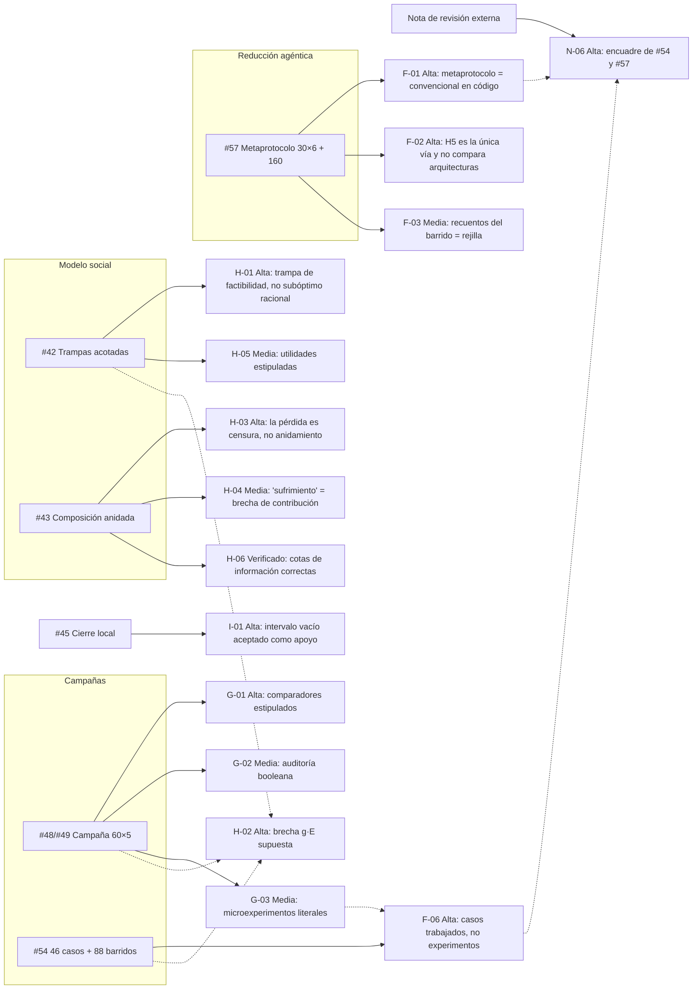
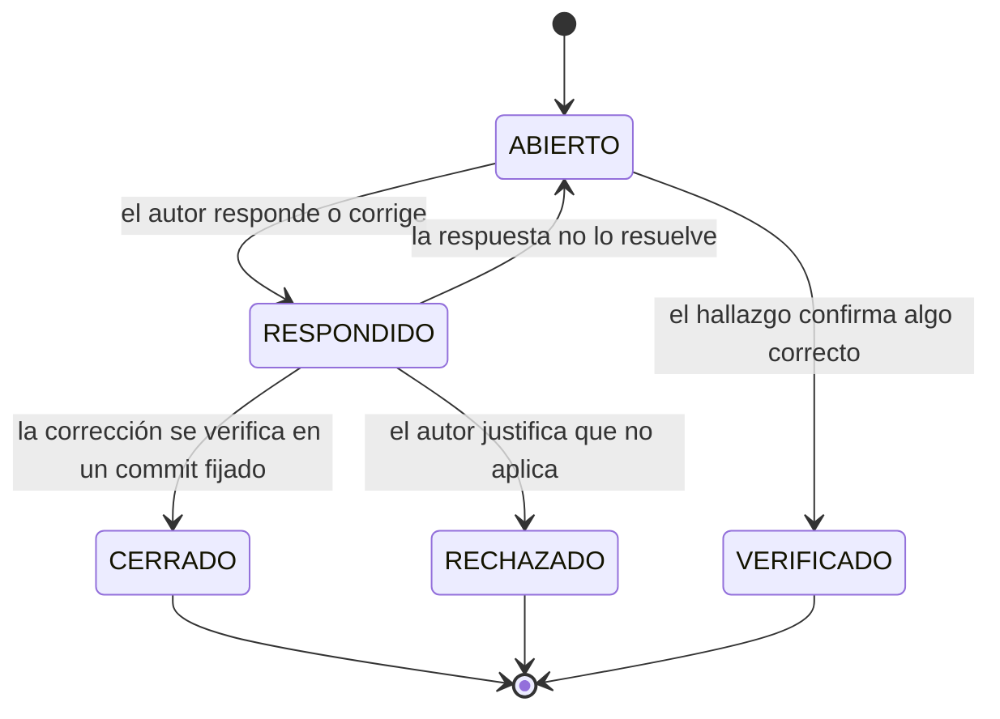
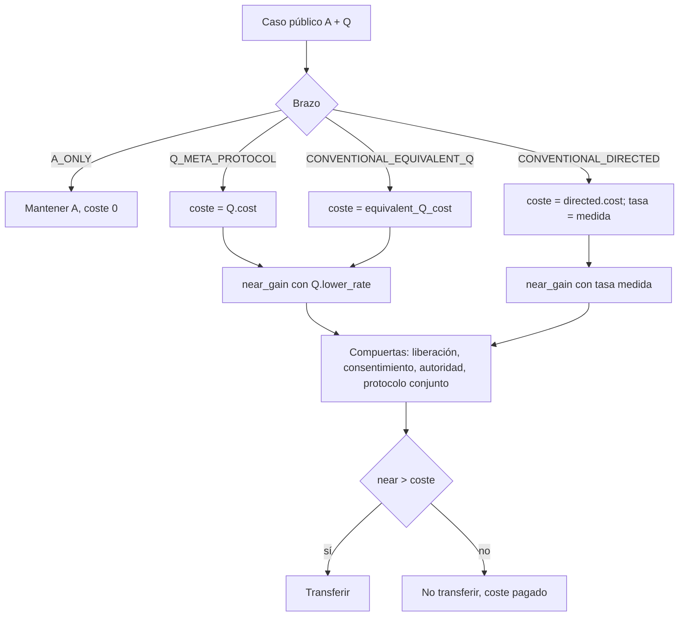
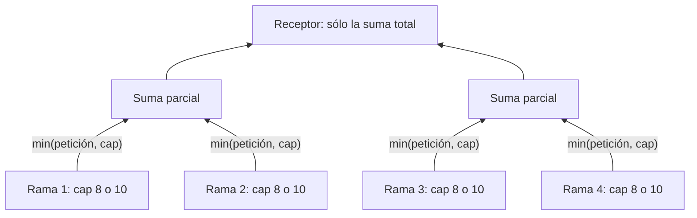

# Anexo de la auditoría incremental — ayudas visuales, propuestas y referencias

**Documento principal:** [Auditoría científica incremental](../INCREMENTAL_SCIENTIFIC_AUDIT_2026-10-26.md).
**Propósito:** que cada hallazgo deje algo utilizable en el PR auditado: una figura, una referencia que citar, una prueba que añadir o una formulación más precisa. Nada de este anexo cambia código, resultados ni canon.
**Reproducción:** todas las cifras de este anexo salen de [`audit_companion.py`](audit_companion.py) (biblioteca estándar, sin importar los estudios auditados). `python -B audit_companion.py --write` regenera [`COMPANION_RESULTS.json`](COMPANION_RESULTS.json) y las figuras de [`figures/`](figures/).

## Índice

1. [Mapa de hallazgos](#1-mapa-de-hallazgos)
2. [Figuras y vistas en tabla](#2-figuras-y-vistas-en-tabla)
3. [Propuestas ejecutables por hallazgo](#3-propuestas-ejecutables-por-hallazgo)
4. [Enriquecimiento por PR](#4-enriquecimiento-por-pr)
5. [Referencias](#5-referencias)
6. [Glosario provisional](#6-glosario-provisional)

---

## 1. Mapa de hallazgos

Cada PR auditado, con sus hallazgos y severidad. Las flechas discontinuas marcan hallazgos transversales: el mismo supuesto o el mismo patrón en varios PRs.



Ciclo de vida de un hallazgo en este registro:



## 2. Figuras y vistas en tabla

### F-01 · Dónde se separan, y dónde no, los brazos de #57



`Q_META_PROTOCOL` y `CONVENTIONAL_EQUIVALENT_Q` sólo difieren en la caja de coste. Con el precio por defecto (0,3 en ambos) producen el mismo resultado en todos los casos.

### F-03 · Barrido de 160 celdas de #57


Vista en tabla (ganador exclusivo por mitad del barrido):

| Mitad del barrido | A | Q + metaprotocolo | Convencional dirigido | Empate |
|---|---:|---:|---:|---:|
| Tasa real 0,6 (80 celdas; ninguna transferencia mejora) | 80 | 0 | 0 | 0 |
| Tasa real 2,0 (80 celdas) | 27 | 14 | 39 | 0 |
| Total publicado | 107 | 14 | 39 | 0 |
| Tasa 2,0 con el brazo equivalente al mismo precio que Q | 27 | 0 | 39 | 14 |

### F-04 · Caso AG01 completo

| Brazo | Valor neto |
|---|---:|
| A_ONLY | 10,0 |
| Q_META_PROTOCOL | 11,2 |
| CONVENTIONAL_EQUIVALENT_Q | 11,2 |
| CONVENTIONAL_DIRECTED | **12,3** (producción 13,5 = óptimo técnico) |

### G-01 · Estructura del registro de 60 casos de #48/#49

| Propiedad | Valor |
|---|---:|
| Casos adjudicables | 48 |
| Casos en que el veredicto del peer convencional es igual a la verdad | 48 |
| Casos con A completo disponible | 32 |
| De ellos, veredicto igual a la verdad | 32 |
| Casos FALSE_Q | 12 |
| De ellos, con `independent_audit = true` | 4 |
| Tablas de utilidad distintas | 1 |
| Precios del peer / de Q | 0,5–1,6 / 1,0–2,2 |

### H-02 · La brecha supuesta frente a n


| n | Densa | Estrella |
|---:|---:|---:|
| 5 | 4 % | 1,6 % |
| 10 | 9 % | 1,8 % |
| 20 | 19 % | 1,9 % |
| 40 | 39 % | 1,95 % |
| 101 | 100 % | 1,98 % |
| 102 | 101 % | 1,98 % |

### H-03 · Censura frente a anidamiento (n = 4, 16 estados ocultos)



| Observación | Informes por rama distinguibles | Sumas anidadas distinguibles |
|---|---:|---:|
| Petición 8 (censurada, como en #43) | 1 | 1 |
| Petición 10 (sin censura) | 16 | 5 |

Sólo la segunda fila aísla la pérdida atribuible a la composición: log₂16 − log₂5 ≈ 1,68 bits para n = 4.

## 3. Propuestas ejecutables por hallazgo

Bocetos mínimos, en el estilo de los estudios existentes (biblioteca estándar, deterministas). Son propuestas para que el autor las adopte o rechace; no se han añadido a ningún estudio.

### H-01 — Forma de juego para «subóptimo racional»

```python
# Caza del ciervo: la desviación unilateral es FACTIBLE pero no rentable.
PAY = {(1, 1): (5, 5), (0, 0): (4, 4), (1, 0): (0, 4), (0, 1): (4, 0)}

def is_nash(a, b):
    return PAY[(a, b)][0] >= PAY[(1 - a, b)][0] and PAY[(a, b)][1] >= PAY[(a, 1 - b)][1]

assert is_nash(0, 0) and is_nash(1, 1)          # dos equilibrios
assert PAY[(1, 1)] > PAY[(0, 0)]                # (1,1) Pareto-superior
assert (4 - 0) ** 2 > (5 - 4) ** 2              # (0,0) domina en riesgo (Harsanyi y Selten)
```

Con esto, (0,0) es un subóptimo *racional* en sentido técnico, y la dominancia en riesgo ofrece el puente natural hacia la aversión al riesgo de #46.

### F-01 / F-02 — Coste de reconfiguración por arquitectura

```python
# Hoy: overhead común a todos los brazos (physical_response).
# Propuesta: el diferencial agéntico, si existe, es exactamente esta diferencia.
OVERHEAD_BY_ARM = {"Q_META_PROTOCOL": h_agentic, "CONVENTIONAL_EQUIVALENT_Q": h_conventional}
# Ventaja en producción para la misma transferencia k: (h_conventional - h_agentic) * true_rate
```

Así el modelo hace explícito que la hipótesis agéntica es una afirmación sobre `h_conventional − h_agentic`, que debe medirse fuera del modelo (H5).

### G-01 — Veredicto derivado de la información de cada comparador

```python
# Hoy: peer["verdict"] escrito igual a la verdad en cada caso.
# Propuesta: el veredicto sale de la señal que el comparador observa, con error explícito.
def peer_verdict(signal_quality: float, truth: str, rng) -> str:
    return truth if rng.random() < signal_quality else ("ALLOW" if truth == "BLOCK" else "BLOCK")
# Barrer signal_quality para Q, peer y A completo con la MISMA semilla y la MISMA información.
```

### H-02 — Brecha derivada de un mecanismo

```python
# Hoy: gap = g * E (supuesto). Propuesta: ganancia y coste por enlace.
def realized_gap(n, topology, gain_per_link, coord_cost_per_link, b=10):
    E = n * (n - 1) // 2 if topology == "dense" else n - 1
    net = max(0.0, gain_per_link - coord_cost_per_link) * E
    return net / (b * n)   # la brecha se cierra si coord_cost_per_link >= gain_per_link
```

### H-03 — Prueba que separe censura y anidamiento

Añadir a `test_nested_model.py` una aserción del tipo de la tabla H-03: con petición 10, los informes por rama distinguen 2ⁿ estados y la suma anidada n + 1. Si el título de #43 se mantiene, esta es la prueba que lo sostiene.

### F-06 / G-03 — Convención de nombres

| Si el resultado… | Llamarlo |
|---|---|
| se sigue aritméticamente de entradas estipuladas | caso trabajado / fixture de especificación |
| comprueba que el código reproduce su propio JSON | prueba de regresión |
| puede fallar por razones que el autor del caso no fija | experimento sintético |
| compara con observaciones independientes | evidencia empírica (DDS Stage C) |

## 4. Enriquecimiento por PR

| PR | Figura o tabla que añadir | Prueba que añadir | Formulación que ajustar | Referencias que citar |
|---|---|---|---|---|
| #42 | Forma normal 2×2 con equilibrios marcados | `is_nash` y dominancia en riesgo (H-01) | «trampa de factibilidad» o «equilibrio Pareto-inferior», según el caso | Cooper y John 1988; Skyrms 2004; Arthur 1989 |
| #43 | Diagrama censura frente a anidamiento | Separación de la sección 3, H-03 | «no identificabilidad bajo observación censurada»; «brecha de desarrollo estructural» | Nahmias 1994; Hayek 1945; Simon 1962; Kushilevitz y Nisan 1997 |
| #45 | — | Contraejemplo de intersección vacía como prueba de regresión (I-01) | Rechazo estricto de `lo > hi`; tolerancia relativa si se mantiene | Shubert 1972 |
| #48/#49 | Tabla G-01 junto a la matriz 60×5 | Comparadores con calidad de señal barrida | «comprobación de la función de puntuación» | Howard 1966; Sargent 2013; Grimm et al. 2020 |
| #54 | Tabla de convención de nombres | — | «46 casos trabajados»; supuesto de uniformidad en `kl` | Cover y Thomas 2006; Shubert 1972 (cotas de Lipschitz en `closure`) |
| #57 | Figura F-03 y tabla F-04 | Brazo equivalente en el barrido; `h` por brazo | «prueba de reducción en v0.1» | Smith 1980; Bernstein et al. 2002; Howard 1966 |
| Transversal | Figura H-02 | Una única definición de brecha compartida | Declarar que #42, #49 y #54 comparten supuesto | Manski 2003 (identificación parcial) |

## 5. Referencias

Referencias para situar cada resultado en la literatura existente. Las marcadas con † se han comprobado contra una fuente bibliográfica en esta ronda; el resto son obras de referencia estándar.

| Referencia | Para qué sirve aquí | Hallazgos |
|---|---|---|
| Cooper, R. y John, A. (1988). Coordinating coordination failures in Keynesian models. *Quarterly Journal of Economics*, 103(3), 441–463.† | Equilibrios Pareto-inferiores por complementariedades estratégicas | H-01 |
| Skyrms, B. (2004). *The Stag Hunt and the Evolution of Social Structure*. Cambridge University Press. | Caza del ciervo como modelo canónico de cooperación arriesgada | H-01, #46 |
| Harsanyi, J. C. y Selten, R. (1988). *A General Theory of Equilibrium Selection in Games*. MIT Press. | Dominancia en riesgo frente a dominancia en pagos | H-01, #46 |
| Arthur, W. B. (1989). Competing technologies, increasing returns, and lock-in by historical events. *The Economic Journal*, 99(394), 116–131. | Bloqueo por dependencia de trayectoria | H-01, H-05 |
| Hayek, F. A. (1945). The use of knowledge in society. *American Economic Review*, 35(4), 519–530. | Conocimiento disperso y señales agregadas | H-03 |
| Simon, H. A. (1962). The architecture of complexity. *Proceedings of the American Philosophical Society*, 106(6), 467–482. | Sistemas jerárquicos casi descomponibles | H-03 |
| Nahmias, S. (1994). Demand estimation in lost sales inventory systems. *Naval Research Logistics*, 41(6), 739–757.† | Estimación con observaciones censuradas: el mecanismo real de #43 | H-03 |
| Kushilevitz, E. y Nisan, N. (1997). *Communication Complexity*. Cambridge University Press. | Cotas de bits de comunicación como las de H-06 | H-06 |
| Cover, T. M. y Thomas, J. A. (2006). *Elements of Information Theory* (2.ª ed.). Wiley. | Entropía, información mutua, divergencia KL | G-03, F-06 |
| Williams, P. L. y Beer, R. D. (2010). Nonnegative decomposition of multivariate information. arXiv:1004.2515.† | El XOR como caso canónico de sinergia | G-03 |
| Shubert, B. O. (1972). A sequential method seeking the global maximum of a function. *SIAM Journal on Numerical Analysis*, 9(3), 379–388.† | Cotas de Lipschitz como en `closure` | F-06 |
| Howard, R. A. (1966). Information value theory. *IEEE Transactions on Systems Science and Cybernetics*, 2(1), 22–26. | Valor de la información frente a su coste (Q, peer, A completo) | F-01, G-01 |
| Manski, C. F. (2003). *Partial Identification of Probability Distributions*. Springer. | Qué se identifica y qué no con información parcial | H-02, H-03 |
| Smith, R. G. (1980). The Contract Net Protocol. *IEEE Transactions on Computers*, C-29(12), 1104–1113. | Precedente de coordinación por contratos (ya citado en #57) | F-01 |
| Bernstein, D. S., Givan, R., Immerman, N. y Zilberstein, S. (2002). The complexity of decentralized control of Markov decision processes. *Mathematics of Operations Research*, 27(4), 819–840. | Dec-POMDP (ya citado en #57) | F-01 |
| Sargent, R. G. (2013). Verification and validation of simulation models. *Journal of Simulation*, 7(1), 12–24. | Distinción entre verificación (regresión) y validación | F-06, G-01 |
| Grimm, V. et al. (2020). The ODD protocol for describing agent-based and other simulation models: a second update. *JASSS*, 23(2), 7.† | Plantilla de descripción de modelos para la revisión externa | N-05, N-09 |

## 6. Glosario provisional

Borrador para N-08, a partir de los documentos del corpus. El autor debe confirmarlo antes de enviarlo a un revisor.

| Término | Significado en el corpus | Dónde se define |
|---|---|---|
| ACC | Agentic Citizenship Contract: perfil de participación agéntica gobernada por humanos. El «modelo auxiliar ACC» es el paquete de investigación alojado en esa línea | `01I_AGENTIC_CITIZENSHIP_CONTRACT_…`; [README del modelo auxiliar](../../README.md) |
| A / B / C / D | A: resultado de la explotación activa. B: reserva caracterizada, con base y límites de A. C: frontera de exploración aún no evaluable. D: incertidumbre residual sin vía efectiva de evaluación | `00M_ABCD_AND_MATHEMATICAL_PLAUSIBILITY_v0.8_RESEARCH_NOTE.md` |
| Q | Declaración cualificada de tipo B, acotada a una pregunta, con fuente, vigencia y cota | Estudios #48, #57 |
| 00M / 00N | Notas de investigación sobre semántica A/B/C/D y plausibilidad matemática (00M) y del mecanismo a los requisitos (00N) | `research/ecosystem-awareness/baseline/` |
| HID / 01K | Human Intelligence Debt; 01K es el perfil propietario de capacidad humana y deuda | `01K_HUMAN_INTELLIGENCE_CAPACITY_ESCALATION_AND_DEBT_PROFILE_v0.1.md` |
| DDS | Deployment Differential Study: método de evaluación con tres etapas | `DDS_CANONICAL_METHOD_INDEX_v0.1.md` |
| Stage A / B / C | A: descubrimiento de especificación. B: verificación de arquitectura. C: validación de implementación frente a ejecución y efectos observados de forma independiente | `DDS_CANONICAL_METHOD_INDEX_v0.1.md` |
| UC-21 | Caso de uso 21 del grupo FG-TIDA de la UIT, familia de desafíos sobre suficiencia de la base de decisión en composición, traspaso y cambio | Issue oficial UC-21 y DDS |
| EA | Ecosystem Awareness, la línea de investigación del corpus | `research/ecosystem-awareness/` |
| FH-C / FH-E | Hipótesis del argumento autónomo del modelo auxiliar | `model/02_ARGUMENTO_AUTONOMO.md` |


## 7. Corpus reconciliation and promotion readiness (27 October 2026)

**Contributor:** Codex, AI-assisted review requested by Iván. Use PR58 for discussion and this receiving view; use the existing owning VNext for the single literal source patch. PR59 transports those records, not a competing scientific approval or source queue.

### 7.1 What the reviews agree on, and what remains open

| Topic / existing finding | Receiving source review | Actionable conclusion |
|---|---|---|
| Empty numerical interval (I-01 / D26-F01) | [01I repair and regression companion](https://github.com/dakleyer/structural-awareness-contributions/blob/38fa9c83a898c7cfaa12151e9dff4812bebd9b10/research/ecosystem-awareness/baseline/01I_VNext.md) | Real source defect remains open. The complete two-file candidate is prepared; software checks pass, numerical policy/source adoption pending. |
| Equivalent comparator and selected-grid ranks (F-01/F-03) | PR59 D26-F03; this audit's existing arguments | Keep conditional fixture outcomes and ties visible. Identity of an algorithm is not observed independent efficacy. |
| Stipulated peer/audit fields and overlap (G-01/G-05) | PR59 source/data cross-check | Preserve all cases and lineage. A true-valued audit flag is not an independent audit, and repeated cells are not independent replication. |
| Finite information/partition results (H-06 and source lemmas) | Existing finite proofs and source-specific scopes | Retain valid conditional mathematics and its negative cases as such; do not turn it into observed deployment advantage. |
| Existing A omitted from supplementary-query selection (D26-F08) | 01I D26-C04/C05 against PR60 | New Theme18 fixture uses the corrected condition, while the original formal/caller passages still need synchronized repair. |
| UC21/DDS namespace/admission (D26-F09) | 01I D26-C06/C07 and receiving DDS VNext | Preserve native UC21 R0/R1/R2 and separate prospective DDS R1/R2/R3; require the actual failure/repair/passing-predecessor evidence. |
| Human evidence/decision reading (TAX26) | [Foundational owner](https://github.com/dakleyer/structural-awareness-contributions/blob/38fa9c83a898c7cfaa12151e9dff4812bebd9b10/research/ecosystem-awareness/baseline/01_FOUNDATIONAL_VNext.md#tax26-02--give-readers-one-operational-evidence-to-decision-distinction) and [interface owner](https://github.com/dakleyer/structural-awareness-contributions/blob/38fa9c83a898c7cfaa12151e9dff4812bebd9b10/research/ecosystem-awareness/baseline/04_GENERAL_FUNCTIONAL_INTERFACES_AGENTIC_SECURITY_VNEXT_REVIEW_AND_DELTA_v0.1_DRAFT.md#tax26-04--make-human-review-evidence-interpretable-at-if-s6) | Nine literal pairs revalidated; recommend 02/04 first without payload, schema or permission changes. |
| Newly added mathematics/overlays | Current main research route, PR57/60 | Preserve these additions. Their new proofs, fixtures, source editions and claims require their own review; old PR58 coverage is not inherited automatically. |

### 7.2 Bounded promotion selection

| Selection | Benefit / impact | Risk / effort | Exact readiness and dependency |
|---|---|---|---|
| **TAX26-02:** evidence → human understanding → sufficiency judgment → decision/execution/effect | High; makes the foundational reader dictionary operationally intelligible | Low / Low | Full unique old/new pair in its owner; source unchanged and candidate absent. Additive private preview reverses exactly. Select with 04. |
| **TAX26-04:** the same distinction at the human-review interface | High; improves interpretation of actual human-review evidence | Low / Low | Preserves IF-S6 payload and human decision ownership. Full pair in its owner; select with 02. |
| **Mathematical citation fragment repair** | Medium; restores a currently broken direct reader route | Low / Low | [Complete original/proposed paragraph](https://github.com/dakleyer/structural-awareness-contributions/blob/38fa9c83a898c7cfaa12151e9dff4812bebd9b10/architectural-contributions/ecosystem-positioning/README_VNext.md#navigation-candidate--current-mathematical-reading-route-27-october-2026). One extra hyphen; same intended theorem. Three-file private reader preview removes the one live fragment error; 17 historical snapshot reports remain classified. |
| **D26-C01 + regression companion** | High; rejects unsupported support from an empty interval | Medium / Low–Medium | [Complete predicate and test method](https://github.com/dakleyer/structural-awareness-contributions/blob/38fa9c83a898c7cfaa12151e9dff4812bebd9b10/research/ecosystem-awareness/baseline/01I_VNext.md). 60 original tests pass; 61 candidate tests with 18 adverse subcases pass; generated report equal. Select semantics and the two files together. |
| **D26-C04/05 and 06/07** | High for integrated correctness and traversal identity | Medium / Medium, with the row-only 07 change Low/Low but dependent | Fix source/caller and prose/matrix units in the still-open PR60; do not mark the original issue corrected because a new annex uses the right formulation. |

Other TAX26 pairs remain intact for subsequent selection; a current literal match is not by itself a decision to adopt. Per-arm cost mechanisms, source-accuracy estimates, human-welfare claims and new experiments remain research development, not quick editorial promotions.

### 7.3 Recheck the remedies as well as the diagnoses

**G-01 signal sketch:** the earlier peer_verdict(signal_quality, truth, rng) is a generative observation/noise model. It is not a runtime decision rule driven solely by the comparator's available evidence. Separate three roles: the generator may use hidden truth to emit a signal; the runtime comparator receives only permitted observations; the referee alone uses truth for scoring. A shared random seed is not automatically equal information. Noise/calibration parameters still require an independently justified design; randomizing a stipulated verdict does not establish real comparator performance.

**F-02/H-02 cost and gap sketches:** a declared per-arm h makes the hypothesis visible but does not measure it. Replacing g*E with (gain_per_link−coord_cost_per_link)*E still stipulates per-link economics; it does not identify a causal coordination mechanism from observations. Keep these as explicit finite models until the relevant mechanism, measurements and negative controls are specified.

**H-01 check refinement:** the displayed PAY values really are Pareto ordered. However, Python tuple “greater than” checks lexicographic order; it does not test Pareto dominance in general. For example (5,0)>(4,4) is lexicographically true but not Pareto superior. The next edition should use componentwise comparison. This is an improvement of a review example, not a claim that the displayed payoff fact is false.

**Current complete affected line:**

````python
assert PAY[(1, 1)] > PAY[(0, 0)]                # (1,1) Pareto-superior
````

**Proposed complete replacement:**

````python
assert all(x >= y for x, y in zip(PAY[(1, 1)], PAY[(0, 0)]))
assert any(x > y for x, y in zip(PAY[(1, 1)], PAY[(0, 0)]))  # Pareto improvement
````

**Glossary scope refinement:** Q is local notation, not a universal synonym for category B. Keep source-specific meanings and 00M qualification. The next reader edition can use this exact row; the earlier glossary is preserved above.

**Current complete row:**

````markdown
| Q | Declaración cualificada de tipo B, acotada a una pregunta, con fuente, vigencia y cota | Estudios #48, #57 |
````

**Proposed complete row:**

````markdown
| Q / Q_j | Study-local source/query notation. Q in #48/#57 is the declared scoped claim; Q_j in #60 is an eligible observation query. Its A/B/C/D role requires actor-, question- and time-specific 00M qualification; the variable name alone does not assign B. | Study definitions and canonical 00M v0.8 |
````

These two review-example refinements have Low risk and Low effort; the Q clarification has Medium reader impact, the assertion refinement Low. They do not change study programs or canonical taxonomy by being published here.

### 7.4 Execution and promotion receipts

For a named source wave: bind the actual source head and complete old passage, preserve its untouched predecessor, apply only the selected full pair, verify unchanged gaps by the inverse operation, run checks relevant to the change and read the published result back. Record the actual applied commit in the single owning VNext and clear its active pending status; retain the original audit and immutable predecessor. A draft PR, transferred proposal or successful document job is not that receipt. Do not close I-01 while its original source is unchanged; do not execute a candidate twice.

This continuation appends to the existing audit and annex. Current main additions and prior review content are preserved; no study, fixture, result or workflow is changed or executed by these review edits.

Publication revalidation: current main 2d9e4509447910a8541827edfc82c592d42e3520 retains the nine TAX26 target blobs and the interval-study source/test blobs unchanged. Its concurrent research additions/edits are inherited without modification; this continuation does not certify their scientific content.
