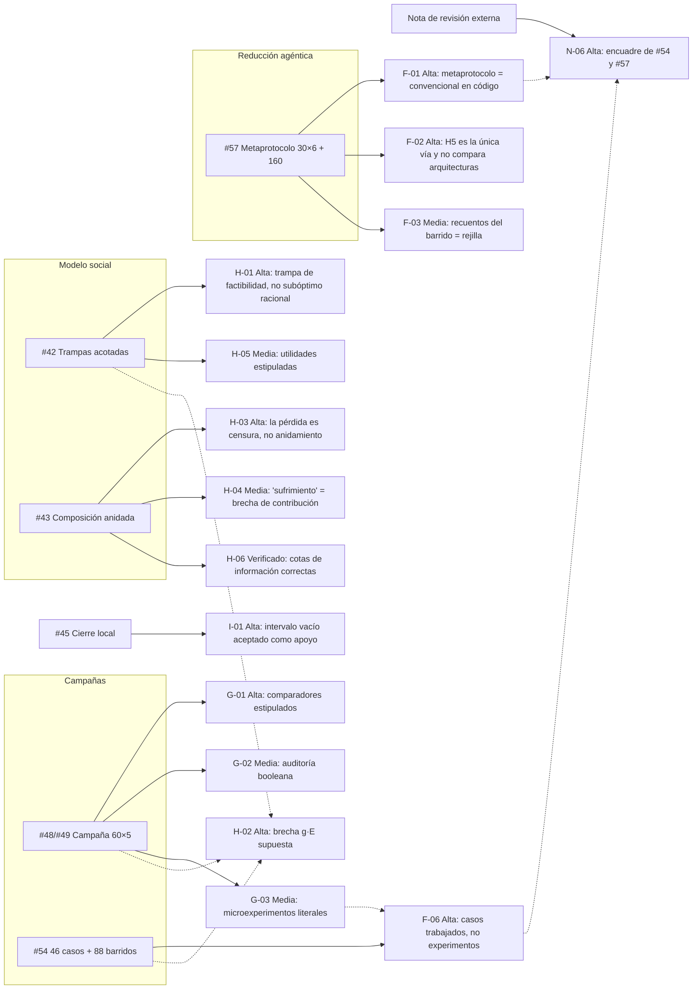
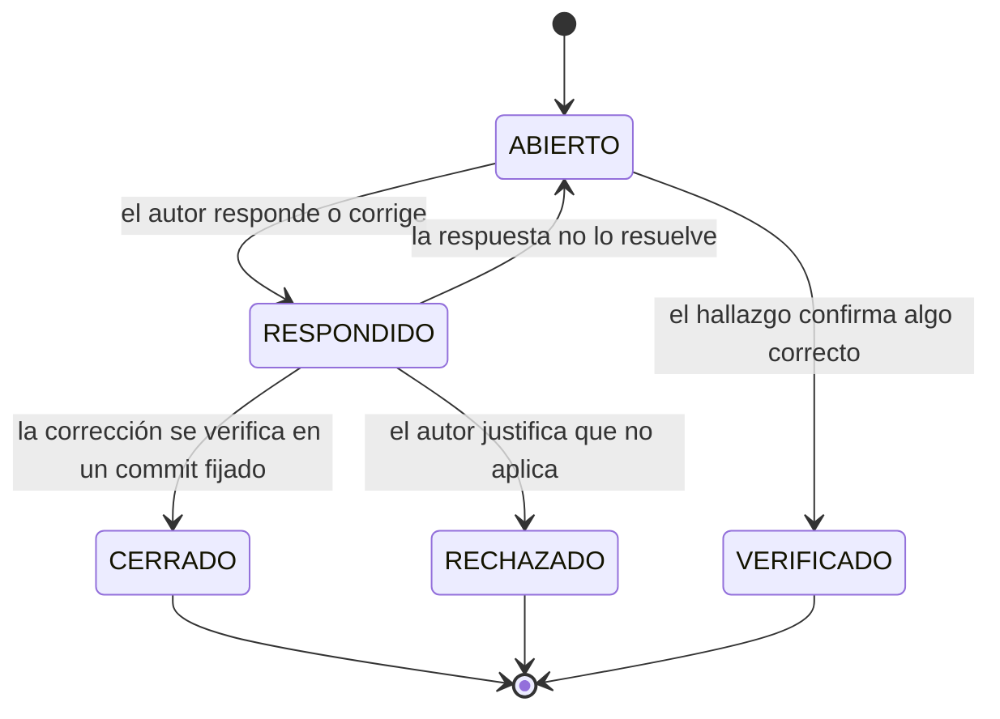
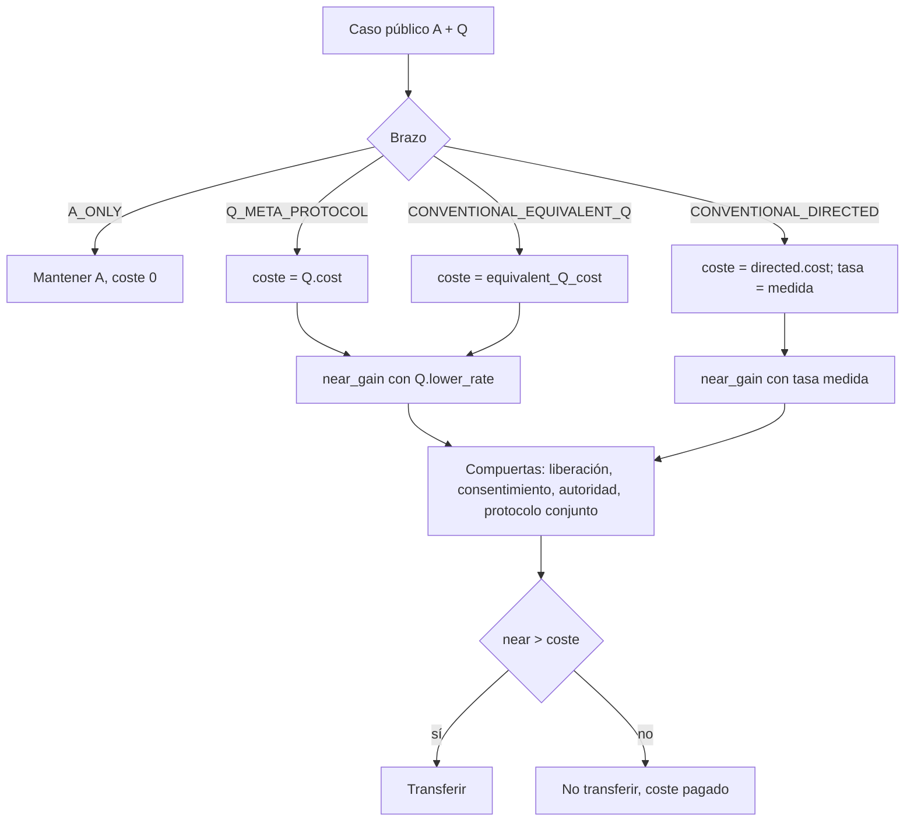
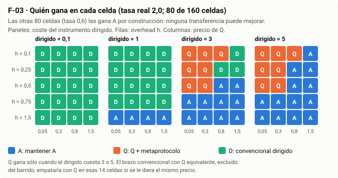
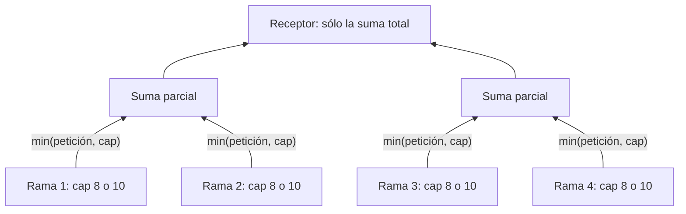

# Anexo de la auditoría incremental — ayudas visuales, propuestas y referencias

**Documento principal:** [Auditoría científica incremental](../INCREMENTAL_SCIENTIFIC_AUDIT_2026-10-26.md).
**Propósito:** que cada hallazgo deje algo utilizable en el PR auditado: una figura, una referencia que citar, una prueba que añadir o una formulación más precisa. Nada de este anexo cambia código, resultados ni canon.
**Reproducción:** todas las cifras de este anexo salen de [`audit_companion.py`](audit_companion.py) (biblioteca estándar, sin importar los estudios auditados). `python -B audit_companion.py --write` regenera [`COMPANION_RESULTS.json`](COMPANION_RESULTS.json) y las figuras de [`figures/`](figures/).

## Índice

1. [Mapa de hallazgos](#1-mapa-de-hallazgos)
2. [Figuras y vistas en tabla](#2-figuras-y-vistas-en-tabla)
3. [Propuestas ejecutables por hallazgo](#3-propuestas-ejecutables-por-hallazgo)
4. [Enriquecimiento por PR](#4-enriquecimiento-por-pr)
5. [Referencias](#5-referencias)
6. [Glosario provisional](#6-glosario-provisional)

---

## 1. Mapa de hallazgos

Cada PR auditado, con sus hallazgos y severidad. Las flechas discontinuas marcan hallazgos transversales: el mismo supuesto o el mismo patrón en varios PRs.



Ciclo de vida de un hallazgo en este registro:



## 2. Figuras y vistas en tabla

### F-01 · Dónde se separan, y dónde no, los brazos de #57



`Q_META_PROTOCOL` y `CONVENTIONAL_EQUIVALENT_Q` sólo difieren en la caja de coste. Con el precio por defecto (0,3 en ambos) producen el mismo resultado en todos los casos.

### F-03 · Barrido de 160 celdas de #57



Vista en tabla (ganador exclusivo por mitad del barrido):

| Mitad del barrido | A | Q + metaprotocolo | Convencional dirigido | Empate |
|---|---:|---:|---:|---:|
| Tasa real 0,6 (80 celdas; ninguna transferencia mejora) | 80 | 0 | 0 | 0 |
| Tasa real 2,0 (80 celdas) | 27 | 14 | 39 | 0 |
| Total publicado | 107 | 14 | 39 | 0 |
| Tasa 2,0 con el brazo equivalente al mismo precio que Q | 27 | 0 | 39 | 14 |

### F-04 · Caso AG01 completo

| Brazo | Valor neto |
|---|---:|
| A_ONLY | 10,0 |
| Q_META_PROTOCOL | 11,2 |
| CONVENTIONAL_EQUIVALENT_Q | 11,2 |
| CONVENTIONAL_DIRECTED | **12,3** (producción 13,5 = óptimo técnico) |

### G-01 · Estructura del registro de 60 casos de #48/#49

| Propiedad | Valor |
|---|---:|
| Casos adjudicables | 48 |
| Casos en que el veredicto del peer convencional es igual a la verdad | 48 |
| Casos con A completo disponible | 32 |
| De ellos, veredicto igual a la verdad | 32 |
| Casos FALSE_Q | 12 |
| De ellos, con `independent_audit = true` | 4 |
| Tablas de utilidad distintas | 1 |
| Precios del peer / de Q | 0,5–1,6 / 1,0–2,2 |

### H-02 · La brecha supuesta frente a n


| n | Densa | Estrella |
|---:|---:|---:|
| 5 | 4 % | 1,6 % |
| 10 | 9 % | 1,8 % |
| 20 | 19 % | 1,9 % |
| 40 | 39 % | 1,95 % |
| 101 | 100 % | 1,98 % |
| 102 | 101 % | 1,98 % |

### H-03 · Censura frente a anidamiento (n = 4, 16 estados ocultos)



| Observación | Informes por rama distinguibles | Sumas anidadas distinguibles |
|---|---:|---:|
| Petición 8 (censurada, como en #43) | 1 | 1 |
| Petición 10 (sin censura) | 16 | 5 |

Sólo la segunda fila aísla la pérdida atribuible a la composición: log₂16 − log₂5 ≈ 1,68 bits para n = 4.

## 3. Propuestas ejecutables por hallazgo

Bocetos mínimos, en el estilo de los estudios existentes (biblioteca estándar, deterministas). Son propuestas para que el autor las adopte o rechace; no se han añadido a ningún estudio.

### H-01 — Forma de juego para «subóptimo racional»

```python
# Caza del ciervo: la desviación unilateral es FACTIBLE pero no rentable.
PAY = {(1, 1): (5, 5), (0, 0): (4, 4), (1, 0): (0, 4), (0, 1): (4, 0)}

def is_nash(a, b):
    return PAY[(a, b)][0] >= PAY[(1 - a, b)][0] and PAY[(a, b)][1] >= PAY[(a, 1 - b)][1]

assert is_nash(0, 0) and is_nash(1, 1)          # dos equilibrios
assert PAY[(1, 1)] > PAY[(0, 0)]                # (1,1) Pareto-superior
assert (4 - 0) ** 2 > (5 - 4) ** 2              # (0,0) domina en riesgo (Harsanyi y Selten)
```

Con esto, (0,0) es un subóptimo *racional* en sentido técnico, y la dominancia en riesgo ofrece el puente natural hacia la aversión al riesgo de #46.

### F-01 / F-02 — Coste de reconfiguración por arquitectura

```python
# Hoy: overhead común a todos los brazos (physical_response).
# Propuesta: el diferencial agéntico, si existe, es exactamente esta diferencia.
OVERHEAD_BY_ARM = {"Q_META_PROTOCOL": h_agentic, "CONVENTIONAL_EQUIVALENT_Q": h_conventional}
# Ventaja en producción para la misma transferencia k: (h_conventional - h_agentic) * true_rate
```

Así el modelo hace explícito que la hipótesis agéntica es una afirmación sobre `h_conventional − h_agentic`, que debe medirse fuera del modelo (H5).

### G-01 — Veredicto derivado de la información de cada comparador

```python
# Hoy: peer["verdict"] escrito igual a la verdad en cada caso.
# Propuesta: el veredicto sale de la señal que el comparador observa, con error explícito.
def peer_verdict(signal_quality: float, truth: str, rng) -> str:
    return truth if rng.random() < signal_quality else ("ALLOW" if truth == "BLOCK" else "BLOCK")
# Barrer signal_quality para Q, peer y A completo con la MISMA semilla y la MISMA información.
```

### H-02 — Brecha derivada de un mecanismo

```python
# Hoy: gap = g * E (supuesto). Propuesta: ganancia y coste por enlace.
def realized_gap(n, topology, gain_per_link, coord_cost_per_link, b=10):
    E = n * (n - 1) // 2 if topology == "dense" else n - 1
    net = max(0.0, gain_per_link - coord_cost_per_link) * E
    return net / (b * n)   # la brecha se cierra si coord_cost_per_link >= gain_per_link
```

### H-03 — Prueba que separe censura y anidamiento

Añadir a `test_nested_model.py` una aserción del tipo de la tabla H-03: con petición 10, los informes por rama distinguen 2ⁿ estados y la suma anidada n + 1. Si el título de #43 se mantiene, esta es la prueba que lo sostiene.

### F-06 / G-03 — Convención de nombres

| Si el resultado… | Llamarlo |
|---|---|
| se sigue aritméticamente de entradas estipuladas | caso trabajado / fixture de especificación |
| comprueba que el código reproduce su propio JSON | prueba de regresión |
| puede fallar por razones que el autor del caso no fija | experimento sintético |
| compara con observaciones independientes | evidencia empírica (DDS Stage C) |

## 4. Enriquecimiento por PR

| PR | Figura o tabla que añadir | Prueba que añadir | Formulación que ajustar | Referencias que citar |
|---|---|---|---|---|
| #42 | Forma normal 2×2 con equilibrios marcados | `is_nash` y dominancia en riesgo (H-01) | «trampa de factibilidad» o «equilibrio Pareto-inferior», según el caso | Cooper y John 1988; Skyrms 2004; Arthur 1989 |
| #43 | Diagrama censura frente a anidamiento | Separación de la sección 3, H-03 | «no identificabilidad bajo observación censurada»; «brecha de desarrollo estructural» | Nahmias 1994; Hayek 1945; Simon 1962; Kushilevitz y Nisan 1997 |
| #45 | — | Contraejemplo de intersección vacía como prueba de regresión (I-01) | Rechazo estricto de `lo > hi`; tolerancia relativa si se mantiene | Shubert 1972 |
| #48/#49 | Tabla G-01 junto a la matriz 60×5 | Comparadores con calidad de señal barrida | «comprobación de la función de puntuación» | Howard 1966; Sargent 2013; Grimm et al. 2020 |
| #54 | Tabla de convención de nombres | — | «46 casos trabajados»; supuesto de uniformidad en `kl` | Cover y Thomas 2006; Shubert 1972 (cotas de Lipschitz en `closure`) |
| #57 | Figura F-03 y tabla F-04 | Brazo equivalente en el barrido; `h` por brazo | «prueba de reducción en v0.1» | Smith 1980; Bernstein et al. 2002; Howard 1966 |
| Transversal | Figura H-02 | Una única definición de brecha compartida | Declarar que #42, #49 y #54 comparten supuesto | Manski 2003 (identificación parcial) |

## 5. Referencias

Referencias para situar cada resultado en la literatura existente. Las marcadas con † se han comprobado contra una fuente bibliográfica en esta ronda; el resto son obras de referencia estándar.

| Referencia | Para qué sirve aquí | Hallazgos |
|---|---|---|
| Cooper, R. y John, A. (1988). Coordinating coordination failures in Keynesian models. *Quarterly Journal of Economics*, 103(3), 441–463.† | Equilibrios Pareto-inferiores por complementariedades estratégicas | H-01 |
| Skyrms, B. (2004). *The Stag Hunt and the Evolution of Social Structure*. Cambridge University Press. | Caza del ciervo como modelo canónico de cooperación arriesgada | H-01, #46 |
| Harsanyi, J. C. y Selten, R. (1988). *A General Theory of Equilibrium Selection in Games*. MIT Press. | Dominancia en riesgo frente a dominancia en pagos | H-01, #46 |
| Arthur, W. B. (1989). Competing technologies, increasing returns, and lock-in by historical events. *The Economic Journal*, 99(394), 116–131. | Bloqueo por dependencia de trayectoria | H-01, H-05 |
| Hayek, F. A. (1945). The use of knowledge in society. *American Economic Review*, 35(4), 519–530. | Conocimiento disperso y señales agregadas | H-03 |
| Simon, H. A. (1962). The architecture of complexity. *Proceedings of the American Philosophical Society*, 106(6), 467–482. | Sistemas jerárquicos casi descomponibles | H-03 |
| Nahmias, S. (1994). Demand estimation in lost sales inventory systems. *Naval Research Logistics*, 41(6), 739–757.† | Estimación con observaciones censuradas: el mecanismo real de #43 | H-03 |
| Kushilevitz, E. y Nisan, N. (1997). *Communication Complexity*. Cambridge University Press. | Cotas de bits de comunicación como las de H-06 | H-06 |
| Cover, T. M. y Thomas, J. A. (2006). *Elements of Information Theory* (2.ª ed.). Wiley. | Entropía, información mutua, divergencia KL | G-03, F-06 |
| Williams, P. L. y Beer, R. D. (2010). Nonnegative decomposition of multivariate information. arXiv:1004.2515.† | El XOR como caso canónico de sinergia | G-03 |
| Shubert, B. O. (1972). A sequential method seeking the global maximum of a function. *SIAM Journal on Numerical Analysis*, 9(3), 379–388.† | Cotas de Lipschitz como en `closure` | F-06 |
| Howard, R. A. (1966). Information value theory. *IEEE Transactions on Systems Science and Cybernetics*, 2(1), 22–26. | Valor de la información frente a su coste (Q, peer, A completo) | F-01, G-01 |
| Manski, C. F. (2003). *Partial Identification of Probability Distributions*. Springer. | Qué se identifica y qué no con información parcial | H-02, H-03 |
| Smith, R. G. (1980). The Contract Net Protocol. *IEEE Transactions on Computers*, C-29(12), 1104–1113. | Precedente de coordinación por contratos (ya citado en #57) | F-01 |
| Bernstein, D. S., Givan, R., Immerman, N. y Zilberstein, S. (2002). The complexity of decentralized control of Markov decision processes. *Mathematics of Operations Research*, 27(4), 819–840. | Dec-POMDP (ya citado en #57) | F-01 |
| Sargent, R. G. (2013). Verification and validation of simulation models. *Journal of Simulation*, 7(1), 12–24. | Distinción entre verificación (regresión) y validación | F-06, G-01 |
| Grimm, V. et al. (2020). The ODD protocol for describing agent-based and other simulation models: a second update. *JASSS*, 23(2), 7.† | Plantilla de descripción de modelos para la revisión externa | N-05, N-09 |

## 6. Glosario provisional

Borrador para N-08, a partir de los documentos del corpus. El autor debe confirmarlo antes de enviarlo a un revisor.

| Término | Significado en el corpus | Dónde se define |
|---|---|---|
| ACC | Agentic Citizenship Contract: perfil de participación agéntica gobernada por humanos. El «modelo auxiliar ACC» es el paquete de investigación alojado en esa línea | `01I_AGENTIC_CITIZENSHIP_CONTRACT_…`; [README del modelo auxiliar](../../README.md) |
| A / B / C / D | A: resultado de la explotación activa. B: reserva caracterizada, con base y límites de A. C: frontera de exploración aún no evaluable. D: incertidumbre residual sin vía efectiva de evaluación | `00M_ABCD_AND_MATHEMATICAL_PLAUSIBILITY_v0.8_RESEARCH_NOTE.md` |
| Q | Declaración cualificada de tipo B, acotada a una pregunta, con fuente, vigencia y cota | Estudios #48, #57 |
| 00M / 00N | Notas de investigación sobre semántica A/B/C/D y plausibilidad matemática (00M) y del mecanismo a los requisitos (00N) | `research/ecosystem-awareness/baseline/` |
| HID / 01K | Human Intelligence Debt; 01K es el perfil propietario de capacidad humana y deuda | `01K_HUMAN_INTELLIGENCE_CAPACITY_ESCALATION_AND_DEBT_PROFILE_v0.1.md` |
| DDS | Deployment Differential Study: método de evaluación con tres etapas | `DDS_CANONICAL_METHOD_INDEX_v0.1.md` |
| Stage A / B / C | A: descubrimiento de especificación. B: verificación de arquitectura. C: validación de implementación frente a ejecución y efectos observados de forma independiente | `DDS_CANONICAL_METHOD_INDEX_v0.1.md` |
| UC-21 | Caso de uso 21 del grupo FG-TIDA de la UIT, familia de desafíos sobre suficiencia de la base de decisión en composición, traspaso y cambio | Issue oficial UC-21 y DDS |
| EA | Ecosystem Awareness, la línea de investigación del corpus | `research/ecosystem-awareness/` |
| FH-C / FH-E | Hipótesis del argumento autónomo del modelo auxiliar | `model/02_ARGUMENTO_AUTONOMO.md` |


## 7. Corpus reconciliation and promotion readiness (27 October 2026)

**Contributor:** Codex, AI-assisted review requested by Iván. Use PR58 for discussion and this receiving view; use the existing owning VNext for the single literal source patch. PR59 transports those records, not a competing scientific approval or source queue.

### 7.1 What the reviews agree on, and what remains open

| Topic / existing finding | Receiving source review | Actionable conclusion |
|---|---|---|
| Empty numerical interval (I-01 / D26-F01) | [01I repair and regression companion](https://github.com/dakleyer/structural-awareness-contributions/blob/38fa9c83a898c7cfaa12151e9dff4812bebd9b10/research/ecosystem-awareness/baseline/01I_VNext.md) | Real source defect remains open. The complete two-file candidate is prepared; software checks pass, numerical policy/source adoption pending. |
| Equivalent comparator and selected-grid ranks (F-01/F-03) | PR59 D26-F03; this audit's existing arguments | Keep conditional fixture outcomes and ties visible. Identity of an algorithm is not observed independent efficacy. |
| Stipulated peer/audit fields and overlap (G-01/G-05) | PR59 source/data cross-check | Preserve all cases and lineage. A true-valued audit flag is not an independent audit, and repeated cells are not independent replication. |
| Finite information/partition results (H-06 and source lemmas) | Existing finite proofs and source-specific scopes | Retain valid conditional mathematics and its negative cases as such; do not turn it into observed deployment advantage. |
| Existing A omitted from supplementary-query selection (D26-F08) | 01I D26-C04/C05 against PR60 | New Theme18 fixture uses the corrected condition, while the original formal/caller passages still need synchronized repair. |
| UC21/DDS namespace/admission (D26-F09) | 01I D26-C06/C07 and receiving DDS VNext | Preserve native UC21 R0/R1/R2 and separate prospective DDS R1/R2/R3; require the actual failure/repair/passing-predecessor evidence. |
| Human evidence/decision reading (TAX26) | [Foundational owner](https://github.com/dakleyer/structural-awareness-contributions/blob/38fa9c83a898c7cfaa12151e9dff4812bebd9b10/research/ecosystem-awareness/baseline/01_FOUNDATIONAL_VNext.md#tax26-02--give-readers-one-operational-evidence-to-decision-distinction) and [interface owner](https://github.com/dakleyer/structural-awareness-contributions/blob/38fa9c83a898c7cfaa12151e9dff4812bebd9b10/research/ecosystem-awareness/baseline/04_GENERAL_FUNCTIONAL_INTERFACES_AGENTIC_SECURITY_VNEXT_REVIEW_AND_DELTA_v0.1_DRAFT.md#tax26-04--make-human-review-evidence-interpretable-at-if-s6) | Nine literal pairs revalidated; recommend 02/04 first without payload, schema or permission changes. |
| Newly added mathematics/overlays | Current main research route, PR57/60 | Preserve these additions. Their new proofs, fixtures, source editions and claims require their own review; old PR58 coverage is not inherited automatically. |

### 7.2 Bounded promotion selection

| Selection | Benefit / impact | Risk / effort | Exact readiness and dependency |
|---|---|---|---|
| **TAX26-02:** evidence → human understanding → sufficiency judgment → decision/execution/effect | High; makes the foundational reader dictionary operationally intelligible | Low / Low | Full unique old/new pair in its owner; source unchanged and candidate absent. Additive private preview reverses exactly. Select with 04. |
| **TAX26-04:** the same distinction at the human-review interface | High; improves interpretation of actual human-review evidence | Low / Low | Preserves IF-S6 payload and human decision ownership. Full pair in its owner; select with 02. |
| **Mathematical citation fragment repair** | Medium; restores a currently broken direct reader route | Low / Low | [Complete original/proposed paragraph](https://github.com/dakleyer/structural-awareness-contributions/blob/38fa9c83a898c7cfaa12151e9dff4812bebd9b10/architectural-contributions/ecosystem-positioning/README_VNext.md#navigation-candidate--current-mathematical-reading-route-27-october-2026). One extra hyphen; same intended theorem. Three-file private reader preview removes the one live fragment error; 17 historical snapshot reports remain classified. |
| **D26-C01 + regression companion** | High; rejects unsupported support from an empty interval | Medium / Low–Medium | [Complete predicate and test method](https://github.com/dakleyer/structural-awareness-contributions/blob/38fa9c83a898c7cfaa12151e9dff4812bebd9b10/research/ecosystem-awareness/baseline/01I_VNext.md). 60 original tests pass; 61 candidate tests with 18 adverse subcases pass; generated report equal. Select semantics and the two files together. |
| **D26-C04/05 and 06/07** | High for integrated correctness and traversal identity | Medium / Medium, with the row-only 07 change Low/Low but dependent | Fix source/caller and prose/matrix units in the still-open PR60; do not mark the original issue corrected because a new annex uses the right formulation. |

Other TAX26 pairs remain intact for subsequent selection; a current literal match is not by itself a decision to adopt. Per-arm cost mechanisms, source-accuracy estimates, human-welfare claims and new experiments remain research development, not quick editorial promotions.

### 7.3 Recheck the remedies as well as the diagnoses

**G-01 signal sketch:** the earlier peer_verdict(signal_quality, truth, rng) is a generative observation/noise model. It is not a runtime decision rule driven solely by the comparator's available evidence. Separate three roles: the generator may use hidden truth to emit a signal; the runtime comparator receives only permitted observations; the referee alone uses truth for scoring. A shared random seed is not automatically equal information. Noise/calibration parameters still require an independently justified design; randomizing a stipulated verdict does not establish real comparator performance.

**F-02/H-02 cost and gap sketches:** a declared per-arm h makes the hypothesis visible but does not measure it. Replacing g*E with (gain_per_link−coord_cost_per_link)*E still stipulates per-link economics; it does not identify a causal coordination mechanism from observations. Keep these as explicit finite models until the relevant mechanism, measurements and negative controls are specified.

**H-01 check refinement:** the displayed PAY values really are Pareto ordered. However, Python tuple “greater than” checks lexicographic order; it does not test Pareto dominance in general. For example (5,0)>(4,4) is lexicographically true but not Pareto superior. The next edition should use componentwise comparison. This is an improvement of a review example, not a claim that the displayed payoff fact is false.

**Current complete affected line:**

````python
assert PAY[(1, 1)] > PAY[(0, 0)]                # (1,1) Pareto-superior
````

**Proposed complete replacement:**

````python
assert all(x >= y for x, y in zip(PAY[(1, 1)], PAY[(0, 0)]))
assert any(x > y for x, y in zip(PAY[(1, 1)], PAY[(0, 0)]))  # Pareto improvement
````

**Glossary scope refinement:** Q is local notation, not a universal synonym for category B. Keep source-specific meanings and 00M qualification. The next reader edition can use this exact row; the earlier glossary is preserved above.

**Current complete row:**

````markdown
| Q | Declaración cualificada de tipo B, acotada a una pregunta, con fuente, vigencia y cota | Estudios #48, #57 |
````

**Proposed complete row:**

````markdown
| Q / Q_j | Study-local source/query notation. Q in #48/#57 is the declared scoped claim; Q_j in #60 is an eligible observation query. Its A/B/C/D role requires actor-, question- and time-specific 00M qualification; the variable name alone does not assign B. | Study definitions and canonical 00M v0.8 |
````

These two review-example refinements have Low risk and Low effort; the Q clarification has Medium reader impact, the assertion refinement Low. They do not change study programs or canonical taxonomy by being published here.

### 7.4 Execution and promotion receipts

For a named source wave: bind the actual source head and complete old passage, preserve its untouched predecessor, apply only the selected full pair, verify unchanged gaps by the inverse operation, run checks relevant to the change and read the published result back. Record the actual applied commit in the single owning VNext and clear its active pending status; retain the original audit and immutable predecessor. A draft PR, transferred proposal or successful document job is not that receipt. Do not close I-01 while its original source is unchanged; do not execute a candidate twice.

This continuation appends to the existing audit and annex. Current main additions and prior review content are preserved; no study, fixture, result or workflow is changed or executed by these review edits.

Publication revalidation: current main 2d9e4509447910a8541827edfc82c592d42e3520 retains the nine TAX26 target blobs and the interval-study source/test blobs unchanged. Its concurrent research additions/edits are inherited without modification; this continuation does not certify their scientific content.


## 8. Mathematical review and development opportunities

**Recepción de la ronda 8 · Codex, asistencia de IA a petición de Iván.** El registro de hallazgos y estados de recepción está en la [ronda 8 de la auditoría](../INCREMENTAL_SCIENTIFIC_AUDIT_2026-10-26.md#ronda-8). Esta sección desarrolla la evidencia nueva y las oportunidades; conserva literalmente todo el anexo previo. Las formulaciones siguientes son propuestas de investigación y de corrección, no cambios ya adoptados.

### 8.1 Correcciones a la lectura de auditoría

**M27-09 — generalización del control de implementación.** En PR57, Q_META_PROTOCOL y CONVENTIONAL_EQUIVALENT_Q entran por la misma rama de plan_public, líneas144–148; se cambia el precio declarado del instrumento. El test AG01 verifica salida y valor neto iguales con el mismo precio. Es una comprobación de la reproducción de ese mecanismo ya proporcionado. No mide cómo se descubre Q, cómo se selecciona una adaptación ni el coste completo de obtenerla.

La Parte I §8, en el corte 891af45a75b245082859147c0f7233cf85dd9035, distingue descubrir, seleccionar, compilar y ejecutar. También establece que quien efectúa el mismo metarazonamiento implementa funcionalmente esa arquitectura cualquiera que sea su nombre. Esta distinción forma parte del argumento y debe conservarse al interpretar F-01. No se exige que la aportación sea imposible de programar en software ordinario.

Mi frase del chat que presentó una conclusión general se retira como extrapolación del revisor. La última frase de SA-O2 §3 merece una precisión editorial local. **Fuente objetivo sin modificar:** [SA-O2](https://github.com/dakleyer/structural-awareness-contributions/blob/891af45a75b245082859147c0f7233cf85dd9035/research/structural-awareness/SA_OPERATIONAL_RESIDUAL_AND_ONLINE_CONTEXT_PLASTICITY_v0.1.md#L40).

**Antes, oración completa:**

> An ordinary controller retaining identical information ties.

**Después, oración de sustitución propuesta, no aplicada:**

> Retaining the same qualified distinctions permits the same target discrimination when a suitable decoder is effectively available. Reproducing the same decision procedure can reproduce its decisions; equal net utility additionally requires the relevant costs and conditions to match. This does not evaluate discovery, selection or adaptation effort, whose distinction from execution is stated in Part I §8.

**Efecto, riesgo y recepción:** precisión del alcance informativo, sin cambiar la prueba por fibras; impacto lector alto, esfuerzo bajo. La edición de la fuente necesita su propietario y ruta de revisión, no se aplica desde este anexo. No se borran F-01 ni sus estados históricos: se corrige la inferencia general que yo había añadido.

**M27-06 — navegación.** La política actual DC-GH-01 v1.0.3 admite materiales subordinados/opcionales y conciliación progresiva de roles. La mera ausencia de una fila individual no demuestra incumplimiento. Se conserva como tarea de identidad/navegación; mi anterior alegación genérica se retira. No se altera el registro ni se inventa el rol de los documentos.

### 8.2 Consistencia conjunta, intervalo vacío y selección suplementaria

**M27-01, contraejemplo nuevo.** Frame de ámbito scope, revisión v1, evidencia vigente, regularidad cualificada L=1. Dos registros de origen distinto declaran f(0)=0 y f(0)=2. En q=1 sus envolventes son [−1,1] y [1,3], así que la intersección local es [1,1]. La implementación devuelve LOCALLY_SUPPORTED_TRUE para f(1)≥1. Pero el conjunto de funciones que satisfacen ambas observaciones es vacío.

Esto muestra una obligación distinta de I-01: rechazar estrictamente lo>hi en el punto consultado conserva [1,1] y no detecta la incompatibilidad en x=0. El control positivo f(0)=0,f(1)=1 mantiene una función 1-Lipschitz y debe conservar su respuesta.

Para un **submodelo de coordenadas exactas**, intervalos [l_i,u_i] y una métrica d, existe una función L-Lipschitz compatible si y solo si todos los intervalos son propios y l_i≤u_j+L d(x_i,x_j) para todo i,j. Necesidad: aplicar la condición Lipschitz a cada par. Suficiencia: f(x)=max_i(l_i−L d(x_i,x)) es L-Lipschitz, f(x_j)≥l_j y las desigualdades garantizan f(x_j)≤u_j. Este es un candidato de contrato comprobable para ese submodelo.

**Límite del remedio:** el código también admite x_i inciertos. La prueba anterior no resuelve automáticamente su semántica, correlaciones ni factibilidad conjunta; hay que fijar esos cuantificadores antes de ofrecer un reemplazo general. Alternativamente, el informe puede declarar explícitamente que solo ha calculado una envolvente local, sin certificar existencia conjunta. Las fuentes siguen sin autenticación criptográfica. No se parchea la función en esta ronda.

**M27-02:** el acompañante reproduce la segunda entrada [1e-13,0] y el estado positivo, manteniendo su identidad I-01/D26-F01. El candidato de intervalo estricto sigue en 01I VNext; la nueva prueba conjunta debe añadirse a su alcance antes de afirmar que resuelve ambas cuestiones.

**M27-03, cuatro mundos.** X={0,1,2,3}; o(x)=⌊x/2⌋, r(x)=x y Q(x)=x mod2. Q sola deja sin separar (0,2) y (1,3). Tras observar o, solo quedan (0,1) y (2,3), ambos separados por Q. Para selección **suplementaria**, usar:

```text
U_(r|o) = {{x,y}: o(x)=o(y), r(x) != r(y)}
C_j^(o) = {{x,y} in U_(r|o): Q_j(x) != Q_j(y)}
```

D3 es correcto para la selección basada en Q sola; no se retira. El problema es su aplicación como complemento de una observación ya disponible. Los candidatos D26-C04/05 y sus propietarios siguen siendo la única propuesta de integración.

**M27-07:** un evento con cuatro valores (.9,.85,.8,.95), capturado antes de admisión pero sin first_capture_observer_id, puede cualificarse y producir salida11,5 con regla emitida. El hallazgo concierne la obligación de procedencia. Si esa identidad es opcional, hay que presentarla como desconocida; no inferirla ni borrar el evento para aparentar completitud.

**M27-08:** para D(n)=n(1−q^(n−1)), la fórmula q^(n−2)(1−q)((1+q)−n(1−q)) corresponde a D(n+1)−2D(n)+D(n−1). Si un consumidor define segunda diferencia como D(n)−2D(n−1)+D(n−2), debe desplazar el índice. En n=19,q=.9 la diferencia numérica es visible. Es una propuesta de coherencia de notación, no un nuevo mecanismo económico.

### 8.3 Ecuaciones y alcance de las fuentes releídas

**M27-05, R12.** Original: [TeX de 10 agosto2025](https://drive.google.com/file/d/1pAylPfeN4KkZiOzp-7UYX8peNvnlFtV2/view), 10.822 bytes, SHA256 cd17979d580d92076ff49a9e39ef7a84b4782e11810b54ffe58f3b7889615bbb. El expediente individual ya distingue el TeX anónimo, su render temporal de cinco páginas, R11 firmado y adaptación posterior a certificados. No se registra como error del expediente una distinción que ya conserva.

El ejemplo fuente 7+5(1−.4)=10 se refiere a divisiones homogéneas. Para reutilizar verificaciones reales hacen falta pesos de coste, prueba de elegibilidad y costes de renovación/coordinación. La fórmula de von Neumann en la línea133 iguala la entropía espectral a una suma de solapamientos de autovectores con Ω. Para una base ortonormal fija, esa suma con Ω fija no cambia al variar el espectro, mientras la entropía sí. Una identidad general necesitaría construir y justificar pesos/asignaciones dependientes del estado. Este contraste no refuta una asignación libre distinta para cada estado, ni la línea más estrecha de reutilización de verificación.

**M27-10, R19.** [Original](https://drive.google.com/file/d/1kjoTgijyzpQsWXUSkZesOLFr4qaPs4L2/view), §4.1, ecuación(4), página4, cotejada visualmente: Ṡ=rS−q(H−S). Para r,q,H>0, el equilibrio es S*=qH/(r+q), pero S(t)−S*=e^((r+q)t)(S(0)−S*). Es inestable; en 0 el campo es −qH y en H es rH, así que el intervalo no es invariante. Ṡ=q(H−S)−rS invierte la realimentación: entonces V=(S−S*)² tiene V̇=−2(r+q)V y el intervalo queda invariante. Ese cambio constituye un modelo propuesto distinto, cuya interpretación física debe justificarse otra vez.

**M27-11/12, ventanas.** Fuentes: [Minimal Proof](https://drive.google.com/file/d/1PpwYraPHiFoOaat_ZeP2Pw5dk-d5y1Fg/view) y [Ordered Multiscale Decoupling](https://drive.google.com/file/d/1wev5ifF7qTS8OJfna47igLwXYE0oSNfT/view), lectura focal de supuestos y proposiciones.

1. Una representación enriquecida permite reproducir las políticas anteriores y puede mejorar el **óptimo alcanzable**. Eso no demuestra que todo estimador fijo mejore al cambiar su entrada/contexto. Con muestras independientes de varianza1, diez actuales y noventa anteriores de media distinta Δ, la media actual tiene MSE=.1 y la conjunta .01+(.9Δ)². Para Δ=.1 la conjunta es mejor; para Δ=1 es peor. El sesgo no determina por sí solo el riesgo total. La Parte II actual ya usa formulaciones de políticas y condiciones de sesgo–varianza.
2. A2 permite acumular instancias anteriores **del mismo tipo**. Sea θ∈{0,1} con prior1/2. Una observación actual X y otra antigua del mismo tipo Z son independientes dado θ y cada una acierta θ con probabilidad.75. P(θ=1|X=1)=.75; P(θ=1|X=Z=1)=.9. Pueden estar separadas por un régimen de otro tipo. La ventana contigua actual no es entonces suficiente respecto de toda la historia. Para concluirlo hay que conservar la historia pertinente del mismo tipo o exigir su irrelevancia condicional.
3. La igualdad de posterior es suficiencia exacta; alcanzar riesgo por debajo de una tolerancia es adecuación práctica para una pérdida y tarea. No son definiciones intercambiables.
4. A3 ya supone estimabilidad por debajo de tolerancia. Una búsqueda finita permite elegir un mínimo si la familia factible no está vacía; no prueba por sí misma que el régimen actual ya contenga suficientes muestras ni que el anclaje encontrado sea verdadero.

**M27-14, D28.** [Fuente](https://tegrity.ai/1379-2/), Prop.3. Estados equiprobables, inacción=(0,0), acción segura=(0,1), otra acción=(−1,100). La segura satisface no-inferioridad frente a inacción. No domina a la otra en el segundo estado y su esperanza.5 es menor que49.5. Se conserva el contrato estricto de seguridad; para afirmar dominancia entre arquitecturas hace falta otro argumento sobre sus políticas, acciones y criterio.

**M27-15/16, D34.** [Fuente](https://tegrity.ai/structural-limits-of-current-ai-integrity-under-regime-change/). Una trayectoria de distribuciones puede salir de la región certificada y volver. Tampoco una tasa de llegada superior a servicio durante un intervalo implica crecimiento ilimitado. La revisión requiere validez indexada en tiempo y condiciones sobre duración, acumulado, servicio y plazos.

**M27-17/18/19, D37.** [Fuente](https://tegrity.ai/evolution-of-regime-awareness-capability/). El texto leído ya explicita P(A)P(P|A), su relación con la intersección y la severidad; esa aclaración no se trata como defecto vigente. Las configuraciones por poda/amplificación requieren una dinámica para llamarse atractores estables. Las ecuaciones afines/cuadráticas de precio requieren unidades, dominio y regla de elección de raíz. En el caso afín (b+d)x=c−a; si b+d=0 y c≠a no hay raíz, mientras que si también c=a todas las x satisfacen la igualdad.

Las fuentes web y Drive son instantáneas de lectura del27octubre; una edición posterior debe revalidar el hallazgo correspondiente. No se publican aquí sus originales completos ni se cambian sus permisos.

### 8.4 Desarrollos matemáticos propuestos

**M27-O1 — suficiencia dinámica.** En un modo fijo m, X abierto, h:X→h(X) submersión C² y F_m C¹, inputs u(t) comunes y soluciones únicas dentro del dominio: existe g_m C¹ con ẏ=g_m(y,u), y=h(x), que representa toda la dinámica observada si y solo si:

```text
h(x)=h(x')  =>  Dh(x)F_m(x,u)=Dh(x')F_m(x',u), para todo u.
```

Necesidad por regla de la cadena. Suficiencia definiendo g con cualquier representante; la condición lo hace independiente del representante y las secciones locales de la submersión aportan regularidad. Unicidad identifica las trayectorias. Este es un resultado clásico de proyección/lumping; una pregunta particular puede necesitar menos que la reducción completa.

Ejemplo: ẋ1=−a x1+κx2+u, ẋ2=−b x2, a,b>0, h=x1. Los autovalores siguen siendo −a,−b. Para κ=0 el resumen es cerrado; para κ≠0 dos estados con igual x1 y distinto x2 dan distinta derivada. Con a=b=κ=1, u=0, estados(0,±1), y±(t)=±te^(−t). A t=1, la pregunta y>.2 tiene respuestas opuestas con igual observación inicial. La historia ideal con modelo conocido puede recuperar x2=(ẏ+a y−u)/κ: el ejemplo no demuestra invisibilidad permanente.

Antecedente primario: [Li y Rabitz, exact lumping](https://doi.org/10.1016/0009-2509(89)85014-6). La posible aportación es el contrato temporal con fuentes, perspectivas, dominio y preguntas, no apropiarse del teorema clásico.

**M27-O2 — error y vigencia.** Si ẏ=g(y,u)+d(t), ||d(t)||≤ε(t), g es L-Lipschitz con L≥0 y la reducción ŷ comienza en el mismo estado, entonces:

```text
||y(t)-yhat(t)|| <= integral_0^t exp(L(t-s))*epsilon(s) ds.
```

La ecuación integral y Grönwall dan la cota; con error inicial se añade exp(Lt)||e(0)||. En el ejemplo triangular, |x2(0)|≤M da la cota exacta E(t)=|κ|M |(e^(−bt)−e^(−at))/(a−b)|, o |κ|M t e^(−at) cuando a=b. Para la pregunta y(t)≤c, ŷ(t)+E(t)≤c certifica el sí. No satisfacer esa desigualdad deja la respuesta sin certificar por este criterio.

El margen puntual puede perderse y volver. La pregunta de seguridad durante todo [0,T] exige el supremo sobre el intervalo; recuperar un margen actual no borra un cruce anterior. El modelo, la cota de perturbación, acceso y permiso para nueva evidencia son premisas independientes.

**M27-O3 — mejora individual y población cambiante.** Edad a, entradas b0 exp(γt), pérdida técnica ℓ(a)=exp(−βa), b0,γ,β>0, sin salidas ni interacciones. Las tasas γ,β tienen unidades de tiempo inverso:

```text
partial_t n + partial_a n = 0
n(t,0) = b0*exp(gamma*t); n(0,a)=0 para a>0
n(t,a) = b0*exp(gamma*(t-a)) para 0<a<t; cero para a>t
```

Por características, con solución débil en el frente a=t. Integrar la densidad y su producto con ℓ da:

```text
N(t)=b0*(exp(gamma*t)-1)/gamma
mean_loss(t)=[gamma/(gamma+beta)]*
            [1-exp(-(gamma+beta)*t)]/[1-exp(-gamma*t)]
limit_mean=gamma/(gamma+beta)>0
```

Cada identidad que entra en s tiene pérdida exp(−β(t−s))→0. La fracción de población con pérdida>θ, 0<θ<1, tiende a1−θ^(γ/β). Si γ=β, la distribución límite es uniforme: media1/2 y fracción por encima de1/4 igual a3/4. Recupera la distinción transversal de R10 del30julio, no sus pasos finitos ni las otras ediciones.

Con llegada constante, la media es (1−exp(−βt))/(βt)→0. La persistencia depende de la renovación, no se deduce de una mejora individual. El antecedente de transporte por edades está en [McKendrick, ejemplo9](https://doi.org/10.1017/S0013091500034428). No se atribuyen estos límites al artículo histórico ni a datos reales de agentes, personas o sufrimiento.

**M27-O4 — cola y balance.** Llegadas brutas λ≥0 y servicio μ≥0 en las mismas unidades de esfuerzo por tiempo, carga inicial w0≥0:

```text
Y(t)=w0+integral_0^t (lambda(s)-mu(s)) ds
w(t)=Y(t)-min(0,inf_{0<=s<=t}Y(s))
```

El regulador solo crece cuando la cola está vacía. El ejemplo λ=4,μ=2 hasta t=3 y λ=0 después llega a6 y se vacía en t=6; si la llegada4 persiste, w=2t. Una cola que se recupera puede haber incumplido un plazo. La espera w/μ requiere FIFO, capacidad constante y trabajo homogéneo, más el propio servicio de la nueva tarea.

Para un recurso conservado en una red, ẋ=Bv+s−d y 1ᵀB=0 implican d(1ᵀx)/dt=1ᵀ(s−d). Sumar tránsito por todas las aristas puede contar la misma unidad varias veces; no equivale al flujo neto que cruza el límite del origen. Tiempo, dinero, información y energía requieren balances separados.

**M27-O5 — ventana y estabilidad.** Para un menú finito de ventanas T, definir la familia factible mediante un testigo cualificado de validez del modelo, una cota E_t(T)≤ε_pregunta, coste≤presupuesto y demora≤plazo restante. Si no está vacía, un criterio de selección con desempate produce una opción; si está vacía, registra insuficiencia y las vías permitidas de adquisición de evidencia. La regla no demuestra que los testigos sean verdaderos ni un origen natural único.

Lema: s(t) absolutamente continuo, |ṡ|≤v, 0<v<∞, umbrales θon>θoff, sin saltos que eludan su cruce. Entre cambios opuestos, Δθ≤∫|ṡ|dt≤vΔt, así que Δt≥Δθ/v. No hay acumulación infinita de cambios en un horizonte finito. Acotar una señal primaria necesita constantes de composición para acotar s; los reinicios deben respetar el contrato. En discreto, con salto máximo c, la cota es ceil(Δθ/c) pasos y puede ser uno. La estabilidad de conmutación no identifica por sí misma el régimen verdadero.

### 8.5 Ejecución, reproducibilidad y transferencia

El [acompañante](math_audit_companion_2026-10-27.py) usa biblioteca estándar. Obtiene cuatro fuentes públicas en revisiones inmutables o admite una copia local con `--source-archive`; verifica el hash Git antes de ejecutar los módulos de estudio. Solo realiza cálculos finitos; no modifica los estudios. La ejecución local de esta ronda produce [32 comprobaciones satisfactorias](MATH_AUDIT_RESULTS_2026-10-27.json), incluidos contraejemplos, controles positivos, posterior .75/.9, integración diferencial y cuadratura de población. Un futuro cambio de blob requiere otra ejecución y recepción; no se asume que el resultado siga vigente.

Los desarrollos pueden aportar reglas/escenarios candidatos a DDS-PC-001/002/003/008, renovación a009/019, capacidad a011/012 y ventanas a010/013. No se declara completada Stage A (Specification Discovery), Stage B (Architecture Verification) ni Stage C (pinned Implementation/Problem Validation). Una demostración interna, una simulación finita y un efecto observado son evidencias distintas.

**Cobertura pendiente:** crítica matemática independiente, delimitación de originalidad, semántica de coordenadas inciertas en M27-01, incorporación de cambios en sus fuentes propietarias y evidencia aplicada de las oportunidades. Los resultados negativos o de corrección del propio revisor permanecen en el registro. Esta lista no se sustituye por recuentos de tests ni por una calificación global del corpus.


## 9. Corpus-wide interpretation repair

La [ronda 9](../INCREMENTAL_SCIENTIFIC_AUDIT_2026-10-26.md#ronda-9) amplía M27-09 desde una corrección del revisor hacia una reparación de lectura para cualquier autor, lector o resumidor.

La [guía transversal completa](INTERPRETATION_AND_COMPARISON_REPAIR_2026-10-27.md) contiene:
- siete dimensiones distintas de comparación y la separación entre etapas de descubrimiento, evidencia, selección, adaptación, ejecución y renovación;
- formulaciones positivas y precisas de lo demostrado, con controles contra la extrapolación y contra una defensa propagandística;
- 36 fichas antes/después sobre 24 fuentes/ediciones, verificadas contra sus unidades exactas;
- reglas de traslado a resúmenes, tablas, figuras, código/datos, matrices, índices, auditorías, VNext y ediciones protegidas;
- papeles separados para reproducción, información, ablación, incumbente independiente y referencia del evaluador;
- rutas propietarias, una primera ola sugerida y una prueba futura de comprensión para personas nuevas.

El contenido válido de F-01 permanece: el brazo con Q equivalente comparte la lógica especificada y el precio puede cambiar el neto. Se precisa qué se puede concluir de ese control y cómo se debe nombrar. El programa matemático conserva sus resultados de representación, expresividad y utilidad condicionada. La posibilidad de un resultado adverso de un incumbente competente permanece explícita y no se elimina mediante una reclasificación de nombres.

Esta propuesta sustituye como candidata editorial desarrollada la formulación breve de §8.1, que se conserva como historia. No crea una segunda VNext ni aplica las sustituciones a las fuentes. La pauta vigente de esta ronda y sus fichas son el receptor para continuar la discusión.

[Datos de fichas](INTERPRETATION_REPAIR_CANDIDATES_2026-10-27.json) · [Cobertura](INTERPRETATION_COVERAGE_2026-10-27.json) · [Índice completo](INTERPRETATION_COVERAGE_INDEX_2026-10-27.csv.gz) · [Verificador](verify_interpretation_repair_2026-10-27.py) · [Resultado interno](INTERPRETATION_REPAIR_VERIFICATION_2026-10-27.json).
