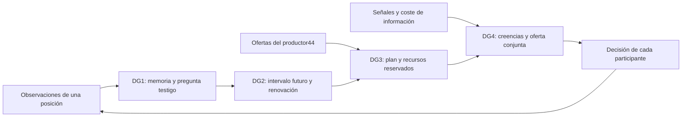

# Cuatro mecanismos para aumentar el poder explicativo y reutilizable del corpus

**Desarrollo de Codex, asistencia de IA · 28 octubre 2026 · por instrucción de Iván.**

El corpus ya conecta información situada, capacidad material, incertidumbre y coordinación. La oportunidad es convertir esas conexiones en operaciones que otra persona pueda usar: **descubrir qué memoria necesita una decisión, calcular cuándo renovarla, componer compromisos sobre recursos compartidos y construir una transición colectiva que sus participantes quieran elegir**.

Este paquete desarrolla esas cuatro operaciones con ecuaciones, argumentos de preservación, código importable y ejemplos conectados con los estudios existentes. El material científico anterior conserva su contenido. Las cuatro unidades de integración se entregan en el mismo expediente de revisión.

## 1. Qué capacidad se añade

| Desarrollo | Base que aprovecha | Operación nueva disponible | Fenómeno que permite explicar |
|---|---|---|---|
| **DG1. Memoria de decisión que se enriquece por testigos** | Fibras y suficiencia de00M§4; aprendizaje contextual de62§14 | Refinar una memoria y devolver la secuencia de acciones que exige distinguir dos estados | Por qué una representación sirve hoy pero necesita otra variable para orientar el futuro |
| **DG2. Suficiencia temporal calculada con una dinámica** | Cotas de45, oportunidad temporal M28-O2 y RA de62 | Proyectar un intervalo, decidir cuándo medir y acotar el próximo instante de renovación | Cuándo una observación sigue siendo útil y qué nueva observación recupera capacidad decisoria |
| **DG3. Certificados que componen compromisos y localizan la siguiente mejora** | B por trayecto de44, K02 y OP04 | Planificar acciones conjuntamente, reservar holgura por versión y localizar el recurso que desbloquea beneficio | Cómo pasar de oportunidades locales legítimas a una mejora colectiva realizable |
| **DG4. Complementariedad explícita entre información y coordinación** | Comparador de riesgo46, restricciones42, K08/OP02 y factorial Q×coordinación ya propuesto en la síntesis | Actualizar creencias desde señales y evaluar una oferta conjunta con costes completos | Por qué mejorar la información y mejorar la coordinación pueden necesitarse mutuamente para cambiar una decisión |

**Resultado concreto entregado:** cuatro mecanismos implementados; adaptador al productor del estudio44; comprobación con los módulos originales44/46; ejemplos JSON reproducibles. DG1–4 desarrollan las líneas anteriores: el factorial y la reserva de holgura ya estaban propuestos; aquí adquieren construcción matemática y funcionamiento.

## 2. Uso por terceros

Los archivos viven junto a esta nota, como acompañantes del expediente:

- [generative_development.py](generative_development.py): API de los cuatro mecanismos, biblioteca estándar de Python.
- [test_generative_development.py](test_generative_development.py): propiedades de conservación, extremos de error, concurrencia y costes.
- [corpus_development_adapter.py](corpus_development_adapter.py): traduce los registros nativos del productor44 a ofertas componibles.
- [exercise_corpus_integration.py](exercise_corpus_integration.py): usa los módulos científicos originales desde un checkout del corpus.
- [Ejemplos calculados](GENERATIVE_EXAMPLES_2026-10-28.json) y [recepción en fuentes](CORPUS_INTEGRATION_2026-10-28.json).

```python
from generative_development import forecast, measurement_window

projection = forecast(0, 1, 1, 3, measurement_error="0.05", acceleration_bound="0.2")
print(projection.lower, projection.upper)    # 43/20, 77/20
print(projection.capacity_decision("3.5"))   # measure_again
safe_until, breach_by = measurement_window(1, "0.5", "0.05", "0.2", 4)
```

```text
python -B generative_development.py
python -B -m unittest test_generative_development -q
python -B exercise_corpus_integration.py --corpus-root RUTA_DEL_REPOSITORIO
```

Las entradas racionales admiten cadenas decimales, enteros y `Fraction`. La salida conserva fracciones exactas. Cada unidad usa sus propias magnitudes: carga material, precisión de una observación o preferencia de un actor. El adaptador conecta operaciones con significado, en lugar de sumar esas magnitudes en un marcador universal.

## 3. DG1 — de una memoria suficiente a una memoria que sabe cómo enriquecerse

### 3.1 Construcción

Sea un modelo finito de transición determinista, con estados \(S\), acciones \(U\), transición \(F(s,u)\) y salida relevante \(h(s)\). La etiqueta inicial puede incluir la respuesta a una pregunta y las restricciones de acción que esa pregunta necesita conservar.

La partición inicial \(P_0\) agrupa los estados con igual salida. Definimos:

\[
s\equiv_{k+1}t
\iff
s\equiv_k t\quad\text{y}\quad
\forall u\in U:\ [F(s,u)]_{P_k}=[F(t,u)]_{P_k}.
\tag{DG1}
\]

Cada paso conserva la información anterior y separa estados cuya evolución exige una distinción más. El proceso termina: cada división incrementa el número de bloques y este no supera \(|S|\).

**Qué se preserva.** En la partición estable, dos estados de un mismo bloque producen la misma salida y sus sucesores permanecen en un mismo bloque para cualquier acción. Por inducción, cualquier palabra finita de acciones produce iguales trazas de salida desde ambos estados. El modelo reducido conserva esas preguntas a todos los horizontes finitos.

**Por qué la memoria resultante es mínima para esa propiedad.** Toda partición estable que conserve \(P_0\) debe conservar cada división de DG1: si dos sucesores pertenecen a bloques ya separados, sus predecesores no pueden quedar juntos. Por inducción, toda alternativa estable refina el resultado obtenido. Se construye así la partición estable más gruesa que conserva la pregunta inicial.

La bisimulación y el refinamiento de modelos aportan la base clásica; se ha releído la definición, el teorema de refinamiento y el algoritmo de [Dean–Givan1997](https://cdn.aaai.org/AAAI/1997/AAAI97-017.pdf). El desarrollo para el corpus es **hacer que la insuficiencia produzca una nueva pregunta de observación**, con un testigo que otra posición pueda ayudar a resolver.

### 3.2 Ejemplo que añade explicación

El estado es \((x,z)\in\{0,1\}^2\), la salida actual es \(x\), y la acción \(u\) produce:

\[
x^+=x\oplus uz,\qquad z^+=z.
\]

Para informar del presente bastan dos clases: \(x=0\) y \(x=1\). Para anticipar el efecto de avanzar, los estados00y01 necesitan distinguirse: la misma acción1 produce salidas0y1. Lo mismo ocurre con10y11. El programa obtiene cuatro clases y devuelve la palabra testigo `(1,)`.

Aquí aparece una ruta concreta de enriquecimiento: buscar una posición capaz de observar \(z\). Esa consulta añade un bit con función predictiva identificada. Una fuente que ya lo conoce puede ofrecerlo en su papel propio; el receptor puede incorporarlo a la memoria de su pregunta.

**Poder explicativo añadido:** distinguir la calidad de una representación para informar del presente y para orientar una intervención; explicar qué variable debe añadirse y por qué. **Interfaz:** `refine_memory(states, actions, output, step)` devuelve bloques y testigos; `distinguishing_word(...)` devuelve una secuencia observable que justifica la separación.

### 3.3 Integración siguiente

La memoria estable pasa a ser un contexto reutilizable del bucle62§14. Un cambio de transición o de pregunta produce una nueva obligación concreta de refinamiento. El selector puede priorizar las posiciones que distinguen los pares testigo y preguntar únicamente por esas distinciones. El contrato de búsqueda mantiene separadas la síntesis sobre el modelo suministrado y la consulta real a su fuente.

## 4. DG2 — ecuaciones diferenciales para calcular la vida útil de una observación

### 4.1 Del resultado actual a la dinámica oculta

Considérese:

\[
\dot x_1=x_2,\qquad \dot x_2=w(t),\qquad |w(t)|\le a.
\]

Se observa la cantidad \(x_1\); \(x_2\) es su velocidad de cambio. Un mismo nivel actual admite velocidades distintas. Cuando \(w=0\), dos observaciones separadas por \(\Delta>0\) recuperan la velocidad. La matriz de observaciones es:

\[
\begin{bmatrix}1&0\\1&\Delta\end{bmatrix},
\qquad \det=\Delta.
\]

La observación temporal aporta una dirección informativa que una fotografía actual pierde. En una dinámica lineal general, la pregunta futura se puede reconstruir cuando su funcional pertenece al espacio fila de las observaciones disponibles; esto permite elegir posiciones y tiempos por la pregunta que realmente se quiere resolver.

### 4.2 Cota y demostración

Con observaciones \(y_0,y_\Delta\), error individual acotado por \(\varepsilon\), y \(T\ge\Delta\), la predicción es:

\[
\hat x(T)=y_0+\frac T\Delta(y_\Delta-y_0).
\]

El radio de error es:

\[
r(T)=\underbrace{\varepsilon\left(\frac{2T}{\Delta}-1\right)}_{\text{medición}}
+\underbrace{\frac a2 T(T-\Delta)}_{\text{evolución no observada}}.
\tag{DG2}
\]

**Derivación:** los coeficientes de los dos errores de medición son \(1-T/\Delta\) y \(T/\Delta\); la suma de sus valores absolutos da el primer término. El resto de interpolación de una función con \(|x_1''|\le a\) tiene valor absoluto acotado por \(aT(T-\Delta)/2\), que da el segundo. Ambos se suman por desigualdad triangular.

La memoria transporta ahora el intervalo \([\hat x-r,\hat x+r]\). Para decidir si una carga cabe en una capacidad \(b\), basta comprobar el extremo superior. Si el intervalo atraviesa \(b\), la siguiente acción informativa es renovar una observación.

**Renovación calculada.** Para un presupuesto de error \(\eta\), se busca el primer cruce \(r(T)>\eta\). El radio es monótono para \(T\ge\Delta\):

\[
r'(T)=\frac{2\varepsilon}{\Delta}+a(T-\Delta/2)\ge0.
\]

`measurement_window` encierra ese cruce por bisección racional. Devuelve un horizonte todavía válido y otro en el que se supera el presupuesto. El momento de renovar sale de la dinámica, de la precisión y de la pregunta. El artículo de [Tabuada2007](https://www.seas.ucla.edu/~tabuada/Papers/EventTriggered.pdf), releído en su disparo por error y sus condiciones temporales, aporta un antecedente de programación de control por eventos; aquí se calcula directamente el evento de renovación de una memoria de decisión.

### 4.3 Ejemplo ejecutado

Con observaciones0y1 en tiempos0y1, \(\varepsilon=0,05\), \(a=0,2\) y pregunta en tiempo3, se obtiene \([2,15;3,85]\). Una capacidad3,5 todavía exige medir. Al recibir la observación2 en tiempo2, la misma pregunta obtiene \([2,65;3,35]\) y ya permite decidir que cabe.

Para presupuesto de error0,5, la primera memoria mantiene su precisión hasta el cruce \(T=\sqrt{5,5}\); el programa lo encierra con racionales. Se explica tanto la pérdida de capacidad decisoria como su recuperación mediante una observación concreta.

**Poder explicativo añadido:** continuidad temporal de la cualificación, necesidad de observación y selección de su frecuencia. **Interfaces:** `forecast(...)`, `capacity_decision(...)` y `measurement_window(...)`. **Receptor:** la ventana semántica y RA de62§14, junto con el desarrollo híbrido M28-O2.

## 5. DG3 — del certificado local al plan conjunto y a la siguiente inversión útil

### 5.1 Una forma de composición

Cada acción \(j\) ofrece una ganancia \(g_j\) y demanda un vector \(r_j\ge0\) sobre recursos identificados. El estado común contiene la holgura \(b\). Un plan \(z_j\in\{0,1\}\) se elige mediante:

\[
\max_z\ \sum_j g_jz_j,
\qquad \sum_j r_jz_j\le b.
\tag{DG3}
\]

La condición de composición es explícita: las acciones seleccionadas caben conjuntamente en cada recurso. Los vectores por trayecto cuentan la carga del mismo incremento en los distintos límites que debe atravesar; no suman esos límites como si fueran varios gastos del incremento.

**Certificado material para el árbol de44.** El productor calcula la holgura de cada nodo de un trayecto con su registro nativo de salidas y sus capacidades. Una oferta de incremento \(d_j\) reserva \(d_j\) unidades en cada límite finito del trayecto. Si la suma reservada en cada nodo no supera su holgura, cada nodo conserva todo el incremento de sus hijos. Por inducción desde las hojas hasta la raíz, llega el incremento total prometido. Así se conserva la ganancia conjunta en este modelo de flujo aditivo con capacidades.

El receptor de planificación consume ofertas y presupuestos. El acceso al estado del productor queda en `producer_offer`; se usa el registro de funcionamiento actual, sin simular el futuro para producir la oferta. La simulación `deliver` se utiliza después como referencia de comprobación.

### 5.2 Ejemplo conectado con el código existente

Dos fuentes ofrecen1unidad cada una. La raíz tiene1unidad de holgura. Ambas ofertas son útiles y se puede elegir una. La oferta conjunta reserva2 y necesita otra unidad de capacidad. Ampliar la raíz a2 permite ambas; si esa ampliación cuesta0,2, la ganancia adicional neta es0,8.

Para holguras enteras \(b\in\{0,1,2,\ldots\}\), la función de valor \(V(b)=\min(b,2)\) identifica dónde ampliar capacidad resulta productivo: antes de2, cada unidad adicional puede liberar una de servicio; después de2, este conjunto de ofertas ya está atendido. Ese cambio de marginal es una señal para buscar otra oportunidad arquitectónica. En una formulación continua de redes mayores, las variables duales de las restricciones acopladas aportan una ruta de localización; se ha releído la descomposición y coordinación jerárquica de [Xiao–Johansson–Boyd2004](https://web.stanford.edu/~boyd/papers/pdf/srra.pdf).

### 5.3 Disponibilidad simultánea y reutilización

`ReservationBook` reserva de forma atómica dentro de un proceso y avanza una versión. Si dos clientes parten de la misma holgura, la primera reserva cambia la versión; la segunda obtiene el estado renovado antes de comprometerlo. Una identidad de acción ya reservada no se vuelve a cargar. La invariante es \(\text{reservado}+\text{remanente}=\text{capacidad inicial}\), con remanente no negativo.

**Poder explicativo añadido:** cómo se obtiene capacidad colectiva de oportunidades locales; qué cuello compartido condiciona el plan; y qué cambio de arquitectura libera el siguiente beneficio. **Interfaces:** `Action`, `best_joint_plan`, `resource_conflicts`, `ReservationBook`, `producer_offer` y `common_budget`.

El optimizador de referencia recorre los subconjuntos finitos. Su interfaz de certificados permite conectar un solucionador de programación entera para colecciones grandes y un registro transaccional para reservas entre procesos. Esos dos receptores conservan el mismo contrato de recurso, pregunta y versión.

## 6. DG4 — información y coordinación como mecanismos complementarios de cambio

### 6.1 Un problema colectivo construido con el comparador de46

Dos actores pueden quedarse o rediseñar. Quedarse proporciona4. Rediseñar en solitario tiene media3; rediseñar juntos tiene media5. Se usa la preferencia CARA-normal del corpus, con \(\gamma=1\):

\[
CE(\mu,v)=\mu-\gamma v/2.
\]

La incertidumbre del retorno tiene varianza previa4. La información llega de un modelo normal de observación: \(\theta\sim N(5,4)\), \(Y_k=\theta+e_k\), con errores independientes \(e_k\sim N(0,4)\). Para \(n\) observaciones:

\[
v_n=\left(\frac1{v_0}+\frac nR\right)^{-1},\qquad
\mu_n=v_n\left(\frac{\mu_0}{v_0}+\frac{\sum y_k}R\right).
\tag{DG4}
\]

Se obtiene completando el cuadrado en la densidad normal previa multiplicada por las verosimilitudes. Con tres observaciones5,5,5, la media posterior permanece5 y la varianza pasa a1. Para el retorno unilateral \(\theta-2\), la media posterior es3. Las observaciones entran en el cálculo; no se suministra directamente el veredicto de la opción.

La coordinación se materializa mediante una oferta que solo se ejecuta cuando ambos aceptan. Sin esa oferta se examina el primer cambio unilateral desde el estado inicial en el que ambos se quedan. Así se especifica una trayectoria de decisión y una operación colectiva diferentes.

### 6.2 Cuatro intervenciones sobre el mismo ejemplo

La información cuesta0,1 por actor. Se paga en los dos brazos que la adquieren, incluso si luego el actor se queda.

| Operaciones disponibles | Rediseño: equivalente cierto neto | Quedarse: neto | Elección desde la situación descrita |
|---|---:|---:|---|
| Ninguna | \(3-4/2=1\) |4| Quedarse |
| Información | \(3-1/2-0,1=2,4\) |3,9| Quedarse |
| Coordinación | \(5-4/2=3\) |4| Quedarse |
| Información y coordinación | \(5-1/2-0,1=4,4\) |3,9| Rediseñar conjuntamente |

La interacción calculada es \(4,4-3,9-4+4=0,5\). La mejora neta del programa combinado sobre la situación inicial es0,4 por actor. El coste se mantiene en los resultados en los que la información no consigue cambiar la acción.

Una región explicativa de este mecanismo satisface:

\[
\mu_C-\gamma v_0/2<s,\qquad
\mu_U^{(1)}-\gamma v_1/2<s,\qquad
\mu_C^{(1)}-\gamma v_1/2-c>s.
\]

La primera desigualdad explica por qué una oferta conjunta con la incertidumbre anterior se rechaza. La segunda explica por qué la información por sí sola no mueve la trayectoria unilateral. La tercera identifica cuándo la combinación produce mejora neta. En el ejemplo, el umbral de esta última es \(v_1<1,8\).

**Poder explicativo añadido:** separar falta de información, incertidumbre de retorno y falta de una transición conjunta; calcular la región donde su combinación abre una elección preferida. **Interfaces:** `normal_posterior`, `certainty_equivalent` y `coordination_regimes`.

### 6.3 Integración con el corpus

Esta construcción convierte el factorial Q×coordinación de la síntesis42–45 y la propuesta K08/OP02 en un mecanismo ejecutable. El componente de elección reutiliza la ecuación46; DG3 aporta una condición material para la oferta; DG1/DG2 aportan memorias e información pertinentes. Cada actor conserva su comparación y su aceptación: el plan conjunto contiene ambas, sin reemplazarlas por una utilidad agregada obligatoria.

## 7. Cómo componer los cuatro desarrollos



La composición se realiza mediante objetos definidos: pregunta, magnitud y tiempo de observación; oferta de acción y recurso; ley de retorno y preferencias. Un intervalo de error se usa como intervalo; una distribución posterior se obtiene de su modelo de señales. Cada operación entrega a la siguiente el objeto que necesita.

**Un siguiente experimento integrado:** un servicio observa cambios de demanda, calcula su horizonte de precisión, solicita ofertas de capacidad a sus productores y formula una transición conjunta. Las preguntas del experimento son operativas: qué observación mantiene la predicción; qué reserva sostiene las acciones; qué restricción conviene transformar; y qué oferta aceptan sus participantes. Los cuatro ejemplos entregados son componentes listos para construir esa trayectoria.

## 8. Reutilización directa e integración propuesta

| Unidad | Propietario existente | Añadido propuesto | Entregable que conserva |
|---|---|---|---|
| DG1 | Única `00M_VNext.md`, con relación a62§14 | Memoria dinámica, condición de estabilidad y palabra testigo | Algoritmo, prueba y ejemplo de cuatro estados |
| DG2 | Nota de reutilización/adaptación de62§14 | Observabilidad temporal, cota de pronóstico y renovación por presupuesto de error | Ecuación diferencial, intervalo y función de programación |
| DG3 | Estudio44 y recepción en la única01I VNext | Certificados por vector de recursos y reserva versionada | Adaptador a44, prueba de flujo y planificador |
| DG4 | Extensión de46 y recepción en la misma01I VNext | Oferta conjunta con posterior explícito y costes de información | Cuatro intervenciones, umbral y funciones de elección |

Las [cuatro unidades exactas de integración](GENERATIVE_INTEGRATION_PROPOSALS_2026-10-28.json) contienen pasaje anterior, añadido completo y receptor. Los acompañantes publicados pueden importarse y ejecutarse ahora. La incorporación editorial a esos propietarios es la siguiente operación concreta del mismo desarrollo.

### Comprobaciones realizadas

Quince pruebas de propiedades y extremos, incluyendo las729 dinámicas deterministas de tres estados y dos acciones con su etiqueta inicial; trazas de tres acciones; errores de medición y curvatura en extremos; dos reservas simultáneas; y coste de adquisición conservado al quedarse.

La integración con las fuentes de main51fc686 cubre240 árboles,480 registros B con alcance válido y904 conjuntos factibles cuya ganancia conjunta coincide exactamente con `deliver`. En56 casos, sumar sin reservas las ofertas originales sobrepasaba la ganancia conjunta; la interfaz de recursos permite construir planes que cumplen la composición. Cuarenta y ocho comparaciones coinciden con `certainty_equivalent` del módulo46.

Estas comprobaciones ejercitan los mecanismos que se entregan. Los objetivos siguientes son ampliar los adaptadores, sustituir los solucionadores de referencia donde sea útil y construir el experimento integrado descrito.
