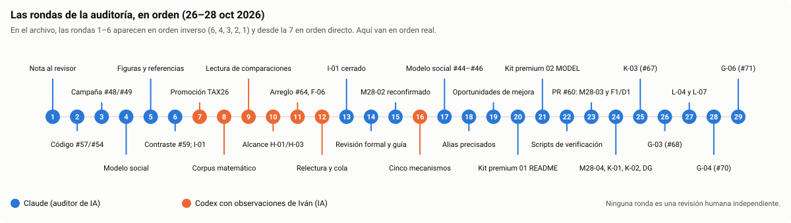
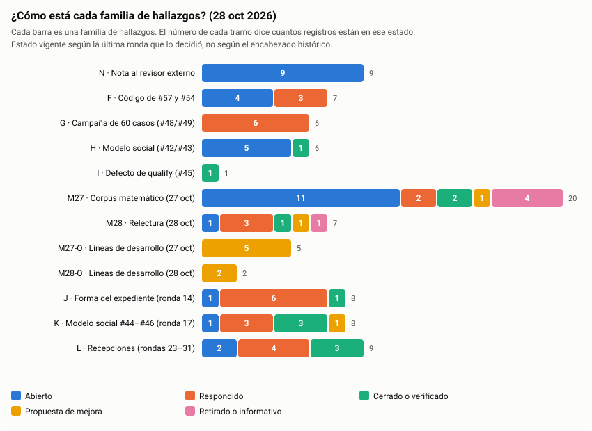
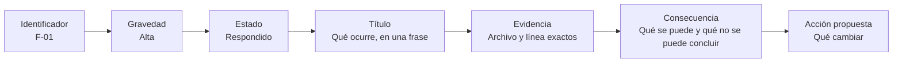
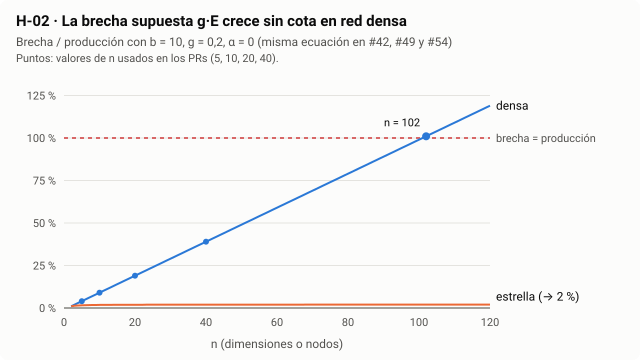
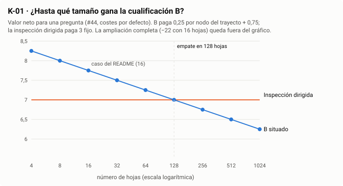
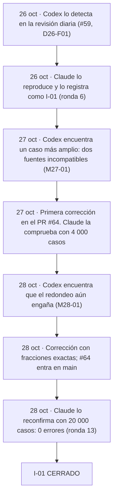
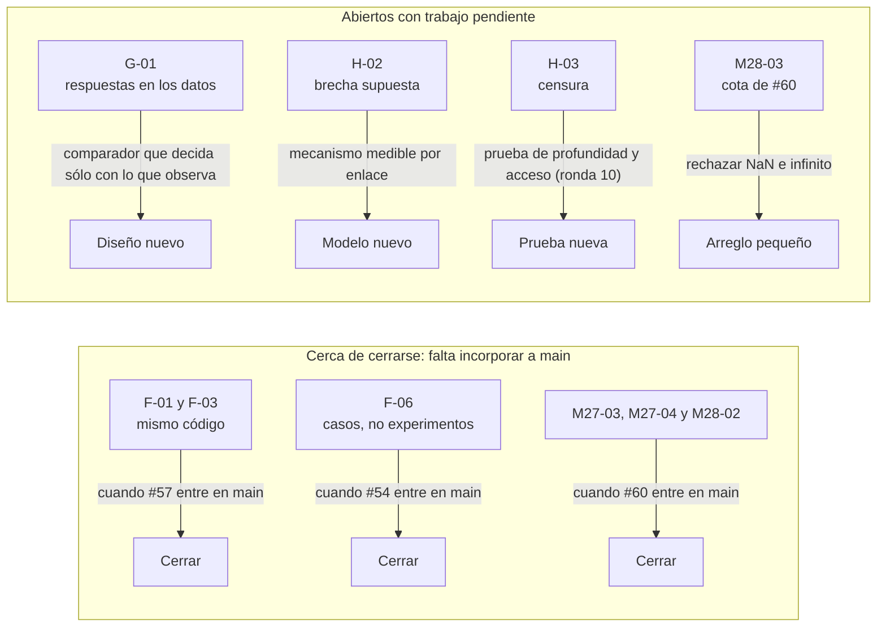

# Guía de lectura de la auditoría incremental

**Para quién:** cualquier persona que quiera entender qué dice la [auditoría](../INCREMENTAL_SCIENTIFIC_AUDIT_2026-10-26.md) sin ser especialista en matemáticas ni en programación.
**Tiempo de lectura:** 10 minutos para las secciones 1 a 5. El resto es para consultar.
**Fecha del estado que se describe:** 28 de octubre de 2026, después de la ronda 17.
**Autoría:** guía preparada por Claude (asistente de IA) a petición de Iván Abril Palma. Resume lo que dice la auditoría; no añade juicios científicos nuevos ni sustituye una revisión humana independiente.

## Índice

1. [En 30 segundos](#1-en-30-segundos)
2. [Quién ha escrito qué](#2-quién-ha-escrito-qué)
3. [Cómo está todo ahora](#3-cómo-está-todo-ahora)
4. [Cómo se lee un hallazgo](#4-cómo-se-lee-un-hallazgo)
5. [Las ideas clave, en lenguaje llano](#5-las-ideas-clave-en-lenguaje-llano)
6. [El viaje completo de un hallazgo: I-01](#6-el-viaje-completo-de-un-hallazgo-i-01)
7. [Un mismo problema, varios nombres](#7-un-mismo-problema-varios-nombres)
8. [Qué falta para cerrar lo que está cerca](#8-qué-falta-para-cerrar-lo-que-está-cerca)
9. [Por dónde empezar según quién seas](#9-por-dónde-empezar-según-quién-seas)
10. [Mapa del expediente: dónde está cada ronda](#10-mapa-del-expediente-dónde-está-cada-ronda)
11. [Los 79 registros, uno por uno](#11-los-79-registros-uno-por-uno)
12. [Glosario en lenguaje llano](#12-glosario-en-lenguaje-llano)
13. [Cómo se ha hecho esta guía](#13-cómo-se-ha-hecho-esta-guía)

---

## 1. En 30 segundos

- **Qué se revisa.** Un conjunto de modelos y simulaciones que estudian cuándo una organización, o un ecosistema de agentes de IA, podría producir más con los mismos recursos y por qué a veces no lo consigue.
- **Qué busca la auditoría.** Comprobar que cada conclusión dice exactamente lo que el modelo demuestra: ni más (exagerar) ni menos (borrar una aportación real).
- **Qué ha encontrado, en grande.**
  - Las matemáticas finitas que se han comprobado son correctas bajo sus supuestos.
  - Varias comparaciones y «experimentos» dan el resultado que ya estaba escrito en sus datos o en su código. Sirven como comprobaciones, pero no prueban una ventaja.
  - Hubo un fallo real de cálculo (I-01), que ya está corregido en la rama principal y reconfirmado.
- **Dónde estamos.** La auditoría tiene 71 registros sobre el contenido y 8 sobre la forma del propio expediente: 79 en total. De ellos, 40 siguen abiertos, 14 tienen respuesta pendiente de incorporarse o de confirmar, 9 están cerrados o verificados y 16 son propuestas de mejora, aclaraciones o puntos retirados.
- **Qué no es.** No es una revisión científica humana independiente. Todas las rondas las han escrito asistentes de IA (Claude y Codex), en parte a partir de observaciones de Iván.

## 2. Quién ha escrito qué

| Rondas | Autor | Qué aportan |
|---|---|---|
| 1–6, 13–15 y 17 | Claude, asistente de IA | Hallazgos sobre la nota al revisor, el código de #57 y #54, la campaña de 60 casos y el modelo social; figuras, referencias, reconfirmación de I-01 y M28-02, revisión formal, esta guía y el resto del modelo social (#44–#46) |
| 7–9, 12 y 16 | Codex, asistente de IA, a petición de Iván | Conexión con otros PR, revisión del corpus matemático, guía de lectura de comparaciones, relecturas del 28 de octubre y desarrollo de cinco mecanismos |
| 10–11 | Codex, recogiendo decisiones y correcciones de alcance de Iván | Precisan hasta dónde llegan H-01, H-03, F-01, G-01 y F-06, y reciben el arreglo de #64 |

Cuando dos revisores de IA coinciden, la auditoría lo llama «confirmado», pero sigue sin ser una validación humana.

## 3. Cómo está todo ahora

**Vista en tabla** (los mismos datos que la figura):

| Familia | Abierto | Respondido | Cerrado o verificado | Propuesta | Retirado o informativo | Total |
|---|---:|---:|---:|---:|---:|---:|
| N · Nota al revisor externo | 9 | 0 | 0 | 0 | 0 | 9 |
| F · Código de #57 y #54 | 4 | 3 | 0 | 0 | 0 | 7 |
| G · Campaña de 60 casos | 4 | 2 | 0 | 0 | 0 | 6 |
| H · Modelo social | 5 | 0 | 1 | 0 | 0 | 6 |
| I · Defecto de qualify | 0 | 0 | 1 | 0 | 0 | 1 |
| M27 · Corpus matemático | 11 | 2 | 2 | 1 | 4 | 20 |
| M28 · Relectura | 2 | 1 | 1 | 2 | 1 | 7 |
| M27-O y M28-O · Líneas de desarrollo | 0 | 0 | 0 | 7 | 0 | 7 |
| J · Forma del expediente | 1 | 6 | 1 | 0 | 0 | 8 |
| K · Modelo social #44–#46 | 4 | 0 | 3 | 1 | 0 | 8 |
| **Total** | **40** | **14** | **9** | **11** | **5** | **79** |

**Qué significa cada estado:**

| Estado | En lenguaje llano |
|---|---|
| 🔵 Abierto | Se ha señalado un problema y todavía no hay respuesta ni corrección. |
| 🟠 Respondido | El autor acepta el diagnóstico y hay una corrección preparada, pero aún no está en la versión oficial (`main`). |
| 🟢 Cerrado | La corrección está en `main` y otro revisor ha comprobado que funciona. |
| 🟢 Verificado | Se revisó y estaba bien: no hay nada que corregir. |
| 🟡 Propuesta | No es un error: es una idea para mejorar o ampliar el trabajo. |
| ⚪ Retirado | El propio revisor reconoció que su crítica iba demasiado lejos. |
| ⚪ Informativo | Una aclaración que no exige cambios. |

> **Ojo con los encabezados antiguos.** En el expediente, cada hallazgo conserva el estado que tenía cuando se escribió. Por ejemplo, F-06 dice `ABIERTO` en su título aunque la ronda 11 lo pasó a respondido. Esta guía usa siempre el **estado vigente**, tomado de la última ronda que lo decidió, y lo enlaza (ver [J-02](../INCREMENTAL_SCIENTIFIC_AUDIT_2026-10-26.md#j-02)).

## 4. Cómo se lee un hallazgo

Todos los hallazgos de Claude siguen la misma estructura. Con F-01 como ejemplo:

- **Gravedad alta** significa que, sin corregirlo, un lector sacaría una conclusión equivocada sobre un resultado central. **Baja** significa que es un detalle.
- **Evidencia** siempre apunta a una versión fija del código (un «commit»), para que cualquiera pueda comprobarlo aunque el código cambie después.
- Los registros de Codex (M27, M28) usan una tabla con columnas parecidas: identificador, estado, qué ocurre y próxima acción.

## 5. Las ideas clave, en lenguaje llano

Seis hallazgos explican la mayor parte de la auditoría. Cada uno va con una comparación cotidiana.

**F-01 · Dos cocineros con la misma receta.**
En #57 se compara un «metaprotocolo» agéntico con un sistema convencional. Pero los dos ejecutan exactamente el mismo código, con los mismos datos. Es como pedir a dos cocineros que sigan la misma receta con los mismos ingredientes: si los platos salen iguales, eso no dice cuál cocina mejor. **Lo que sí demuestra:** que el resultado se reproduce. **Lo que no demuestra:** que una forma de organizarse sea superior. Desde el 28 de octubre, unas pruebas nuevas en #57 confirman este empate de forma automática.

**G-01 · Un examen con la hoja de respuestas.**
En la campaña de 60 casos, el comparador convencional acierta los 48 casos que se pueden puntuar. Pero su respuesta estaba escrita en los datos, igual que la solución. Es como comparar a dos alumnos cuando uno tiene la hoja de respuestas. El ranking resultante comprueba que la puntuación está bien programada; no mide qué método decide mejor.

**H-02 · Decidir de antemano cuánto vale cada amistad.**
Varios estudios muestran una «brecha» que crece mucho al aumentar el tamaño de la red. Pero esa brecha se define como una cantidad fija por cada conexión. Si decides que cada amistad aporta 0,2 puntos sin aprovechar, con muchos amigos la pérdida será enorme, porque así lo has decidido tú, no porque lo hayas observado. Esta misma ecuación aparece en tres estudios distintos; repetirla no la convierte en tres pruebas.

**H-03 · Preguntar a cada tienda por sólo 8 unidades.**
En #43 se pierde información sobre la capacidad real de cada rama. La causa es que a cada una sólo se le piden 8 unidades. Si una tienda puede venderte 10 pero sólo le pides 8, nunca sabrás que tenía 10, da igual cómo organices las tiendas. La auditoría lo llama **censura**. Iván señaló después una idea distinta y válida, que necesita su propia prueba: la información también puede estar fuera del alcance de quien pregunta, varios proveedores más allá (ronda 10).

**H-01 · Una puerta cerrada no es una decisión.**
La «trampa» de #42 muestra un estado mejor al que no se puede llegar paso a paso, porque los pasos intermedios están prohibidos. Eso es una puerta cerrada, no alguien que *elige* quedarse fuera. Para hablar de un «subóptimo racional» habría que mostrar agentes que *podrían* moverse y prefieren no hacerlo. La auditoría no dice que ACC carezca de teoría sobre coordinación; sólo que este ejemplo concreto no la muestra (ronda 10).

**I-01 · Un redondeo que convierte «casi» en «sí».**
La función `qualify` decide si la evidencia basta para afirmar algo. Con datos que se contradecían por una diferencia minúscula, el redondeo de la calculadora borraba esa diferencia y la función respondía «verdadero». Es como una báscula que redondea 49,999 kg a 50 kg y deja pasar una maleta que no cumple el límite de 50 kg. Ya está corregido: la función usa ahora fracciones exactas. La sección siguiente cuenta el proceso completo.

### Añadido en la ronda 17

**K-02 · Dos plazas libres que son la misma plaza.**
En #44, una fuente puede emitir un certificado B: «si me pides 2 unidades más, te puedo dar 1». Si dos fuentes distintas dependen del mismo cuello de botella, cada una calcula su certificado por separado y las dos dicen «1 más». Es como si dos personas te dijeran «queda una plaza libre en el coche» refiriéndose al mismo coche: cada frase es verdad, pero juntas no caben dos. Cada certificado vale para su pregunta, no para varias preguntas a la vez.

**K-01 · Lo barato en pequeño no siempre lo es en grande.**
En el ejemplo de #44, con 16 hojas, el certificado B sale más barato que una inspección dirigida. Pero el coste de B crece con la profundidad del árbol y el de la inspección está fijado. Con los costes del propio estudio, a partir de 128 hojas la inspección dirigida empata o gana. El resultado depende del tamaño, no sólo del método.

**K-08 · La pieza que faltaba ya estaba en el corpus.**
H-01 echaba en falta una elección racional para hablar de «subóptimo racional». El estudio #46 ya calcula cuándo un actor prudente prefiere quedarse aunque cambiar rinda más de media: cuando el cambio es mucho más incierto. Juntar esa regla con la restricción conjunta de #42 da el juego de coordinación que pedía H-01, sin inventar dimensiones nuevas.

## 6. El viaje completo de un hallazgo: I-01

Este es el único hallazgo que ha recorrido todo el ciclo. Sirve de modelo de cómo debería funcionar la auditoría.

**Lo que enseña este caso:**

- Una prueba automática en verde no basta: la primera corrección pasaba sus pruebas y todavía tenía un fallo.
- Dos revisores encontraron cosas distintas. Ninguno de los dos lo habría resuelto solo.
- Cerrar exige que la corrección esté en `main` **y** que alguien distinto de quien la escribió la compruebe.

## 7. Un mismo problema, varios nombres

Distintas revisiones han dado nombres diferentes al mismo problema. Esta tabla evita contarlos dos veces.

| Problema | Nombres que recibe | Estado |
|---|---|---|
| Defecto de `qualify` (#45) | I-01, D26-F01, M27-01, M27-02, M28-01 | 🟢 Cerrado |
| Mismo código en dos brazos (#57) | F-01, F-03, D26-F03 | 🟠 Respondido |
| Consulta suplementaria (#60) | M27-03, D26-F08, D26-C04/05 | 🟠 Respondido |
| Numeración UC21/DDS (#60) | M27-04, D26-F09, D26-C06/07 | 🟠 Respondido |
| Brecha supuesta g·E | H-02, G-05 y la familia «network» de F-06 | 🔵 Abierto |

**Prefijos de los identificadores:**

| Prefijo | Origen |
|---|---|
| N, F, G, H, I | Hallazgos de Claude en este PR (rondas 1–6) |
| J | Revisión formal del expediente de Claude (ronda 14) |
| K | Hallazgos de Claude sobre #44, #45 y #46 (ronda 17) |
| M27, M28 | Hallazgos de Codex del 27 y 28 de octubre (rondas 8 y 12) |
| M27-O, M28-O | Líneas de desarrollo propuestas, no errores |
| D26-F, D26-C | Revisión diaria de Codex en el PR #59: F es un fallo, C una corrección propuesta |
| TAX26 | Propuestas de redacción sobre taxonomía, en sus documentos propietarios |
| IP | Fichas de corrección de lectura de la ronda 9 (IP-01 a IP-42) |
| R10, R11 | Precisiones de alcance de las rondas 10 y 11 |

## 8. Qué falta para cerrar lo que está cerca

La familia N, sobre la nota al revisor externo, está entera abierta. Se cierra al reescribir la nota. Es el paso que más ayudaría a un revisor humano. En la familia J sólo queda abierta J-07: decidir el idioma del expediente.

## 9. Por dónde empezar según quién seas

| Si eres… | Lee primero | Después |
|---|---|---|
| **Revisor científico externo** | Secciones 1, 3 y 7 de esta guía | [Ronda 1](../INCREMENTAL_SCIENTIFIC_AUDIT_2026-10-26.md#ronda-01) (qué falta en la nota), [ronda 12](../INCREMENTAL_SCIENTIFIC_AUDIT_2026-10-26.md#ronda-12) (estado vigente) y la [guía de comparaciones](INTERPRETATION_AND_COMPARISON_REPAIR_2026-10-27.md) |
| **Autor o mantenedor** | Sección 8 | Los hallazgos 🔵 de la sección 11 y las [propuestas ejecutables del anexo](ANNEX.md#3-propuestas-ejecutables-por-hallazgo) |
| **Lector curioso** | Secciones 1, 5 y 6 | El [mapa de hallazgos del anexo](ANNEX.md#1-mapa-de-hallazgos) |
| **Quien vaya a corregir código** | Las rondas [13](../INCREMENTAL_SCIENTIFIC_AUDIT_2026-10-26.md#ronda-13) y [15](../INCREMENTAL_SCIENTIFIC_AUDIT_2026-10-26.md#ronda-15) como modelo de verificación | M28-03 y M27-07 en la sección 11 |

## 10. Mapa del expediente: dónde está cada ronda

En el archivo de la auditoría, las rondas no aparecen en orden: 6, 4, 3, 2, 1 y después, de la 7 en adelante. La razón es que las primeras se añadían arriba y las siguientes abajo. Esta tabla las ordena. Los enlaces usan anclas estables que no cambian aunque cambie el estado de un hallazgo.

| Ronda | Fecha | Autor | Tema | Ir a |
|---:|---|---|---|---|
| 1 | 26 oct | Claude | Nota al revisor externo (N-01 a N-09) | [ronda 1](../INCREMENTAL_SCIENTIFIC_AUDIT_2026-10-26.md#ronda-01) |
| 2 | 26 oct | Claude | Código de #57 y #54 (F-01 a F-07) | [ronda 2](../INCREMENTAL_SCIENTIFIC_AUDIT_2026-10-26.md#ronda-02) |
| 3 | 26 oct | Claude | Campaña de 60 casos (G-01 a G-06) | [ronda 3](../INCREMENTAL_SCIENTIFIC_AUDIT_2026-10-26.md#ronda-03) |
| 4 | 26 oct | Claude | Modelo social #42/#43 (H-01 a H-06) | [ronda 4](../INCREMENTAL_SCIENTIFIC_AUDIT_2026-10-26.md#ronda-04) |
| 5 | 26 oct | Claude | Figuras, cálculos independientes, referencias, glosario | [anexo §1–6](ANNEX.md#1-mapa-de-hallazgos) |
| 6 | 26 oct | Claude | Contraste con #59; I-01 | [ronda 6](../INCREMENTAL_SCIENTIFIC_AUDIT_2026-10-26.md#ronda-06) |
| 7 | 27 oct | Codex | Conexión con TAX26 y promoción | [ronda 7](../INCREMENTAL_SCIENTIFIC_AUDIT_2026-10-26.md#ronda-07) · [anexo §7](ANNEX.md#7-corpus-reconciliation-and-promotion-readiness-27-october-2026) |
| 8 | 27 oct | Codex | Corpus matemático (M27) | [ronda 8](../INCREMENTAL_SCIENTIFIC_AUDIT_2026-10-26.md#ronda-08) · [anexo §8](ANNEX.md#8-mathematical-review-and-development-opportunities) |
| 9 | 27 oct | Codex | Lectura de comparaciones (IP-01 a IP-36) | [ronda 9](../INCREMENTAL_SCIENTIFIC_AUDIT_2026-10-26.md#ronda-09) · [guía](INTERPRETATION_AND_COMPARISON_REPAIR_2026-10-27.md) |
| 10 | 27 oct | Codex con Iván | Alcance de H-01 y H-03 | [ronda 10](../INCREMENTAL_SCIENTIFIC_AUDIT_2026-10-26.md#ronda-10) |
| 11 | 27 oct | Codex con Iván | Arreglo #64, comparadores, F-06 | [ronda 11](../INCREMENTAL_SCIENTIFIC_AUDIT_2026-10-26.md#ronda-11) |
| 12 | 28 oct | Codex | Relectura y cola de trabajo (M28) | [ronda 12](../INCREMENTAL_SCIENTIFIC_AUDIT_2026-10-26.md#ronda-12) · [anexo §10](ANNEX.md#10-corpus-refresh-and-open-audit-work--28-october-2026) |
| 13 | 28 oct | Claude | I-01 reconfirmado y cerrado | [ronda 13](../INCREMENTAL_SCIENTIFIC_AUDIT_2026-10-26.md#ronda-13) |
| 14 | 28 oct | Claude | Revisión formal del expediente y esta guía | [ronda 14](../INCREMENTAL_SCIENTIFIC_AUDIT_2026-10-26.md#ronda-14) |
| 15 | 28 oct | Claude | M28-02 reconfirmado en la rama de #60 | [ronda 15](../INCREMENTAL_SCIENTIFIC_AUDIT_2026-10-26.md#ronda-15) |
| 16 | 28 oct | Codex | Cierres reconfirmados, recepción de #59/#60/#62 y cinco mecanismos de §15 | [ronda 16](../INCREMENTAL_SCIENTIFIC_AUDIT_2026-10-26.md#ronda-16) · [anexo §11](ANNEX.md#11-ronda-16--recepción-y-propuestas-acotadas) |
| 17 | 28 oct | Claude | Modelo social #44–#46 (K-01 a K-08) | [ronda 17](../INCREMENTAL_SCIENTIFIC_AUDIT_2026-10-26.md#ronda-17) |

## 11. Los 79 registros, uno por uno

Haz clic en cada familia para desplegarla. Cada identificador enlaza con su texto completo en la auditoría. Esta sección la genera [`reader_guide_build.py`](reader_guide_build.py) a partir de [`STATUS_LEDGER_2026-10-28.json`](STATUS_LEDGER_2026-10-28.json), para que no se desajuste con el expediente.

<!-- LEDGER:BEGIN (generado por reader_guide_build.py) -->

<b>N · Nota al revisor externo</b> — 9 registros, 9 abiertos

| ID | Estado | Gravedad | En pocas palabras | Ronda que fijó el estado |
|---|---|---|---|---|
| [N-01](../INCREMENTAL_SCIENTIFIC_AUDIT_2026-10-26.md#n-01) | 🔵 Abierto | Alta | La nota para el revisor externo no lista todos los PR relevantes. | 1 |
| [N-02](../INCREMENTAL_SCIENTIFIC_AUDIT_2026-10-26.md#n-02) | 🔵 Abierto | Media | La nota da a entender que la auditoría #50 cubre PR posteriores que no cubre. | 1 |
| [N-03](../INCREMENTAL_SCIENTIFIC_AUDIT_2026-10-26.md#n-03) | 🔵 Abierto | Alta | La nota calla limitaciones que los propios PR ya reconocen. | 1 |
| [N-04](../INCREMENTAL_SCIENTIFIC_AUDIT_2026-10-26.md#n-04) | 🔵 Abierto | Alta | La nota no separa lo que hizo una IA de lo que hizo el autor. | 1 |
| [N-05](../INCREMENTAL_SCIENTIFIC_AUDIT_2026-10-26.md#n-05) | 🔵 Abierto | Alta | La nota no enumera las afirmaciones concretas que se piden revisar. | 1 |
| [N-06](../INCREMENTAL_SCIENTIFIC_AUDIT_2026-10-26.md#n-06) | 🔵 Abierto | Alta | La nota presenta #54 y #57 con más fuerza de la que tienen. | 1 |
| [N-07](../INCREMENTAL_SCIENTIFIC_AUDIT_2026-10-26.md#n-07) | 🔵 Abierto | Media | La nota no fija versiones y el material cambia cada día. | 1 |
| [N-08](../INCREMENTAL_SCIENTIFIC_AUDIT_2026-10-26.md#n-08) | 🔵 Abierto | Media | La nota usa siglas sin definirlas. | 1 |
| [N-09](../INCREMENTAL_SCIENTIFIC_AUDIT_2026-10-26.md#n-09) | 🔵 Abierto | Baja | Faltan datos prácticos: plazo, honorario, confidencialidad, cómo ejecutar. | 1 |

<b>F · Código de #57 y #54</b> — 7 registros, 4 abiertos

| ID | Estado | Gravedad | En pocas palabras | Ronda que fijó el estado |
|---|---|---|---|---|
| [F-01](../INCREMENTAL_SCIENTIFIC_AUDIT_2026-10-26.md#f-01) | 🟠 Respondido | Alta | En #57 el metaprotocolo y el comparador convencional ejecutan el mismo código: empatar no prueba ventaja. | 11 |
| [F-02](../INCREMENTAL_SCIENTIFIC_AUDIT_2026-10-26.md#f-02) | 🔵 Abierto | Alta | En el modelo de #57, la única palanca de ventaja agéntica es un coste supuesto e igual para todos. | 10 |
| [F-03](../INCREMENTAL_SCIENTIFIC_AUDIT_2026-10-26.md#f-03) | 🟠 Respondido | Media | Los recuentos 107/14/39 del barrido dependen de cómo se eligió la rejilla. | 6 |
| [F-04](../INCREMENTAL_SCIENTIFIC_AUDIT_2026-10-26.md#f-04) | 🔵 Abierto | Media | En el caso estrella de #57, el comparador convencional obtiene más. | 2 |
| [F-05](../INCREMENTAL_SCIENTIFIC_AUDIT_2026-10-26.md#f-05) | 🔵 Abierto | Media | El modelo de #57 es lineal y resta costes sin una tasa de conversión declarada. | 2 |
| [F-06](../INCREMENTAL_SCIENTIFIC_AUDIT_2026-10-26.md#f-06) | 🟠 Respondido | Alta | Los 46 «experimentos» de #54 son ejemplos calculados a partir de datos fijados. | 11 |
| [F-07](../INCREMENTAL_SCIENTIFIC_AUDIT_2026-10-26.md#f-07) | 🔵 Abierto | Baja | Una variable calculada y no usada en el código de #54. | 2 |

<b>G · Campaña de 60 casos (#48/#49)</b> — 6 registros, 4 abiertos

| ID | Estado | Gravedad | En pocas palabras | Ronda que fijó el estado |
|---|---|---|---|---|
| [G-01](../INCREMENTAL_SCIENTIFIC_AUDIT_2026-10-26.md#g-01) | 🟠 Respondido | Alta | En la campaña de 60 casos, el comparador convencional tiene la respuesta correcta escrita en los datos. | 11 |
| [G-02](../INCREMENTAL_SCIENTIFIC_AUDIT_2026-10-26.md#g-02) | 🔵 Abierto | Media | La «auditoría independiente» de Q es un sí/no escrito en los datos. | 3 |
| [G-03](../INCREMENTAL_SCIENTIFIC_AUDIT_2026-10-26.md#g-03) | 🔵 Abierto | Media | Varios «microexperimentos» son números escritos a mano, no calculados. | 3 |
| [G-04](../INCREMENTAL_SCIENTIFIC_AUDIT_2026-10-26.md#g-04) | 🔵 Abierto | Media | Dos análisis de la campaña repiten la regla que pretenden probar. | 3 |
| [G-05](../INCREMENTAL_SCIENTIFIC_AUDIT_2026-10-26.md#g-05) | 🟠 Respondido | Baja | #54 repite 8 celdas de red que ya estaban en #49. | 6 |
| [G-06](../INCREMENTAL_SCIENTIFIC_AUDIT_2026-10-26.md#g-06) | 🔵 Abierto | Baja | Hay tres cifras distintas de documentos «cribados» (17, 19 y 23). | 3 |

<b>H · Modelo social (#42/#43)</b> — 6 registros, 5 abiertos

| ID | Estado | Gravedad | En pocas palabras | Ronda que fijó el estado |
|---|---|---|---|---|
| [H-01](../INCREMENTAL_SCIENTIFIC_AUDIT_2026-10-26.md#h-01) | 🔵 Abierto | Alta | La «trampa» de #42 prohíbe los pasos intermedios; no muestra agentes que elijan quedarse. | 10 |
| [H-02](../INCREMENTAL_SCIENTIFIC_AUDIT_2026-10-26.md#h-02) | 🔵 Abierto | Alta | La brecha que crece con n es un supuesto: la misma ecuación en #42, #49 y #54. | 4 |
| [H-03](../INCREMENTAL_SCIENTIFIC_AUDIT_2026-10-26.md#h-03) | 🔵 Abierto | Alta | En #43 la información se pierde por cómo se pregunta (censura), no por el anidamiento. | 10 |
| [H-04](../INCREMENTAL_SCIENTIFIC_AUDIT_2026-10-26.md#h-04) | 🔵 Abierto | Media | «Sufrimiento estructural» mide una brecha de contribución, no bienestar. | 4 |
| [H-05](../INCREMENTAL_SCIENTIFIC_AUDIT_2026-10-26.md#h-05) | 🔵 Abierto | Media | La curva de utilidad de las manzanas está escrita a mano, no derivada. | 4 |
| [H-06](../INCREMENTAL_SCIENTIFIC_AUDIT_2026-10-26.md#h-06) | 🟢 Verificado | Informativo | Las cotas de bits de #43 son correctas. | 4 |

<b>I · Defecto de qualify (#45)</b> — 1 registros, 0 abiertos

| ID | Estado | Gravedad | En pocas palabras | Ronda que fijó el estado |
|---|---|---|---|---|
| [I-01](../INCREMENTAL_SCIENTIFIC_AUDIT_2026-10-26.md#i-01) | 🟢 Cerrado | Alta | qualify podía decir «verdadero» con evidencia vacía; corregido en main y reconfirmado. | 13 |

<b>M27 · Corpus matemático (27 oct)</b> — 20 registros, 11 abiertos

| ID | Estado | Gravedad | En pocas palabras | Ronda que fijó el estado |
|---|---|---|---|---|
| [M27-01](../INCREMENTAL_SCIENTIFIC_AUDIT_2026-10-26.md#m27-01) | 🟢 Cerrado | Alta | Dos fuentes incompatibles podían dar «verdadero»; corregido en main y reconfirmado. | 13 |
| [M27-02](../INCREMENTAL_SCIENTIFIC_AUDIT_2026-10-26.md#m27-02) | 🟢 Cerrado | Alta | El mismo defecto de tolerancia que I-01; corregido y reconfirmado. | 13 |
| [M27-03](../INCREMENTAL_SCIENTIFIC_AUDIT_2026-10-26.md#m27-03) | 🟠 Respondido | Alta | #60: la consulta suplementaria debe contar con la observación A ya disponible. Aplicado en la rama de #60. | 12 |
| [M27-04](../INCREMENTAL_SCIENTIFIC_AUDIT_2026-10-26.md#m27-04) | 🟠 Respondido | Alta | #60 mezclaba numeraciones UC21 y DDS. Aplicado en la rama de #60. | 12 |
| [M27-05](../INCREMENTAL_SCIENTIFIC_AUDIT_2026-10-26.md#m27-05) | ⚪ Informativo | — | Aclaración de procedencia de R12: TeX original frente a PDF posterior. | 8 |
| [M27-06](../INCREMENTAL_SCIENTIFIC_AUDIT_2026-10-26.md#m27-06) | ⚪ Retirado | — | El revisor retiró una alegación de incumplimiento de navegación. | 8 |
| [M27-07](../INCREMENTAL_SCIENTIFIC_AUDIT_2026-10-26.md#m27-07) | 🔵 Abierto | Baja | #57: el primer observador puede quedar sin identificar. | 12 |
| [M27-08](../INCREMENTAL_SCIENTIFIC_AUDIT_2026-10-26.md#m27-08) | 🔵 Abierto | Baja | El núcleo económico usa convenciones distintas de segunda diferencia. | 12 |
| [M27-09](../INCREMENTAL_SCIENTIFIC_AUDIT_2026-10-26.md#m27-09) | ⚪ Retirado | — | El revisor retiró una conclusión demasiado amplia sobre F-01. | 8 |
| [M27-10](../INCREMENTAL_SCIENTIFIC_AUDIT_2026-10-26.md#m27-10) | 🔵 Abierto | Alta | R19: la ecuación (4) no mantiene S dentro de [0, H]. | 8 |
| [M27-11](../INCREMENTAL_SCIENTIFIC_AUDIT_2026-10-26.md#m27-11) | 🔵 Abierto | Media | La ventana semántica no mejora «todo» estimador, sólo una clase definida. | 8 |
| [M27-12](../INCREMENTAL_SCIENTIFIC_AUDIT_2026-10-26.md#m27-12) | 🔵 Abierto | Media | La ventana actual no es automáticamente suficiente frente a toda la historia. | 8 |
| [M27-13](../INCREMENTAL_SCIENTIFIC_AUDIT_2026-10-26.md#m27-13) | 🔵 Abierto | Media | Una cota de la señal no acota automáticamente el indicador. | 8 |
| [M27-14](../INCREMENTAL_SCIENTIFIC_AUDIT_2026-10-26.md#m27-14) | 🔵 Abierto | Media | D28: ser seguro frente a no hacer nada no implica ser mejor que otra acción. | 8 |
| [M27-15](../INCREMENTAL_SCIENTIFIC_AUDIT_2026-10-26.md#m27-15) | 🔵 Abierto | Media | D34: salir una vez de una tolerancia no implica quedarse fuera. | 8 |
| [M27-16](../INCREMENTAL_SCIENTIFIC_AUDIT_2026-10-26.md#m27-16) | 🔵 Abierto | Media | Una sobrecarga temporal no implica una cola infinita. | 8 |
| [M27-17](../INCREMENTAL_SCIENTIFIC_AUDIT_2026-10-26.md#m27-17) | ⚪ Informativo | — | La versión web de D37 ya contiene la aclaración. | 8 |
| [M27-18](../INCREMENTAL_SCIENTIFIC_AUDIT_2026-10-26.md#m27-18) | 🔵 Abierto | Media | D37: podar nodos no demuestra atractores estables. | 8 |
| [M27-19](../INCREMENTAL_SCIENTIFIC_AUDIT_2026-10-26.md#m27-19) | 🟡 Propuesta | — | D37: especificar dominio y raíz para obtener un precio interpretable. | 8 |
| [M27-20](https://github.com/dakleyer/structural-awareness-contributions/pull/58#issuecomment-6446350643) | 🔵 Abierto | — | Cantor no implica que toda representación fiel sea imposible. | 8 |

<b>M28 · Relectura (28 oct)</b> — 7 registros, 2 abiertos

| ID | Estado | Gravedad | En pocas palabras | Ronda que fijó el estado |
|---|---|---|---|---|
| [M28-01](../INCREMENTAL_SCIENTIFIC_AUDIT_2026-10-26.md#m28-01) | 🟢 Cerrado | Alta | El redondeo de coma flotante podía certificar «verdadero»; corregido y reconfirmado. | 13 |
| [M28-02](../INCREMENTAL_SCIENTIFIC_AUDIT_2026-10-26.md#m28-02) | 🟠 Respondido | Media | #60: la guarda no comprobaba que el punto pertenezca al dominio. Corregido en la rama de #60 y reconfirmado; falta incorporarlo a main. | 15 |
| [M28-03](../INCREMENTAL_SCIENTIFIC_AUDIT_2026-10-26.md#m28-03) | 🔵 Abierto | Media | #60: se aceptan NaN o infinito como cota de utilidad. | 12 |
| [M28-04](../INCREMENTAL_SCIENTIFIC_AUDIT_2026-10-26.md#m28-04) | 🟡 Propuesta | Media | #60: decidir si la caducidad se mide en la fecha del evento o en la de uso. | 12 |
| [M28-05](../INCREMENTAL_SCIENTIFIC_AUDIT_2026-10-26.md#m28-05) | 🔵 Abierto | — | Nombres de pruebas que sugieren una comparación que no existe. | 12 |
| [M28-06](../INCREMENTAL_SCIENTIFIC_AUDIT_2026-10-26.md#m28-06) | ⚪ Informativo | — | Panel y navegación de la auditoría actualizados. | 12 |
| [M28-07](../INCREMENTAL_SCIENTIFIC_AUDIT_2026-10-26.md#m28-07) | 🟡 Propuesta | Baja | Un script de la ronda 8 sobrescribe su JSON si se ejecuta sin --output. | 12 |

<b>M27-O · Líneas de desarrollo (27 oct)</b> — 5 registros, 0 abiertos

| ID | Estado | Gravedad | En pocas palabras | Ronda que fijó el estado |
|---|---|---|---|---|
| [M27-O1](../INCREMENTAL_SCIENTIFIC_AUDIT_2026-10-26.md#m27-o1) | 🟡 Propuesta | — | Línea de desarrollo: suficiencia de una representación durante una dinámica. | 8 |
| [M27-O2](../INCREMENTAL_SCIENTIFIC_AUDIT_2026-10-26.md#m27-o2) | 🟡 Propuesta | — | Línea de desarrollo: cotas de error ligadas a pregunta y horizonte. | 8 |
| [M27-O3](../INCREMENTAL_SCIENTIFIC_AUDIT_2026-10-26.md#m27-o3) | 🟡 Propuesta | — | Línea de desarrollo: renovación de poblaciones (cohortes). | 8 |
| [M27-O4](../INCREMENTAL_SCIENTIFIC_AUDIT_2026-10-26.md#m27-o4) | 🟡 Propuesta | — | Línea de desarrollo: colas, plazos y contabilidad sin doble conteo. | 8 |
| [M27-O5](../INCREMENTAL_SCIENTIFIC_AUDIT_2026-10-26.md#m27-o5) | 🟡 Propuesta | — | Línea de desarrollo: ventanas con error, coste y plazo. | 8 |

<b>M28-O · Líneas de desarrollo (28 oct)</b> — 2 registros, 0 abiertos

| ID | Estado | Gravedad | En pocas palabras | Ronda que fijó el estado |
|---|---|---|---|---|
| [M28-O1](../INCREMENTAL_SCIENTIFIC_AUDIT_2026-10-26.md#m28-o1) | 🟡 Propuesta | — | Línea de desarrollo: coste esperado de un selector frente a búsqueda exhaustiva. | 12 |
| [M28-O2](../INCREMENTAL_SCIENTIFIC_AUDIT_2026-10-26.md#m28-o2) | 🟡 Propuesta | — | Línea de desarrollo: modelo temporal con versiones de contexto. | 12 |

<b>J · Forma del expediente (ronda 14)</b> — 8 registros, 1 abiertos

| ID | Estado | Gravedad | En pocas palabras | Ronda que fijó el estado |
|---|---|---|---|---|
| [J-01](../INCREMENTAL_SCIENTIFIC_AUDIT_2026-10-26.md#j-01) | 🟠 Respondido | Media | La cabecera «lectura vigente» estaba desfasada tras la ronda 13. | 14 |
| [J-02](../INCREMENTAL_SCIENTIFIC_AUDIT_2026-10-26.md#j-02) | 🟠 Respondido | Media | Los encabezados guardan el estado histórico; el vigente no se veía en ningún sitio. | 14 |
| [J-03](../INCREMENTAL_SCIENTIFIC_AUDIT_2026-10-26.md#j-03) | 🟠 Respondido | Media | Los enlaces a hallazgos se rompían cada vez que cambiaba su estado. | 14 |
| [J-04](../INCREMENTAL_SCIENTIFIC_AUDIT_2026-10-26.md#j-04) | 🟠 Respondido | Baja | Las rondas no están en orden y la 7 no tiene título propio. | 14 |
| [J-05](../INCREMENTAL_SCIENTIFIC_AUDIT_2026-10-26.md#j-05) | 🟠 Respondido | Baja | Un mismo defecto tiene hasta cinco nombres: riesgo de contarlo varias veces. | 14 |
| [J-06](../INCREMENTAL_SCIENTIFIC_AUDIT_2026-10-26.md#j-06) | 🟠 Respondido | Baja | Se usaban más estados de los que la cabecera declaraba. | 14 |
| [J-07](../INCREMENTAL_SCIENTIFIC_AUDIT_2026-10-26.md#j-07) | 🔵 Abierto | Baja | El expediente mezcla español e inglés; falta decidir un idioma. | 14 |
| [J-08](../INCREMENTAL_SCIENTIFIC_AUDIT_2026-10-26.md#j-08) | 🟢 Verificado | Informativo | Enlaces internos y versiones fijadas: ninguno roto. | 14 |

<b>K · Modelo social #44–#46 (ronda 17)</b> — 8 registros, 4 abiertos

| ID | Estado | Gravedad | En pocas palabras | Ronda que fijó el estado |
|---|---|---|---|---|
| [K-01](../INCREMENTAL_SCIENTIFIC_AUDIT_2026-10-26.md#k-01) | 🔵 Abierto | Media | #44: que la cualificación B gane a la inspección dirigida depende del tamaño: con los costes actuales deja de ganar a partir de 128 hojas. | 17 |
| [K-02](../INCREMENTAL_SCIENTIFIC_AUDIT_2026-10-26.md#k-02) | 🔵 Abierto | Media | #44: dos certificados B válidos por separado pueden prometer juntos más de lo que cabe por un cuello compartido. | 17 |
| [K-03](../INCREMENTAL_SCIENTIFIC_AUDIT_2026-10-26.md#k-03) | 🔵 Abierto | Baja | #44: el informe escribe a mano dos ganancias (2 y 0); son correctas, pero no se calculan. | 17 |
| [K-04](../INCREMENTAL_SCIENTIFIC_AUDIT_2026-10-26.md#k-04) | 🟢 Verificado | Informativo | #44: el mismo A con respuestas futuras distintas, el certificado por trayecto y las cotas de bits son correctos. | 17 |
| [K-05](../INCREMENTAL_SCIENTIFIC_AUDIT_2026-10-26.md#k-05) | 🟢 Verificado | Informativo | #45: el orden derechos > autorización > consentimiento > evidencia es correcto y nunca actúa solo. | 17 |
| [K-06](../INCREMENTAL_SCIENTIFIC_AUDIT_2026-10-26.md#k-06) | 🟢 Verificado | Informativo | #46: equivalentes ciertos, ejemplos y umbral de varianza recalculados: correctos. | 17 |
| [K-07](../INCREMENTAL_SCIENTIFIC_AUDIT_2026-10-26.md#k-07) | 🔵 Abierto | Media | #46: compara una media de lotería (14) con un bienestar neto estipulado (17) sin escala común declarada. | 17 |
| [K-08](../INCREMENTAL_SCIENTIFIC_AUDIT_2026-10-26.md#k-08) | 🟡 Propuesta | — | #46 ya tiene la elección racional bajo riesgo que pedía H-01: se puede reutilizar para el juego de coordinación. | 17 |

<!-- LEDGER:END -->

## 12. Glosario en lenguaje llano

| Término | Qué significa aquí |
|---|---|
| **ACC** | *Agentic Citizenship Contract*: marco sobre cómo participan los agentes de IA bajo gobierno humano. El «modelo auxiliar ACC» es el paquete de investigación revisado aquí. |
| **A / B / C / D** | Cuatro niveles de lo que un proceso sabe. A: lo que hace y entrega ahora. B: lo que podría hacer y sabe evaluar. C: una vía prometedora que aún no sabe evaluar. D: lo que no tiene forma de evaluar en sus condiciones actuales. |
| **Q** | En #48 y #57, una declaración acotada sobre una pregunta concreta, con fuente y fecha de caducidad. El nombre por sí solo no la convierte en B. |
| **Brazo** | Cada estrategia que se compara en una simulación, por ejemplo «sólo A», «Q + metaprotocolo» o «convencional». |
| **Fixture** | Un caso de prueba con los datos ya fijados de antemano. Sirve para comprobar que el código hace lo que dice, no para descubrir algo del mundo. |
| **Prueba de regresión** | Comprueba que el código sigue dando el mismo resultado que antes. Detecta cambios, no demuestra que el resultado sea cierto. |
| **Barrido (sweep)** | Repetir un cálculo cambiando sistemáticamente sus parámetros, para ver cómo cambia el resultado. |
| **Lipschitz (constante L)** | Una regla que limita lo rápido que puede cambiar una cantidad: si sabes su valor en un punto, sabes entre qué valores puede estar en un punto cercano. |
| **Censura** | Observar sólo hasta un tope. Si pides 8, nunca ves si había 10. |
| **Commit** | Una versión fija y con nombre del repositorio. Citarla permite comprobar algo aunque el código cambie después. |
| **`main`** | La versión oficial del repositorio. Un cambio sólo cuenta como incorporado cuando está en `main`. |
| **PR (pull request)** | Una propuesta de cambio que se revisa antes de entrar en `main`. |
| **CI** | Las comprobaciones automáticas que se ejecutan en cada cambio. «En verde» significa que pasaron. |
| **DDS, Stage A/B/C** | Método de evaluación del corpus en tres etapas: A, especificar; B, verificar la arquitectura; C, validar con ejecución y efectos observados. |
| **UC-21** | Caso de uso 21 del grupo FG-TIDA de la UIT, sobre si la base de una decisión sigue siendo suficiente cuando el sistema cambia. |
| **HID / 01K** | *Human Intelligence Debt*, deuda de inteligencia humana; 01K es el documento que la define. |

## 13. Cómo se ha hecho esta guía

- Los estados vigentes se han tomado de la última ronda que los decidió, citada en la columna «Ronda que fijó el estado». Están en [`STATUS_LEDGER_2026-10-28.json`](STATUS_LEDGER_2026-10-28.json).
- [`reader_guide_build.py`](reader_guide_build.py) regenera las dos figuras nuevas, la tabla de la sección 11 y el registro de estados. También comprueba que los 79 identificadores existen en la auditoría, que la fila de totales de la sección 3 coincide con el registro, que todos los hallazgos de la auditoría están en el registro y que todos los enlaces internos llevan a su destino.
- Las comparaciones cotidianas de la sección 5 simplifican a propósito. Cuando haya duda, manda el texto completo del hallazgo enlazado.
- Colores: paleta categórica validada para visión de color atípica y para modo oscuro. Como algunos colores tienen poco contraste con el fondo claro, cada tramo lleva su número escrito y hay una vista en tabla.
