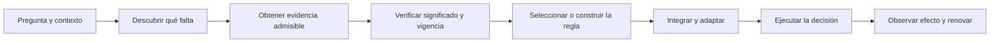

# Interpretar comparaciones sin borrar la aportación ni exagerarla

**Propuesta transversal de revisión · PR58 · 27 de octubre de 2026 · Codex, asistencia de IA solicitada por Iván.** Este documento desarrolla M27-09 para cualquier autor, lector, revisor o resumidor del corpus. Incluye una pauta de lectura y publicación, un inventario de cobertura y fichas literales de cambio. Es una propuesta auditable, no una incorporación automática a las fuentes ni una revisión científica humana independiente.

## 1. El problema que se corrige

En distintos lugares aparece una secuencia breve: se presenta un mecanismo, se concede a un programa denominado «convencional» su misma información o procedimiento y se informa una coincidencia. Al resumirlo, el lector puede concluir que el mecanismo, su construcción y todo el programa de investigación carecen de aportación. Ese salto cambia el objeto de la comparación.

El problema tampoco se resuelve borrando los resultados desfavorables o declarando que todo competidor competente «ya es EA» y queda fuera de evaluación. Un sistema existente que realiza una función pertinente con menor carga puede ser evidencia importante contra una ventaja concreta. La tarea es formular y conservar **la conclusión que efectivamente corresponde a cada comparación**.

Esta ronda sustituye la explicación centrada en una equivocación personal por una corrección de lectura y redacción reproducible. Mi error anterior es un testigo del riesgo: una reserva local se convirtió en una valoración general. El remedio debe estar en los textos y sus rutas de lectura, no depender de recordar el chat.

**Propuesta de criterio general:** cada comparación dice qué se compara, para qué pregunta y en qué etapa, con qué evidencia/procedimiento disponible y qué métrica. La conclusión conserva esos límites cuando pasa a un resumen, tabla, figura, índice, revisión o presentación.

## 2. Qué puede afirmarse con claridad

### 2.1 La aportación positiva va primero

Un resultado matemático válido se presenta como resultado. Si la interfaz enriquecida conserva una distinción necesaria para una pregunta que la interfaz reducida perdió, se afirma esa separación y se muestran sus hipótesis. Si una guarda demuestra que un conjunto de comprobaciones puede sustituirse sin cambiar la decisión y se satisface la desigualdad de costes, se afirma el ahorro en ese dominio. Si el metaproceso produce una construcción efectiva, se identifica qué construye.

El alcance se incorpora a la misma afirmación. No hace falta terminar cada proposición con una valoración genérica sobre el software convencional. Tampoco se debe sustituir una prueba por una promesa de eficacia real, una superioridad universal o una declaración de originalidad.

Patrón de escritura propuesto:

> En [dominio y pregunta], [mecanismo] permite [capacidad o resultado] bajo [hipótesis materiales]. La prueba o ejecución [referencia] establece [conclusión precisa] frente a [contrato del comparador]. La aplicación o comparación adicional [identificada] requiere [dato pendiente concreto].

El último campo se incluye cuando realmente falta una premisa para el uso que se propone; no funciona como una reserva automática contra cualquier aportación.

### 2.2 Ejemplo finito que conserva el contenido del argumento

Sea W={0,1,2,3}, señal reducida X(w)=⌊w/2⌋, señal conservada Y(w)=w y pregunta q(w)=w mod2.

- X no permite distinguir 0 de 1 ni 2 de 3, aunque q cambia dentro de ambos pares.
- Y permite contestar q exactamente.
- Un segundo programa que recibe Y y aplica el decodificador adecuado también puede contestar q.

La tercera observación confirma que la operación es realizable en otra implementación. No elimina la separación demostrada entre X e Y. Si se pretende comparar cómo dos sistemas obtienen Y, reconocen su pertinencia o construyen el decodificador, hay que estudiar esas operaciones. Si un incumbente ya las realiza legítimamente y con menor coste, se registra ese resultado para la afirmación que se contrastaba.

### 2.3 Ejemplo de ahorro real dentro de un modelo

En SA-O4, una guarda G y un certificado π permiten conservar la decisión de D10 saltando comprobaciones justificadamente. Bajo las unidades y condiciones de la fuente, el ahorro neto se establece cuando:

```text
N*p*E[coste evitado | G] > N*coste_guarda + coste_total_certificado
```

Que otra implementación pueda instalar la misma guarda no hace desaparecer esa clase de ahorro. Si la comparación se hace contra un incumbente que **ya tiene** la misma optimización, no hay un ahorro adicional de ese paso que atribuirle al nuevo nombre. La comparación de descubrimiento, instalación o renovación es otra cuestión y no puede resolverse asignándole costes favorables al método propuesto.

## 3. Igualdad de qué: siete objetos distintos

| Objeto comparado | Condición que permite la conclusión | Conclusión autorizada | Inferencia que se evita |
|---|---|---|---|
| **Poder de cómputo** | Ambos procedimientos son efectivos en el modelo de máquina declarado | La operación puede implementarse en ese modelo | «Es programable, por tanto no aporta arquitectura o método» |
| **Representación / distinciones** | Mismas fibras sobre W; para uso efectivo, decodificadores permitidos y factibles | Mismo potencial de discriminación de esa información | «Sus políticas reales, costes y adaptación son iguales» |
| **Riesgo óptimo alcanzable** | Misma tarea, pérdida, distribución o criterio, acciones y clase de reglas elegibles; hipótesis del teorema | Igualdad o inclusión de los óptimos de ese problema | «Cualquier estimador implementado obtiene el mismo resultado» |
| **Procedimiento suministrado** | Misma función/regla, entradas y semántica de ejecución; aleatoriedad acoplada si se compara por trayectoria | Reproducción de la decisión o distribución especificada | «Dos equipos descubrieron o mantuvieron el mecanismo igual de bien» |
| **Salida de un ensayo** | Casos, métricas, tolerancias y ejecuciones registrados | Coincidencia en esas observaciones | «Equivalencia de arquitectura en toda población o futuro contexto» |
| **Utilidad o coste neto** | Resultados, unidades, costes incluidos, derechos y horizonte realmente emparejados | Igualdad o diferencia del neto definido | «Mismo output implica mismo coste completo» |
| **Equivalencia estadística** | Margen, variable, población y procedimiento de inferencia fijados | La conclusión del contraste dentro del margen declarado | «No detectar una diferencia demuestra equivalencia» |

Las palabras pueden mantenerse cuando el objeto y sus condiciones son visibles. No se propone una lista de palabras prohibidas. Sí se propone sustituir el sujeto impreciso «el convencional» por el mecanismo o control efectivamente comparado.

### 3.1 Información igual no obliga a la misma decisión

Dos programas reciben el bit Y=w en W={0,1}. Uno devuelve siempre0; otro devuelveY. Con pérdida0–1 y mundos equiprobables, el primero tiene riesgo 1/2 y el segundo 0. El acceso informativo es el mismo; las reglas efectivamente utilizadas son distintas.

Un teorema sobre el óptimo entre todas las reglas admisibles puede reconocer el mismo potencial para ambos. No identifica ese óptimo con cualquier implementación. Del mismo modo, una equivalencia conjuntista no entrega por sí sola un decodificador computable, autorizado y asequible.

### 3.2 Ausencia de diferencia detectada tampoco basta

Un intervalo de incertidumbre ilustrativo [−100,100] contiene 0 y también diferencias materialmente grandes. No permite declarar una equivalencia estrecha. Cuando no existe un contraste de equivalencia especificado, la redacción conserva el dato observado y su incertidumbre. El corpus no debe transformar un resultado inconcluso en evidencia de igualdad ni de ventaja.

## 4. La comparación tiene etapas



Copiar el ejecutable final puede reproducir E. Recibir una fuente ya elegida puede facilitar A/V/S. Un procedimiento de adaptación completo puede abarcar varias etapas. Cada estudio debe declarar dónde empieza la comparación.

Para una contabilidad escalar admitida:

```text
V = G - C_descubrimiento - C_adquisicion - C_verificacion
      - C_seleccion_adaptacion - C_integracion - C_ejecucion - C_renovacion
```

Los costes compartidos no se cuentan dos veces y los costes hundidos se distinguen de los nuevos. Se fijan amortización, unidades, horizonte y costes de terceros relevantes. Los derechos y restricciones duras conservan su función de admisibilidad: no se convierten en un precio que permita eludirlos.

Igualar la salida y C_ejecución no determina el resto de términos. Tampoco se presupone que el metaproceso reduzca esos términos. Una comparación completa puede encontrar ventaja, redundancia o mayor carga; su conclusión se atribuye a las etapas evaluadas.

## 5. Nombrar controles y comparadores de forma útil

| Papel | Qué recibe o hace | Para qué sirve | Cómo se describe |
|---|---|---|---|
| **Control de reproducción del procedimiento** | Recibe el procedimiento o regla que se desea reproducir | Comprobar comportamiento, portabilidad o cálculo del precio | «Reproduce la decisión especificada con las entradas y regla suministradas» |
| **Control de información** | Recibe la misma evidencia, con reglas declaradas | Examinar si la diferencia proviene de acceso o de procesamiento | Se identifican la evidencia y la política; no se infiere igualdad de toda implementación |
| **Ablación de pérdida/retención** | Se quita una distinción o ruta manteniendo el resto pertinente | Localizar una condición necesaria del mecanismo | «La pérdida de esta distinción impide esta respuesta en estos pares» |
| **Incumbente independiente** | Método existente con acceso y recursos admisibles | Contrastar una ventaja operativa o económica | Se documentan disponibilidad, procedencia, política y coste completo |
| **Referencia/oráculo del evaluador** | Acceso a verdad o información no entregada a candidatos | Adjudicar y medir una referencia | No se convierte en un competidor desplegable sin justificar ese acceso |
| **Óptimo técnico** | Optimización bajo el modelo completo especificado | Medir una brecha de factibilidad o rendimiento | No se presenta como ruta que el participante ya puede encontrar o ejecutar |

Un control puede ser competente y seguir siendo un control de reproducción. Competencia e independencia son propiedades distintas. Un incumbente que utiliza operaciones semejantes a las propuestas sigue siendo un comparador válido cuando su disponibilidad y condiciones son pertinentes. Su clasificación funcional no borra su historia ni le quita valor como antecedente.

### 5.1 Qué resultados sí cuentan contra una afirmación

- Si se afirma ahorro de verificación frente a comprobación fresca y no se satisface la desigualdad de costes, ese caso no demuestra el ahorro.
- Si se afirma un diferencial de flujo completo y un incumbente independiente realiza la misma misión con igual o menor carga total bajo el mismo contrato, ese resultado cuenta contra ese diferencial.
- Si se afirma que una interfaz preserva una distinción y se exhibe un par admitido con igual mensaje y distinto resultado necesario, el contraejemplo afecta a esa afirmación.
- Si solo se ha demostrado realizabilidad o una condición de posibilidad, una reproducción por otro programa es compatible con el resultado. No constituye por sí sola una refutación.
- Si se afirma expresamente que una operación es imposible para programas ordinarios, una implementación válida de esa operación sí contradice esa afirmación. El alcance se fija antes de interpretar el control.
- Si se formula originalidad, los antecedentes reales importan. La capacidad abstracta de una máquina universal no demuestra que un método ya existiera, ni su ausencia.

El revisor escribe exactamente qué afirmación queda apoyada, limitada, contradicha o pendiente. Evita una calificación global del corpus a partir de un único instrumento.

## 6. Una ficha por familia de comparación

No se pide repetir una lista administrativa tras cada teorema. Una familia de comparaciones puede tener una ficha compacta común, situada donde se presenta el resultado y accesible desde sus resúmenes.

| Campo | Pregunta que debe contestar |
|---|---|
| Afirmación | ¿Qué capacidad, ganancia o límite se contrasta? |
| Objeto y etapa | ¿Información, procedimiento, decisión, coste, contexto o efecto? ¿Dónde empieza y termina? |
| Tarea y dominio | ¿Qué pregunta, mundos/casos y horizonte se han fijado? |
| Evidencia | ¿Qué puede observar, consultar o recibir cada brazo? ¿De dónde sale? |
| Regla | ¿Se entrega el mismo procedimiento, se deriva independientemente o aún no se sabe? |
| Admisibilidad | ¿Qué acciones, fuentes y transiciones están permitidas? |
| Recursos | ¿Qué costes, latencias, trabajo humano y renovación están incluidos? |
| Referencia | ¿Quién conoce la verdad, cuándo la conoce y cómo puntúa? |
| Resultado | ¿Qué métrica, casos, incertidumbre y condiciones sustentan la conclusión? |
| Traslado | ¿Qué puede decir un resumen y qué dato adicional haría falta para otra afirmación? |

Si falta información sobre un comparador, se registra el dato pendiente. No se le atribuye por defecto el procedimiento del candidato, una fuente perfecta ni incapacidad para adaptarse.

## 7. Transportar el alcance por todas las superficies de lectura

| Superficie | Cambio propuesto | Qué se conserva |
|---|---|---|
| **Título, resumen y abstract** | Nombrar la capacidad y clase del contraste; evitar sujetos ilimitados como «el convencional» | La aportación demostrada y su relevancia |
| **Definiciones y teoremas** | Mantener cuantificadores, dominio y dimensión; enlazar la interpretación correcta | La prueba y el estatus matemático |
| **Ejemplos y fixtures** | Identificar qué está estipulado, calculado y suministrado a cada brazo | Los casos positivos, adversos y negativos |
| **Tablas de resultados** | Rótulo de brazo legible con su papel; métrica y alcance en cabecera o pie | Todos los valores, empates numéricos y resultados desfavorables |
| **Figuras y diapositivas** | Pie que viaje con la figura: medida, casos, control, etapa y fuente | Serie de datos y geometría; no se alteran cifras para apoyar un relato |
| **Código y JSON/CSV** | Mantener IDs y resultados; explicar su significado en el contrato y el README propietario | Compatibilidad y evidencia ejecutada |
| **README e índices** | Resumen autosuficiente de qué se estableció; enlace directo a condiciones | Jerarquía de lectura y rutas protegidas |
| **Matrices de afirmaciones y linaje** | Conservar el alcance del resultado citado; distinguir teorema, construcción y ejecución | Procedencia y estado de evidencia |
| **Auditorías y revisiones** | Formular la objeción sobre una afirmación identificada; separar limitación de instrumento y fallo del argumento | Historia, desacuerdos y estados; disposición posterior aditiva |
| **VNext y propuestas** | Una única propuesta propietaria por unidad; receptor transversal enlazado | Antes/después literal y decisión de incorporación |
| **Fuentes históricas o congeladas** | Aclaración en la recepción actual y fuente original fijada | Bytes, fecha, formulación original y restricciones |
| **Informes, respuestas y divulgación** | El resumen cita dimensión y conclusión; no amplifica la reserva ni la promesa | Correspondencia con el estado real del corpus |

### 7.1 Plantillas breves listas para usar

**Información:** «Para la pregunta q sobre W, Y conserva la distinción que X pierde; el decodificador declarado permite la respuesta. Una implementación con esa misma información y decodificador puede reproducirla.»

**Ejecución suministrada:** «Ambos brazos ejecutan la misma política sobre las entradas declaradas. La coincidencia verifica esa reproducción; la comparación no evalúa aquí cómo se obtuvo la política.»

**Coste condicionado:** «El procedimiento ahorra trabajo en el régimen que satisface [desigualdad]. El coste de fuentes, verificación y renovación forma parte de esa condición.»

**Incumbente real:** «En [casos y horizonte], [método identificado] alcanzó [métrica] con [coste incluido]. El resultado limita la afirmación [X] bajo estas condiciones.»

**Computabilidad:** «La operación es implementable en el modelo ordinario de cómputo. La proposición estudia su contrato y organización, no otro poder de máquina.»

**Resultado inconcluso:** «En este ensayo no se estableció una diferencia en [métrica]; no se realizó/justificó un contraste de equivalencia para [margen].»

Estas plantillas no conceden resultados que no existan. Se rellenan con las condiciones y evidencias reales, y se omiten las palabras que no correspondan al estudio.

## 8. Evitar los dos errores de lectura

| Lectura que hay que prevenir | Lectura precisa |
|---|---|
| «Un programa convencional puede hacerlo; por tanto no hay aportación» | La realizabilidad ordinaria es compatible con una contribución de arquitectura, método o análisis. Esa contribución se identifica y evalúa por separado. |
| «Los dos tienen los mismos datos; por tanto deciden y cuestan igual» | Hace falta especificar decodificador, política y etapas/costes comparados. |
| «Como hay un control con la misma salida, toda la teoría queda neutralizada» | La conclusión pertenece a esa pregunta, control y métrica. |
| «Todo lo que replica el método es EA; por tanto ningún incumbente cuenta» | La similitud funcional no elimina al incumbente ni sus antecedentes del contraste. |
| «La mejora está garantizada porque se retiene más información» | La retención conserva oportunidades; la ganancia estricta exige relevancia para la decisión y las condiciones de coste/uso. |
| «La construcción finita es una demostración de ventaja aplicada» | Un resultado de posibilidad o una simulación se presenta en ese estatus. |
| «Falta validación empírica, por tanto el teorema no vale» | La validez de la prueba y la aplicabilidad de sus premisas son preguntas distintas. |
| «El resultado adverso desprestigia al programa; hay que ocultarlo» | Un resultado adverso bien atribuido delimita el programa y puede orientar su desarrollo. |

## 9. Orden de reparación propuesto

1. **Riesgo inmediato de extrapolación:** SA-O2, conclusiones/resúmenes de Partes I/II, matrices y etiquetas de los controles de reproducción. Usar las fichas literales siguientes.
2. **Recepción editorial:** README de entrada, tablas/figuras, registro de pruebas, linaje y auditoría actual. El mensaje debe llegar junto con el resultado, no en una advertencia remota.
3. **Disciplina de comparación:** CONTRIBUTING, procedimiento/plantillas y protocolos DDS propietarios. Aprovechar la disciplina ex ante existente; no añadir un régimen paralelo.
4. **Propagación por familias:** macros de texto o resúmenes derivados reciben la misma dimensión y vínculo de condiciones, sin reescribir fuentes históricas ni datos.
5. **Comprobación de lectura:** revisar extractos aislados y rutas completas; documentar dónde la ambigüedad persiste.
6. **Incorporación:** seleccionar unidades concretas y sus propietarios, preservar predecesores, aplicar solo la selección autorizada y verificar sus receptores. Registrar propuesta y aplicación como estados distintos.

La selección propuesta de primera ola es IP-01, IP-02, IP-14, IP-18/IP-19, IP-24, IP-26/IP-27 y las disposiciones IP-30/IP-31/IP-32. Son unidades de alto impacto lector; no cambian resultados, pruebas, IDs ni políticas ejecutadas. IP-23 afecta a la disciplina general de contribuciones y necesita recepción de su propietario. Los demás candidatos completan familias y evitan incoherencias posteriores.

La precisión de una comparación tiene coste editorial bajo o medio; el efecto sobre comprensión sigue por comprobar con lectores. No se declara una eficacia pedagógica medida.


### 9.1 Rutas concretas de incorporación

| Familia receptora | Ruta propietaria ya identificada | Alcance de esta propuesta |
|---|---|---|
| Partes I/II, SA-E/SA-V/SA-O y notas de residuales | Fuentes de trabajo en `research/structural-awareness/`, identificadas por ficha y SHA | Devolver las unidades al responsable del programa matemático. No se presume un rol canónico ni se abre una VNext competidora por cada ficha. |
| Entrada Structural Awareness y Article Review Essentials | Sus fuentes de navegación y el programa de revisión de artículos | Transportar la dimensión de los resultados al primer resumen; las referencias y fichas de fuente se conservan. |
| Documentos del estudio agéntico | PR57, rama `research/acc-agentic-ecosystem-reduction-v0.1-20261026` | Ajustar contratos de lectura, nombres visibles y pies; mantener enums, código, casos y resultados. |
| Linaje y núcleo formal social→agéntico | PR60, rama `research/mathematical-lineage-agentic-reduction-20261026` | Precisar la cita, el resultado de particiones y la matriz de afirmaciones. Las propuestas D26 de integración siguen en su propietario01I. |
| Revisión de ACC y propuestas D26 | `research/ecosystem-awareness/baseline/01I_VNext.md`, transportada por PR59 | Enlazar la precisión común y añadir allí cualquier candidato concreto de su fuente; no duplicar su propuesta propietaria en otra VNext. |
| Puerta de Ecosystem Positioning | `architectural-contributions/ecosystem-positioning/README_VNext.md` | Recibir el candidato del README protegido y revisar sus resúmenes derivados. |
| Catálogos Hugging Face y estudios parciales | Catálogo correspondiente y revisión propietaria del paquete Hugging Face | Preservar cada edición; aclarar en recepción el papel del control y separar sucesores. |
| Auditoría compartida | PR58, registro y anexo existentes | Añadir la disposición vigente, mantener observaciones anteriores y enlazar el detalle sin reescribir la historia. |
| Disciplina de contribución y procedimiento | CONTRIBUTING y procedimiento de revisión, bajo DC-GH-01 | Recibir la pauta propuesta en sus propios controles antes de adoptarla como instrucción general. |
| Presentaciones y exportaciones protegidas | Fuente y propietario de la edición, con su ruta de revisión ya vigente | Proponer un pie o edición sucesora cuando proceda; no sobrescribir archivos firmados, congelados o enviados. |

### 9.2 Pies de tabla y figura que pueden viajar solos

**Control con el mismo procedimiento:**

> Medida: [salida/coste/error] en [casos]. Los brazos [IDs] reciben [evidencia] y ejecutan [regla compartida]. La coincidencia corresponde a esa ejecución. Esta figura no compara la obtención independiente de la regla. Costes incluidos: [lista]. Fuente: [edición y referencia].

**Comparación operativa independiente:**

> Se comparan [métodos y versiones] en [misión, población y horizonte], con [acceso y acciones admitidos]. La métrica es [definición] y el coste incluye [etapas]. Resultado observado: [dato e incertidumbre]. Se conserva el resultado favorable a cualquiera de los métodos.

**Ilustración matemática:**

> Construcción bajo [hipótesis]. La figura muestra [propiedad] y su contraste con [interfaz/clase]. Los valores provienen del modelo; no estiman una frecuencia de despliegue.

Un pie no usa «mismo presupuesto» como sustituto de todos los costes ni «mismo conocimiento» como sustituto de política y acceso efectivos. Las etiquetas breves remiten a una ficha, pero la frase que impide la extrapolación se mantiene visible.


## 10. Prueba de comprensión propuesta

Esta ronda ofrece análisis y comprobaciones internas. No declara realizada una prueba con lectores humanos independientes.

Para una futura prueba de lectura, entregar a una persona nueva: (a) un párrafo aislado; (b) su tabla/figura; (c) el resumen del README; (d) la ficha completa. Preguntar:

- ¿Qué resultado se sostiene y por qué importa?
- ¿Qué se hizo igual en los controles y qué no se evaluó?
- ¿La comparación versa sobre información, una ejecución o el flujo completo?
- ¿Un segundo programador que implementa la misma operación borra la aportación? ¿Por qué?
- ¿Qué dato haría falta para sostener una ventaja económica o de adaptación?
- ¿Se conserva un resultado desfavorable de un incumbente competente?
- ¿Se reconoce cuándo la fuente es una prueba, una construcción, un ensayo o una hipótesis?
- ¿Puede formularse la conclusión sin añadir una afirmación más amplia?

La reparación de lectura queda abierta si la persona infiere una igualdad global desde un control suministrado, o una superioridad global desde una clase positiva. Registrar la respuesta real, el pasaje que la produjo y la revisión propuesta; no convertir la simulación del revisor en validación humana.

## 11. Cobertura y límites de la inspección

El inventario adjunto procede de instantáneas fijadas y verifica los blobs Git. Abarca los tipos de texto soportados del main y los cambios de los ocho PR abiertos en el corte (5/18/54/56/57/58/59/60), con extracción de texto de PDF, presentaciones, documentos y SVG donde existe. Los recuentos que se insertan al generar este documento describen un barrido lexical amplio, no miles de fallos ni una revisión matemática completa de cada fuente.

Las apariciones de «tie» como desempate de óptimos, «tied to» como relación, igualdad algebraica, nombres de tests o campos de datos pueden ser correctas y ajenas al problema. Las copias históricas se distinguen de una fuente mutable. No se borran, ni se normalizan sus resultados. Las fichas propuestas son una selección argumentada de unidades y familias relevantes, con la evidencia exacta al lado.

Los logs comprimidos, paquetes de evidencia y rasteres sin capa de texto conservan su custodia; la pauta de pies, metadatos y recepción se aplica también a ellos. No se afirma una revisión visual exhaustiva ni una lectura de todos los originales privados de Drive o Workbench en esta ronda. Sus receptores públicos y la propagación futura se incluyen en la pauta transversal.

Un cambio de head no hace obsoleto un argumento por sí solo; sí exige revalidar la unidad literal antes de aplicar su candidato. La recuperación de archivos usa comparaciones entre SHA fijos, evitando mezclar la lista de un PR que avanzó con el contenido de un head anterior.

## 12. Qué se entrega al propietario

- Este análisis transversal y las fichas exactas antes/después.
- Cobertura por archivo y localización de coincidencias, con referencias a instantáneas.
- Verificador de que las unidades citadas existen en el blob declarado y de preservación por sustitución inversa en las propuestas aplicables.
- Ejemplos finitos que distinguen información, política, ejecución y coste.
- Una recepción en la auditoría compartida y una ruta de incorporación en las VNext propietarias.

Publicar aquí la propuesta satisface la recepción de auditoría. La adopción de una regla editorial o la modificación de fuentes canónicas se decide y verifica por su propio alcance.


## 13. Cobertura fijada de esta ronda

Main: `43203858893325b9cbc1c3e3b75f72a7d35e6f1d`. Se analizaron 2,725 archivos/ediciones (2,509 blobs distintos), con 7,830 coincidencias literales amplias en 1,157 archivos/ediciones. El inventario tiene 0 errores de recuperación o extracción registrados. Las coincidencias incluyen datos, historia y usos ajenos al problema; no son un recuento de defectos.

[Cobertura y límites](INTERPRETATION_COVERAGE_2026-10-27.json) · [Índice completo por archivo, comprimido](INTERPRETATION_COVERAGE_INDEX_2026-10-27.csv.gz) · [Fichas estructuradas](INTERPRETATION_REPAIR_CANDIDATES_2026-10-27.json).

| Instantánea | Archivos/ediciones | Con coincidencias | Coincidencias |
|---|---:|---:|---:|
| PR18 | 22 | 19 | 192 |
| PR5 | 13 | 10 | 102 |
| PR54 | 10 | 2 | 3 |
| PR56 | 5 | 5 | 301 |
| PR57 | 21 | 17 | 165 |
| PR58 | 8 | 5 | 52 |
| PR59 | 7 | 6 | 414 |
| PR60 | 13 | 12 | 71 |
| main | 2626 | 1081 | 6530 |

## 14. Fichas literales de reparación

Las fichas conservan el idioma de la fuente. «Después» es una propuesta localizada, no una afirmación de que se haya aplicado. Las disposiciones históricas se añaden a la recepción vigente y conservan el texto anterior. Las referencias que ya son correctas se preservan y reciben una plantilla de cita.

| Ficha | Fuente | Dimensión | Operación |
|---|---|---|---|
| IP-01 | main · SA_OPERATIONAL_RESIDUAL_AND_ONLINE_CONTEXT_PLASTICITY_v0.1.md | información / decisión / coste | sentence |
| IP-02 | main · A_APRIME_OPEN_SEMANTIC_TRANSFER_BETWEEN_AGENT_ECOSYSTEMS_v0.1.md | resumen / información | line |
| IP-03 | main · A_APRIME_OPEN_SEMANTIC_TRANSFER_BETWEEN_AGENT_ECOSYSTEMS_v0.1.md | óptimo informativo | line |
| IP-04 | main · A_APRIME_OPEN_SEMANTIC_TRANSFER_BETWEEN_AGENT_ECOSYSTEMS_v0.1.md | representación | retain_reference |
| IP-05 | main · A_APRIME_OPEN_SEMANTIC_TRANSFER_BETWEEN_AGENT_ECOSYSTEMS_v0.1.md | computabilidad / realización | add_after |
| IP-06 | main · A_APRIME_OPEN_SEMANTIC_TRANSFER_BETWEEN_AGENT_ECOSYSTEMS_v0.1.md | descubrimiento / comparador | add_after |
| IP-07 | main · METASYNTACTIC_UTILITY_CLASS_THEOREMS_v0.1.md | reutilización / coste | sentence |
| IP-08 | main · METASYNTACTIC_UTILITY_CLASS_THEOREMS_v0.1.md | igualdad condicionada | retain_reference |
| IP-09 | main · METASYNTACTIC_UTILITY_CLASS_THEOREMS_v0.1.md | retención / uso | sentence |
| IP-10 | main · SA_METAEXISTENCE_CONTEXT_AND_EVALUABILITY_CALCULUS_v0.1.md | acceso / prueba / coste | sentence |
| IP-11 | main · SA_META_VALUE_AND_CONTEXT_SYNTAX_REQUALIFICATION_TWO_PHASE_v0.1.md | suficiencia / adquisición | line |
| IP-12 | main · SA_META_VALUE_AND_CONTEXT_SYNTAX_REQUALIFICATION_TWO_PHASE_v0.1.md | reutilización | sentence |
| IP-13 | main · SA_META_VALUE_AND_CONTEXT_SYNTAX_REQUALIFICATION_TWO_PHASE_v0.1.md | cuantificador / coste | line |
| IP-14 | main · SA_MULTIAGENT_COMMON_RESIDUAL_AND_ARRIVAL_v0.1.md | etapa III / pérdida irreversible | sentence |
| IP-15 | main · SA_MULTIAGENT_COMMON_RESIDUAL_AND_ARRIVAL_v0.1.md | adaptación | sentence |
| IP-16 | main · SA_CROSS_AGENT_RESIDUAL_INTERSECTION_AND_EVOLUTIONARY_OPPORTUNITY_v0.1.md | tabla / rol del control | line |
| IP-17 | main · SA_COLLECTIVE_RESIDUAL_INTERSECTION_AND_OPPORTUNITY_v0.1.md | resultado positivo / control | line |
| IP-18 | main · README.md | resumen / tabla | replace_phrase |
| IP-19 | main · README.md | resumen / tabla | replace_phrase |
| IP-20 | main · OPEN_WORLD_AGENTIC_INTERACTION_INDETERMINACY_L1_EXTENSION_v0.1.md | computabilidad / contribución | sentence |
| IP-21 | main · EDITORIAL_MATHEMATICAL_AUDIT_PART_I_II_2026-10-27.md | auditoría / resumen | line |
| IP-22 | main · ARTICLE_REVIEW_ESSENTIALS_v0.1.md | índice / evidencia | sentence |
| IP-23 | main · CONTRIBUTING.md | disciplina transversal | line |
| IP-24 | PR57 · README.md | contrato de brazo | line |
| IP-25 | PR57 · RUN_SUMMARY.md | resumen numérico | substring |
| IP-26 | PR57 · FALSIFIABILITY_AND_PROMOTION.md | falsador / hipótesis | line |
| IP-27 | PR60 · 02_FORMAL_CORE_AND_PROOFS.md | información / política | line |
| IP-28 | PR60 · 01_ORIGINAL_SOURCE_LINEAGE.md | linaje / cita | line |
| IP-29 | PR60 · 06_CLAIM_AND_EVIDENCE_MATRIX.md | matriz / recepción | line |
| IP-30 | PR58 · INCREMENTAL_SCIENTIFIC_AUDIT_2026-10-26.md | auditoría / alcance | historical_disposition |
| IP-31 | PR58 · INCREMENTAL_SCIENTIFIC_AUDIT_2026-10-26.md | auditoría / cuantificación | historical_disposition |
| IP-32 | PR58 · ANNEX.md | conciliación / resumen | line |
| IP-33 | main · README.md | router / traslado | add_after |
| IP-34 | main · README.md | evidencia histórica / catálogo | historical_disposition |
| IP-35 | main · SA_CROSS_AGENT_RESIDUAL_INTERSECTION_AND_EVOLUTIONARY_OPPORTUNITY_v0.1.md | registro de prueba | substring |
| IP-36 | PR57 · ISOMORPHISM_AND_BOUNDARY_AUDIT.md | isomorfismo / niveles | add_after |

### IP-01 · información / decisión / coste

**Fuente fijada:** [main · research/structural-awareness/SA_OPERATIONAL_RESIDUAL_AND_ONLINE_CONTEXT_PLASTICITY_v0.1.md:40](https://github.com/dakleyer/structural-awareness-contributions/blob/43203858893325b9cbc1c3e3b75f72a7d35e6f1d/research/structural-awareness/SA_OPERATIONAL_RESIDUAL_AND_ONLINE_CONTEXT_PLASTICITY_v0.1.md#L40). Blob `c6c655cab99ebf4d0d62ba8a87bc453a1e0cd88e`.

**Problema de lectura:** Poseer información no implica usarla correctamente, disponer del decodificador ni pagar el mismo coste. La formulación actual comprime tres conclusiones distintas en una sola palabra.

**Recepción / operación:** literal replacement candidate; not applied. Ruta: existing source-owned VNext or declared owner; locate/confirm before incorporation.

**Antes — unidad literal completa:**

````markdown
An ordinary controller retaining identical information ties.
````

**Después — unidad completa propuesta:**

````markdown
Retaining the same qualified distinctions preserves the same potential target discrimination when an admissible decoder is effectively available. Reproducing the same decision procedure on those inputs reproduces its decisions; equal net value additionally requires matched costs and conditions. The retention result concerns the distinction lost by irreversible discard, while discovery, selection and adaptation are separate operations.
````

**Se conserva:** Se conservan las hipótesis, pruebas y resultados numéricos de la fuente; esta ficha delimita su lectura.

**Comprobación antes de incorporar:** revalidar el blob y la unidad, confirmar propietario y receptores, aplicar solo la selección aprobada, invertir la sustitución para verificar preservación y revisar la lectura de su resumen.

### IP-02 · resumen / información

**Fuente fijada:** [main · research/structural-awareness/A_APRIME_OPEN_SEMANTIC_TRANSFER_BETWEEN_AGENT_ECOSYSTEMS_v0.1.md:299](https://github.com/dakleyer/structural-awareness-contributions/blob/43203858893325b9cbc1c3e3b75f72a7d35e6f1d/research/structural-awareness/A_APRIME_OPEN_SEMANTIC_TRANSFER_BETWEEN_AGENT_ECOSYSTEMS_v0.1.md#L299). Blob `66b9f475940de3e3f8322b39ab09404a7b38f055`.

**Problema de lectura:** Una conclusión breve es citada fuera del teorema. Debe transportar la dimensión y las condiciones del resultado sin convertir una equivalencia de representaciones en comparación global de sistemas.

**Recepción / operación:** literal replacement candidate; not applied. Ruta: existing source-owned VNext or declared owner; locate/confirm before incorporation.

**Antes — unidad literal completa:**

````markdown
4. A recoverably enriched report is **weakly at least as decision-informative** as its erasure; a constant OPEN tag may yield no strict world-discrimination, and equivalent conventional representations can tie.
````

**Después — unidad completa propuesta:**

````markdown
4. A recoverably enriched report preserves every decision rule available from its erasure and can support additional decisions when it retains a target-relevant distinction. A constant OPEN tag may add expressive scope without adding state discrimination. Representations with the same decision-relevant fibers have the same informational potential under the admissible-decoder assumptions of §7.3; this conclusion does not compare discovery effort or measured end-to-end cost.
````

**Se conserva:** Se conservan las hipótesis, pruebas y resultados numéricos de la fuente; esta ficha delimita su lectura.

**Comprobación antes de incorporar:** revalidar el blob y la unidad, confirmar propietario y receptores, aplicar solo la selección aprobada, invertir la sustitución para verificar preservación y revisar la lectura de su resumen.

### IP-03 · óptimo informativo

**Fuente fijada:** [main · research/structural-awareness/A_APRIME_OPEN_SEMANTIC_TRANSFER_BETWEEN_AGENT_ECOSYSTEMS_v0.1.md:245](https://github.com/dakleyer/structural-awareness-contributions/blob/43203858893325b9cbc1c3e3b75f72a7d35e6f1d/research/structural-awareness/A_APRIME_OPEN_SEMANTIC_TRANSFER_BETWEEN_AGENT_ECOSYSTEMS_v0.1.md#L245). Blob `66b9f475940de3e3f8322b39ab09404a7b38f055`.

**Problema de lectura:** El mínimo sobre reglas de decisión no describe el rendimiento observado de cualquier par de programas. El resultado positivo debe encabezar la explicación.

**Recepción / operación:** literal replacement candidate; not applied. Ruta: existing source-owned VNext or declared owner; locate/confirm before incorporation.

**Antes — unidad literal completa:**

````markdown
This theorem is **weak, with equality permitted**. The extra flag H-ND-UNIVERSAL, if constant and already derivable from common knowledge, may **not distinguish any further possible-world pair**. A message containing only "OPEN" need not lower loss for an independently fixed decision problem. **Observed, source-qualified, world-varying evidence** can create strict decision improvement; the broader mathematical conditions are Part II's subject.
````

**Después — unidad completa propuesta:**

````markdown
Theorem 7.2 establishes a reusable positive guarantee: the receiver can implement every decision rule available from X by decoding it from Y, under the theorem's action and information-cost assumptions. Strict reduction of optimal loss requires a distinction useful for the specified target and loss. In particular, a constant openness flag already implied by common knowledge may add no such distinction. Equality here concerns the optimal decision-information bound, not the actual policy quality, discovery effort or total operating cost of two arbitrary implementations.
````

**Se conserva:** Se conservan las hipótesis, pruebas y resultados numéricos de la fuente; esta ficha delimita su lectura.

**Comprobación antes de incorporar:** revalidar el blob y la unidad, confirmar propietario y receptores, aplicar solo la selección aprobada, invertir la sustitución para verificar preservación y revisar la lectura de su resumen.

### IP-04 · representación

**Fuente fijada:** [main · research/structural-awareness/A_APRIME_OPEN_SEMANTIC_TRANSFER_BETWEEN_AGENT_ECOSYSTEMS_v0.1.md:247](https://github.com/dakleyer/structural-awareness-contributions/blob/43203858893325b9cbc1c3e3b75f72a7d35e6f1d/research/structural-awareness/A_APRIME_OPEN_SEMANTIC_TRANSFER_BETWEEN_AGENT_ECOSYSTEMS_v0.1.md#L247). Blob `66b9f475940de3e3f8322b39ab09404a7b38f055`.

**Problema de lectura:** La equivalencia de fibras es útil y correcta; una glosa de lectura impide que se convierta en equivalencia de implementaciones.

**Recepción / operación:** retain source; citation template only. Ruta: existing source-owned VNext or declared owner; locate/confirm before incorporation.

**Antes — unidad literal completa:**

````markdown
**Theorem 7.3 — representation equivalence (TR-7).** Two deterministic interfaces \(Y,Z\) are information-isomorphic on an admissible world class W exactly when they induce identical observation fibers: \(Y(w)=Y(w')\iff Z(w)=Z(w')\). Equivalently, each signal is a function of the other on their images. **Effective** equivalence also requires computable, authorized, feasible decoding under the resource profile.
````

**Texto de cita propuesto; fuente retenida:**

````markdown
Here the equal object is the partition of the admitted world class induced by each interface. The statement identifies which distinctions are representable, and its effective clause additionally requires usable decoding. A report of equal software accuracy, latency or complete workflow cost needs those separate quantities and procedures to be specified.
````

**Se conserva:** Se conservan las hipótesis, pruebas y resultados numéricos de la fuente; esta ficha delimita su lectura.

**Comprobación antes de incorporar:** revalidar el blob y la unidad, confirmar propietario y receptores, aplicar solo la selección aprobada, invertir la sustitución para verificar preservación y revisar la lectura de su resumen.

### IP-05 · computabilidad / realización

**Fuente fijada:** [main · research/structural-awareness/A_APRIME_OPEN_SEMANTIC_TRANSFER_BETWEEN_AGENT_ECOSYSTEMS_v0.1.md:255](https://github.com/dakleyer/structural-awareness-contributions/blob/43203858893325b9cbc1c3e3b75f72a7d35e6f1d/research/structural-awareness/A_APRIME_OPEN_SEMANTIC_TRANSFER_BETWEEN_AGENT_ECOSYSTEMS_v0.1.md#L255). Blob `66b9f475940de3e3f8322b39ab09404a7b38f055`.

**Problema de lectura:** Compartir modelo de máquina y poder de cómputo no decide qué programa se construye ni la utilidad de su diseño.

**Recepción / operación:** literal replacement candidate; not applied. Ruta: existing source-owned VNext or declared owner; locate/confirm before incorporation.

**Antes — unidad literal completa:**

````markdown
**Compiler theorem (TR-19).** An ordinary universal machine can compile or simulate an effective kernel P and effective metareporter M into one conventional programme with the same specified observable behaviour on terminating inputs. The model's **relative syntactic expressivity** derives from *different interpreted output languages and permitted operations*, not a super-Turing processor.
````

**Después — unidad completa propuesta:**

````markdown
**Compiler theorem (TR-19).** An ordinary universal machine can compile or simulate an effective kernel P and effective metareporter M into one conventional programme with the same specified observable behaviour on terminating inputs. The model's **relative syntactic expressivity** derives from *different interpreted output languages and permitted operations*, not a super-Turing processor.

This compiler result establishes that the metasyntactic operations can be implemented on ordinary computing machinery. It preserves specified behavior once the effective kernel and metareporter are supplied. The architectural contribution being examined is the organization and construction of those operations and their interpreted contracts; their implementation on the same machine model is compatible with that contribution.
````

**Se conserva:** Se conservan las hipótesis, pruebas y resultados numéricos de la fuente; esta ficha delimita su lectura.

**Comprobación antes de incorporar:** revalidar el blob y la unidad, confirmar propietario y receptores, aplicar solo la selección aprobada, invertir la sustitución para verificar preservación y revisar la lectura de su resumen.

### IP-06 · descubrimiento / comparador

**Fuente fijada:** [main · research/structural-awareness/A_APRIME_OPEN_SEMANTIC_TRANSFER_BETWEEN_AGENT_ECOSYSTEMS_v0.1.md:257](https://github.com/dakleyer/structural-awareness-contributions/blob/43203858893325b9cbc1c3e3b75f72a7d35e6f1d/research/structural-awareness/A_APRIME_OPEN_SEMANTIC_TRANSFER_BETWEEN_AGENT_ECOSYSTEMS_v0.1.md#L257). Blob `66b9f475940de3e3f8322b39ab09404a7b38f055`.

**Problema de lectura:** La misma aclaración puede usarse de forma defensiva para excluir un competidor competente. Hay que impedir tanto la devaluación por programabilidad como esa exclusión.

**Recepción / operación:** literal replacement candidate; not applied. Ruta: existing source-owned VNext or declared owner; locate/confirm before incorporation.

**Antes — unidad literal completa:**

````markdown
**Design-versus-copy distinction.** Creating a context-appropriate meta-description, choosing a valid source, proving an inadequacy, selecting a safe response, compiling a programme and running the final binary are **different activities**. A conventional system given the correct already-selected binary can reproduce execution. This says nothing about the effort, provenance and uncertainty of **discovering which binary is appropriate** in a new context. Conversely, a conventional programme that itself performs the same metareasoning is functionally an open-aware/metasyntactic implementation, however it is named. An execution-only benchmark cannot establish an advantage in design or choice; the full cost of acquisition, verification and discovery must be represented.
````

**Después — unidad completa propuesta:**

````markdown
**Design-versus-copy distinction.** Creating a context-appropriate meta-description, choosing a valid source, proving an inadequacy, selecting a safe response, compiling a programme and running the final binary are **different activities**. A conventional system given the correct already-selected binary can reproduce execution. This says nothing about the effort, provenance and uncertainty of **discovering which binary is appropriate** in a new context. Conversely, a conventional programme that itself performs the same metareasoning is functionally an open-aware/metasyntactic implementation, however it is named. An execution-only benchmark cannot establish an advantage in design or choice; the full cost of acquisition, verification and discovery must be represented.

The functional classification in this paragraph must not remove an independently available incumbent from an empirical comparison. Record what that incumbent actually implements, when it was available, how it obtains its evidence and what the complete workflow costs. A supplied-copy control verifies reproduction of specified behavior; an independently operated incumbent can test the proposed differential. Both remain visible under their actual provenance.
````

**Se conserva:** Se conservan las hipótesis, pruebas y resultados numéricos de la fuente; esta ficha delimita su lectura.

**Comprobación antes de incorporar:** revalidar el blob y la unidad, confirmar propietario y receptores, aplicar solo la selección aprobada, invertir la sustitución para verificar preservación y revisar la lectura de su resumen.

### IP-07 · reutilización / coste

**Fuente fijada:** [main · research/structural-awareness/METASYNTACTIC_UTILITY_CLASS_THEOREMS_v0.1.md:326](https://github.com/dakleyer/structural-awareness-contributions/blob/43203858893325b9cbc1c3e3b75f72a7d35e6f1d/research/structural-awareness/METASYNTACTIC_UTILITY_CLASS_THEOREMS_v0.1.md#L326). Blob `dac2fda85a2c25497c6ad94028104582731eace7`.

**Problema de lectura:** El mecanismo positivo es ahorro por reutilización cualificada. Su reproducibilidad no elimina ese ahorro ni prueba una diferencia de flujo completo.

**Recepción / operación:** literal replacement candidate; not applied. Ruta: existing source-owned VNext or declared owner; locate/confirm before incorporation.

**Antes — unidad literal completa:**

````markdown
An ordinary competent memoizing verifier that does the same qualified reuse **ties on this mechanism**; the distinction is not proprietary.
````

**Después — unidad completa propuesta:**

````markdown
A memoizing verifier supplied with the same eligible certificates and performing the same qualified reuse reproduces this saving at that verification stage. The theorem establishes the saving relative to repeated fresh checking under its cost condition. Whether an independently available verifier already supplies that route, and the cost of discovering or renewing it, are separate comparison facts.
````

**Se conserva:** Se conservan las hipótesis, pruebas y resultados numéricos de la fuente; esta ficha delimita su lectura.

**Comprobación antes de incorporar:** revalidar el blob y la unidad, confirmar propietario y receptores, aplicar solo la selección aprobada, invertir la sustitución para verificar preservación y revisar la lectura de su resumen.

### IP-08 · igualdad condicionada

**Fuente fijada:** [main · research/structural-awareness/METASYNTACTIC_UTILITY_CLASS_THEOREMS_v0.1.md:455](https://github.com/dakleyer/structural-awareness-contributions/blob/43203858893325b9cbc1c3e3b75f72a7d35e6f1d/research/structural-awareness/METASYNTACTIC_UTILITY_CLASS_THEOREMS_v0.1.md#L455). Blob `dac2fda85a2c25497c6ad94028104582731eace7`.

**Problema de lectura:** La fuente ya contiene las condiciones correctas. Se conserva como referencia para corregir resúmenes que las omitan.

**Recepción / operación:** retain source; citation template only. Ruta: existing source-owned VNext or declared owner; locate/confirm before incorporation.

**Antes — unidad literal completa:**

````markdown
**SA-U10 — equivalence under no extra usable evidence or work.** Suppose all metasyntactic outputs M are freely and feasibly reproducible from the receiver's existing O, task, common proofs and allowed operations, and both architectures have equal authority/actions and exactly matched full resource costs. Then any action/report attainable with the metalevel can be simulated by the other programme. There is **no strict informational or computational superiority** from a change in nomenclature alone.
````

**Texto de cita propuesto; fuente retenida:**

````markdown
SA-U10 is the appropriate bounded reference when all its premises are established. A short citation should carry its conditions: freely and feasibly reconstructible outputs, common admissible actions and matched full resource costs. The result concerns the attainable behavior under those premises. It should not be shortened to a verdict about conventional software as a whole.
````

**Se conserva:** Se conservan las hipótesis, pruebas y resultados numéricos de la fuente; esta ficha delimita su lectura.

**Comprobación antes de incorporar:** revalidar el blob y la unidad, confirmar propietario y receptores, aplicar solo la selección aprobada, invertir la sustitución para verificar preservación y revisar la lectura de su resumen.

### IP-09 · retención / uso

**Fuente fijada:** [main · research/structural-awareness/METASYNTACTIC_UTILITY_CLASS_THEOREMS_v0.1.md:562](https://github.com/dakleyer/structural-awareness-contributions/blob/43203858893325b9cbc1c3e3b75f72a7d35e6f1d/research/structural-awareness/METASYNTACTIC_UTILITY_CLASS_THEOREMS_v0.1.md#L562). Blob `dac2fda85a2c25497c6ad94028104582731eace7`.

**Problema de lectura:** La capacidad de volver a leer no acredita por sí sola la misma interpretación ni política.

**Recepción / operación:** literal replacement candidate; not applied. Ruta: existing source-owned VNext or declared owner; locate/confirm before incorporation.

**Antes — unidad literal completa:**

````markdown
A controller with replay/re-entry can tie the open-aware one.
````

**Después — unidad completa propuesta:**

````markdown
Replay or re-entry preserves an opportunity to recover a previously retained distinction. Reproducing a particular qualified decision additionally requires the relevant retained record, an effective interpretation and the authorized rule. A claim about equal decisions or cost must identify those conditions rather than infer it from replay capability alone.
````

**Se conserva:** Se conservan las hipótesis, pruebas y resultados numéricos de la fuente; esta ficha delimita su lectura.

**Comprobación antes de incorporar:** revalidar el blob y la unidad, confirmar propietario y receptores, aplicar solo la selección aprobada, invertir la sustitución para verificar preservación y revisar la lectura de su resumen.

### IP-10 · acceso / prueba / coste

**Fuente fijada:** [main · research/structural-awareness/SA_METAEXISTENCE_CONTEXT_AND_EVALUABILITY_CALCULUS_v0.1.md:175](https://github.com/dakleyer/structural-awareness-contributions/blob/43203858893325b9cbc1c3e3b75f72a7d35e6f1d/research/structural-awareness/SA_METAEXISTENCE_CONTEXT_AND_EVALUABILITY_CALCULUS_v0.1.md#L175). Blob `60a39d24f016b0534600f867c8f386a53c0d95b2`.

**Problema de lectura:** El contraste de acceso estructurado frente a caja negra es el contenido demostrado. El control que recibe ese acceso se debe identificar como tal.

**Recepción / operación:** literal replacement candidate; not applied. Ruta: existing source-owned VNext or declared owner; locate/confirm before incorporation.

**Antes — unidad literal completa:**

````markdown
If the ordinary comparator also has the formula and checker, it can obtain the identical advantage.
````

**Después — unidad completa propuesta:**

````markdown
An implementation given the same predicate formula and qualified checker can use this structured-proof route as well. The demonstrated saving is the difference between that route and unrestricted point querying under the stated access model; reproducing it does not evaluate how the formula, certificate or checker is discovered, acquired or renewed.
````

**Se conserva:** Se conservan las hipótesis, pruebas y resultados numéricos de la fuente; esta ficha delimita su lectura.

**Comprobación antes de incorporar:** revalidar el blob y la unidad, confirmar propietario y receptores, aplicar solo la selección aprobada, invertir la sustitución para verificar preservación y revisar la lectura de su resumen.

### IP-11 · suficiencia / adquisición

**Fuente fijada:** [main · research/structural-awareness/SA_META_VALUE_AND_CONTEXT_SYNTAX_REQUALIFICATION_TWO_PHASE_v0.1.md:135](https://github.com/dakleyer/structural-awareness-contributions/blob/43203858893325b9cbc1c3e3b75f72a7d35e6f1d/research/structural-awareness/SA_META_VALUE_AND_CONTEXT_SYNTAX_REQUALIFICATION_TWO_PHASE_v0.1.md#L135). Blob `4181d7881d125a0bf5f9fb9c93219ddce154c975`.

**Problema de lectura:** El lector debe poder afirmar el resultado positivo de suficiencia parcial sin pasar de una ejecución reproducible a una valoración de todo el programa.

**Recepción / operación:** literal replacement candidate; not applied. Ruta: existing source-owned VNext or declared owner; locate/confirm before incorporation.

**Antes — unidad literal completa:**

````markdown
**Same-target solution comparison.** Suppose another valid method reconstructs a complete hidden \((b,t)\) or broader context at a charge \(c_{\rm full}\), while the qualified b-source costs \(c_M<c_{\rm full}\). Both permit the correct \(r_1\), but the latter does not identify t and is cheaper **under the stipulated cost/source model**. A competent programme with identical access to the qualified b-source can adopt exactly the same shortcut and **tie**. There is no different Turing degree.
````

**Después — unidad completa propuesta:**

````markdown
**Same-target solution comparison.** Suppose a complete hidden reconstruction costs c_full and a qualified b-source costs c_M<c_full. Both support the correct r_1, while the latter leaves t unidentified and reduces the charged acquisition cost in this model. A second implementation already supplied with the same b-source and response rule can reproduce that shortcut. This execution-level control preserves the positive result about sufficient partial information; it does not compare the work of identifying b as relevant, finding its source or adapting the response when the task changes.
````

**Se conserva:** Se conservan las hipótesis, pruebas y resultados numéricos de la fuente; esta ficha delimita su lectura.

**Comprobación antes de incorporar:** revalidar el blob y la unidad, confirmar propietario y receptores, aplicar solo la selección aprobada, invertir la sustitución para verificar preservación y revisar la lectura de su resumen.

### IP-12 · reutilización

**Fuente fijada:** [main · research/structural-awareness/SA_META_VALUE_AND_CONTEXT_SYNTAX_REQUALIFICATION_TWO_PHASE_v0.1.md:173](https://github.com/dakleyer/structural-awareness-contributions/blob/43203858893325b9cbc1c3e3b75f72a7d35e6f1d/research/structural-awareness/SA_META_VALUE_AND_CONTEXT_SYNTAX_REQUALIFICATION_TWO_PHASE_v0.1.md#L173). Blob `4181d7881d125a0bf5f9fb9c93219ddce154c975`.

**Problema de lectura:** Debe decirse qué etapa reproduce el caché y qué ahorro se ha establecido.

**Recepción / operación:** literal replacement candidate; not applied. Ruta: existing source-owned VNext or declared owner; locate/confirm before incorporation.

**Antes — unidad literal completa:**

````markdown
An equally competent conventional certified-proof cache is information/computation-equivalent for this task.
````

**Después — unidad completa propuesta:**

````markdown
A certified-proof cache implementing the same admissible reuse can reproduce the receiving-stage computation for this task. The saving relative to fresh checking remains the stated result; cache construction, proof discovery and renewal belong in the complete cost comparison.
````

**Se conserva:** Se conservan las hipótesis, pruebas y resultados numéricos de la fuente; esta ficha delimita su lectura.

**Comprobación antes de incorporar:** revalidar el blob y la unidad, confirmar propietario y receptores, aplicar solo la selección aprobada, invertir la sustitución para verificar preservación y revisar la lectura de su resumen.

### IP-13 · cuantificador / coste

**Fuente fijada:** [main · research/structural-awareness/SA_META_VALUE_AND_CONTEXT_SYNTAX_REQUALIFICATION_TWO_PHASE_v0.1.md:316](https://github.com/dakleyer/structural-awareness-contributions/blob/43203858893325b9cbc1c3e3b75f72a7d35e6f1d/research/structural-awareness/SA_META_VALUE_AND_CONTEXT_SYNTAX_REQUALIFICATION_TWO_PHASE_v0.1.md#L316). Blob `4181d7881d125a0bf5f9fb9c93219ddce154c975`.

**Problema de lectura:** El cuantificador del título y la mención de coste igual exceden lo que prueba la mera simulabilidad.

**Recepción / operación:** literal replacement candidate; not applied. Ruta: existing source-owned VNext or declared owner; locate/confirm before incorporation.

**Antes — unidad literal completa:**

````markdown
**Counterexample C4 — every metacertificate has equal-cost conventional handling.** A conventional programme that carries the same source claims, proof objects and permitted operators can implement identical metasyntactic work using ordinary instructions. Strict superiority **over that equivalent architecture** does not follow from word choice or programme branding.
````

**Después — unidad completa propuesta:**

````markdown
**Control C4 — reproduction of specified metacertificate handling.** A program supplied with the same source claims, proof objects, permitted operators and effective response procedure can reproduce the specified metasyntactic work. This is a functional implementation control. Equal end-to-end cost additionally requires the same charged discovery, acquisition, validation, adaptation and execution work. The existence of an ordinary implementation establishes realizability and does not settle those lifecycle quantities.
````

**Se conserva:** Se conservan las hipótesis, pruebas y resultados numéricos de la fuente; esta ficha delimita su lectura.

**Comprobación antes de incorporar:** revalidar el blob y la unidad, confirmar propietario y receptores, aplicar solo la selección aprobada, invertir la sustitución para verificar preservación y revisar la lectura de su resumen.

### IP-14 · etapa III / pérdida irreversible

**Fuente fijada:** [main · research/structural-awareness/SA_MULTIAGENT_COMMON_RESIDUAL_AND_ARRIVAL_v0.1.md:113](https://github.com/dakleyer/structural-awareness-contributions/blob/43203858893325b9cbc1c3e3b75f72a7d35e6f1d/research/structural-awareness/SA_MULTIAGENT_COMMON_RESIDUAL_AND_ARRIVAL_v0.1.md#L113). Blob `4cb67a291372c2b6342edc3c35ff01bc596f29ea`.

**Problema de lectura:** La etiqueta convencional no define un contrato de observación. Hay dos comparaciones distintas y deben nombrarse por sus operaciones.

**Recepción / operación:** literal replacement candidate; not applied. Ruta: existing source-owned VNext or declared owner; locate/confirm before incorporation.

**Antes — unidad literal completa:**

````markdown
A conventional peer with exactly the same captured event, Q, rights and effective dispatcher may tie; only a **permanently discarding and source-denied** baseline lacks the distinction.
````

**Después — unidad completa propuesta:**

````markdown
A second implementation supplied with the same captured event, Q, rights and dispatcher can reproduce the specified Stage III decision. The strict information contrast in this example is with the stated baseline that irreversibly discards the event and has no recovery source. That contrast establishes the usefulness of retaining and qualifying this distinction; a complete adaptation-cost comparison would evaluate how each implementation obtains and maintains the required procedure.
````

**Se conserva:** Se conservan las hipótesis, pruebas y resultados numéricos de la fuente; esta ficha delimita su lectura.

**Comprobación antes de incorporar:** revalidar el blob y la unidad, confirmar propietario y receptores, aplicar solo la selección aprobada, invertir la sustitución para verificar preservación y revisar la lectura de su resumen.

### IP-15 · adaptación

**Fuente fijada:** [main · research/structural-awareness/SA_MULTIAGENT_COMMON_RESIDUAL_AND_ARRIVAL_v0.1.md:131](https://github.com/dakleyer/structural-awareness-contributions/blob/43203858893325b9cbc1c3e3b75f72a7d35e6f1d/research/structural-awareness/SA_MULTIAGENT_COMMON_RESIDUAL_AND_ARRIVAL_v0.1.md#L131). Blob `4cb67a291372c2b6342edc3c35ff01bc596f29ea`.

**Problema de lectura:** Igual evidencia no garantiza síntesis ni selección del adaptador.

**Recepción / operación:** literal replacement candidate; not applied. Ruta: existing source-owned VNext or declared owner; locate/confirm before incorporation.

**Antes — unidad literal completa:**

````markdown
A strong conventional controller with equal source evidence can perform the same meta adaptation.
````

**Después — unidad completa propuesta:**

````markdown
A controller supplied with the same source evidence and an effective, permitted adaptation procedure can reproduce that adaptation. Whether another controller independently obtains the procedure in time is a separate property to test.
````

**Se conserva:** Se conservan las hipótesis, pruebas y resultados numéricos de la fuente; esta ficha delimita su lectura.

**Comprobación antes de incorporar:** revalidar el blob y la unidad, confirmar propietario y receptores, aplicar solo la selección aprobada, invertir la sustitución para verificar preservación y revisar la lectura de su resumen.

### IP-16 · tabla / rol del control

**Fuente fijada:** [main · research/structural-awareness/SA_CROSS_AGENT_RESIDUAL_INTERSECTION_AND_EVOLUTIONARY_OPPORTUNITY_v0.1.md:92](https://github.com/dakleyer/structural-awareness-contributions/blob/43203858893325b9cbc1c3e3b75f72a7d35e6f1d/research/structural-awareness/SA_CROSS_AGENT_RESIDUAL_INTERSECTION_AND_EVOLUTIONARY_OPPORTUNITY_v0.1.md#L92). Blob `e6c8d48b4dc035cccd8d7cf8980312a27764a785`.

**Problema de lectura:** La fila reproduce una política con el mismo intérprete. Se evita presentar su nombre como prueba de independencia o como clase global de sistemas.

**Recepción / operación:** literal replacement candidate; not applied. Ruta: existing source-owned VNext or declared owner; locate/confirm before incorporation.

**Antes — unidad literal completa:**

````markdown
| **Strong conventional comparator** | Same meta-evidence, permission and effective interpreter | **3.82** | **0.18** |
````

**Después — unidad completa propuesta:**

````markdown
| **Specified-decision reproduction control** | Same meta-evidence, permission and effective interpreter supplied | **3.82** | **0.18** |
````

**Se conserva:** Se conservan exactamente 3.82 y 0.18 y los otros brazos. La independencia de un comparador real se documentaría en otra ficha.

**Comprobación antes de incorporar:** revalidar el blob y la unidad, confirmar propietario y receptores, aplicar solo la selección aprobada, invertir la sustitución para verificar preservación y revisar la lectura de su resumen.

### IP-17 · resultado positivo / control

**Fuente fijada:** [main · research/structural-awareness/SA_COLLECTIVE_RESIDUAL_INTERSECTION_AND_OPPORTUNITY_v0.1.md:152](https://github.com/dakleyer/structural-awareness-contributions/blob/43203858893325b9cbc1c3e3b75f72a7d35e6f1d/research/structural-awareness/SA_COLLECTIVE_RESIDUAL_INTERSECTION_AND_OPPORTUNITY_v0.1.md#L152). Blob `4dd6c440e5264aeaccf8055d18ae8c280b840896`.

**Problema de lectura:** La frase de cierre debe conservar el resultado positivo y precisar la naturaleza de la reproducción.

**Recepción / operación:** literal replacement candidate; not applied. Ruta: existing source-owned VNext or declared owner; locate/confirm before incorporation.

**Antes — unidad literal completa:**

````markdown
This is **conditional strict opportunity gain against a specifically defined permanently discarding comparator**. A conventional agent with the same pre-admission capture, source credentials, rules and permissions can reproduce the identical result. De Morgan and meta labels do not create a different Turing degree or costless source.
````

**Después — unidad completa propuesta:**

````markdown
This is **conditional strict opportunity gain against the specified permanently discarding interface**: retaining the pre-admission candidate, checking the scoped value evidence and applying the permitted rule makes the declared integration opportunity usable. A second program supplied with those same source credentials, rules and permissions can reproduce Stage III. That supplied-procedure control establishes implementability; the complete cost of discovering, obtaining and renewing the route remains a distinct research comparison.
````

**Se conserva:** Se conservan las hipótesis, pruebas y resultados numéricos de la fuente; esta ficha delimita su lectura.

**Comprobación antes de incorporar:** revalidar el blob y la unidad, confirmar propietario y receptores, aplicar solo la selección aprobada, invertir la sustitución para verificar preservación y revisar la lectura de su resumen.

### IP-18 · resumen / tabla

**Fuente fijada:** [main · research/structural-awareness/README.md:14](https://github.com/dakleyer/structural-awareness-contributions/blob/43203858893325b9cbc1c3e3b75f72a7d35e6f1d/research/structural-awareness/README.md#L14). Blob `9b5974f51fce692e1cbf8238c93d6c659f7ea519`.

**Problema de lectura:** La ruta de entrada debe explicar el tipo de control al mismo nivel de visibilidad que los valores 19 y77.

**Recepción / operación:** literal replacement candidate; not applied. Ruta: existing source-owned VNext or declared owner; locate/confirm before incorporation.

**Antes — unidad literal completa:**

````markdown
| **[Four-actor ACC portfolio — collective residual intersection and event-triggered opportunity](./SA_COLLECTIVE_RESIDUAL_INTERSECTION_AND_OPPORTUNITY_v0.1.md)** | SA-M1–SA-M4 over the **published four-actor, five-dimension ACC portfolio input**: exact finite referee SCALE=19, SCALE+INTEGRATE=77; common four-admission blind spot, separate anonymous lower-bound meta-source (+48), Stage2 19 unchanged, Stage3 first candidate at authored event 3 admitted and scored 77. [46-check finite JavaScript fixture](./fixtures/COLLECTIVE_RESIDUAL_ACC_PORTFOLIO_STAGE123_v0.1.mjs) includes false class, nonarrival, source/authority controls and same-information peer tie. | **New local admission-mask overlay, NOT a rerun of the original Python toy**, PR57's two-provider scores or a field experiment; no calibrated arrival rate |
````

**Después — unidad completa propuesta:**

````markdown
| **[Four-actor ACC portfolio — collective residual intersection and event-triggered opportunity](./SA_COLLECTIVE_RESIDUAL_INTERSECTION_AND_OPPORTUNITY_v0.1.md)** | SA-M1–SA-M4 over the **published four-actor, five-dimension ACC portfolio input**: exact finite referee SCALE=19, SCALE+INTEGRATE=77; common four-admission blind spot, separate anonymous lower-bound meta-source (+48), Stage2 19 unchanged, Stage3 first candidate at authored event 3 admitted and scored 77. [46-check finite JavaScript fixture](./fixtures/COLLECTIVE_RESIDUAL_ACC_PORTFOLIO_STAGE123_v0.1.mjs) includes false class, nonarrival, source/authority controls and a supplied-procedure Stage III reproduction control. | **New local admission-mask overlay, NOT a rerun of the original Python toy**, PR57's two-provider scores or a field experiment; no calibrated arrival rate |
````

**Se conserva:** Los resultados 19→19→77, la naturaleza de overlay y el número46 se conservan; solo cambia la descripción del control.

**Comprobación antes de incorporar:** revalidar el blob y la unidad, confirmar propietario y receptores, aplicar solo la selección aprobada, invertir la sustitución para verificar preservación y revisar la lectura de su resumen.

### IP-19 · resumen / tabla

**Fuente fijada:** [main · research/structural-awareness/README.md:16](https://github.com/dakleyer/structural-awareness-contributions/blob/43203858893325b9cbc1c3e3b75f72a7d35e6f1d/research/structural-awareness/README.md#L16). Blob `9b5974f51fce692e1cbf8238c93d6c659f7ea519`.

**Problema de lectura:** Un rótulo corto es fácilmente reutilizado como una conclusión general. Debe nombrar inputs y etapa.

**Recepción / operación:** literal replacement candidate; not applied. Ruta: existing source-owned VNext or declared owner; locate/confirm before incorporation.

**Antes — unidad literal completa:**

````markdown
| **[Independent normalized four-dimensional residual-intersection witness](./SA_CROSS_AGENT_RESIDUAL_INTERSECTION_AND_EVOLUTIONARY_OPPORTUNITY_v0.1.md)** | Alternative source-grounded **linear-quality** case and [27-check finite fixture](./fixtures/CROSS_AGENT_RESIDUAL_CARTOGRAPHY_v0.1.mjs): 2→2→3.82 with conservative 3.78 bound and identical-information peer tie. Contrasts with **PR57's distinct original-physics overlay** (10→10→11.5). Includes De Morgan disjunction qualification, arrival uncertainty and refusal to infer optimum from a bare residual label | Independent **mathematical illustration**, not a rerun of source ACC toy or PR57 geometry; no field evidence |
````

**Después — unidad completa propuesta:**

````markdown
| **[Independent normalized four-dimensional residual-intersection witness](./SA_CROSS_AGENT_RESIDUAL_INTERSECTION_AND_EVOLUTIONARY_OPPORTUNITY_v0.1.md)** | Alternative source-grounded **linear-quality** case and [27-check finite fixture](./fixtures/CROSS_AGENT_RESIDUAL_CARTOGRAPHY_v0.1.mjs): 2→2→3.82 with conservative 3.78 bound and a reproduction control supplied with the same task-relevant evidence and interpreter. Contrasts with **PR57's distinct original-physics overlay** (10→10→11.5). Includes De Morgan disjunction qualification, arrival uncertainty and refusal to infer optimum from a bare residual label | Independent **mathematical illustration**, not a rerun of source ACC toy or PR57 geometry; no field evidence |
````

**Se conserva:** Se conservan 2→2→3.82, cota3.78, 27checks y distinción de la física original de PR57.

**Comprobación antes de incorporar:** revalidar el blob y la unidad, confirmar propietario y receptores, aplicar solo la selección aprobada, invertir la sustitución para verificar preservación y revisar la lectura de su resumen.

### IP-20 · computabilidad / contribución

**Fuente fijada:** [main · research/structural-awareness/OPEN_WORLD_AGENTIC_INTERACTION_INDETERMINACY_L1_EXTENSION_v0.1.md:504](https://github.com/dakleyer/structural-awareness-contributions/blob/43203858893325b9cbc1c3e3b75f72a7d35e6f1d/research/structural-awareness/OPEN_WORLD_AGENTIC_INTERACTION_INDETERMINACY_L1_EXTENSION_v0.1.md#L504). Blob `a1c421e033c9e93e0e3b73be60750f660127570c`.

**Problema de lectura:** Una negación correcta de una inferencia no debe convertirse en el único mensaje del resultado ni en un juicio global del método.

**Recepción / operación:** literal replacement candidate; not applied. Ruta: existing source-owned VNext or declared owner; locate/confirm before incorporation.

**Antes — unidad literal completa:**

````markdown
No superiority of Structural/Ecosystem Awareness over conventional tools follows from OW-1.
````

**Después — unidad completa propuesta:**

````markdown
OW-1 establishes the stated uniform limit on definitive computation for its expressive peer family. The proposed operational contribution is how a system preserves a justified indeterminate result and supports requalification under its actual information contract; evidence for that contribution uses the handling measures just listed, rather than treating computability-class membership as a performance comparison.
````

**Se conserva:** Se conservan las hipótesis, pruebas y resultados numéricos de la fuente; esta ficha delimita su lectura.

**Comprobación antes de incorporar:** revalidar el blob y la unidad, confirmar propietario y receptores, aplicar solo la selección aprobada, invertir la sustitución para verificar preservación y revisar la lectura de su resumen.

### IP-21 · auditoría / resumen

**Fuente fijada:** [main · research/structural-awareness/EDITORIAL_MATHEMATICAL_AUDIT_PART_I_II_2026-10-27.md:32](https://github.com/dakleyer/structural-awareness-contributions/blob/43203858893325b9cbc1c3e3b75f72a7d35e6f1d/research/structural-awareness/EDITORIAL_MATHEMATICAL_AUDIT_PART_I_II_2026-10-27.md#L32). Blob `23107d050136d491ad655b9dd3cb204b7e47895a`.

**Problema de lectura:** La auditoría editorial también debe transportar la separación de dimensiones al resumir la corrección.

**Recepción / operación:** literal replacement candidate; not applied. Ruta: existing source-owned VNext or declared owner; locate/confirm before incorporation.

**Antes — unidad literal completa:**

````markdown
| A supposedly stronger language advertised as universally superior to every conventional product | Part I §§1, 5, 7 and Part II §8 identify the **strictly U-only claim-language comparator** and allow an equally qualified independent implementation to tie. |
````

**Después — unidad completa propuesta:**

````markdown
| A stronger interpreted language generalized to an unspecified software population | Part I §§1,5,7 and Part II §8 define the strictly U-restricted claim-language comparator. A second implementation that carries the same interpreted operations is a realization of the supplied mechanism; comparison of independent workflows additionally requires declared evidence acquisition, adaptation, action and cost conditions. |
````

**Se conserva:** Se conservan las hipótesis, pruebas y resultados numéricos de la fuente; esta ficha delimita su lectura.

**Comprobación antes de incorporar:** revalidar el blob y la unidad, confirmar propietario y receptores, aplicar solo la selección aprobada, invertir la sustitución para verificar preservación y revisar la lectura de su resumen.

### IP-22 · índice / evidencia

**Fuente fijada:** [main · research/structural-awareness/ARTICLE_REVIEW_ESSENTIALS_v0.1.md:84](https://github.com/dakleyer/structural-awareness-contributions/blob/43203858893325b9cbc1c3e3b75f72a7d35e6f1d/research/structural-awareness/ARTICLE_REVIEW_ESSENTIALS_v0.1.md#L84). Blob `75b9312561fe7ed75b4176f55a7943ea8dcdd648`.

**Problema de lectura:** La posibilidad abstracta se puede leer como un resultado ya encontrado. El índice debe pedir una comparación concreta sin anticiparla.

**Recepción / operación:** literal replacement candidate; not applied. Ruta: existing source-owned VNext or declared owner; locate/confirm before incorporation.

**Antes — unidad literal completa:**

````markdown
An existing competent method may tie, cost less or already solve the case; that is useful evidence rather than a reason to weaken the comparator.
````

**Después — unidad completa propuesta:**

````markdown
Each proposed contribution should be compared with a competent method whose actual inputs, actions and complete charged work are documented for that task. Report whether the measured decision, cost or response-time criterion improves, remains unchanged or worsens. A supplied implementation copy is identified separately from an independently available method.
````

**Se conserva:** Se conservan las hipótesis, pruebas y resultados numéricos de la fuente; esta ficha delimita su lectura.

**Comprobación antes de incorporar:** revalidar el blob y la unidad, confirmar propietario y receptores, aplicar solo la selección aprobada, invertir la sustitución para verificar preservación y revisar la lectura de su resumen.

### IP-23 · disciplina transversal

**Fuente fijada:** [main · CONTRIBUTING.md:26](https://github.com/dakleyer/structural-awareness-contributions/blob/43203858893325b9cbc1c3e3b75f72a7d35e6f1d/CONTRIBUTING.md#L26). Blob `a1334142c9da86d06a8c33099e740df28b2a30e3`.

**Problema de lectura:** La guía general debe impedir la extrapolación negativa y la exclusión defensiva de un competidor válido.

**Recepción / operación:** literal replacement candidate; not applied. Ruta: existing source-owned VNext or declared owner; locate/confirm before incorporation.

**Antes — unidad literal completa:**

````markdown
Benchmark submissions should identify the comparator arm, resources, authority, time horizon, evidence access, implementation burden and falsifier being tested. Conventional mechanisms that reproduce a candidate EA behaviour with equal or lower burden count against differentiation and should be reported as such.
````

**Después — unidad completa propuesta:**

````markdown
Benchmark submissions should state the comparative claim, the stage tested, admissible evidence access, actions and authority, time horizon, resources, implementation burden and falsifier. Identify separately (a) a control supplied with the candidate's effective procedure, which checks behavior reproduction, and (b) an independently available incumbent, which may test a claimed workflow differential. If an incumbent achieves the specified result with equal or lower complete burden under the declared conditions, report that result against the claim actually tested. Retain it even when the incumbent uses operations also described by EA.
````

**Se conserva:** Se conservan las hipótesis, pruebas y resultados numéricos de la fuente; esta ficha delimita su lectura.

**Comprobación antes de incorporar:** revalidar el blob y la unidad, confirmar propietario y receptores, aplicar solo la selección aprobada, invertir la sustitución para verificar preservación y revisar la lectura de su resumen.

### IP-24 · contrato de brazo

**Fuente fijada:** [PR57 · research/ecosystem-awareness/baseline/01I-artifacts/acc-auxiliary-model-v0.1/studies/agentic-ecosystem-reduction-v0.1/README.md:54](https://github.com/dakleyer/structural-awareness-contributions/blob/2a895a98c55d8a60d6f317dc9c07f89d90480272/research/ecosystem-awareness/baseline/01I-artifacts/acc-auxiliary-model-v0.1/studies/agentic-ecosystem-reduction-v0.1/README.md#L54). Blob `ad0c2c9309df62682dac23257899c2289d5de25a`.

**Problema de lectura:** El nombre de brazo se conserva por compatibilidad; su descripción debe hacer visible lo que el código compara.

**Recepción / operación:** literal replacement candidate; not applied. Ruta: existing source-owned VNext or declared owner; locate/confirm before incorporation.

**Antes — unidad literal completa:**

````markdown
| `CONVENTIONAL_EQUIVALENT_Q` | EXACTAMENTE la misma Q en una realización convencional competente, con un precio declarado | ¿El mecanismo tiene diferencial más allá de usar Q? |
````

**Después — unidad completa propuesta:**

````markdown
| `CONVENTIONAL_EQUIVALENT_Q` | Control de reproducción: recibe exactamente la misma Q y usa la misma rama de decisión; su precio instrumental se declara por separado | ¿Se reproduce esa ejecución al suministrar el mismo mecanismo, y cómo cambia su valor neto cuando cambia el precio? No evalúa aquí el descubrimiento independiente de Q ni del planificador. |
````

**Se conserva:** Se conservan las hipótesis, pruebas y resultados numéricos de la fuente; esta ficha delimita su lectura.

**Comprobación antes de incorporar:** revalidar el blob y la unidad, confirmar propietario y receptores, aplicar solo la selección aprobada, invertir la sustitución para verificar preservación y revisar la lectura de su resumen.

### IP-25 · resumen numérico

**Fuente fijada:** [PR57 · research/ecosystem-awareness/baseline/01I-artifacts/acc-auxiliary-model-v0.1/studies/agentic-ecosystem-reduction-v0.1/RUN_SUMMARY.md:37](https://github.com/dakleyer/structural-awareness-contributions/blob/2a895a98c55d8a60d6f317dc9c07f89d90480272/research/ecosystem-awareness/baseline/01I-artifacts/acc-auxiliary-model-v0.1/studies/agentic-ecosystem-reduction-v0.1/RUN_SUMMARY.md#L37). Blob `32446c44a4d11efed5a9602b74dcac67dbb37642`.

**Problema de lectura:** El resultado numérico se conserva y se explica su causa en este instrumento.

**Recepción / operación:** literal replacement candidate; not applied. Ruta: existing source-owned VNext or declared owner; locate/confirm before incorporation.

**Antes — unidad literal completa:**

````markdown
**Caso AG01:** el óptimo puramente técnico del árbitro vale 13.5 con diez unidades físicas; Q justifica condicionalmente sólo mover dos, entrega 11.5 y deja brecha 2. El Q observado sin protocolo declara mejora mínima condicional de 0.8 pero no crea permiso ni recursos. Con Q equivalente, un peer convencional también entrega 11.5; una inspección dirigida más completa puede alcanzar 13.5 con costo instrumental propio.
````

**Después — unidad completa propuesta:**

````markdown
**Caso AG01:** el óptimo puramente técnico del árbitro vale 13.5 con diez unidades físicas; Q justifica condicionalmente sólo mover dos, entrega 11.5 y deja brecha 2. El Q observado sin protocolo declara mejora mínima condicional de 0.8 pero no crea permiso ni recursos. El control que recibe la misma Q y ejecuta la misma rama de decisión entrega también 11.5 bajo sus premisas; una inspección dirigida más completa puede alcanzar 13.5 con costo instrumental propio.
````

**Se conserva:** Se conservan11.5,13.5 ybrecha2; la inspección dirigida y sus costes siguen descritos.

**Comprobación antes de incorporar:** revalidar el blob y la unidad, confirmar propietario y receptores, aplicar solo la selección aprobada, invertir la sustitución para verificar preservación y revisar la lectura de su resumen.

### IP-26 · falsador / hipótesis

**Fuente fijada:** [PR57 · research/ecosystem-awareness/baseline/01I-artifacts/acc-auxiliary-model-v0.1/studies/agentic-ecosystem-reduction-v0.1/FALSIFIABILITY_AND_PROMOTION.md:25](https://github.com/dakleyer/structural-awareness-contributions/blob/2a895a98c55d8a60d6f317dc9c07f89d90480272/research/ecosystem-awareness/baseline/01I-artifacts/acc-auxiliary-model-v0.1/studies/agentic-ecosystem-reduction-v0.1/FALSIFIABILITY_AND_PROMOTION.md#L25). Blob `0b365ea46e2e437fc9683451565b716d856cff6a`.

**Problema de lectura:** Debe distinguirse una identidad de implementación de un falsador de una hipótesis distinta.

**Recepción / operación:** literal replacement candidate; not applied. Ruta: existing source-owned VNext or declared owner; locate/confirm before incorporation.

**Antes — unidad literal completa:**

````markdown
| Peer Q equivalente | AG01/22 | Empate o peer mejor | Refutador de una marca EA exclusiva |
````

**Después — unidad completa propuesta:**

````markdown
| Reproducción con Q y procedimiento suministrados | AG01/22 | Misma salida con el mismo coste; el neto varía con el precio declarado | Control de implementabilidad de la ejecución. Un diferencial de descubrimiento, adaptación o disponibilidad requiere un comparador y costes propios. |
````

**Se conserva:** Se conservan las hipótesis, pruebas y resultados numéricos de la fuente; esta ficha delimita su lectura.

**Comprobación antes de incorporar:** revalidar el blob y la unidad, confirmar propietario y receptores, aplicar solo la selección aprobada, invertir la sustitución para verificar preservación y revisar la lectura de su resumen.

### IP-27 · información / política

**Fuente fijada:** [PR60 · research/ecosystem-awareness/baseline/01I-artifacts/acc-auxiliary-model-v0.1/studies/mathematical-lineage-social-agentic-v0.1/02_FORMAL_CORE_AND_PROOFS.md:207](https://github.com/dakleyer/structural-awareness-contributions/blob/c406232a3c4e3b8b42a719956ce7f3136a6dfc49/research/ecosystem-awareness/baseline/01I-artifacts/acc-auxiliary-model-v0.1/studies/mathematical-lineage-social-agentic-v0.1/02_FORMAL_CORE_AND_PROOFS.md#L207). Blob `a63939b00f106fdf82efe813ed0c3d9b4f714894`.

**Problema de lectura:** Computar la misma partición no obliga a aplicar la misma política; sí permite el mismo potencial informativo bajo el contrato.

**Recepción / operación:** literal replacement candidate; not applied. Ruta: existing source-owned VNext or declared owner; locate/confirm before incorporation.

**Antes — unidad literal completa:**

````markdown
| Competent incumbent computes the same partition, with same queries, rights and cost | Expected **tie**; evidence against superiority assertion |
````

**Después — unidad completa propuesta:**

````markdown
| Incumbent computes the same task-relevant partition under the stated query, action and cost assumptions | Same attainable decision information; identical decisions require a suitable specified policy. A measured independent workflow with no greater complete burden is evidence against the corresponding differential claim. |
````

**Se conserva:** Se conservan las hipótesis, pruebas y resultados numéricos de la fuente; esta ficha delimita su lectura.

**Comprobación antes de incorporar:** revalidar el blob y la unidad, confirmar propietario y receptores, aplicar solo la selección aprobada, invertir la sustitución para verificar preservación y revisar la lectura de su resumen.

### IP-28 · linaje / cita

**Fuente fijada:** [PR60 · research/ecosystem-awareness/baseline/01I-artifacts/acc-auxiliary-model-v0.1/studies/mathematical-lineage-social-agentic-v0.1/01_ORIGINAL_SOURCE_LINEAGE.md:60](https://github.com/dakleyer/structural-awareness-contributions/blob/c406232a3c4e3b8b42a719956ce7f3136a6dfc49/research/ecosystem-awareness/baseline/01I-artifacts/acc-auxiliary-model-v0.1/studies/mathematical-lineage-social-agentic-v0.1/01_ORIGINAL_SOURCE_LINEAGE.md#L60). Blob `a6352ca0f0239792ec97f95253f866ac97ae5286`.

**Problema de lectura:** La cita de un expediente debe conservar el significado del control sin adjudicarle independencia no revisada en esta ronda.

**Recepción / operación:** literal replacement candidate; not applied. Ruta: existing source-owned VNext or declared owner; locate/confirm before incorporation.

**Antes — unidad literal completa:**

````markdown
- **R, review §§4–6:** source-receiver factorization and a 96-state finite synthetic study; importantly, a **competent conventional comparator ties** on some cases.
````

**Después — unidad completa propuesta:**

````markdown
- **R, review §§4–6:** source-receiver factorization and a 96-state finite synthetic study. Any reported coincidence is a result of that study's specified arms, inputs, policies and metrics; it must travel with those conditions when cited. This lineage entry does not establish equivalence of complete software workflows.
````

**Se conserva:** Se conservan las hipótesis, pruebas y resultados numéricos de la fuente; esta ficha delimita su lectura.

**Comprobación antes de incorporar:** revalidar el blob y la unidad, confirmar propietario y receptores, aplicar solo la selección aprobada, invertir la sustitución para verificar preservación y revisar la lectura de su resumen.

### IP-29 · matriz / recepción

**Fuente fijada:** [PR60 · research/ecosystem-awareness/baseline/01I-artifacts/acc-auxiliary-model-v0.1/studies/mathematical-lineage-social-agentic-v0.1/06_CLAIM_AND_EVIDENCE_MATRIX.md:17](https://github.com/dakleyer/structural-awareness-contributions/blob/c406232a3c4e3b8b42a719956ce7f3136a6dfc49/research/ecosystem-awareness/baseline/01I-artifacts/acc-auxiliary-model-v0.1/studies/mathematical-lineage-social-agentic-v0.1/06_CLAIM_AND_EVIDENCE_MATRIX.md#L17). Blob `e7f3738d4e42a3d096de1c810219cf230eee5377`.

**Problema de lectura:** La celda de evidencia no debe amplificar una coincidencia de casos a un veredicto global.

**Recepción / operación:** literal replacement candidate; not applied. Ruta: existing source-owned VNext or declared owner; locate/confirm before incorporation.

**Antes — unidad literal completa:**

````markdown
| **M-R09** | Source-qualified receiver obligations can be represented without global omniscience | R09 original v4; review §§4–6 and 96-state fixture | [03 §§2–3](./03_METAPROTOCOL_ALGORITHMS_AND_COST.md) | **R**; strong comparator ties in source experiment |
````

**Después — unidad completa propuesta:**

````markdown
| **M-R09** | Source-qualified receiver obligations can be represented without global omniscience | R09 original v4; review §§4–6 and 96-state fixture | [03 §§2–3](./03_METAPROTOCOL_ALGORITHMS_AND_COST.md) | **R**; study-local decision results must be read with the source arm, access and cost contract; no conclusion about every conventional implementation |
````

**Se conserva:** Se conservan las hipótesis, pruebas y resultados numéricos de la fuente; esta ficha delimita su lectura.

**Comprobación antes de incorporar:** revalidar el blob y la unidad, confirmar propietario y receptores, aplicar solo la selección aprobada, invertir la sustitución para verificar preservación y revisar la lectura de su resumen.

### IP-30 · auditoría / alcance

**Fuente fijada:** [PR58 · research/ecosystem-awareness/baseline/01I-artifacts/acc-auxiliary-model-v0.1/review/INCREMENTAL_SCIENTIFIC_AUDIT_2026-10-26.md:196](https://github.com/dakleyer/structural-awareness-contributions/blob/63a6450e7de8f0b92d19a680be48ec6c0b56fab9/research/ecosystem-awareness/baseline/01I-artifacts/acc-auxiliary-model-v0.1/review/INCREMENTAL_SCIENTIFIC_AUDIT_2026-10-26.md#L196). Blob `31d78841f37fad78b01735bc04d85660ea51ece0`.

**Problema de lectura:** La misma auditoría puede crear la extrapolación que pretende evitar. Se añade una disposición visible de lectura, conservando la entrada histórica.

**Recepción / operación:** append-only reception; historical source preserved. Ruta: existing audit record/annex; append reception, retain history.

**Antes — unidad literal completa:**

````markdown
### F-01 · Alta · `RESPONDIDO` (ronda 6) — En v0.1 el metaprotocolo es, en código, el brazo convencional con Q equivalente
````

**Texto nuevo de recepción; unidad histórica retenida:**

````markdown
**Lectura vigente de F-01.** La rama compartida establece reproducción de la misma decisión cuando se suministra el mismo mecanismo, y el valor neto depende además de su precio. El diagnóstico se dirige a una eventual atribución de eficacia independiente a ese control. No niega la utilidad del mecanismo frente al contrato que pierde la distinción, ni evalúa cómo se descubre o mantiene. Una comparación con un incumbente independiente conserva toda su fuerza cuando se documentan su disponibilidad, procedimiento y costes completos. Esta precisión acompaña la lectura de las rondas históricas; no borra su evidencia ni cambia automáticamente sus estados.
````

**Se conserva:** Se conservan las hipótesis, pruebas y resultados numéricos de la fuente; esta ficha delimita su lectura.

**Comprobación antes de incorporar:** revalidar el blob y la unidad, confirmar propietario y receptores, aplicar solo la selección aprobada, invertir la sustitución para verificar preservación y revisar la lectura de su resumen.

### IP-31 · auditoría / cuantificación

**Fuente fijada:** [PR58 · research/ecosystem-awareness/baseline/01I-artifacts/acc-auxiliary-model-v0.1/review/INCREMENTAL_SCIENTIFIC_AUDIT_2026-10-26.md:206](https://github.com/dakleyer/structural-awareness-contributions/blob/63a6450e7de8f0b92d19a680be48ec6c0b56fab9/research/ecosystem-awareness/baseline/01I-artifacts/acc-auxiliary-model-v0.1/review/INCREMENTAL_SCIENTIFIC_AUDIT_2026-10-26.md#L206). Blob `31d78841f37fad78b01735bc04d85660ea51ece0`.

**Problema de lectura:** «La única vía» debe transportar el límite del instrumento al lector y no convertirse en un inventario de toda la teoría.

**Recepción / operación:** append-only reception; historical source preserved. Ruta: existing audit record/annex; append reception, retain history.

**Antes — unidad literal completa:**

````markdown
### F-02 · Alta · `ABIERTO` — La única vía hacia un diferencial agéntico es H5, que no está probada y además no compara arquitecturas
````

**Texto nuevo de recepción; unidad histórica retenida:**

````markdown
**Lectura vigente de F-02.** La observación sobre h y AG-H5 se refiere a la vía económica representada por ese instrumento y a su parametrización común. No agota los resultados de expresividad, suficiencia informativa ni construcción de reglas del programa matemático. La hipótesis de menor coste de reconfiguración requiere evidencia propia; formular h por brazo hace explícita una hipótesis, pero no la demuestra.
````

**Se conserva:** Se conservan las hipótesis, pruebas y resultados numéricos de la fuente; esta ficha delimita su lectura.

**Comprobación antes de incorporar:** revalidar el blob y la unidad, confirmar propietario y receptores, aplicar solo la selección aprobada, invertir la sustitución para verificar preservación y revisar la lectura de su resumen.

### IP-32 · conciliación / resumen

**Fuente fijada:** [PR58 · research/ecosystem-awareness/baseline/01I-artifacts/acc-auxiliary-model-v0.1/review/incremental-audit-2026-10-26/ANNEX.md:293](https://github.com/dakleyer/structural-awareness-contributions/blob/63a6450e7de8f0b92d19a680be48ec6c0b56fab9/research/ecosystem-awareness/baseline/01I-artifacts/acc-auxiliary-model-v0.1/review/incremental-audit-2026-10-26/ANNEX.md#L293). Blob `4361fdf2b0a2bc8d171306257a47e295448233c1`.

**Problema de lectura:** El cuadro de conciliación es una ruta vigente y debe ser autosuficiente para quien no leyó los debates.

**Recepción / operación:** literal replacement candidate; not applied. Ruta: existing audit record/annex; append reception, retain history.

**Antes — unidad literal completa:**

````markdown
| Equivalent comparator and selected-grid ranks (F-01/F-03) | PR59 D26-F03; this audit's existing arguments | Keep conditional fixture outcomes and ties visible. Identity of an algorithm is not observed independent efficacy. |
````

**Después — unidad completa propuesta:**

````markdown
| Supplied-mechanism control and selected-grid ranks (F-01/F-03) | PR59 D26-F03 and the pinned fixture | Preserve all conditional outcomes. Shared decision logic explains the reproduction control; it does not measure independent acquisition or adaptation. Incumbent results test a differential only under their documented access, policy, metric and complete cost conditions. |
````

**Se conserva:** Se conservan las hipótesis, pruebas y resultados numéricos de la fuente; esta ficha delimita su lectura.

**Comprobación antes de incorporar:** revalidar el blob y la unidad, confirmar propietario y receptores, aplicar solo la selección aprobada, invertir la sustitución para verificar preservación y revisar la lectura de su resumen.

### IP-33 · router / traslado

**Fuente fijada:** [main · architectural-contributions/ecosystem-positioning/README.md:789](https://github.com/dakleyer/structural-awareness-contributions/blob/43203858893325b9cbc1c3e3b75f72a7d35e6f1d/architectural-contributions/ecosystem-positioning/README.md#L789). Blob `9bd2c1d10a8d440fa947abb7bc834d99ec97ff9b`.

**Problema de lectura:** La puerta principal transporta resultados de otro nivel; su alcance debe ser visible en la primera lectura.

**Recepción / operación:** literal replacement candidate; not applied. Ruta: existing source-owned VNext or declared owner; locate/confirm before incorporation.

**Antes — unidad literal completa:**

````markdown
The [RS-00E-Q1a Stage-0 execution record](../../research/ecosystem-awareness/baseline/fixtures/RS-00E-Q1a/EXECUTION_RECORD_v0.5.md) publishes two instrumentation controls and twelve deterministic candidate traces; B1 and B3 share decision logic and tie in this descriptive run. The [00L executed subset](../../research/ecosystem-awareness/baseline/00L_REINFORCED_PAPER_TRAVERSALS_00E_00J_v0.1/00L_A10_VERIFICACION_PARES_Y_PREVUELO_v0.1.md) covers six positive/negative symbolic pairs, with [reproduction and traces](../../research/ecosystem-awareness/baseline/00L_REINFORCED_PAPER_TRAVERSALS_00E_00J_v0.1/00L_A11_REGISTRO_REPRODUCCION_Y_TRAZAS_v0.1.md).
````

**Después — unidad completa propuesta:**

````markdown
The [RS-00E-Q1a Stage-0 execution record](../../research/ecosystem-awareness/baseline/fixtures/RS-00E-Q1a/EXECUTION_RECORD_v0.5.md) publishes two instrumentation controls and twelve deterministic candidate traces; B1 and B3 share decision logic and tie in this descriptive run. The [00L executed subset](../../research/ecosystem-awareness/baseline/00L_REINFORCED_PAPER_TRAVERSALS_00E_00J_v0.1/00L_A10_VERIFICACION_PARES_Y_PREVUELO_v0.1.md) covers six positive/negative symbolic pairs, with [reproduction and traces](../../research/ecosystem-awareness/baseline/00L_REINFORCED_PAPER_TRAVERSALS_00E_00J_v0.1/00L_A11_REGISTRO_REPRODUCCION_Y_TRAZAS_v0.1.md).

The B1/B3 statement describes a shared-decision-logic instrumentation control on these deterministic traces. It establishes that specific reproduction result, not an end-to-end comparison of independently obtained architectures or a general conclusion about the programme.
````

**Se conserva:** Se conservan las hipótesis, pruebas y resultados numéricos de la fuente; esta ficha delimita su lectura.

**Comprobación antes de incorporar:** revalidar el blob y la unidad, confirmar propietario y receptores, aplicar solo la selección aprobada, invertir la sustitución para verificar preservación y revisar la lectura de su resumen.

### IP-34 · evidencia histórica / catálogo

**Fuente fijada:** [main · research/ecosystem-awareness/baseline/reductions/00G-R01/extensions/hugging-face/annexes/BOT_APPROXIMATIONS_AND_PARTIAL_RUNS/README.md:17](https://github.com/dakleyer/structural-awareness-contributions/blob/43203858893325b9cbc1c3e3b75f72a7d35e6f1d/research/ecosystem-awareness/baseline/reductions/00G-R01/extensions/hugging-face/annexes/BOT_APPROXIMATIONS_AND_PARTIAL_RUNS/README.md#L17). Blob `6a6d595523cf5a79f7dbaf063b1361ea106a475a`.

**Problema de lectura:** El catálogo de ejecuciones parciales debe explicar qué significa la coincidencia diseñada sin borrar su registro.

**Recepción / operación:** append-only reception; historical source preserved. Ruta: existing source-owned VNext or declared owner; locate/confirm before incorporation.

**Antes — unidad literal completa:**

````markdown
| [BOT-PARTIAL-RUN v0.4](../../review-2026-10-11/traversals/first-channel-counterfactual-v0.4/README.md) | 26 × 7 = 182 locales; 63 grafos | R1/R2/R3, órdenes alternativos, human escalation y señalización; nativo adaptativo y EA comparten disparador y empatan por diseño. |
````

**Texto nuevo de recepción; unidad histórica retenida:**

````markdown
En esta fila, «comparten disparador» identifica una reproducción de la regla de activación suministrada en ese estudio v0.4. La coincidencia es del resultado controlado de esos recorridos; la comparación de detección o adaptación independiente exige declarar qué obtiene cada política y con qué costes. Se conserva íntegro el registro v0.4 y se mantiene separado de los estudios sucesores.
````

**Se conserva:** Se conservan las hipótesis, pruebas y resultados numéricos de la fuente; esta ficha delimita su lectura.

**Comprobación antes de incorporar:** revalidar el blob y la unidad, confirmar propietario y receptores, aplicar solo la selección aprobada, invertir la sustitución para verificar preservación y revisar la lectura de su resumen.

### IP-35 · registro de prueba

**Fuente fijada:** [main · research/structural-awareness/SA_CROSS_AGENT_RESIDUAL_INTERSECTION_AND_EVOLUTIONARY_OPPORTUNITY_v0.1.md:111](https://github.com/dakleyer/structural-awareness-contributions/blob/43203858893325b9cbc1c3e3b75f72a7d35e6f1d/research/structural-awareness/SA_CROSS_AGENT_RESIDUAL_INTERSECTION_AND_EVOLUTIONARY_OPPORTUNITY_v0.1.md#L111). Blob `e6c8d48b4dc035cccd8d7cf8980312a27764a785`.

**Problema de lectura:** Una descripción de tests debe nombrar la propiedad que realmente comprueba.

**Recepción / operación:** literal replacement candidate; not applied. Ruta: existing source-owned VNext or declared owner; locate/confirm before incorporation.

**Antes — unidad literal completa:**

````markdown
The Node fixture was exercised with **27 finite source-code assertions**, then committed, checking the four arms, qualified lower bound, source/version/expiry gates, duplicated-source rejection, missing candidate, lack of authority, material D barrier, correct De Morgan logic, and the **equivalent conventional peer tie**. Run from repository root:
````

**Después — unidad completa propuesta:**

````markdown
The Node fixture was exercised with **27 finite source-code assertions**, then committed, checking the four arms, qualified lower bound, source/version/expiry gates, duplicated-source rejection, missing candidate, lack of authority, material D barrier, correct De Morgan logic, and reproduction of the Stage III output by the control supplied with the same evidence and interpreter. Run from repository root:
````

**Se conserva:** Se conservan las hipótesis, pruebas y resultados numéricos de la fuente; esta ficha delimita su lectura.

**Comprobación antes de incorporar:** revalidar el blob y la unidad, confirmar propietario y receptores, aplicar solo la selección aprobada, invertir la sustitución para verificar preservación y revisar la lectura de su resumen.

### IP-36 · isomorfismo / niveles

**Fuente fijada:** [PR57 · research/ecosystem-awareness/baseline/01I-artifacts/acc-auxiliary-model-v0.1/studies/agentic-ecosystem-reduction-v0.1/ISOMORPHISM_AND_BOUNDARY_AUDIT.md:5](https://github.com/dakleyer/structural-awareness-contributions/blob/2a895a98c55d8a60d6f317dc9c07f89d90480272/research/ecosystem-awareness/baseline/01I-artifacts/acc-auxiliary-model-v0.1/studies/agentic-ecosystem-reduction-v0.1/ISOMORPHISM_AND_BOUNDARY_AUDIT.md#L5). Blob `b890c3cc47eb82f983cb476c316074ecbec4f898`.

**Problema de lectura:** La auditoría de correspondencia también necesita una pauta de traslado entre niveles para prevenir la conclusión global.

**Recepción / operación:** literal replacement candidate; not applied. Ruta: existing source-owned VNext or declared owner; locate/confirm before incorporation.

**Antes — unidad literal completa:**

````markdown
**Alcance exacto de esta reducción:** el fixture computacional **no reproduce todo el modelo social ACC**. Estudia dos proveedores, un recurso físico fungible, una producción marginal sencilla y una decisión acotada de transferencia. Quedan fuera de esta v0.1, sin refutarse: crecimiento intertemporal, rendimientos decrecientes o sufrimiento no lineal, deuda social acumulada, preferencias humanas y aversión al riesgo, validación social, heterogeneidad multi-recurso y cierre voluntario total de un proveedor. Una cesión total/apagado de un agente sólo podría añadirse si el rol y la autoridad ya constan en A y se preservan sus derechos y deberes. Los modelos sociales previos conservan la propiedad de esas preguntas; AG-R1–R3 constituyen **una instancia acotada**, no un reemplazo.
````

**Después — unidad completa propuesta:**

````markdown
**Alcance exacto de esta reducción:** el fixture computacional **no reproduce todo el modelo social ACC**. Estudia dos proveedores, un recurso físico fungible, una producción marginal sencilla y una decisión acotada de transferencia. Quedan fuera de esta v0.1, sin refutarse: crecimiento intertemporal, rendimientos decrecientes o sufrimiento no lineal, deuda social acumulada, preferencias humanas y aversión al riesgo, validación social, heterogeneidad multi-recurso y cierre voluntario total de un proveedor. Una cesión total/apagado de un agente sólo podría añadirse si el rol y la autoridad ya constan en A y se preservan sus derechos y deberes. Los modelos sociales previos conservan la propiedad de esas preguntas; AG-R1–R3 constituyen **una instancia acotada**, no un reemplazo.

Las correspondencias de esta reducción y sus comparadores se leen por nivel: propiedad matemática trasladada, arquitectura propuesta, contrato A/B/C/D, instrumento y ejecución concreta. La reproducción de la misma política en un brazo no identifica esos niveles entre sí. Para trasladar una conclusión a otro nivel se debe citar qué hipótesis, datos, derechos, procedimiento y métrica se conservan.
````

**Se conserva:** Se conservan las hipótesis, pruebas y resultados numéricos de la fuente; esta ficha delimita su lectura.

**Comprobación antes de incorporar:** revalidar el blob y la unidad, confirmar propietario y receptores, aplicar solo la selección aprobada, invertir la sustitución para verificar preservación y revisar la lectura de su resumen.

## 15. Estado de recepción y actualización

Esta versión amplía la propuesta localizada de M27-09 del anexo §8.1: pasa a ser una reparación transversal para cualquier lector. La propuesta anterior permanece como historia y no se aplica por separado como una segunda versión competidora. Los resultados y objeciones históricos conservan su estado; la recepción de esta guía no cierra por sí sola sus decisiones.

El índice comprimido conserva referencias verificables, no un mapa de superioridad. El propietario puede seleccionar la primera ola y devolver cada unidad a su VNext existente. Ninguna selección se aplica por el mero hecho de figurar aquí.
