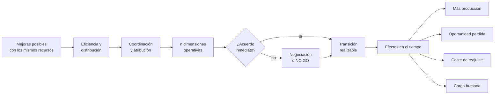
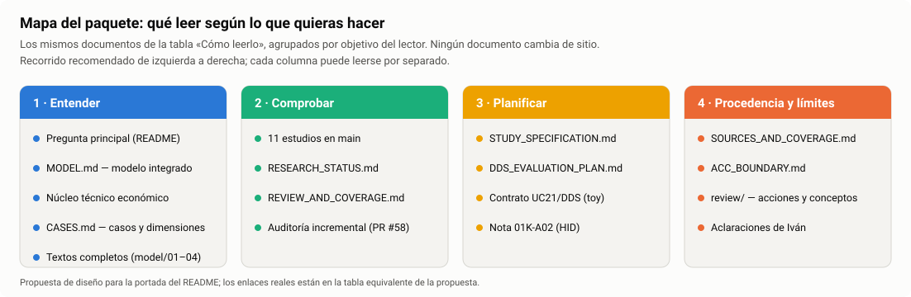
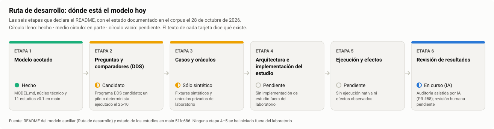
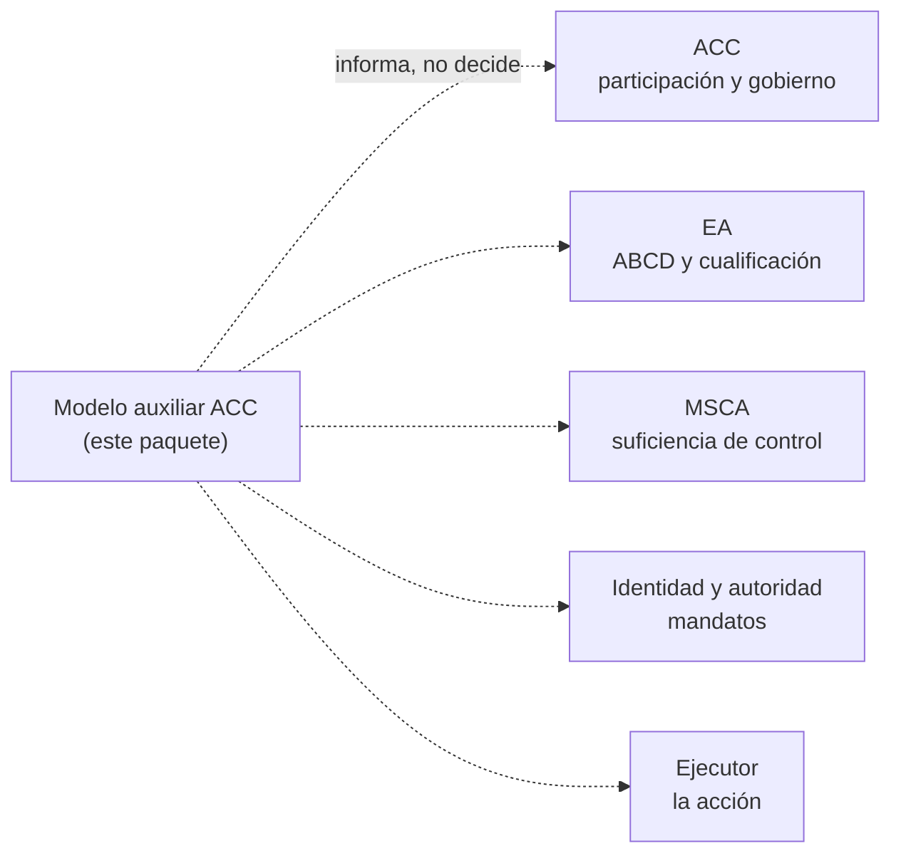

# Edición premium · 01 — README del modelo auxiliar ACC

**Documento revisado:** [`acc-auxiliary-model-v0.1/README.md`](../../../README.md), en `main` [`51fc686`](https://github.com/dakleyer/structural-awareness-contributions/blob/51fc686f45b6ef10c53b69f4c26d0e381b007ff8/research/ecosystem-awareness/baseline/01I-artifacts/acc-auxiliary-model-v0.1/README.md) (81 líneas, 9 secciones).
**Qué es esto:** propuestas de ayudas visuales, edición, diseño y conexión, listas para incorporar. **No se ha modificado el README.** Todas las propuestas son **añadidos**: ninguna borra ni reescribe texto existente. Su incorporación corresponde al propietario.
**Autor:** Claude, asistente de IA, a petición de Iván (ronda 20 de la [auditoría](../../INCREMENTAL_SCIENTIFIC_AUDIT_2026-10-26.md#ronda-20)).

---

## Lectura de fondo: qué funciona y qué le cuesta al lector

| Sección del README | Lo que ya funciona | Lo que le cuesta a un lector nuevo |
|---|---|---|
| Título y párrafo inicial | Delimita con rigor qué es y qué no es el paquete | Abre con cinco negaciones seguidas («No constituye», «no ocupa», «no redefine», «no especifica», «Tampoco») antes de decir qué ofrece. El lector sabe lo que **no** es antes de saber lo que **es**. |
| Pregunta principal | La pregunta es clara y ambiciosa | Una sola frase de 50 palabras con cinco ideas. Ningún esquema la descompone. |
| Cómo leerlo | Tabla completa con 11 destinos | Mezcla públicos: el núcleo matemático, una auditoría de promoción y la frontera institucional en la misma lista, sin orden ni grupos. |
| Textos completos | Lista numerada y clara | — |
| Ruta de desarrollo | La cadena de seis etapas es el mejor resumen del proyecto | Está en una línea de texto en negrita y no dice en qué etapa está hoy el trabajo. |
| (Estudios, repartidos) | Cada estudio está enlazado | Los estudios aparecen dispersos en tres secciones. Faltan los de #42–#47; no hay una vista única con pregunta, número de pruebas y nivel de evidencia. |
| Relación con el corpus | Reparte bien las competencias | Párrafo denso; funcionaría mejor como esquema de «quién hace qué». |
| Qué cambió tras las auditorías | Remite a las 24 acciones | No menciona la auditoría incremental (PR #58) ni su guía de lectura. |
| Tres subsecciones fechadas al final | Conservan el historial | Funcionan como un registro de cambios dentro del README; el lector no distingue lo vigente de lo histórico. |

---

## Propuestas

Cada propuesta indica el tipo, el impacto y esfuerzo estimados (no medidos), **dónde** insertarla y el texto listo para pegar. Los enlaces del texto listo para pegar son relativos a la carpeta del README.

| ID | Tipo | Propuesta | Impacto / esfuerzo |
|---|---|---|---|
| [P-R01](#p-r01--portada-en-cuatro-líneas) | Edición + diseño | Portada en cuatro líneas, en positivo | Alto / Bajo |
| [P-R02](#p-r02--esquema-de-la-pregunta-principal) | Ayuda visual | Esquema de la pregunta principal | Alto / Bajo |
| [P-R03](#p-r03--mapa-del-paquete-por-objetivo-del-lector) | Ayuda visual + diseño | Mapa del paquete por objetivo del lector | Alto / Bajo |
| [P-R04](#p-r04--ruta-de-desarrollo-con-estás-aquí) | Ayuda visual | Ruta de desarrollo con «estás aquí» | Alto / Bajo |
| [P-R05](#p-r05--catálogo-único-de-estudios) | Conexión + diseño | Catálogo único de estudios | Alto / Medio |
| [P-R06](#p-r06--quién-hace-qué) | Ayuda visual | «Quién hace qué» en la relación con el corpus | Medio / Bajo |
| [P-R07](#p-r07--enlace-a-la-auditoría-incremental) | Conexión | Enlace a la auditoría incremental y su guía | Medio / Bajo |
| [P-R08](#p-r08--separar-lo-vigente-del-historial) | Diseño | Separar lo vigente del historial | Medio / Bajo |
| [P-R09](#p-r09--pauta-de-estilo-para-todo-el-paquete) | Edición | Pauta de estilo para todo el paquete | Medio / Bajo |

### P-R01 · Portada en cuatro líneas

**Dónde:** inmediatamente debajo del título `# ACC — Modelo auxiliar`, **antes** del párrafo «Papel», que se conserva íntegro.
**Por qué:** el lector necesita saber en diez segundos qué es, para quién es y por dónde empezar. Las delimitaciones siguen justo debajo, sin cambios.

```markdown
> **En una frase:** un modelo para estudiar cuándo un sistema —una organización, una red de proveedores o un ecosistema de agentes— podría producir más con los mismos recursos, por qué a menudo no lo consigue y qué cuesta intentarlo.
> **Para quién:** investigadores, revisores y diseñadores de sistemas que necesitan separar lo demostrado de lo supuesto.
> **Por dónde empezar:** la [pregunta principal](#pregunta-principal), el [mapa del paquete](#cómo-leerlo) y el [catálogo de estudios](#catálogo-de-estudios).
> **Estado:** modelo acotado v0.1 con 11 estudios (10 con pruebas ejecutables, todos sintéticos o documentales); sin ejecución empírica todavía.
```

### P-R02 · Esquema de la pregunta principal

**Dónde:** al final de la sección «Pregunta principal», después de su párrafo.
**Por qué:** la frase contiene un recorrido completo: eficiencia y distribución, coordinación y atribución, n dimensiones, acuerdo frente a negociación y efectos en el tiempo. Un esquema lo hace visible de un vistazo. Se dibuja con Mermaid, que GitHub muestra directamente y cualquiera puede editar.

````markdown

*Una mayor producción puede coexistir con más oportunidad perdida, coste de reajuste o carga humana: esa coexistencia es la pregunta del modelo.*
````

### P-R03 · Mapa del paquete por objetivo del lector

**Dónde:** al comienzo de «Cómo leerlo», antes de la frase «Lectura técnica prioritaria», que se conserva. La tabla actual se mantiene debajo como índice completo.
**Por qué:** agrupa los mismos 11 destinos según lo que el lector quiere hacer. No mueve ningún documento.



Versión en texto, lista para pegar (los enlaces son los mismos de la tabla actual):

```markdown
| Quiero… | Empieza por | Después |
|---|---|---|
| **1 · Entender** el modelo | [Modelo integrado](MODEL.md) | [Núcleo técnico](ECONOMIC_MODEL_TECHNICAL_CORE_v0.1.md) · [Casos](CASES.md) · [Textos completos](model/01_NOTAS_COMPLETAS.md) |
| **2 · Comprobar** qué está demostrado | [Catálogo de estudios](#catálogo-de-estudios) | [Estado de las afirmaciones](RESEARCH_STATUS.md) · [Revisión y cobertura](REVIEW_AND_COVERAGE.md) · [Guía de la auditoría](review/incremental-audit-2026-10-26/GUIA_DE_LECTURA.md) |
| **3 · Planificar** un estudio | [Especificación](STUDY_SPECIFICATION.md) | [Programa DDS](DDS_EVALUATION_PLAN.md) · [Nota 01K-A02](../../01K_A02_HID_SECOND_ORDER_ECONOMIC_ACCELERATION_RESEARCH_NOTE_v0.1.md) |
| **4 · Conocer procedencia y límites** | [Fuentes y cobertura](SOURCES_AND_COVERAGE.md) | [Límites con ACC](ACC_BOUNDARY.md) · [Acciones de auditoría](review/AUDIT_ACTIONS.md) · [Aclaraciones de Iván](review/PROMPT_CLARIFICATIONS.md) |
```

### P-R04 · Ruta de desarrollo con «estás aquí»

**Dónde:** debajo de la línea en negrita de «Ruta de desarrollo», que se conserva.
**Por qué:** la cadena de seis etapas es el mejor resumen del proyecto, pero no dice dónde está hoy. El estado de cada etapa se toma del propio corpus.



Vista en tabla, lista para pegar:

```markdown
| Etapa | Estado (28-10-2026) | Qué existe |
|---|---|---|
| 1 · Modelo acotado | ● Hecho | MODEL, núcleo técnico y 11 estudios v0.1 |
| 2 · Preguntas y comparadores (DDS) | ◐ Candidato | Programa DDS candidato; un piloto determinista (25-10) |
| 3 · Casos y oráculos | ◐ Sólo sintético | Fixtures y oráculos privados de laboratorio |
| 4 · Arquitectura e implementación del estudio | ○ Pendiente | — |
| 5 · Ejecución y efectos | ○ Pendiente | — |
| 6 · Revisión de resultados | ◐ En curso | Auditoría asistida por IA (PR #58); revisión humana pendiente |
```

### P-R05 · Catálogo único de estudios

**Dónde:** nueva sección `## Catálogo de estudios`, inmediatamente **después** de «Ruta de desarrollo». Los párrafos actuales que describen estudios se conservan donde están.
**Por qué:** hoy los estudios aparecen en tres secciones y faltan seis (#42–#47). Una sola tabla conecta cada estudio con su pregunta, su PR de origen, sus pruebas, su nivel de evidencia y lo que dice la auditoría.

**Datos comprobados para esta propuesta:** cada suite se ejecutó en `main` `51fc686` el 28-10-2026 y todas pasaron. El PR de origen se obtuvo del commit que creó cada carpeta.

```markdown
| Estudio | PR | Pregunta, en una línea | Pruebas | Evidencia | Auditoría |
|---|---|---|---:|---|---|
| [Piloto económico](studies/economic-pilot-v0.1/STUDY_PROTOCOL.md) | #28 | ¿Coinciden los procedimientos principales en una especificación pequeña? | 21 | 🧪 Sintético | — |
| [Toy paramétrico](studies/parametric-economic-toy-v0.1/README.md) | #28 | Óptimos, costes, permisos, HID por óptimo y crecimiento n→n+1 | 52 | 🧪 Sintético | — |
| [Recreación analítica](studies/synthetic-recreation-v0.1/README.md) | #28 | Recalcular los parámetros declarados | — | 📄 Documental | — |
| [Puentes causales](studies/causal-bridges-v0.1/README.md) | #40 | HID, Attribution Gap, Informational Friction y obligaciones | 19 | 🧪 Sintético | — |
| [Trampas acotadas](studies/bounded-traps-v0.1/README.md) | #42 | Bloqueo por codependencia y utilidad no monótona | 21 | 🧪 Sintético | H-01, H-02, H-05 |
| [Composición anidada](studies/nested-composition-suffering-v0.1/README.md) | #43 | Pérdida de distinciones en la composición | 32 | 🧪 Sintético | H-03, H-04, H-06 ✓ |
| [A/B/C/D intrínseco](studies/intrinsic-abcd-economics-v0.1/README.md) | #44 | Coste de comprensión y cualificación situada | 61 | 🧪 Sintético | K-01, K-02, K-03, K-04 ✓ |
| [Cierre local y metacognición](studies/scoped-closure-metacognition-v0.1/README.md) | #45 | Respuesta local con indeterminación abierta | 72 | 🧪 Sintético | I-01 ✓ cerrado, K-05 ✓ |
| [Aversión al riesgo](studies/risk-aversion-persistence-v0.1/README.md) | #46 | Permanencia racional bajo riesgo de transición | 82 | 🧪 Sintético | K-06 ✓, K-07, K-08 |
| [Puente 00M → ACC → UC21](studies/00m-acc-uc21-bridge-v0.1/README.md) | #47 | Plausibilidad, dominancia débil y falsadores | 20 | 🧪 Sintético | Sin auditar aún |
| [Campaña Conscientia](studies/conscientia-campaign-v0.1/README.md) | #48/#49 | 60 casos × 5 estrategias | 61 | 🧪 Sintético | G-01 a G-06 |

*En PR abiertos:* casos adicionales Conscientia (#54; F-06), reducción agéntica (#57; F-01 a F-05) y linaje matemático (#60; M27-03/04, M28-02 a M28-04).
**Leyenda:** 🧪 sintético = ejecutable con datos fijados; 📄 documental = cálculo o lectura sin pruebas; 🔬 empírico = con observaciones del mundo (ninguno todavía). ✓ = verificado o cerrado por la auditoría. Pruebas contadas en `main` el 28-10-2026.
```

### P-R06 · «Quién hace qué»

**Dónde:** debajo del primer párrafo de «Relación con el corpus», que se conserva.
**Por qué:** el párrafo reparte cinco competencias en una sola frase. Un esquema evita leerlo tres veces.

````markdown

*Cada consumidor conserva su competencia; el modelo puede informar sus decisiones o contrastes sin transferírselas.*
````

### P-R07 · Enlace a la auditoría incremental

**Dónde:** al final del primer párrafo de «Qué cambió tras las auditorías».

```markdown
La [auditoría incremental](review/INCREMENTAL_SCIENTIFIC_AUDIT_2026-10-26.md) continúa esa revisión ronda a ronda, con estados por hallazgo; su [guía de lectura](review/incremental-audit-2026-10-26/GUIA_DE_LECTURA.md) resume en lenguaje llano qué está abierto, qué está cerrado y por dónde empezar.
```

*Nota:* la auditoría vive hoy en el PR #58. El enlace funciona cuando ese PR se incorpore a `main`.

### P-R08 · Separar lo vigente del historial

**Dónde:** inmediatamente antes de `### Puente experimental UC21 / DDS y revisión científica (25-10-2026)`.
**Por qué:** las tres subsecciones fechadas son historial valioso, pero hoy se leen como si fueran la parte vigente. Un encabezado basta para distinguirlas; no se mueve ni se borra nada.

```markdown
## Registro de novedades

*Entradas fechadas en orden de incorporación. El estado vigente de cada estudio está en el [catálogo de estudios](#catálogo-de-estudios).*
```

### P-R09 · Pauta de estilo para todo el paquete

Recomendaciones de edición para aplicar al escribir texto nuevo, sin reescribir el existente:

1. **Primero lo que es, después lo que no es.** Abrir cada documento con una frase afirmativa; las delimitaciones van inmediatamente después.
2. **Un párrafo, una idea.** Cuatro o cinco líneas como máximo. Si hay tres condiciones, una lista.
3. **Entradilla en negrita** al comienzo de cada párrafo largo, para poder leer en diagonal.
4. **Cifras con fecha.** «52 pruebas (28-10-2026)». Las cifras cambian y el lector necesita saber de cuándo son.
5. **Nivel de evidencia visible.** La misma leyenda (🧪 sintético · 📄 documental · 🔬 empírico) en cada estudio y cada resultado citado.
6. **Cada esquema con su versión en texto.** Toda figura lleva al lado una tabla o una frase con la misma información.
7. **Siglas definidas en su primera aparición** en cada documento, o enlazadas al glosario.

---

**Comprobaciones de esta propuesta:** las 11 suites de pruebas se ejecutaron en `main` `51fc686` (todas en verde; 00M bridge 20, trampas 21, puentes 19, campaña 61, piloto 21, ABCD 61, anidada 32, toy 52, riesgo 82 = 43 + 39, cierre local 72; la recreación no tiene pruebas). El PR de origen de cada carpeta se obtuvo de la API de GitHub. El estado de cada etapa de la ruta procede de los documentos citados en cada tarjeta. Las figuras se generan con [`build_premium_figures.py`](build_premium_figures.py).
