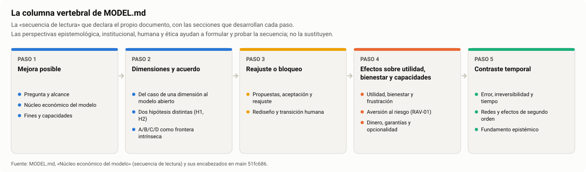
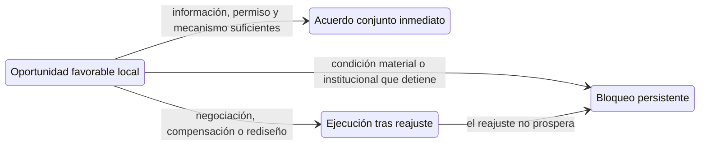
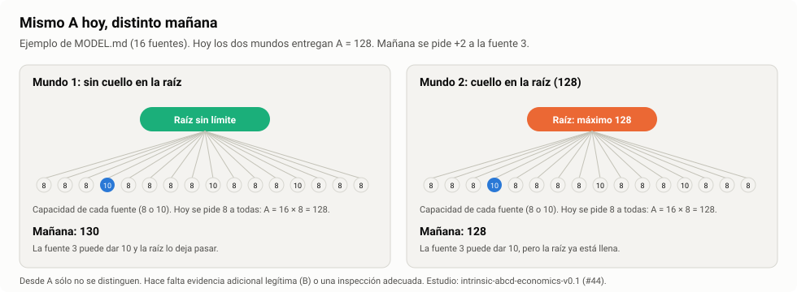
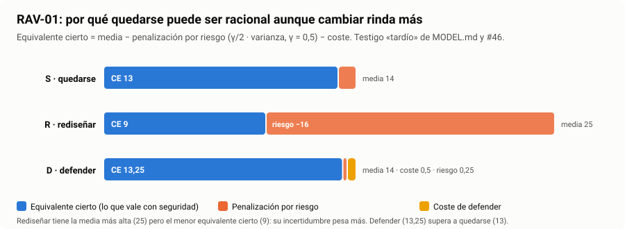
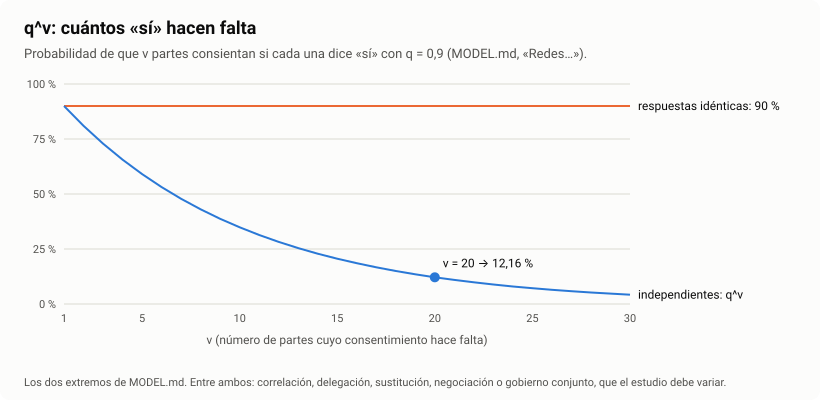

# Edición premium · 02 — `MODEL.md`, el modelo integrado

**Documento revisado:** [`acc-auxiliary-model-v0.1/MODEL.md`](../../../MODEL.md), en `main` [`51fc686`](https://github.com/dakleyer/structural-awareness-contributions/blob/51fc686f45b6ef10c53b69f4c26d0e381b007ff8/research/ecosystem-awareness/baseline/01I-artifacts/acc-auxiliary-model-v0.1/MODEL.md) (218 líneas, 23 títulos).
**Qué es esto:** propuestas de ayudas visuales, edición, diseño y conexión, listas para incorporar. **No se ha modificado `MODEL.md`.** Salvo P-M02, que se señala aparte, todas las propuestas son **añadidos**. Su incorporación corresponde al propietario.
**Autor:** Claude, asistente de IA, a petición de Iván (ronda 21 de la [auditoría](../../INCREMENTAL_SCIENTIFIC_AUDIT_2026-10-26.md#ronda-21)). Forma parte del [kit de edición premium](INDEX.md).

---

## En una mirada

`MODEL.md` es el texto que mejor explica el proyecto. Su fortaleza es la **precisión**: separa con cuidado lo técnicamente posible de lo autorizado, la brecha del modelo de la frustración vivida y la elección racional del óptimo social. Su dificultad es la **densidad**: 23 secciones, más de 20 magnitudes con símbolo, 13 ejemplos narrativos y cautelas dentro de casi cada párrafo. Un lector no especialista se pierde porque no ve el esqueleto. Las propuestas hacen visible ese esqueleto sin quitar ninguna cautela.



## Lectura de fondo, sección por sección

| Sección | Lo que ya funciona | Lo que le cuesta a un lector nuevo | Propuesta |
|---|---|---|---|
| Título | — | Faltan comas: «oportunidades transición y capacidades» | P-M02 |
| Pregunta y alcance | Abre con una frase afirmativa y concreta | — | P-M01 |
| Núcleo económico | Declara la secuencia de lectura que ordena todo el documento | La secuencia está en una línea en negrita y no remite a las secciones | P-M01 |
| Fines y capacidades | Separa conservar objetos de conservar una práctica viva | — | — |
| Del caso de una dimensión… | Ejemplos memorables (ministerios, plátanos, Cáritas/DANA) | Seis escenas seguidas en un párrafo; el lector no sabe qué ilustra cada una | P-M09 |
| Mecanismo primario de bloqueo | El ejemplo x₁ ≤ x₂, x₂ ≤ x₁ es claro | Remite a #42 sin decir que la auditoría lo lee como trampa de factibilidad (H-01) | P-M10 |
| Dimensiones implícitas | Distinción fina entre activar y crear una dimensión | Abstracta; sin ejemplo visual | — |
| Dos hipótesis (H1, H2) | Separa linealidad instrumental de complejidad | — | P-M03 |
| A/B/C/D como frontera intrínseca | El mejor resumen del corpus sobre por qué no hace falta un «velo» | El ejemplo de 16 fuentes (A = 128) se cuenta sólo en texto | P-M05 |
| Suficiencia parcial y metacognición | — | Párrafos muy largos | P-M12 |
| Propuestas, aceptación y reajuste | Cuatro estados de una oportunidad bien separados | Los cuatro estados no se ven como recorrido | P-M04 |
| Rediseño y transición humana | Dignidad independiente de la productividad | — | — |
| Utilidad, bienestar y frustración | Lista explícita de magnitudes que no se suman | Diez símbolos en una frase (P, G, G_vis, C_adj, F, W, HID…) sin tabla | P-M03 |
| RAV-01 | Resultado cerrado y testigo numérico | Las cifras CE_S = 13, CE_R = 9, CE_D = 13,25 no se ven comparadas | P-M06 |
| Error, irreversibilidad y tiempo | Volver atrás es otra transición | — | — |
| Redes y efectos de segundo orden | q^v con sus dos extremos | Las cifras 0,1216 y 0,9 no se ven en una curva | P-M07 |
| Crecimiento relativo de la brecha | Excepciones explícitas | No remite a la lectura de la auditoría (H-02) | P-M08 |
| Uso posterior | — | Dice «34 comprobaciones»; la carpeta del toy reúne hoy 52 + 70 pruebas | P-M11 |

## Propuestas

| ID | Tipo | Propuesta | Impacto / esfuerzo |
|---|---|---|---|
| [P-M01](#p-m01--columna-vertebral-visible) | Ayuda visual | Columna vertebral visible, con enlaces a las secciones | Alto / Bajo |
| [P-M02](#p-m02--comas-en-seis-títulos) | Edición | Comas en seis títulos (las anclas no cambian) | Bajo / Bajo |
| [P-M03](#p-m03--tabla-de-magnitudes) | Ayuda visual + edición | Tabla de magnitudes y choques de notación | Alto / Bajo |
| [P-M04](#p-m04--los-cuatro-estados-de-una-oportunidad) | Ayuda visual | Los cuatro estados de una oportunidad | Medio / Bajo |
| [P-M05](#p-m05--mismo-a-hoy-distinto-mañana) | Ayuda visual | Mismo A hoy, distinto mañana | Alto / Bajo |
| [P-M06](#p-m06--rav-01-en-una-figura) | Ayuda visual | RAV-01 en una figura | Alto / Bajo |
| [P-M07](#p-m07--qv-en-una-curva) | Ayuda visual | q^v en una curva | Medio / Bajo |
| [P-M08](#p-m08--enlace-a-la-lectura-de-la-brecha-relativa) | Conexión | Enlace a la lectura de la brecha relativa | Medio / Bajo |
| [P-M09](#p-m09--índice-de-ejemplos) | Diseño + conexión | Índice de ejemplos | Alto / Bajo |
| [P-M10](#p-m10--de-cada-sección-a-su-estudio-y-su-auditoría) | Conexión | De cada sección a su estudio y su auditoría | Alto / Bajo |
| [P-M11](#p-m11--cifra-de-pruebas-con-fecha) | Edición | Cifra de pruebas con fecha | Bajo / Bajo |
| [P-M12](#p-m12--recuadros-de-límite) | Diseño | Recuadros de límite | Medio / Medio |

### P-M01 · Columna vertebral visible

**Dónde:** en «Núcleo económico del modelo», justo después del párrafo que contiene «La secuencia de lectura es…», que se conserva.

```markdown


| Paso | Secciones |
|---|---|
| 1 · Mejora posible | [Pregunta y alcance](#pregunta-y-alcance) · [Núcleo económico](#núcleo-económico-del-modelo) · [Fines y capacidades](#fines-y-capacidades) |
| 2 · Dimensiones y acuerdo | [Del caso de una dimensión](#del-caso-de-una-dimensión-al-modelo-abierto) · [Dos hipótesis](#dos-hipótesis-distintas-y-retroalimentación-de-la-aceptación) · [A/B/C/D](#abcd-como-frontera-intrínseca-del-modelo-social--no-un-anexo-de-incertidumbre) |
| 3 · Reajuste o bloqueo | [Propuestas, aceptación y reajuste](#propuestas-aceptación-y-reajuste) · [Rediseño y transición humana](#rediseño-y-transición-humana) |
| 4 · Efectos sobre utilidad, bienestar y capacidades | [Utilidad, bienestar y frustración](#utilidad-bienestar-y-frustración) · [RAV-01](#aversión-al-riesgo-constante-y-permanencia-con-sufrimiento-creciente-rav-01) · [Dinero y garantías](#dinero-garantías-opcionalidad-y-reconocimiento) |
| 5 · Contraste temporal | [Error, irreversibilidad y tiempo](#error-irreversibilidad-y-tiempo) · [Redes](#redes-y-efectos-de-segundo-orden) · [Fundamento epistémico](#fundamento-epistémico-y-estatuto-de-las-hipótesis) |
```

*La ruta es relativa a `MODEL.md` y funciona en cuanto se fusione el PR #58. Si se prefiere, la figura puede copiarse junto al documento.*

### P-M02 · Comas en seis títulos

**Única propuesta no aditiva del documento; es opcional.** GitHub elimina las comas al generar las anclas, así que los 35 enlaces que hoy apuntan en `main` a cinco de estos títulos (10 a «Propuestas…», 9 a «Utilidad…», 7 a «Dinero…», 5 a «Error…» y 4 a «Preservación…») **siguen funcionando**. Comprobado con el mismo algoritmo de anclas.

| Título actual | Con comas |
|---|---|
| ACC — Modelo auxiliar de oportunidades transición y capacidades | ACC — Modelo auxiliar de oportunidades, transición y capacidades |
| Propuestas aceptación y reajuste | Propuestas, aceptación y reajuste |
| Utilidad bienestar y frustración | Utilidad, bienestar y frustración |
| Error irreversibilidad y tiempo | Error, irreversibilidad y tiempo |
| Dinero garantías opcionalidad y reconocimiento | Dinero, garantías, opcionalidad y reconocimiento |
| Preservación métodos y contextos | Preservación, métodos y contextos |

### P-M03 · Tabla de magnitudes

**Dónde:** nueva subsección `### Magnitudes y símbolos` al final de «Núcleo económico del modelo». Cada definición se toma del propio `MODEL.md`; los componentes de HID remiten a 01K.

```markdown
### Magnitudes y símbolos

| Símbolo | Qué es, en una línea | No confundir con | Se usa en |
|---|---|---|---|
| P | Producción realizada | Beneficio, bienestar | Redes; brecha relativa |
| G | Brecha del modelo respecto de una alternativa mejor y factible | Frustración vivida, deuda recuperable | Utilidad, bienestar y frustración |
| G_vis | La parte de la brecha que resulta visible | G completa | Ídem |
| C_adj | Coste de reajuste de una transición | Coste de producción | Ídem |
| F | Disconfort; requiere medición independiente | G | Ídem; RAV-01 |
| W | Bienestar | Producción; F | Ídem; regímenes A y B |
| HID | Human Intelligence Debt, definida en 01K | G; F | Ídem |
| GIC, NEO, ACW | Categorías de tiempo humano definidas en 01K | — | Ídem |
| L | Utilidad perdida económicamente reconocible, para una persona y una referencia factible | F; sufrimiento estructural (#43) | RAV-01 |
| γ | Aversión absoluta al riesgo, constante | — | RAV-01 |
| μ, σ² | Media y varianza de cada trayectoria | — | RAV-01 |
| CE, ΔCE | Equivalente cierto; diferencia entre rediseñar y quedarse | La media | RAV-01 |
| k | Coste de la defensa activa | — | RAV-01 |
| q, v | Probabilidad de que cada parte consienta; número de partes | — | Redes |
| g, b, n | Ganancia neta por interacción; producción por unidad; número de unidades | — | Brecha relativa |
| Δu_i, t_i, c_i | Cambio de utilidad, transferencia y coste del participante i | — | Propuestas, aceptación y reajuste |
| O(t) | Obligaciones vigentes en t | Deuda monetaria | Dinero y garantías |
| A, B, C, D | Posiciones de evaluación relativas al proceso | Categorías fijas de subsistemas | A/B/C/D |
| Q | Cualificación transmitida para una pregunta | B por sí misma | A/B/C/D |
| H1, H2 | Linealidad instrumental; hipótesis de complejidad | — | Dos hipótesis |
| FH-C, FH-E | Prioridad causal; economía computacional | — | Fundamento epistémico |

El mapa completo de magnitudes y la prohibición de doble cómputo están en [IQ-05 de las notas](model/01_NOTAS_COMPLETAS.md#iq-05--mapa-de-magnitudes-económicas-y-prohibición-de-doble-cómputo); esta tabla es su versión de bolsillo.

**Choques de notación.** La letra **C** nombra la posición C de A/B/C/D y también el coste de transición en ΔCE; la letra **D** nombra la posición D y también la acción «defender» de RAV-01. En texto nuevo conviene escribir *C_tr* para el coste de transición y *Def* para la acción de defender, sin cambiar las fórmulas ya publicadas.
```

### P-M04 · Los cuatro estados de una oportunidad

**Dónde:** en «Propuestas, aceptación y reajuste», después de su primer párrafo, que se conserva.

````markdown

*Una dimensión de evaluación no es por sí misma titular de veto: detener corresponde a una condición material o institucional concreta.*
````

### P-M05 · Mismo A hoy, distinto mañana

**Dónde:** en «A/B/C/D como frontera intrínseca…», después del párrafo «La comparación en un laboratorio finito…», que se conserva.



Versión en texto: hoy los dos mundos entregan A = 128. Mañana se piden dos unidades más a la fuente 3, que puede dar 10. En el mundo 1 la raíz no tiene límite y la respuesta es 130; en el mundo 2 la raíz tiene un máximo de 128 y la respuesta sigue siendo 128. Desde A solo no se distinguen.

### P-M06 · RAV-01 en una figura

**Dónde:** en «Aversión al riesgo constante…», después del párrafo «Extensión a defensa activa», que se conserva.



| Acción | Media | Penalización por riesgo (γ/2 · σ²) | Coste | Equivalente cierto |
|---|---:|---:|---:|---:|
| S · quedarse | 14 | 1 | 0 | **13** |
| R · rediseñar | 25 | 16 | 0 | **9** |
| D · defender | 14 | 0,25 | 0,5 | **13,25** |

*Cifras ejecutadas con `risk_model.py` de #46 en `main` (ronda 17, K-06).*

### P-M07 · q^v en una curva

**Dónde:** en «Redes y efectos de segundo orden», después del párrafo de q^v, que se conserva.



Con q = 0,9 y partes independientes, la probabilidad de que todas consientan cae al 12,16 % con 20 partes. Si todas responden igual, se mantiene en el 90 %. La realidad está entre ambos extremos y depende de correlación, delegación, sustitución, negociación y gobierno conjunto.

### P-M08 · Enlace a la lectura de la brecha relativa

**Dónde:** al final del párrafo de «Crecimiento relativo de la brecha y excepciones».

```markdown
La [auditoría incremental (H-02)](review/INCREMENTAL_SCIENTIFIC_AUDIT_2026-10-26.md#h-02) muestra gráficamente cómo crece G/P con n bajo este supuesto y propone derivar g de un mecanismo medible por enlace, con casos en que la brecha se cierra.
```

### P-M09 · Índice de ejemplos

**Dónde:** nueva subsección `### Índice de ejemplos` al final de «Del caso de una dimensión al modelo abierto».

```markdown
### Índice de ejemplos

| Ejemplo | Qué ilustra | Sección | Desarrollo |
|---|---|---|---|
| Ministerios; 700 aplicaciones a dos | Eficiencia con reparto o autoridad pendientes; rediseño por sustracción | Del caso de una dimensión · Rediseño | [CASES](CASES.md) |
| Plátano a quien lo necesita / cerca del origen | Distribución con transporte frente a evitar el viaje | Del caso de una dimensión | [Recorrido de variantes](CASES.md#recorrido-de-variantes-y-condiciones-que-pueden-bloquear) |
| Recogida Cáritas/DANA (hipotético) | Atribución y reconocimiento condicionan la aceptación | Del caso de una dimensión | Ídem |
| Viernes/Robinson | Ganancias directas positivas y reparto relativo | Del caso de una dimensión | Ídem |
| Dos proyectos x₁ ≤ x₂, x₂ ≤ x₁ | Óptimo conjunto inaccesible paso a paso | Mecanismo primario de bloqueo | [#42](studies/bounded-traps-v0.1/README.md) |
| Manzanas | Utilidad no monótona y Pareto sobre estados finales | Mecanismo primario de bloqueo | [#42](studies/bounded-traps-v0.1/README.md) |
| 16 fuentes, A = 128 | Mismo A, distinta respuesta futura | A/B/C/D | [#44](studies/intrinsic-abcd-economics-v0.1/README.md) |
| Nube de puntos inciertos | Cotas conservadoras con regularidad justificada | Suficiencia parcial | [#45](studies/scoped-closure-metacognition-v0.1/README.md) |
| Tendero que fía y cajera que no | Comprender no concede mandato | Propuestas, aceptación y reajuste | [Notas, caso F](model/01_NOTAS_COMPLETAS.md) |
| Marketing, Producción y Sistemas | Compensación sin pagador predeterminado | Propuestas, aceptación y reajuste | [CASES](CASES.md) |
| Playa | Ingreso nuevo frente a utilidad nueva | Rediseño y transición humana | [CASES](CASES.md) |
| Dos plátanos; naranjas | Más consumo con peor balance; observación frente a causa | Utilidad, bienestar y frustración | [CASES](CASES.md) |
| España → Colombia (hipotético) | Quedarse con mayor riesgo de cambio | RAV-01 | [#46](studies/risk-aversion-persistence-v0.1/README.md) |
| Ormuz (experimento mental) | Cuellos comunes, rutas alternativas y costes | Redes | [CASES](CASES.md) |
| Oficio cultural | Objetos, maestros y práctica no son intercambiables | Preservación | [CASES](CASES.md) |
| Limpiador de mesas | Verdad del dominio frente a fundamento para actuar | Fundamento epistémico | [Notas completas](model/01_NOTAS_COMPLETAS.md) |
```

### P-M10 · De cada sección a su estudio y su auditoría

**Dónde:** nueva sección `## Dónde se pone a prueba cada parte`, antes de «Uso posterior».

```markdown
## Dónde se pone a prueba cada parte

| Sección | Estudio ejecutable | Qué dice la auditoría |
|---|---|---|
| Mecanismo primario de bloqueo | [#42 Trampas acotadas](studies/bounded-traps-v0.1/README.md) | Trampa de factibilidad correcta; para «racional» falta un modelo de elección, que #46 ya aporta (H-01, K-08) |
| Crecimiento relativo de la brecha | [#42](studies/bounded-traps-v0.1/README.md) | La brecha creciente es un supuesto declarado (H-02) |
| A/B/C/D como frontera intrínseca | [#43](studies/nested-composition-suffering-v0.1/README.md), [#44](studies/intrinsic-abcd-economics-v0.1/README.md) | Cotas de información y separación por fibras verificadas (H-06, K-04); B no es componible entre preguntas (K-02) |
| Suficiencia parcial y metacognición | [#45](studies/scoped-closure-metacognition-v0.1/README.md) | Defecto numérico corregido y reconfirmado (I-01, cerrado) |
| RAV-01 | [#46](studies/risk-aversion-persistence-v0.1/README.md) | Cálculos verificados (K-06); falta declarar escala común al comparar con bienestar (K-07) |
| Un mismo programa: 00M y UC21 | [#47](studies/00m-acc-uc21-bridge-v0.1/README.md) | Aún sin auditar |
| Ejecución integrada de Conscientia | [#48/#49](studies/conscientia-campaign-v0.1/README.md) | Los comparadores tienen el veredicto escrito en los datos (G-01) |

Estados vigentes en la [guía de lectura de la auditoría](review/incremental-audit-2026-10-26/GUIA_DE_LECTURA.md).
```

### P-M11 · Cifra de pruebas con fecha

**Dónde:** en «Uso posterior», la frase «Las 34 comprobaciones son sintéticas». **Propuesta aditiva:** dejar la frase y añadir detrás:

```markdown
(Recuento del 28-10-2026: el toy tiene 52 pruebas, 34 iniciales y 18 de HID/ABCD; su carpeta `tests/` añade 70 regresiones del puente UC21–DDS, que la CI ejecuta por separado.)
```

*Comprobado en `main` `51fc686`:* `python -m unittest discover` en `studies/parametric-economic-toy-v0.1` ejecuta 52 pruebas (34 en `test_toy.py`, 18 en `test_hid_optimum.py`), todas en verde; `tests/test_uc21_dds_bridge.py` ejecuta otras 70, también en verde, y la CI las lanza en un paso aparte (`document-integrity.yml`). El README del paquete cita 52 y no suma las 70; conviene que diga ambas cifras.

### P-M12 · Recuadros de límite

**Por qué:** casi cada párrafo de `MODEL.md` termina con una cautela («no demuestra…», «no mide…», «no atribuye…»). Son necesarias, pero mezcladas con el argumento dificultan seguirlo. Un formato fijo las hace visibles sin quitar ninguna.

**Pauta para texto nuevo**, y para el existente si el propietario lo decide: la idea va en el párrafo y la cautela en un recuadro inmediatamente debajo.

```markdown
Un sistema social compuesto no necesita recibir una variable de «ignorancia» inventada: dos configuraciones con igual A hoy pueden aportar outputs distintos mañana.

> **Límite.** No se catalogan exhaustivamente subsistemas como A/B/C/D ni se transforma D en una probabilidad o un precio oculto.
```

---

**Comprobaciones de esta entrega:** las cifras de P-M06 proceden de ejecutar `risk_model.py` (#46) en `main`; las de P-M07 son 0,9²⁰ = 0,1216 y 0,9; el ejemplo de P-M05 es el de `MODEL.md` y #44 (verificado en K-04); el recuento de P-M11 se obtuvo ejecutando las pruebas. Los enlaces entrantes se contaron en `main` (81 a secciones de `MODEL.md`, 35 a los títulos de P-M02), y se comprobó que las anclas no cambian al añadir comas. El diagrama de P-M04 se validó con `mmdc`. Figuras generadas con [`build_premium_figures.py`](build_premium_figures.py).
