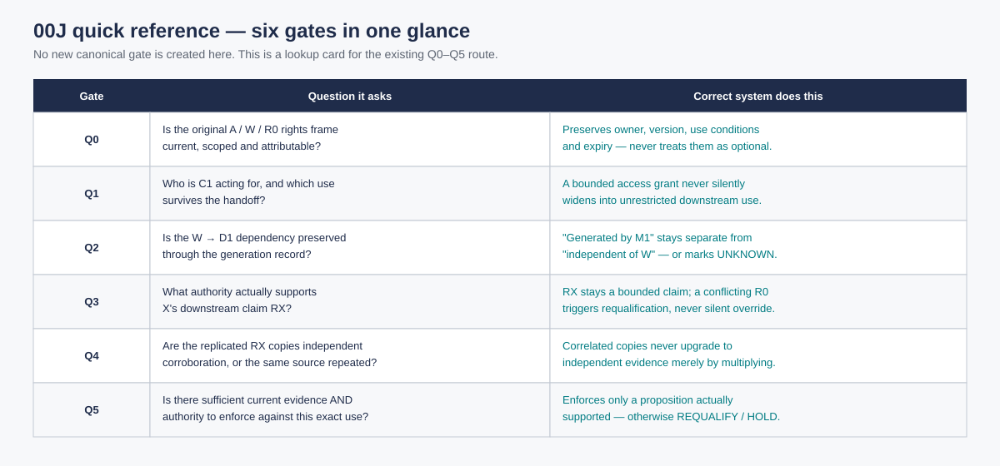

> **Estado de aplicación — 15 octubre 2026.** Aplicadas y verificadas: 94, 105, 106, 113, sealed00J. [Comprobación final](#owner-authorised-application-complete-15-october-2026). Los pares antes/después se conservan como trazabilidad; este lote aprobado ya no está pendiente.

# Revisión del README del corpus técnico de Ecosystem Awareness

**Única VNext de este README.** [Fuente](./README.md) · [plan](../../../governance/CORPUS_REVIEW_PROCEDURE_2026-10-06.md) · [EP README VNext](../../../architectural-contributions/ecosystem-positioning/README_VNext.md). Auditoría por Codex, 6 de octubre de 2026; asistente de IA del mismo chat.

Este es el índice técnico del tercer nivel de lectura: **Ecosystem Positioning → Awareness → corpus técnico**. Sus paquetes y fichas locales no crean una escalera adicional de README.

## Instrucción de Iván y alcance

Iván exige examinar aquí redistribución, jerarquías y relaciones de lectura. El texto existente se conserva; las propuestas requieren su decisión concreta. En esta entrada se examinaron la ruta 00M/00N, la leyenda de estado, el spine de pruebas, las referencias a UC-EA-03 y 05A, y el grafo de destinos. **Todavía no es lectura semántica completa de los 71.454 caracteres ni cuatro pasadas terminadas del README.**

## Auditoría de relaciones realizada por Codex

La ruta inicial separa plausibilidad y cumplimiento y avisa que los companion links del addendum son históricos. Esa regla permite conservar v0.6/v0.5 sin enfrentarlos como vocabulario vigente a v0.8/v0.7. La [VNext del addendum](./00N_ADDENDUM_VNext.md) propone llevar la misma aclaración a su introducción; la propuesta permanece en este expediente de lectura.

La tabla [00M-A01](./00M_A01_MECHANISM_TO_REQUIREMENTS_TRACEABILITY_v0.1_WORKING_PROPOSAL.md) existe y se enlaza desde 04 VNext. Puede ayudar a seguir el puente mecanismo→función→requisito. Su [revisión](./00M_A01_VNext.md) no la trata como fuente canónica ni exige hacerla otra estación obligatoria de lectura.

UC-EA-03 se enlaza a su documento completo; sus copias por partes no tienen referencias entrantes en este grafo. La dirección cortada entre part02/part03 no justifica reescribir el freeze ni agregar un nuevo índice por parte. La [VNext única de UC-EA-03](./UC-EA-03_VNext.md) conserva el hallazgo. La propuesta de tratamiento futuro de esas copias necesita examinar pertenencia/publicación, no “limpiarlas”.

La ruta actual hacia 05A está en fg-tida/interfaces. La copia antigua en baseline tiene el mismo número v0.1 y otra cabecera/texto, sin una advertencia inicial inequívoca de predecessor. Se registra la posible confusión en la [VNext existente de 05A](../fg-tida/interfaces/05A_FG_TIDA_CURRENT_STATE_CONFORMANCE_BRIDGE_VNEXT_REVIEW_AND_DELTA_v0.1_DRAFT.md). Su diferencia exacta y los consumidores deberán conciliarse antes de proponer cambio de autoridad o movimiento.

La leyenda de estados ayuda, pero “canonical working” no acredita una validación. El spine A23 declara la retirada del all-six previo; las filas de casos no pueden heredar suficiencia general de pruebas relativas. La auditoría integral de sus demostraciones y de los resúmenes de ejecución queda pendiente, aunque los enlaces existan.

## Conversación y prioridades

**Codex, auto-revisión:** este registro recibe hallazgos de navegación y relación para que no se decidan en archivos aislados. El [recorrido de 529 Markdown](../../../governance/review/EP_REVIEW_NAVIGATION_2026-10-06.md) no sustituye las pasadas de fondo, forma y legibilidad de este índice.

Primero se contrastarán las afirmaciones de prueba y evidencia con sus fuentes completas; después se examinará la organización para una persona. Se mantendrán los tres niveles acordados y una sola VNext por documento. Ninguna redistribución se ejecutó.

## Alcance y conciliación con las otras ramas — instrucción de Iván

**6 de octubre de 2026.** Todo Contributions queda dentro del programa de revisión, incluidas las rutas de este índice, MSCA y Regime Awareness, y los documentos sin enlace textual desde EP. [Plan 1.5](../../../governance/CORPUS_REVIEW_PROCEDURE_2026-10-06.md#alcance-confirmado-todo-contributions-y-sus-integraciones) · [inventario del árbol completo](../../../governance/review/EP_REVIEW_REPOSITORY_SCOPE_2026-10-06.md).

**Auditoría realizada por Codex; cotejo parcial de integraciones.** Se comprobó la relación entre 01C, los README RA/MSCA y el input de MSCA Operation; 01D se leyó completo para revisar operación/scope/versiones/tiempo y permiso separados. Los resúmenes de B_RA y de “direction/intensity/capability/residual” necesitan conciliarse con sus definiciones fuente, sin cambiar los contratos durante la auditoría.

[Registro conjunto](../../../governance/review/EP_REVIEW_INTEGRATIONS_2026-10-06.md) · [01C VNext](./01C_VNext.md) · [MSCA Operation VNext](../../../standards/minimum-sufficient-control/04_OPERATION_VNext.md) · [RA README VNext](../../regime-awareness/README_VNext.md) · [MSCA README VNext](../../../standards/minimum-sufficient-control/README_VNext.md).

La revisión integral de este README continúa pendiente. Se conservan las entradas anteriores y las propuestas opcionales; no se ejecuta redistribución, cambio de propietario, renombrado de fields, ni nuevas pruebas o campañas. Los tres niveles acordados y las funciones propias de cada rama siguen vigentes.


---

## Quinta pasada — investigación externa, diferencial y reutilización

**Instrucción de Iván, 6 de octubre de 2026. Estado: contraste específico pendiente.** Esta quinta pasada se realiza después de las cuatro y queda dentro de esta misma VNext. No se crea otro expediente ni se incorporan propuestas a la fuente por esta anotación.

**Pregunta de este documento:** Revisar la ruta externa de fundamentos, casos, interfaces y evidencia y su actualización. Mostrar al lector dónde un método es antecedente, alternativa o pieza aprovechable, sin crear nuevos niveles de README ni inflar evidencia.

Se fijarán trabajos primarios de FG-TIDA y de otras líneas relevantes, incluidos antecedentes y actualizaciones posteriores, con autor, versión, fecha y alcance realmente leído. Aquí se justificará qué coincide, qué diferencia podría sostenerse y qué pieza concreta conviene reutilizar, con sus condiciones de atribución, adaptación y compatibilidad.

El [mapa externo preparatorio](../../../governance/review/EP_EXTERNAL_RESEARCH_REVIEW_2026-10-06.md) aporta fuentes iniciales; no completa esta pasada. El [plan 1.6](../../../governance/CORPUS_REVIEW_PROCEDURE_2026-10-06.md#quinta-pasada--trabajos-externos-diferencial-y-reutilización) gobierna método y cierre. Las cuatro lecturas previas mantienen sus estados reales y se reabren si aparece evidencia que las afecte. Codex, mismo asistente de IA; anotación de alcance, sin independencia externa.


---

## Sexta pasada unificadora — preparación y continuidad

**Instrucción de Iván, 6 de octubre de 2026. Preparación registrada por Codex, mismo asistente de IA. Estado: pendiente de lanzamiento después de las cinco pasadas del corpus.** Esta anotación organiza el trabajo futuro; no declara una auditoría unificadora realizada ni cambia el estado de las lecturas anteriores.

**Pregunta de consolidación de este documento:** Hacer que la ruta de fundamentos, casos, interfaces y evidencia conserve versiones y límites y sea legible, incluyendo documentos sueltos sin abrir más niveles de README.

Los hallazgos concretos se comentarán aquí y en las VNext de los documentos relacionados, conservando respuestas y desacuerdos. Se cotejarán las propuestas con la fuente actual y sus consumidores antes de presentar candidatos consolidados antes/después. La [sexta pasada del plan](../../../governance/CORPUS_REVIEW_PROCEDURE_2026-10-06.md#sexta-pasada-unificadora-y-consolidación) fija el lanzamiento y el método. Se preservan fuente, historia y decisión de Iván para incorporar cambios.


---

## Organización autorizada del trabajo adicional — 6 octubre de 2026

**Lectura y registro realizados por Codex, mismo asistente de IA.** Iván pide explicar y enlazar el material fuera de la ruta principal y conservar los documentos sueltos, sin abrir nuevas auditorías de cada uno. Se mantienen las tres capas canónicas y se usan tres hojas auxiliares no canónicas: [EA y transversal](non-canonical/README.md), [RA](../../regime-awareness/ADDITIONAL_WORK_README.md) y [MSCA](../../../standards/minimum-sufficient-control/ADDITIONAL_WORK_README.md). EA reutiliza su índice existente; RA y MSCA añaden hojas de trabajo, sin crear propietarios nuevos.

El [plan 1.10](../../../governance/CORPUS_REVIEW_PROCEDURE_2026-10-06.md#trabajo-fuera-de-la-ruta-principal--lectura-adicional-sin-nuevas-auditorías) registra la instrucción más reciente. El inventario del corte 4ebb0c89722f1dc36adc11bec031c9d88b07737c tiene 1.306 archivos, 155 snapshots y 1.151 vivos: 800 alcanzables por enlaces de archivo y 351 sin esa ruta, incluidos 62 Markdown. Las fichas, partes y mirrors no se cuentan como 62 nuevas teorías. Los catálogos explican propósito, relaciones y límites y enlazan todos los archivos del corte; las listas exhaustivas quedan plegadas.

Los originales sueltos, canon, código, datos, freezes y binarios no reciben correcciones. Estar en el catálogo no altera autoridad. La lectura es de orientación y organización; no sustituye las cinco pasadas de una fuente vigente ni una dependencia material del argumento.

## Prioridades del plan de cambios — revisión del corte

**Revisión realizada por Codex, 6 octubre de 2026, mismo asistente de IA.** Se revisan las auditorías y propuestas ya registradas para valorar impacto esperado, riesgo y esfuerzo. La fuente pública del corte es `7500dd5ee05c1a5052a28d35a8cefaf2c530707f`; los viejos y pares anteriores permanecen íntegros. Esta revisión no completa las pasadas pendientes ni la sexta.

El [plan 1.11](../../../governance/CORPUS_REVIEW_PROCEDURE_2026-10-06.md#prioridad-de-cada-cambio--impacto-riesgo-y-esfuerzo) explica los criterios y el [listado completo](../../../governance/review/change-priorities-2026-10-06/priorities.json) conserva las fuentes y los pares. La prioridad sirve para preparar tandas de decisión; la incorporación depende de Iván y de las comprobaciones indicadas.


## Continuación de ACC01I — fuente de participación y perfil de linaje

**Auditoría realizada por Codex, 6 de octubre de 2026; mismo asistente.**01I completo cotejado conArchitecture/ACC/Role/Composition/Operation. Conserva el modelo amplio de participación humana/institucional; su ubicaciónEA no lo convierte en kernelEA o autoridad jurídica. El perfil de linaje posee continuidad/validez/mutación; Operation posee el cambio legítimo de rol/contrato. Las propiedades colectivas de01I§9.1 siguen como preguntas futuras.

[01I VNext](01I_VNext.md) registra sus cinco preguntas y límites reales. El índice recibe un enlace breve a su ficha externa: fuente intacta, sin nuevo README, jerarquía o migración. El contrasteOAP es de borrador y no acredita implementación, adopción o novelty; la segunda material queda abierta por01H/01J/EHD.

### Cambio 65 — Separar dos lecturas en el índice de extensiones

**Fuente/ubicación:** [fuente actual](README.md), commit `8757ba614c94f962206912d4896c119a18a924fa`, blob `7ed07825cb83779afc83ca609fce12f145d808dc`; viejo único. **Impacto esperado: Medio. Riesgo: Bajo. Esfuerzo: Bajo. Prioridad: Siguiente. Tanda: 4 — Lectura humana y rutas.**

**Beneficio:** Que01K y el predecessor01J se lean como entradas separadas. Es esperado, no eficacia medida. **Riesgo:** No alterar status/links o confundir successor y predecessor al corregir el separador. **Coste:** Línea concreta y readback visual/Markdown; fuente previa preservada.

**Texto antes — viejo literal completo:**

```markdown
- [01K — Human Intelligence Capacity, Escalation and Debt Profile](./01K_HUMAN_INTELLIGENCE_CAPACITY_ESCALATION_AND_DEBT_PROFILE_v0.1.md): additive Human Intelligence / Human Escalation extension. It separates Human Time from deployment-relative Human Intelligence Tokens (HIT), defines a bounded working Human Intelligence Debt notion, and connects optional finite-capacity qualification to 01J/EHD and MSCA Operation/Repositioning. It is not an EA core function and does not make human alerting a privileged interrupt.\n- [01J predecessor — Distributed Opportunity](./01J_ECOSYSTEM_SIGNALLING_SELECTIVE_DISCLOSURE_DISTRIBUTED_OPPORTUNITY_v0.1.md): earlier additive signalling formulation retained for provenance. The current signalling route is the successor immediately below.
```

**Texto después — propuesto completo:**

```markdown
- [01K — Human Intelligence Capacity, Escalation and Debt Profile](./01K_HUMAN_INTELLIGENCE_CAPACITY_ESCALATION_AND_DEBT_PROFILE_v0.1.md): additive Human Intelligence / Human Escalation extension. It separates Human Time from deployment-relative Human Intelligence Tokens (HIT), defines a bounded working Human Intelligence Debt notion, and connects optional finite-capacity qualification to 01J/EHD and MSCA Operation/Repositioning. It is not an EA core function and does not make human alerting a privileged interrupt.
- [01J predecessor — Distributed Opportunity](./01J_ECOSYSTEM_SIGNALLING_SELECTIVE_DISCLOSURE_DISTRIBUTED_OPPORTUNITY_v0.1.md): earlier additive signalling formulation retained for provenance. The current signalling route is the successor immediately below.
```

**Dependencias/orden:** [01K_HUMAN_INTELLIGENCE_CAPACITY_ESCALATION_AND_DEBT_PROFILE_v0.1.md](01K_HUMAN_INTELLIGENCE_CAPACITY_ESCALATION_AND_DEBT_PROFILE_v0.1.md) · [04_CANONICAL_MSCA_OPERATION_AND_REPOSITIONING.md](../../../standards/minimum-sufficient-control/04_CANONICAL_MSCA_OPERATION_AND_REPOSITIONING.md) · [01J_ECOSYSTEM_SIGNALLING_SELECTIVE_DISCLOSURE_AND_CHOREOGRAPHED_REPOSITIONING_v0.1.md](01J_ECOSYSTEM_SIGNALLING_SELECTIVE_DISCLOSURE_AND_CHOREOGRAPHED_REPOSITIONING_v0.1.md). Propuesta, no corrección aplicada; decisión concreta de Iván. Estado: Pendiente de decisión; autorización existente sólo de publicación. Instrucciones de Iván: conservarviejo, relaciones, prioridades y decisión concreta antes deincorporar; ninguna aplicación por esta revisión.

### Cambio 66 — Explicar el cuarto propietario de extensión en el resumen

**Fuente/ubicación:** [fuente actual](README.md), commit `8757ba614c94f962206912d4896c119a18a924fa`, blob `7ed07825cb83779afc83ca609fce12f145d808dc`; viejo único. **Impacto esperado: Medio. Riesgo: Medio. Esfuerzo: Bajo. Prioridad: Siguiente. Tanda: 4 — Lectura humana y rutas.**

**Beneficio:** Que el relato incluya01K y conserve su dueño sin volverlo core EA. Es esperado, no eficacia medida. **Riesgo:** Puede quedar incoherente conEP/EAentry/Operation/01J si se presenta como validado o kernel. **Coste:** Cotejo breve del estado/owner de01K y rutas relacionadas; no nueva jerarquía.

**Texto antes — viejo literal completo:**

```markdown
These annexes are **Ecosystem Positioning-related extensions hosted in the EA folder for lineage/routing**. Their semantic ownership remains separated: 01H is an additive EA integration/participant-local precursor, 01I is a governance/participation neighbour, and 01J is the ecosystem-signalling neighbour. Their parent MSCA and Regime Awareness/EWS documents remain independent corpora. Folder placement does not make 01I or 01J EA-core functions, and these annexes do not import programme-specific Theme numbering into the general architecture.
```

**Texto después — propuesto completo:**

```markdown
These annexes are **Ecosystem Positioning-related extensions hosted in the EA folder for lineage/routing**. Their semantic ownership remains separated: 01H is an additive EA integration/participant-local precursor, 01I is a governance/participation neighbour, 01J is the ecosystem-signalling neighbour, and 01K owns its optional Human Intelligence capacity/escalation/debt qualification. Their parent MSCA and Regime Awareness/EWS documents remain independent corpora. Folder placement does not make 01I, 01J or 01K EA-core functions, and these annexes do not import programme-specific Theme numbering into the general architecture.
```

**Dependencias/orden:** [01K_HUMAN_INTELLIGENCE_CAPACITY_ESCALATION_AND_DEBT_PROFILE_v0.1.md](01K_HUMAN_INTELLIGENCE_CAPACITY_ESCALATION_AND_DEBT_PROFILE_v0.1.md) · [04_CANONICAL_MSCA_OPERATION_AND_REPOSITIONING.md](../../../standards/minimum-sufficient-control/04_CANONICAL_MSCA_OPERATION_AND_REPOSITIONING.md) · [01J_ECOSYSTEM_SIGNALLING_SELECTIVE_DISCLOSURE_AND_CHOREOGRAPHED_REPOSITIONING_v0.1.md](01J_ECOSYSTEM_SIGNALLING_SELECTIVE_DISCLOSURE_AND_CHOREOGRAPHED_REPOSITIONING_v0.1.md). Decisión de Iván; conservar diferencia entre extensión y core. Estado: Pendiente de decisión; autorización existente sólo de publicación. Instrucciones de Iván: conservarviejo, relaciones, prioridades y decisión concreta antes deincorporar; ninguna aplicación por esta revisión.


## Nueva extensión01K y conservación del índice vigente

La base cambió a`8757ba614c94f962206912d4896c119a18a924fa`. Se conservan todas sus adiciones01K/01J/Operation/EP; sólo se añade navegación de revisión al final del índice vigente.65 propone separar un backslash-n literal entre01K y elpredecessor01J;66 completa el relato depropietarios. No se ejecutan estas precisiones editoriales.

[01K VNext](01K_VNext.md) publica lectura propia completa, contraejemplo contable y condiciones de escala; [01J VNext](01J_VNext.md) publica el pasaje material sin simular lectura total. Originales intactos.63 conserva supar inicial; el bloque de navegación nuevo incorpora las dos fichas adicionales y se confirma contra laversión vigente alpublicar.


## Recepción de 01J y significado de D — contraste cruzado

**Auditoría realizada por Codex, mismo asistente de IA, 6 de octubre de 2026.** Se leyó completo01J y se cotejó con00M§§1.4–1.5 y su ejemplo de telemetría. El índice propietario recibe una consecuencia de significado en una extensión actual: no una nueva jerarquía ni reorganización. La VNext existente de01J acumula la lectura completa y mantiene los límites materiales pendientes.

[01J VNext](01J_VNext.md) conserva el relato, contraejemplos propios y pares68/69/70, con impactoAlto/riesgoAlto/esfuerzoMedio/prioridadPrimera. Misma regla en prosa, síntesis y esquema; cotejar campos materiales y consumidores antes de decidir. No se aplicó ninguna propuesta ni se transformó la relectura en auditoría independiente. Quinta específica de01J realizada en alcance declarado; segunda material y sexta global permanecen abiertas. [Evidencia](../../../governance/review/Signalling-full-2026-10-06/evidence.json).


---

## 01K source-series reconciliation — supersedes HIT-ledger proposals

**6 October 2026 · explicit Iván instruction.** The current [01K Human Capacity / Human Intelligence Debt](./01K_HUMAN_INTELLIGENCE_CAPACITY_ESCALATION_AND_DEBT_PROFILE_v0.1.md) has been reconciled with the complete Tegrity.AI Human Intelligence Debt / Human Intelligence Gap source series and cross-series bridges.

The earlier Change 64 / Change 67 proposals preserved in this VNext were based on the first, incorrect treatment of HID as a runtime HIT-capacity ledger. They are now **SUPERSEDED / NOT PENDING**. Historical text remains visible for audit traceability; it must not be re-applied.

Current semantics:
- HID = architecture-level HICR/HICT gap, with Paper-5 GIC/NEO/ACW measurement;
- runtime Human Capacity = separate operational surface;
- HIT = not a canonical HID unit;
- organisational measurement remains gated by Study 0 and its evidence conditions;
- deficit is not decay; rho/irreversibility, longitudinal decay and the oversight threshold remain empirical questions.

The baseline README, Ecosystem Positioning README, 01J, MSCA Operation and Regime Awareness navigation were reconciled to the new 01K name and boundary. No frozen UC result was rewritten by this integration.


---

## Revisión a fondo de los planes de cambio — 6 octubre 2026

**Evaluación realizada por Codex, mismo asistente de IA, para que una persona pueda decidir.** Se revisan el plan, sus motivos de auditoría, pares literales, impacto, riesgo, esfuerzo y dependencias; no es la sexta pasada científica global ni acredita el cierre de las cinco. Fuente de este cotejo: commit `03db21016d6a0831a43d7a99d3640854ab549777`, [documento propietario](README.md), blob `a764abcf9330575c1a4b9a078856dfb83affc950`. Los registros anteriores y sus viejos completos permanecen íntegros.

La valoración actual distingue una mejora documental de una modificación conceptual o de contrato. **Candidato para revisión documental significa preparado para leer y decidir, no autorizado para incorporar.** Los originales siguen en sólo lectura; no se ejecuta ninguno de estos pares.

| Cambio | Calidad/estado actual | Impacto esperado | Riesgo | Esfuerzo | Prioridad |
|---|---|---|---|---|---|
| 65 | Resuelto mediante otra edición; RESOLVED BY LATER INTEGRATION | Medio | Bajo | Bajo | Histórico |
| 66 | Resuelto mediante otra edición; RESOLVED BY LATER INTEGRATION | Medio | Medio | Bajo | Histórico |

**Cambio 65 — Resuelto mediante otra edición.** El índice actual tiene líneas01K y predecessor01J separadas; incorporó otra redacción, no el después literal65.

**Beneficio esperado:** Que01K y el predecessor01J se lean como entradas separadas. **Riesgo concreto:** No alterar status/links o confundir successor y predecessor al corregir el separador. **Coste de preparar y mantener:** Línea concreta y readback visual/Markdown; fuente previa preservada.

**Localización actual:** viejo completo 0 coincidencia(s); texto propuesto 0 coincidencia(s), fuente actual completa. No se interpreta una cita o una subcadena del encabezado como modificación aplicada.

**Condición y orden de decisión:** No ejecutar65 otra vez ni copiar su descripción obsoletaHIT/HID. Registro funcional resuelto; la coincidencia exacta vieja/después es0/0. La decisión concreta de Iván sigue siendo necesaria para incorporar; publicar esta evaluación no la sustituye.

**Cambio 66 — Resuelto mediante otra edición.** El párrafo actual nombra01K, propietarios separados y HC/HID; no coincide exactamente con el después antiguo.

**Beneficio esperado:** Que el relato incluya01K y conserve su dueño sin volverlo coreEA. **Riesgo concreto:** Puede quedar incoherente con EP/EA entry/Operation/01J si se presenta como validado o kernel. **Coste de preparar y mantener:** Cotejo breve del estado/owner de 01K y rutas relacionadas; no nueva jerarquía.

**Localización actual:** viejo completo 0 coincidencia(s); texto propuesto 0 coincidencia(s), fuente actual completa. No se interpreta una cita o una subcadena del encabezado como modificación aplicada.

**Condición y orden de decisión:** No volver a ejecutar66 ni tratar la redacción anterior como autoridad de la versión actual. La decisión concreta de Iván sigue siendo necesaria para incorporar; publicar esta evaluación no la sustituye.

[Visión conjunta y tandas en EP README VNext](../../../architectural-contributions/ecosystem-positioning/README_VNext.md#revisión-a-fondo-de-los-planes-de-cambio--6-octubre-2026). Mantener tres niveles de README, fuentes congeladas, resultados y binarios. Reorganización, nueva campaña, experimentos e incorporación canónica permanecen fuera de esta entrega.

---

## Fuentes, receptores y cambios del corpus — 12 octubre 2026

**Codex, mismo asistente; `17b597bf91acb0f37daebc716e8f23f65daa23eb`.** Se cotejó cada delta de clasificación de 00E–00J: añadieron contexto DDS, no resultados nativos. Los límites anteriores permanecen; no se renombra S/T/H ni se revalida una edición congelada. Tres README de extensiones necesitan una época SHA clara. No corregir pruebas o resultados para obtener éxito.

Los datos y límites están en [EP VNext](../../../architectural-contributions/ecosystem-positioning/README_VNext.md#nueva-revisión-integral-de-cambios-y-consistencia--12-octubre-2026). Los 49 pares pendientes mantienen su viejo localizado; eso no prueba compatibilidad o cierre científico. Sin otra firma independiente, experimentos o cambios a originales.


---

<a id="ola3-cambio-07"></a>


## Propuestas aplicadas retiradas

Por autorización de Iván del 12 octubre 2026 se retiran las fichas completas de cambios ya incorporados: textos, títulos, justificaciones, valoraciones y filas de prioridad. Las auditorías y las propuestas pendientes permanecen. Las decisiones y fichas completas se consultan en la [predecesora de esta limpieza](https://github.com/dakleyer/structural-awareness-contributions/blob/884e892a6fe1d0deffea493931c9fc5acf8e0258/research/ecosystem-awareness/baseline/README_VNext.md).

## Revisión del diseño de consolidación DDS por campañas — 12 octubre 2026

**Auditoría realizada por Codex, mismo asistente; revisión documental sobre el corte `07c83653babec79f387bdfd5fc4b93e4ac21b533`.** Iván solicita analizar el borrador autocontenido v0.2 de reorganización, no ejecutar la migración. Se leyó el plan completo y se contrastaron la navegación controlada, el método A/B/C, los contratos HF v0.3 y v0.3.1, sus ocho bindings de paquete, el catálogo de extensiones y los recorridos bot v0.6. El documento recibido permanece fuera del repositorio; aquí se publican las conclusiones de revisión.

Una clasificación por campañas no elimina la función de baseline, Challenges, contratos comparativos ni infraestructura R01. Los casos, fuentes y artefactos compartidos conservan propietario; su adscripción a una campaña es una relación adicional. Las carpetas protocol/evidence/runs/results no deben rellenarse copiando el mismo archivo varias veces.

El inventario actual y la evidencia congelada son dos conjuntos diferentes. HF v0.3 consume requisitos del baseline y una versión anterior del mapa FG-TIDA; copiar solamente el subárbol HF o todos los archivos del head actual no reproduce ese cierre. La matriz debe incluir los pares commit/ruta/blob realmente usados, versiones de herramientas y referencias que quedan externas. Una copia de documentación con enlaces relativos sin su contexto sólo puede declararse archivística; no se presentará como paquete ejecutable autónomo.

La propuesta se revisa también en [extensiones VNext](./reductions/00G-R01/extensions/README_VNext.md), [HF VNext](./reductions/00G-R01/extensions/hugging-face/README_VNext.md) y [EP VNext](../../../architectural-contributions/ecosystem-positioning/README_VNext.md). Primero indexación, impacto Alto/riesgo Bajo/esfuerzo Medio; copia posterior riesgo Medio–Alto/esfuerzo Alto hasta cerrar dependencias. Baseline y todas sus fuentes permanecen intactos.


<details>
<summary>Historial de las propuestas incorporadas</summary>

<a id="propuesta-antesdespués--orientación-opcional-pendiente"></a>
<a id="adición-de-navegación--texto-viejo-y-después-completo"></a>
<a id="cambio-20--orientación-humana-del-índice-ea"></a>
<a id="cambio-21--acceso-a-trabajo-adicional-desde-baseline"></a>
<a id="adición-de-navegación-63--enlazar-ficha-externa-de-participación-acc01i"></a>
<a id="adición63--bloque-completo-contra-el-índice-vigente"></a>
<a id="ola-3--cambio-7-ruta-humana-desde-el-índice-a-la-trazabilidad"></a>
<a id="bloques-aplicados-retirados"></a>

Las fichas retiradas se conservan completas en la [edición anterior](https://github.com/dakleyer/structural-awareness-contributions/blob/884e892a6fe1d0deffea493931c9fc5acf8e0258/research/ecosystem-awareness/baseline/README_VNext.md). Los enlaces anteriores siguen llevando a este historial.

</details>


## Escenarios, fuentes y ejercicios en la ruta UC-21 — 12 octubre 2026

**Comprobación terminológica previa.** Se leyeron UC-21 Conventions/Extensionality, DDS A §3/§6/§10A, DDS B/C, R01, el protocolo de extensiones, kernel E1–E7, HEW Technical Report, DBC, 00D, Requirements y los índices RA/MSCA pertinentes. La búsqueda pública de usos complementó esas lecturas; no equivale a leer cada documento histórico. Challenge define problema/familia; el escenario delimitado lo instancia. UC-21 mantiene S1–S6 y sus familias 00E–00J. HEW usa escenario como descripción humana con instancia formal. Campaña de investigación, campaña operativa de S4 y unidad de campaña R01 no son intercambiables. Ejercicio se usa como entrada de lectura para estudios/recorridos existentes, no como nuevo tipo normativo. A/B/C DDS, A–D causales, A/B/C/D epistemológicos, R0/R1/R2 UC-21 y R01-R1/R2/R3 siguen con sus fuentes. La adición inicial que identificaba escenario con problema se corrigió antes de publicarse.

Los escenarios/familias 00E–00J y sus mínimos/variantes conservan texto, admisión y gates. Un reporte reducido o modelo local no es una nueva versión del caso. La primera tanda añade acceso desde UC-21 al método y registros existentes; baseline original no cambia. La segunda tanda cotejará los enlaces de los 2.200 archivos y sus freezes/aliases, incluidos 00K/00L/00G-HF, versiones y lecturas adicionales, sin excluir evidencia material por no tener enlace directo. El [plan EP](../../../architectural-contributions/ecosystem-positioning/README_VNext.md) fija los controles y las propuestas de relación; no se mueve ninguna fuente.

**Aclaración de Iván — ruta ratificada:** UC-21→objetivos→Challenges→DDS→campañas→resultados. Dentro de DDS, escenario de evaluación designa la aplicación de una tecnología/configuración a un Challenge. Se conserva la distinción de la fuente entre instancia/base delimitada y technology mapping/profile; no se sustituyen los nombres de los originales ni se transforma la campaña operativa S4 en campaña de investigación.


## Incorporación de la primera tanda de lectura — 12 octubre 2026

Iván autoriza ejecutar la ruta UC-21→objetivos→Challenges→DDS→campañas→resultados. Las adiciones descritas aquí se incorporan conservando todos los bytes previos y vínculos de las fuentes. La terminología de lectura remite a sus propietarios: Challenge, escenario base, escenario de evaluación/perfil tecnológico y campañas/operaciones mantienen sus contextos. No se renombra un archivo, se modifica un contrato o se ejecuta una campaña.

La ficha de esta tanda aplicada se retira de la cola activa; sus textos completos están en la [versión de preparación](https://github.com/dakleyer/structural-awareness-contributions/blob/ccf0d4b897eb56498de8fd64d97bf94af496e614/research/ecosystem-awareness/baseline/README_VNext.md). El plan de las tandas 2–6 sigue vigente: inventario de dependencias/versiones, agrupación con unidad explícita, informes de campaña y conciliación. La entrada de Issue se actualiza después de verificar las fuentes publicadas. Sus enlaces de envío se conservan.


## Tanda 2 — inventario de rutas, versiones y dependencias · 12 octubre 2026

**Revisión realizada por Codex, mismo asistente.** Iván confirma que «no cambiar nada» significa conservar la información: autoriza continuar las ayudas de navegación, sin borrar contenido. El UC-21 en PDF y su entrada pública quedan para el final. La ruta de trabajo sigue UC-21 → objetivos → Challenges → DDS → campañas → resultados.

Se obtuvieron los árboles completos y los bytes de los cortes Contributions `af344bd93d8e0ae0e9912dbc08055ded3b25cd25` (2.200 archivos) y rama UC-21 `aafc9a49346a7b2030563d3b8c1bde51de3c6446` (77 archivos). Cada uno de los 2.277 blobs se cotejó contra su identidad Git. Se extrajeron enlaces Markdown de las 967 páginas de Contributions y las 38 de la rama del caso; el análisis distingue documentos actuales, VNext y archivos preservados. Las rutas explícitas y fragmentos examinados en los Markdown actuales resolvieron; no se extiende ese resultado a todos los enlaces web, comandos o formatos de manifiesto.

La lectura humana detecta 19 documentos actuales sin enlace Markdown entrante: dos documentos del diagnóstico, un perfil FG-TIDA, cuatro guías de la segunda serie, tres guías/recapitulaciones compartidas y nueve explicaciones de coste/tipos. Las nueve últimas ya están referidas por los registros JSON; falta acceso directo para el lector. Se añaden tres accesos desde el índice DDS y dieciséis desde el índice de extensiones. La modificación es navegación, no una nueva prueba científica.

Los trece CURRENT_STUDY_RECORD conservan su pregunta y Stage A/Simplified. Se comprobaron 186 referencias de archivo explícitas dentro de esos registros, con cero ausentes. Se verificaron 173 bindings SHA-256 de los mapas `files` de FREEZE/MANIFEST en extensiones, sin divergencias en ese alcance, y los cinco blobs del instrumento diagnóstico v0.2 coinciden con su freeze. El perfil FG-TIDA v0.2 consume expresamente el diagnóstico v0.1: se explica esa relación, sin reemplazar su dependencia por v0.2 o v0.3.

La custodia de 92 copias al pin409bfa9 sigue identificando su origen auténtico. En el receptor actual, 70 permanecen idénticas y 22 evolucionaron: 16 documentos y seis revisiones. Se cotejaron las diferencias documentales: lectura A/B/C, sucesores coste/tipos y aclaraciones de resultados, sin convertir las copias en campañas independientes. Las 16 fuentes correspondientes en feasibility mantienen sus blobs originales. Las seis VNext tienen evolución propia; no se abre otro expediente ni se declara independencia por duplicación.

Se verificaron los árboles de 39 referencias históricas de estos dos repositorios, recuperando cada destino citado por Markdown actual. Incluyen el envío UC-21 aec08fb5, la custodia409bfa9 y el paquete S5 en2c7f545, ausente del main actual. La existencia y ubicación del paquete S5 están comprobadas; su ZIP no se ejecutó aquí. Los enlaces externos de otros propietarios mantienen sus versiones y quedan para la revisión de las relaciones materiales, sin asimilarlos a archivos del head.

**Prioridad Primera; impacto Alto; riesgo Bajo para estas adiciones; esfuerzo Medio.** Beneficio: el lector llega a guías, evidencia y versiones sin depender de claves JSON o de adivinar carpetas. Riesgo concreto: confundir un documento actualizado con el input de un run; se conserva el pin/freeze y se explica la distinción. Coste: lectura de los materiales identificados, cotejo de destinos y mantenimiento de tres pequeñas adiciones. La auditoría de identidad no cierra las pasadas científicas ni las tandas 3–6.

El [plan común](https://github.com/dakleyer/structural-awareness-contributions/blob/main/architectural-contributions/ecosystem-positioning/README_VNext.md) sigue fijando el orden. No se reubica, renombra o elimina un archivo; el contenido previo se conserva byte por byte. Los before/after completos se registran en las VNext propietarias antes de incorporar las adiciones. La ficha aplicada se retira de la cola activa y permanece en Git history.


## Tanda 2 aplicada — decisión concreta de Iván, 12 octubre 2026

Iván responde «Adelante, muy bien» a la solicitud que identifica las tres adiciones a DDS_CANONICAL_METHOD_INDEX_v0.1.md, extensions/README.md y README UC-21. Se incorporan exactamente esos bloques y se conserva cada byte anterior de las fuentes. Esta decisión resuelve el bloqueo registrado antes; el PDF y la entrada externa siguen para el final.

Se retiran únicamente las fichas literales de esas adiciones ya incorporadas. Sus pares completos siguen en la edición de preparación publicada: https://github.com/dakleyer/structural-awareness-contributions/blob/b8729701ff0303363d48fe63a629587d4b12a6e2/research/ecosystem-awareness/baseline/README_VNext.md. Auditoría, explicaciones, instrucciones y propuestas anteriores abiertas permanecen. Cero archivos creados, eliminados, movidos o renombrados; código, resultados, fuentes congeladas y manifiestos íntegros. Continúa la tanda 3 sobre objetivos, Challenges y escenarios/ejercicios, dentro de las VNext actuales.


## Tanda 3 — objetivos, Challenges y escenarios de evaluación · 12 octubre 2026

**Revisión realizada por Codex, mismo asistente.** Iván autoriza las tres adiciones concretas de la tanda2 y pide preparar y continuar la siguiente. Esas adiciones ya están publicadas en Contributions `2ff085688de77938aeaa5a3c0e7edbb607247d58` y la rama UC-21 `285ca77fc4cc5d69f3ea78aeda820777c647d0da`, con todos los bytes anteriores de las fuentes conservados. El PDF y la entrada pública se reservan para el final. Esta tanda publica revisión y cuatro propuestas; su incorporación requiere el GO de esta tanda.

Se cotejaron los cinco objetivos reunidos en README/USE_CASE, las 37 condiciones de los planes del caso, los núcleos/admisión X1–X7 de Annex X, selección de HC/HR/HS/H1–H6, las condiciones de recurrencia y los nueve perfiles T01–T09. Las lecturas de escenarios y perfiles se centraron en problema, plan, variantes, comparadores y fuentes/versiones relevantes al itinerario; no se declara una nueva auditoría completa de cada apéndice histórico. Se contrastaron los trece registros actuales por su propia pregunta/configuración/closure, y el README externo S5 al pin a9eca743df5a5c1fbef5dc6f792ea08f8add29e0, blob4b0d2a673c8ee945bd6c52248390a3c595b9285a. No se ejecutaron productos, simuladores o experimentos.

**Qué se sostiene.** La línea común es la decisión receptora con evidencia, autoridad, tiempo, capacidad y efecto. Las seis familias mantienen mecanismos diferentes: síntesis, composición de recurso compartido, misión/fuentes, hallazgo versus autoridad, validez al actuar y proposición de derechos. Sus 37 gates, nueve perfiles y27posiciones documentales no son37/9/27resultados ejecutados. La nueva lectura «Challenge» organiza las familias y «escenario de evaluación» relaciona tecnología/configuración con condiciones; se conservan S1–S6, escenarios base y los nombres existentes.

**Qué hay que conciliar.** El índice baseline abre00H v0.2, mientras v0.5 y el S4 del paquete desarrollan el núcleo de sobrealcance/pérdida y V19/V20. No es pérdida física de información: ambas versiones existen. Es una ruta inicial incompleta para esa lectura. Se propone un enlace explícito al sucesor y conservación del antecedente, sin reasignar resultados delfreeze. S3 declara su copia obsoleta y remite a00G mantenido; S6 ya es adapter a00J. No se restaura una segunda fuente ni se elimina la historia.

**Comparaciones que no se pueden fusionar.** R0/R1/R2 del caso distingue configuración ordinaria, corrección reforzada y recurrencia con esa misma corrección retenida. El S5 externo declara I0 ordinario, I1 parcialmente defendido que aún falla, e I2 que corrige ramas conocidas del modelo suministrado. Su I2 no es AWS-I2/R2, ni su I1 prueba una corrección previa apta para HR. Los A–D causales, A/B/C/D epistemológicos y Stages DDS son dimensiones separadas. La frontera «blind» del simulador es acceso del candidato a inputs; no acredita un auditor humano independiente.

**Reutilización con sentido.** Los trece registros responden preguntas locales distintas y se declaran Stage A/Simplified completos dentro de esa pregunta. Hay mecanismos útiles para evidencia, identidad, uso temporal, receipts, continuidad y respuesta, pero esos registros no declaran por sí mismos pertenencia a una familia UC-21 ni ejecución de HC/HR/HS para ella. El paso de reutilización especifica mapa de relaciones, failure predicate, control positivo y recursos usando X1–X7 y DDS§4. No se exige volver a ejecutar una batería universal ni se suman denominadores heterogéneos.

**Criterio estratégico.** Cuatro adiciones de lectura, Alto impacto esperado/Bajo riesgo/Medio esfuerzo. El beneficio es elegir la pregunta, versión y evidencia correcta antes de crear un ejercicio. Riesgo: el lector puede confundir una ruta vigente con una edición ejecutada o heredar conclusiones por parecido; las propuestas identifican la versión, pregunta y contrato. El esfuerzo incluye cotejo de fuentes, enlaces y mantenimiento, además de redacción. No cambian requisitos, gates, umbrales, hipótesis, fuentes congeladas o resultados. Prioridad Primera; ejecutar como una tanda coherente sólo tras GO: baseline00H → guía del caso → DDS selección → preguntas de extensiones.

| Familia | Qué se evalúa | Control positivo que debe sobrevivir | Perfil del paquete | Fuente/versionado |
|---|---|---|---|---|
| S1 / 00E | Síntesis: preservar qualifiers y cerrar con recursos finitos. | Estrategia sustentada y revisión útil. | [T01](https://github.com/dakleyer/use-cases/blob/285ca77fc4cc5d69f3ea78aeda820777c647d0da/contributions/when-controls-work-system-fails/annexes/technology/T01.md), [T02](https://github.com/dakleyer/use-cases/blob/285ca77fc4cc5d69f3ea78aeda820777c647d0da/contributions/when-controls-work-system-fails/annexes/technology/T02.md) | [00E source](https://github.com/dakleyer/structural-awareness-contributions/blob/2ff085688de77938aeaa5a3c0e7edbb607247d58/research/ecosystem-awareness/baseline/00E_FAILURE_MODES_100M_TOKEN_COMPOUNDING_v0.1.md) |
| S2 / 00F | Composición compatible en el mismo corredor/recurso/tiempo. | Movimiento y acceso de emergencia compatibles. | [T03](https://github.com/dakleyer/use-cases/blob/285ca77fc4cc5d69f3ea78aeda820777c647d0da/contributions/when-controls-work-system-fails/annexes/technology/T03.md), [T04](https://github.com/dakleyer/use-cases/blob/285ca77fc4cc5d69f3ea78aeda820777c647d0da/contributions/when-controls-work-system-fails/annexes/technology/T04.md) | [00F source](https://github.com/dakleyer/structural-awareness-contributions/blob/2ff085688de77938aeaa5a3c0e7edbb607247d58/research/ecosystem-awareness/baseline/00F_FAILURE_MODE_SMART_CITY_MOBILITY_SYSTEMIC_DIVERGENCE_v0.2_DRAFT.md) |
| S3 / 00G | Linaje de fuente y autoridad para cambiar la misión. | Cambio genuino y autorizado de misión. | [T05](https://github.com/dakleyer/use-cases/blob/285ca77fc4cc5d69f3ea78aeda820777c647d0da/contributions/when-controls-work-system-fails/annexes/technology/T05.md) | [00G source](https://github.com/dakleyer/structural-awareness-contributions/blob/2ff085688de77938aeaa5a3c0e7edbb607247d58/research/ecosystem-awareness/baseline/00G_FAILURE_MODE_COLLECTIVE_FALSE_CONTEXT_CONVERGENCE_v0.4.md) |
| S4 / 00H | Evitar sobrealcance y conservar el hallazgo material. | Acción agregada autorizada; casos realmente independientes. | [T06](https://github.com/dakleyer/use-cases/blob/285ca77fc4cc5d69f3ea78aeda820777c647d0da/contributions/when-controls-work-system-fails/annexes/technology/T06.md), [T07](https://github.com/dakleyer/use-cases/blob/285ca77fc4cc5d69f3ea78aeda820777c647d0da/contributions/when-controls-work-system-fails/annexes/technology/T07.md) | [00H source](https://github.com/dakleyer/structural-awareness-contributions/blob/2ff085688de77938aeaa5a3c0e7edbb607247d58/research/ecosystem-awareness/baseline/00H_FAILURE_MODE_BATCH_OPPORTUNITY_BEYOND_AUTHORITY_v0.5_DRAFT.md) |
| S5 / 00I | Base vigente en el uso y binding check→act. | Reparación que sigue justificada. | [T08](https://github.com/dakleyer/use-cases/blob/285ca77fc4cc5d69f3ea78aeda820777c647d0da/contributions/when-controls-work-system-fails/annexes/technology/T08.md) | [00I source](https://github.com/dakleyer/structural-awareness-contributions/blob/2ff085688de77938aeaa5a3c0e7edbb607247d58/research/ecosystem-awareness/baseline/00I_FAILURE_MODE_SEMANTIC_TOCTOU_v0.5_DRAFT.md) |
| S6 / 00J | Soporte de la demanda final de derechos por sujeto/uso. | Transferencia y demanda legítimas. | [T09](https://github.com/dakleyer/use-cases/blob/285ca77fc4cc5d69f3ea78aeda820777c647d0da/contributions/when-controls-work-system-fails/annexes/technology/T09.md) | [00J source](https://github.com/dakleyer/structural-awareness-contributions/blob/2ff085688de77938aeaa5a3c0e7edbb607247d58/research/ecosystem-awareness/baseline/00J_FAILURE_MODE_RIGHTS_PROVENANCE_INVERSION_v0.1_DRAFT.md) |


Relación revisada en ambos extremos: [plan EP](https://github.com/dakleyer/structural-awareness-contributions/blob/2ff085688de77938aeaa5a3c0e7edbb607247d58/architectural-contributions/ecosystem-positioning/README_VNext.md), [DDS VNext](https://github.com/dakleyer/structural-awareness-contributions/blob/2ff085688de77938aeaa5a3c0e7edbb607247d58/research/ecosystem-awareness/DDS_CHALLENGE_TRAJECTORY_PROFILE_v0.1_VNext.md), [baseline VNext](https://github.com/dakleyer/structural-awareness-contributions/blob/2ff085688de77938aeaa5a3c0e7edbb607247d58/research/ecosystem-awareness/baseline/README_VNext.md), [extensiones VNext](https://github.com/dakleyer/structural-awareness-contributions/blob/2ff085688de77938aeaa5a3c0e7edbb607247d58/research/ecosystem-awareness/baseline/reductions/00G-R01/extensions/README_VNext.md) y [caso VNext](https://github.com/dakleyer/use-cases/blob/285ca77fc4cc5d69f3ea78aeda820777c647d0da/contributions/when-controls-work-system-fails/README_VNext.md). Las entradas se atribuyen al mismo asistente; no se inventa consenso ni una revisión independiente.


## Tanda 3 aplicada — GO de Iván, 12 octubre 2026

Iván autoriza continuar después de la entrega de las cuatro propuestas de la tanda3. Se incorporan exactamente sus adiciones a baseline README (sucesor00H), README UC-21 (seis Challenges), DDSIndex (elección del ejercicio) y extensions README (preguntas de trece estudios). Todos los bytes previos de esas cuatro fuentes permanecen íntegros, con sus enlaces. No se modifica otro pasaje ni el PDF.

Las cuatro fichas incorporadas salen de la cola activa; su antes/después completo está en la [preparación publicada](https://github.com/dakleyer/structural-awareness-contributions/blob/db248c134318c8786471eec1ef0ead2248b360a6/research/ecosystem-awareness/baseline/README_VNext.md). Auditorías y decisiones anteriores se conservan. Cero archivos nuevos, movidos, renombrados o eliminados y ninguna VNext nueva. Los estudios conservan registros, inputs, resultados, código, freezes y manifiestos. Continúa la tanda4: método, instrumentos, comparadores y oráculo/harness, con propuestas nuevas pendientes del GO correspondiente.


## Tanda 4 — método, instrumentos, comparadores y evidencia · 12 octubre 2026

**Revisión realizada por Codex, mismo asistente.** Iván autoriza la tanda3 y pide preparar la siguiente. Las cuatro adiciones anteriores ya se incorporaron en Contributions `269d60cc478d2756516c631f587efc074e822eed` y la rama UC-21 `5c2a969bfbfc5eb8065537f3fade718e756dcdad`; se conservan los bytes anteriores y sus fichas aplicadas salen de pendientes. Esta tanda publica lectura de contratos y cuatro propuestas nuevas, aún pendientes del GO de la tanda4. PDF y entrada final UC-21 quedan reservados.

La selección de método/instrumentos se contrasta con los perfiles y registros existentes. C02/freeze0.9 aporta infraestructura acotada; C3 HF conserva su contrato; ninguno sustituye los gates del caso ni adjudica todo el corpus. El enlace al sucesor00H aprobado en tanda3 conserva los inputs históricos. Esta tanda no propone otra modificación al README baseline: el índice DDS y el propietario oracle reúnen la nueva ruta.

La relación se registra en ambos extremos: [plan EP](https://github.com/dakleyer/structural-awareness-contributions/blob/269d60cc478d2756516c631f587efc074e822eed/architectural-contributions/ecosystem-positioning/README_VNext.md), [DDS VNext](https://github.com/dakleyer/structural-awareness-contributions/blob/269d60cc478d2756516c631f587efc074e822eed/research/ecosystem-awareness/DDS_CHALLENGE_TRAJECTORY_PROFILE_v0.1_VNext.md), [oracle VNext](https://github.com/dakleyer/structural-awareness-contributions/blob/269d60cc478d2756516c631f587efc074e822eed/research/ecosystem-awareness/baseline/reductions/00G-R01/oracle/README_VNext.md), [UC4 bridge VNext](https://github.com/dakleyer/structural-awareness-contributions/blob/269d60cc478d2756516c631f587efc074e822eed/research/ecosystem-awareness/baseline/reductions/00G-R01/oracle/UC4_INTEROPERABILITY_PROFILE_VNext.md) y [caso VNext](https://github.com/dakleyer/use-cases/blob/5c2a969bfbfc5eb8065537f3fade718e756dcdad/contributions/when-controls-work-system-fails/README_VNext.md). Se conservan desacuerdos/propuestas anteriores; estas entradas corresponden al mismo asistente.


## Tanda 4 aplicada y publicación en main — decisión de Iván, 12 octubre 2026

Iván autoriza continuar después de la tanda4 y pide que todas las tandas aprobadas estén en main. Se incorporan exactamente las cuatro adiciones a DDSIndex, oracle README, UC4 bridge y adapter guide. Sus bytes anteriores y enlaces permanecen íntegros. Las cuatro fichas incorporadas salen de pendientes; los pares completos quedan en la [preparación publicada](https://github.com/dakleyer/structural-awareness-contributions/blob/bb432e8a9e2809612d2b721b3660974362c34879/research/ecosystem-awareness/baseline/README_VNext.md). Se conservan auditorías y otras decisiones abiertas.

Contributions ya contiene en main las tandas1–3. UC-21 se publica ahora en main de use-cases con sus54archivos existentes: fuentes, anexos, assets, fixtures y las seis VNext del paquete. La rama anterior permanece como historia. Los23archivos preexistentes de main se conservan; el README raíz recibe sólo un enlace añadido. No se altera un código, dato, manifiesto, resultado o PDF, ni se borra/mueve un archivo. Las revisiones siguientes de UC-21 usan main. Continúa tanda5: campañas e informes, con candidatos nuevos sujetos a su propioGO.


## Tanda 5 — campañas, estudios e informes · 12 octubre 2026

**Revisión realizada por Codex, mismo asistente.** Iván autoriza la tanda4 y pide que todas las tandas aprobadas estén en main. Contributions `1897ed9424f58b95a10f2839c8e5b9f7bf741935` incorpora la4; use-cases main `d4fad875d12c1542fff8236ec484d68c6e641327` publica los54archivos UC-21 ya existentes en su rama y una entrada raíz añadida conservando los23archivos previos. Se reutilizan las seis VNext del paquete: ningún expediente nuevo. Continúa este trabajo en main de ambos repositorios. La rama anterior queda como historia. Esta tanda publica revisión y cuatro candidatos nuevos; no los aplica. PDF y entradaFG-TIDA siguen al final.

### Relación de pregunta, registro, ejecución y retorno

Se cotejaron los13CURRENT_STUDY_RECORD y su evidence successor con catalogue/reportes; las47fuentes materiales seleccionadas conservan sus blobs en el head. Se leyeron cierres, scope, resultados y pasajes de accounting de los reportes para contrastar unidades/epochs; no se declara otra auditoría completa de todos los anexos/código ni se rerun ningún experimento. En los13 registros coinciden case count y ambas fraccionesType1/Type2 con la evidencia sucesora. El conjunto descriptivo contiene162operaciones/casos:122 del primercohorte y40 del segundo. No es una tasa común ni162observaciones independientes de una misma tecnología.

El linaje distingue resultado original, sucesor coste/tipos de nueve perfiles y repair successor de trece. Se preservan26controles originales y40controles de reparación/positivos, elegidos tras conocer defectos. Un replay no duplica la muestra. Los antiguos párrafos no puntuados pertenecen a su versión; los nuevos diagnósticos tienen su registro, inputs yadmisiónM propios. RawP no se fuerza aType2 yØ no se fuerza aType1: el SQL conserva unP fuera deType2 yHEW tiene9Ø sin convertirlas en9Type1.

### Comparaciones y trabajos separados

Las fuentes HF conservan éxitos convencionales y límites: strong-native8/8 frente a7/8native+EA; cachedlineage EA8/10 frente a9/10revalidación; Casbin-polling mejora con recarga convencional tick15 frente a17EA. Los rapports de access-check para native/model-receiver declaran cero model requests/episodes y bloqueo antes de ejecución. No se hereda ejecución de modelos desde los nombres de directorio. El botv0.6 conserva30casos×10arms=300trazas sintéticas y7efectos known-denied del comparatorstrong-assurance frente a8EA-meta-local; no se convierte en aceptación del paquete StageAv0.3, que registra blind-reader/mutations pendientes.

Los lotes R123(480redes), socialcontinuo(960) ydynamicreview(1056) se leen por sus protocolos propios: redes y receiver/checkpoint records no son muestras deLLM. En esos lotes no se ejecutó un brazoEA; se conservan revalidación convencional y pendientes de admisión/continuidad. El00I-STATEFUL aporta efecto/recovery local por contrato separado;00L combina trazas en papel, evidencia simbólica y correcciones. No se crea una campaña por fichero, repetición o réplica.

### Inconsistencia material encontrada

00K-A04 anuncia379 al principio y conserva en§6 un bloque101+27=128 presentado como expected regression contract. El runner actual fija42+58+49+76+47+74=346core y10+11+12=33supplemental,379total; el router coincide. Se propone una aclaración vigente al final y enlace directo desde DDS a ella. Los números anteriores, código, historial, resultados adversos yfalsifiers permanecen. No se ejecutaron los379tests aquí ni se los usa como score científico.

### Prioridad y siguientes pasos

Cuatro candidatos de impactoAlto/riesgoBajo/esfuerzoMedio: primero00Kconteo, luego linaje de estudios, mapa de informes DDS ycomparaciones HF. El beneficio es reconocer el trabajo ya ejecutado y qué conclusión puede usarse. Riesgos concretos: duplicar cohortes, mezclar unidades/versiones o asociar un pendingaunresult; las adiciones enlazan el registro eidentifican alcance. No cambian thresholds, datos, hipótesis o experimentos. PendingGOtanda5. Después corresponde conciliación de navegación; esta tanda no equivale al cierre de las cinco/sexta pasadas científicas de todo el corpus.


Revisión cruzada: [plan EP](https://github.com/dakleyer/structural-awareness-contributions/blob/1897ed9424f58b95a10f2839c8e5b9f7bf741935/architectural-contributions/ecosystem-positioning/README_VNext.md), [DDS VNext](https://github.com/dakleyer/structural-awareness-contributions/blob/1897ed9424f58b95a10f2839c8e5b9f7bf741935/research/ecosystem-awareness/DDS_CHALLENGE_TRAJECTORY_PROFILE_v0.1_VNext.md), [extensiones VNext](https://github.com/dakleyer/structural-awareness-contributions/blob/1897ed9424f58b95a10f2839c8e5b9f7bf741935/research/ecosystem-awareness/baseline/reductions/00G-R01/extensions/README_VNext.md), [UC-21 VNext en main](https://github.com/dakleyer/use-cases/blob/d4fad875d12c1542fff8236ec484d68c6e641327/contributions/when-controls-work-system-fails/README_VNext.md). Cada registro conserva su propietario; estas notas son del mismo asistente.


## Revisión histórica a fondo de 00K: 128 →134 →379 — 12 octubre 2026

**Instrucción de Iván:** «revisa a fondo qué pasó, no tomes decisiones apresuradas». Auditoría realizada por Codex, mismo asistente. Se revisaron las cuatro versiones Git de00K-A04, ocho del runner, historial de router/workflow/manifest, patches ylogs de CI. El informe canónico sigue con blob55259d1863e062e02f40d0bf50e91b50788c7e4a; ningún número, fixture, resultado o umbral se modificó. No se lanzó ni repitió una campaña. La CI reciente consultada ya había sido generada por el workflow existente.

### Qué ocurrió, con versión y evidencia

| Estado / cambio | Evidencia comprobada | Interpretación |
|---|---|---|
| 25 septiembre05:40UTC, informe inicial5a3d49f | Intro/tablas/§6 dan101+27=128. [CI36099824950](https://github.com/dakleyer/structural-awareness-contributions/actions/runs/36099824950), headf66cf2a,10jobsSUCCESS ylogaggregate128/128. | El128 es un resultado histórico real y coherente con ese contrato, no una cifra arbitraria. |
| 05:47UTC, runner181fa2d | Cross-scenario pasa6→12:101+33=134. [CI36100046965](https://github.com/dakleyer/structural-awareness-contributions/actions/runs/36100046965), head138fab3,10jobsSUCCESS ylog134/134. | Cambia el conjunto registrado; su resultado no reemplaza el128 anterior. |
| 06:18–07:33UTC | Runner progresa163→208→242→289→322→379 al cambiarP1–P6. Último runner894173d:346core+33supplemental. | Hay más controles y también cambios de diseño/aislamiento;379−128 no representa251experimentos independientes añadidos a una muestra idéntica. |
| 07:38UTC, informe7b42231 | [Patch exacto](https://github.com/dakleyer/structural-awareness-contributions/commit/7b422314e170c7da910ba3ac995e561239d31466) actualizaintro/coretables/totals a379; deja§6con128 yuna fila cross-scenario aún6. | Aquí se identifica la actualización documental parcial. |
| 07:42UTC, CI379 | [CI36108965548](https://github.com/dakleyer/structural-awareness-contributions/actions/runs/36108965548), head948b493,10jobsSUCCESS. Log:42+58+49+76+47+74=346 y10+11+12=33;379/379. | La ejecución del nuevo conjunto está respaldada porlogs, no sólo por el título del informe. |
| 07:46 y08:30UTC | 3a42eb1 añadeCI;78089c7 corrige la fila6→12 yA05→A06. Ningúnpatch cambia el bloque§6. | El desfase128 persiste en el documento hasta elheadconsultado. |
| CI actual delhead eee0a74 | [CI38283402660](https://github.com/dakleyer/structural-awareness-contributions/actions/runs/38283402660):13jobsSUCCESS yaggregate379/379. Hay meta-checks y3replaysP5 separados. | No sumar esos replays/meta-checks a379 ni llamarlos casos científicos nuevos. |

### Qué cambió en las pruebas y qué se preservó

El manifestactual declara corrección deconfoundsP1(source/recordclass), matched-prefixP2, eliminación deHOLDmarkerconfoundP3, refinamientoP4(full lineage no necesaria conpermitPDP/capability válido), exhaustivebasisP5 ydependencia transitivaP6. No es un simple cambio deetiqueta o contador: esos cambios afectan qué pregunta y controles sostienen cada argumento. Una CI verde acredita el código/expectativas delcommit, no necesidad universal ni evaluación deproducto.

Se comprobaron contra sus pins los seis archivos de00K-HISTORICAL A1–A3: todos losblobs coinciden exactamente con las fuentes originales348edcb/8af3969/465c892. El archivo conserva32assertions devariantes diferentes, excluidas del379. Las ejecuciones128 y134 siguen identificadas por sus propios commits/logs. No se encontró aquí evidencia depérdida deesosarchivos/resultados; tampoco se afirma una prueba exhaustiva de toda la teoría por este cotejo.

### Decisión y propuesta vigente

No reemplazar128 por379 sin contexto. La candidata deconteo de tanda5 queda refinada como adición histórica conpins/CI yreferencias defixtures. Conserva la propuesta anterior como historia; esta variante es la referencia activa para la futura decisión. ImpactoAlto/riesgoBajo/esfuerzoMedio, pendingGOdeIván. Elantes sigue siendo literal delmismo blob; el índiceDDS ylos otros tres candidatos continúan compatibles con elanchor previsto. Ningúncambio canónico se incorpora por esta auditoría.


La variante literal y el seguimiento de las ejecuciones están en la [única VNext propietaria](https://github.com/dakleyer/structural-awareness-contributions/blob/main/research/ecosystem-awareness/baseline/fixtures/00K-SUITE/README_VNext.md). Las cuatro propuestas de tanda5 siguen pendientes; esta comprobación no cambia sus fuentes.


## Tanda 5 aplicada — autorización completa de Iván, 12 octubre 2026

Se incorporaron las cuatro adiciones aprobadas: historia de los conteos 00K, linaje de los trece estudios, mapa de informes DDS y comparaciones HF. La versión de 00K incluye los tres estados 128/134/379 comprobados en Git y CI. Todos los bytes anteriores de las cuatro fuentes permanecen como prefijo exacto. Las fichas incorporadas salen de pendientes; auditorías y evidencia permanecen. La autorización de hoy comprende también las propuestas literales anteriores que sigan vigentes; se están conciliando por fuente y dependencias. No se lanzó una campaña.


## Tanda 6 — conciliación de navegación UC-21 / DDS · 12 octubre 2026

Revisión por Codex, mismo asistente. Iván pide preparar y continuar la siguiente tanda. Corte: Contributions `582a1b87b18c651beff8dd8a8f2d590cf50aace6` y use-cases main `e9efbda5e0cc002793a4df82484a6b3f47a79976`. Las 31 incorporaciones anteriores están publicadas; esta tanda prepara seis ajustes nuevos, sin incorporarlos a las fuentes. Es la sexta tanda del plan de navegación, no la sexta auditoría científica del corpus.

### Coherencia del enlace S4 / 00H

La nota 00H conserva v0.5 como lectura actual y v0.2 como predecessor, los dos resultados S4 y los 37 gates locales del caso. Su enlace a EXTENSIONALITY abre la antigua rama, cuyo texto sigue disponible. El cambio79 orienta a main y conserva la URI anterior. Se mantienen literalmente los enunciados sobre acción no autorizada, pérdida del hallazgo, campaña autorizada y casos independientes. No se renumeran Q/S/T ni se modifica 00H o sus resultados.

Requirements y UC-EA-03 conservan sus freezes y los sucesores de trabajo aprobados. Actualizar el enlace de lectura no promueve un successor a otro baseline. El caso y DDS reciben el mismo cotejo de llegada y retorno en sus VNext.

### Revisiones en ambos extremos

[Visión conjunta EP](https://github.com/dakleyer/structural-awareness-contributions/blob/main/architectural-contributions/ecosystem-positioning/README_VNext.md) · [DDS](https://github.com/dakleyer/structural-awareness-contributions/blob/main/research/ecosystem-awareness/DDS_CHALLENGE_TRAJECTORY_PROFILE_v0.1_VNext.md) · [baseline](https://github.com/dakleyer/structural-awareness-contributions/blob/main/research/ecosystem-awareness/baseline/README_VNext.md) · [extensiones](https://github.com/dakleyer/structural-awareness-contributions/blob/main/research/ecosystem-awareness/baseline/reductions/00G-R01/extensions/README_VNext.md) · [puente UC4](https://github.com/dakleyer/structural-awareness-contributions/blob/main/research/ecosystem-awareness/baseline/reductions/00G-R01/oracle/UC4_INTEROPERABILITY_PROFILE_VNext.md) · [UC-21 README](https://github.com/dakleyer/use-cases/blob/main/contributions/when-controls-work-system-fails/README_VNext.md) · [caso](https://github.com/dakleyer/use-cases/blob/main/contributions/when-controls-work-system-fails/USE_CASE_VNext.md).

### Cambio 79 — Llevar la familia S4 vigente a main sin perder su ruta anterior

**Aplicado en main — autorización de Iván, 12 octubre 2026.** Cambio 79 incorporado y fuera de pendientes. El par completo y su ficha anterior se conservan en el predecessor Git de esta aplicación.


## Migración conservadora completada en los repositorios — 12 octubre 2026

Iván autoriza completar la migración y preservar toda la información y sus rutas. Se incorporan los seis cambios77–82 mediante sus trece pasajes exactos, con nueve enlaces de orientación actualizados y sus referencias anteriores conservadas. No se mueve ni renombra ningún archivo. Las fuentes mantienen todo el contenido fuera de esos pasajes; los anexos añadidos son bloques al final.

El cotejo encontró dos archivos históricos del paquete S5 que ya faltaban de main antes de esta tanda: README y ZIP. Ambos vuelven a sus rutas originales con los mismos blobs del commit2c7f545. El ZIP conserva123.884bytes y SHA2569ea1ac54378018e60809f6dff63613fc41d6c0cf53c4ac952345f1e927c51bb8; sus25miembros pasan comprobación CRC, sin ejecutar scripts. La restauración se presenta en la hoja adicional EA, con su edición y finalidad histórica. El paquete v0.1.3 de Steven y sus límites posteriores mantienen su propio registro.

El README UC-21 añade al final acceso a todos los archivos de su paquete, los materiales de envío y los archivos de trabajo del registro. El anexo adicional EA enlaza el soporte compartido, los originales R01 y la historia de revisión. Las tres hojas auxiliares EA/RA/MSCA mantienen su organización; no se crea una colección de índices ni niveles nuevos. El envío aec08fb5, los freezes y los resultados siguen con sus identidades.


### Adición de conservación autorizada — Hoja adicional EA: preservar archivos de apoyo y restaurar S5

**Aplicada con la migración.** Se conserva el contexto íntegro y se añade únicamente el bloque final de acceso opcional. Los pares literales completos están en el predecessor publicado `6cf55449158340f6201a13affc35fcfe6e746e2e`; salen de pendientes tras incorporación.

Comprobación final compartida:2.283rutas accesibles por los lectores y carpetas enlazadas;2.006destinos anteriores conservados en los cinco documentos intervenidos;13sustituciones inversas exactas, cero cambios fuera de alcance; README/ZIP históricos restaurados idénticos. El detalle permanece en EP VNext.


## Entire fork preservation — 14 October 2026

The [complete file/history reconciliation](https://github.com/dakleyer/structural-awareness-contributions/blob/main/research/ecosystem-awareness/DDS_CHALLENGE_TRAJECTORY_PROFILE_v0.1_VNext.md#entire-use-cases-fork--file-and-history-reconciliation-14-october-2026) accounts for all 77 current fork files, 14 additional branch/historical paths and 162 authenticated historical blob versions. The maintained corpus contains the fifteen direct family/technology sources, but **the compiled UC-21 case protocols, adapted artifacts and complete UC-20 branch package are not fully integrated**. The earlier completion statement concerned navigation, not full content import. The owner now requires complete material preservation inside the one Contributions corpus.

Six family SVGs and one AWS JSON are exact existing copies; five family SVGs and three AWS JSON files are case adaptations with actual semantic/namespace differences. S6 was reduced from 46,256 to 3,633 bytes on 3 October; its complete submitted edition remains in history, and its differences from current 00J must be retained. The case manifest does not certify the current expanded package, and one listed USE_CASE digest has no match in authenticated reachable fork history.

Changes 92/91 are reopened for content recovery and source-owner decisions. Preserve their literal pairs; do not treat an approved link edit as complete case transfer. Required order: full case/protocol preservation, family/profile differences, assets/fixture adapters, separately identified UC-20, then the Contributions entry and official UC-21 route. No physical reorganization, new canonical level or source edit is performed here. The detailed audit includes the upstream register/template files and unresolved historical deletion boundaries, rather than silently excluding them.


## Content inside existing files — 14 October 2026

The [literal content review](https://github.com/dakleyer/structural-awareness-contributions/blob/main/research/ecosystem-awareness/DDS_CHALLENGE_TRAJECTORY_PROFILE_v0.1_VNext.md#content-within-surviving-files--literal-preservation-review-14-october-2026) checks 2,727 Contributions commits, 5,148 authenticated blobs and 3,625 modification/deletion events at `f16b3ba`. It includes internal rewrites in surviving files, not just the earlier deleted-path inventory. All 162 reachable fork editions are compared with current corpus bytes. Its supporting inventory names all 620 paths with retired text.

Material reconciliations: DDS's old eight-column mapping retains its dimensions and eight family/support rows in current Method Index §8; 01K retains the five old formula expressions. An explicit required-HumanTime-fit condition is absent from its rewritten runtime gate: [CP-01/change93](https://github.com/dakleyer/structural-awareness-contributions/blob/main/research/ecosystem-awareness/baseline/01K_VNext.md#content-preservation-cp-01--restore-the-explicit-human-time-condition) proposes its bounded restoration, with old/current/proposed text and component/oversight dependencies. A deleted 22,330-byte Stage-A G-A01–G-A14 draft differs from the current SA-G00–SA-G14 catalogue; the full former text is now historical audit custody in the existing DDS VNext, not another active specification.

Literal no-match counts are not lost-fact counts and do not prove preservation either. Applied-fiche retirements, corrected status/claims, namespace/URL changes and real omissions are kept distinct. Binary old editions/translation changes retain their source identities. Complete current-tree content preservation remains unconfirmed pending material crosswalks; direct-entry91/92 stay reopened. This publication changes only existing review/priority records.


## Damage control and restoration plan — 14 October 2026

The [detailed plan](https://github.com/dakleyer/structural-awareness-contributions/blob/main/research/ecosystem-awareness/DDS_CHALLENGE_TRAJECTORY_PROFILE_v0.1_VNext.md#damage-control-and-restoration-plan--14-october-2026) restores complete case/source custody and applicable current meaning without replaying superseded errors. It covers the162 distinct fork editions, all620 internally edited source paths/8,749 retired units and64 deleted-source events lacking a whole-blob receiver at the earlier cut. These are evidence queues, not proven loss counts or completed semantic reconciliations.

Order: preserve exact editions; reconcile UC-21 objectives/H-R-Evidence/Conventions/run obligations; compare all six family/nine technology editions including full S6; retain figures and explicit fixture adapters; map old/current Stage-A clauses; reconcile HumanTime scheduling consumers; address binary/source-language/history and separate UC-20/support; then reprepare92's maintained route and91's actual official entry. Only the three existing canonical reading levels remain. Historical custody uses the existing boundary as a proposed destination, not a new active repository, README owner or VNext collection. Source adoption requires exact complete old/proposed passages or payloads and a named wave decision. No restoration is applied by this plan publication.


## Second source-first review — S6, T09 and 00J, 14 October 2026

Reviewer `/root/s6_semantic_forensics`, separate instance with inherited model; full primary sources and complete relevant chronological deltas. Global method and queue: [second damage pass](https://github.com/dakleyer/structural-awareness-contributions/blob/main/research/ecosystem-awareness/DDS_CHALLENGE_TRAJECTORY_PROFILE_v0.1_VNext.md#second-damage-review-pass--separate-source-first-reviewers-14-october-2026). This is a preservation/meaning judgement with defined limits; complete-source excerpts remain review evidence, not new active sources.

## Verdict

The S6 reduction replaced a complete 46,256-byte case edition with a 3,633-byte pointer. That is a demonstrated current-body reduction of 42,623 bytes, not a measured percentage of semantic loss. The complete current 00J retains the principal rights-provenance mechanism, all seven C0–C6 controls, all ten deterministic rules, both Type-2 and companion Type-1 failures, and all twelve S6 measure meanings. All **30 substantive gate cells are literal-identical** after removing the extra canonical-route column from 00J.

The unresolved differences are the complete case edition and its neutral research framing, the route and measurement ownership bridge, the specific EUIPO citation, figure and link context, and the distinction between a successful conventional defence of a recurrence prediction and a finding about EA differentiation. Full submitted source custody and an explicit current-owner adapter are needed; whole-body restoration as a second canonical 00J is not justified by this comparison.

The additional retired 00J author-pays alias is a different 32,554-byte edition. It contains distinct fixture particulars, an explicit human-approval control, metric denominators and a comparator ladder. Those need separate historical and semantic disposition. Their partial receipt does not establish loss of all S6.

## Scope and source method

Corpus cut: `ca2131e20e2629a0ef1e0398bb9bd274f407bf3e`. Case inventory cut: `724d69f9cf69aaadd2f84f50934db9cf77fcc1f1`. Submitted case: `aec08fb5b0fac2ee399372370e9ee2a82a2d5779`. S6 reduction: `32ffe48c908a14b60c33bd5fdaa2e3c3263e311a`.

Six primary bodies were read completely as standalone documents: complete submitted S6, complete pointer S6, complete submitted/current T09, complete current 00J, complete current A01, and complete retired 00J alias. The 27 distinct relevant corpus editions were authenticated and compared through complete chronological diffs, using unchanged spans already read in complete current receivers. This covers shared bodies and every changed paragraph, but is not a claim of 27 separate monolithic rereads of repeated text. There are 30 distinct source objects when the three case editions are included.

Current corpus blobs were resolved by `ls-tree` and read by `cat-file blob`. All 27 corpus objects match their recorded bytes, SHA-256 and Git blob SHA-1; the three case readbacks likewise match. No checkout or reset occurred. The specified authenticated cuts govern the findings; public main was not fetched again.

Substantive verdicts were derived from original source bodies and complete current receivers before deliberately challenging previous audit and plan conclusions. This was not a blinded review: shared task/control/memory context and an incidental large JSON output were available. No earlier preservation verdict was accepted as proof. Memory was used only for local-custody orientation.

The current recurrence protocol and Conventions were read completely. USE_CASE, Evidence, DDS VNext, baseline README VNext and the damage plan were read in the relevant receiving/audit passages; those broader documents were not all reread completely. Complete primary bodies are identified by authenticated Git source editions; the crucial source/receiver passages, chronological deltas and coverage limits are reproduced below. Unchanged full current source bodies are not duplicated as new audit results.

## Findings and action risk

### S6-01: complete edition custody remains open; principal content survives

**Impact High; risk Medium; effort Medium.** Current S6 is a pointer, so it cannot be described as the full submitted edition. The submitted pinned fork body is authentic historical custody. Complete custody inside the owner's Contributions boundary remains outstanding. The full source includes neutral case interpretation, contextual references and a unique EUIPO citation that its pointer does not carry.

The receiving document nevertheless retains all nine frozen negative-branch facts, C0–C6, the ten deterministic rules, every gate decision/evidence/exit/failure cell, both failure types and all twelve measure meanings. “The full source is not integrated” and “the main mechanism is preserved” are simultaneously supported conclusions.

### S6-02: exact gate content does not settle acceptance ownership

**Impact High; risk High if substituted wholesale; effort Medium.** Submitted S6 presents local case acceptance criteria and declared measures. Current 00J adds canonical S1–S14/T1–T4/H1–H6 routes and EA interpretation. The 6×5 gate-cell equality verifies the receiving content, not the adoption or validation of an architecture, an executed requirement, or the replacement of UC-21's selected objective.

Public/synthetic/inference boundaries survive. The case's “do not retrospectively change gates” instruction is reformulated into the canonical Requirements-vNext route. The receiving research frame must be declared in the run contract; it must not be inferred from common Q0–Q5 labels.

### S6-03: R0 namespaces and route obligations are preserved in different locations

**Impact High; risk Medium; effort Low to Medium.** A prior summary suggesting that S6 lost the literal R0/R1/R2 ladder over-generalizes. Submitted S6 contains **18 R0 mentions, no R1 and no R2**. Current 00J contains **22 R0 mentions, no R1 and no R2**. These R0 values are original rights records. The actual changed passage is S6 implementation step 6, which says “ordinary, reinforced and frozen-reinforced-under-change configurations”; current 00J step 6 says “Route N and Route Q.”

T09's lead explicitly invokes common R0/R1/R2. Current Conventions `f14cfee1b588d0814bb39288b40d715bbed826a2` maps H0/H1/H2 to the same three ordered configurations. The recurrence protocol and current case preserve corrected R1 before R2, the same registered receiving decision, retained safeguards/resources, and enabled generic discovery, policy loading and adaptation. H0/H1/H2 remain complete in T09/A01. There is no demonstrated disappearance of those obligations from the preserved case source.

Keep the namespaces separate: R0 in A/W/R0 is a rights record; R0 in the implementation ladder is the ordinary configuration. Route N/Q are quality-plan traversals, not the three comparison routes. DDS A/B/C and evidence-maturity Stage-0/1/2 are separate axes. The active Contributions reading bridge needs the compiled case protocol and alias mapping without relying on unqualified implicit inheritance.

### S6-04: twelve S6 measures remain; exact older-alias denominators are a different issue

**Impact High; risk Medium; effort Medium.** Ten S6 metric definition rows are literal-identical to current 00J. Targeted re-entry changes from “the precision/recall definition in Annex Evidence” to “same canonical definition”; total burden is abbreviated canonically, with its full ledger still present in section 4. Current case Evidence E.5 explicitly retains precision/recall denominators, finite horizon, privacy, human capacity and the rule that zero denominator is not a perfect score.

Thus the submitted S6 metric set has been retained in substance. The retired alias's repair-success rate and material-handoff promotion metric, and its differently scoped licence-demand denominator, are separately pending. Do not infer that the twelve S6 rates were deleted merely because they use a different definition owner.

### S6-05: one source attribution is absent; the mechanism is retained

**Impact Medium; risk Medium; effort Low.** The complete submitted S6 adds an EUIPO May-2026 mapping citation, with an explicit statement that it does not establish the final author-pays outcome. The full current 00J, A01 and T09 have no corresponding EUIPO passage.

Their TEMS and European Commission evidence tables still express fragmentation, origin/authorship/use-condition loss, durable signalling and the distinction between registry signalling and rights/licensing adjudication. This is an unreceived **specific citation and source context**, not disappearance of the fragmentation mechanism or an actual occurrence claim. The official EUIPO publication body/date was not refreshed in this pass; it remains an authenticated historical attribution pending official readback and evidence-freeze disposition before active evidentiary adoption.

### S6-06: graphics survive; their embedded reading context changes

**Impact Medium; risk Low; effort Low.** Chain and evidence-scopes SVGs are exact current corpus copies. The gate-card source SVG is still current in case assets; its sole difference from the corpus SVG is a subtitle naming scenario-local acceptance conditions instead of canonical gates. Every Q0–Q5 question and action remains unchanged.

The current S6 pointer drops three figure embeds. Current 00J retains their reading roles and captions and adds a fourth Route N/Q graphic. This creates a cross-repository reading dependency, not proof of graphic destruction. Exact source subtitles and original figure context belong in historical custody. No pixel rendering or wider PNG/binary-family audit was performed here.

### S6-07: T09 and A01 select different research interpretations

**Impact High; risk High; effort Medium.** T09 retains the complete engineering trajectory and credit for a successful frozen defender. It generalizes or removes EA-specific wording in sections 3, 5.3, Test G, 11 and 15. A01 retains a conditional future EA-enabled arm and a differential falsifier involving ordinary engineering without EA-specific semantics. Their same-Q5 correction, paired unsupported/legitimate-transfer controls and H2 coverage-change contract are preserved.

A successful defender can reject the registered failure prediction for that branch. A separate inference about EA distinctiveness may require its own semantics comparison. Neither outcome silently replaces the other research object. Keep UC-21's question, case acceptance, HR recurrence and specification/architecture differentiation explicit. A01's qualified negative findings must remain available; T09's successful-defence criterion must not be rewritten as evidence for recurrence.

### S6-08: a documented incomplete update predates the S6 reduction

**Impact Medium; risk Low; effort Low.** T09 section 1 and current A01 section 1 still say the “decision proposition itself changes downstream.” Their controlling sections 6.2–6.4 and Test F require the **same final Q5 proposition**.

The complete historical diff gives a concrete origin: commit `3c3d9d8ee61456dd1095d99793c5ab01d1028e67`, “Make 00J A01 regime stress same-decision and lineage-aware,” changes `2cc0d0ea187568b8eb65b86ca82177cd9384831e` to `4e2abf8f5de694acf565fdb1f9a93eb89ae36e1d`. It revises H2, section 6, Test F, the matrix and measures from access-to-enforcement change to the same question, while leaving that section-1 sentence untouched. Later authorial correction fixes other remaining falsifier/conclusion wording. The submitted T09 inherits the old section-1 residue.

This is an incomplete earlier source update, not damage caused by the S6 reduction. The exact current-owner A01 correction pair appears below. The same pair for T09 is a historical interpretive disposition of a frozen case edition, not an instruction to edit the fork or submitted snapshot.

### S6-09: pre-existing “fails only” wording must not erase Type 1

**Impact Medium; risk Medium; effort Low.** Both old S6 and current 00J say the scenario fails only when a narrow valid record becomes stronger enforcement; both also retain the companion Type-1 outcome where unlimited search, human review or HOLD makes legitimate use no longer viable. The wording hazard predates reduction. A registered outcome evaluator must keep the finite horizon and legitimate-activity controls; no new loss is established by this shared ambiguity.

### S6-10: later qualified status and negative findings must survive recovery

**Impact High; risk High; effort Low.** Current 00J section 7.4 records one limited semantic proposition pair, a strong non-EA peer that matches both branches, no EA differential, no C0–C6 complete route, no product benchmark or legal determination, and an open A23 P6 bridge. A01 remains an unexecuted product trajectory with not-W3-admitted status and a Stage-A classification.

These claims concern different scopes and coexist. Restoring an older source must not erase the later corrected negative evidence boundary or relabel the limited symbolic pair as a product execution. This review read the status provenance; it did not rerun A10/A11/A23 or independently validate their runtime evidence.

## Additional complete source: retired 00J author-pays alias

Full path: `research/ecosystem-awareness/baseline/00J_FAILURE_MODE_RIGHTS_PROVENANCE_INVERSION_THE_AUTHOR_PAYS_FOR_THEIR_OWN_WORK_v0.1_DRAFT.md`.

Blob: `55e0a2cff9d354bf18c10ec1a639f1bab22a6319`. Bytes: 32,554. SHA-256: `a0ee6bbef93fddd712e13f215db6fae7af1fb2564a2eca05b2a77877ab608fa2`. Added at `cb10aca3c9cb2d4281e0ed056c60643f305596ac`, 24 September 2026 12:52:22+02:00. Deleted at `49fe688cf3b45e7b1f531b6502254ab5b7a4da48`, 12:53:13+02:00, with a duplicate-filename message. The other 00J source had already been added at `cefc0ca7200b1a00511ef11dbcd9d3814a77081b`, 12:49:18+02:00. This alias is therefore not automatically a linear predecessor fully absorbed by the other source.

The source is not byte-identical, and its complete body has meaningful particulars. All 52 own-section spans are mapped separately below. The following distinctions matter:

| Historical detail | Current receiving meaning | Disposition |
|---|---|---|
| P0 permits bounded RAG, denies training/permanent corpus, requires attribution and bounded retention | General fixture requires at least one permitted and one nonpermitted/conditioned use; RAG/unknown-use and A01 training-prohibition controls remain | Specific fixture policy generalized; preserve exact historical choice |
| W-ID/P0/G1/L1/K1–K4/T0–T5 | A/W/R0/C1/M1/D1/X/RX narrative; some G1/K1–K4 labels remain A01 | Same principal mechanism; explicit variant identifier map pending |
| J-C0 legitimate transfer | Current C1 | Meaning retained, identifier changes |
| J-C1 independent work | Current C2 | Meaning retained, identifier changes |
| J-C2 correlated copies | Current C3 | Meaning retained, identifier changes |
| J-C3 allowed RAG/unknown downstream use | Current C4 | Meaning retained, identifier changes |
| J-C4 stale/revoked record | Current C5 | Meaning retained, identifier changes |
| J-C5 human approval is noncurative | Current deterministic rule 6, Q5 and conditional S4/S13 human branch | Principle retained; explicit named test and applicability selection pending. Current C6 is dispute/re-entry |
| Repair success: future decisions repaired while R0/G1/RX history remains reconstructable ÷ repair branches | Repair/challenge/history boundaries remain in S12/C6 | Same named rate/denominator not in the two complete current receivers; metric disposition pending |
| Evidence-scope promotion: stronger proposition consumed ÷ material handoffs | Wrong-domain closures ÷ designated branches; qualifier loss ÷ relevant handoffs | Related mechanism/measures retained; denominator is not identical |
| Unsupported licence demand ÷ main inversion branches | Unsupported licence-demand decisions ÷ applicable final decisions | Observation scope differs; do not silently pool denominators |
| Inversion rate ÷ applicable runs | Negative-branch inversion runs ÷ applicable negative branches | Later definition narrows the measured domain |
| Explicit B0–B3 comparator ladder | Current strong peers and conditional future EA arm | Historical comparator ladder, not a fourth UC-21 technological walkthrough |
| Four result classes | Current falsification/determination prose | Meanings retained; old result-4 ordinal is historical |
| Seven horizontal example domains and direct 00E/00F/00G/00H/00D links | Current family-kernel and extensibility/A25 links | Link/example context needs historical custody; linked extra recipients not fully reread here |

The old source's exact human-control and metric passages are reproduced with the current receiving passages below. “Specific citation absent,” “mechanism retained” and “denominator pending” are separate findings. This review does not claim that the repair mechanism vanished or that the entire S6 was lost. It does not claim a corpus-wide absence beyond the two complete current receivers; separate extensibility, success-case and companion traversal bodies were not all read.

## Challenge to previous audit and plan conclusions

- DDS VNext `ec39010b1ec2d013ad4f7a6234adcbcad543e4aa`, full-fork section line 1066, correctly distinguishes the reduced S6 from preservation of principal fixture/controls/gates. The exact thirty-cell comparison strengthens that qualified conclusion.
- Its case-neutral gate/measurement and route reconciliation queue is justified as ownership, framing and receiving-context work. Any interpretation that all metrics or literal R1/R2 labels disappeared is over-generalized: twelve S6 measure meanings survive, and those labels were never present in the original S6 body.
- Its EUIPO queue is confirmed as an absent specific citation in the selected receivers. The fragmentation mechanism and its negative source bounds remain elsewhere in their evidence tables.
- The gate-card inventory difference is real but limited to a subtitle; two other figures are exact. The asset distinction does not prove loss of the whole graphical mechanism.
- Damage-plan DC-03 correctly requires the complete submitted edition, current receivers and clause/figure mapping. Restoring the full source as historical custody does not require a second live 00J. Its warning against automatic canonical terminology substitution is supported.
- Damage-plan DC-08's retired 00J alias is a distinct historical source. This review identifies its particulars and rejects byte-duplicate treatment. Full current adoption or global semantic equivalence remains unapproved.

## Exact grounded current-owner proposal, not applied

Owner path: `research/ecosystem-awareness/baseline/00J_A01_PANODYSSEY_TEMS_RIGHTS_PORTABILITY_IMPLEMENTATION_PROFILE_v0.1_DRAFT.md`. Source blob `af17d682b7e7e742b298de7918ade6029dffa9b8`. The complete old bullet occurs exactly once. This is an editorial correction grounded in the current controlling section 6 and Test F. Impact Medium; risk Low; effort Low. Revalidate the current owner blob and obtain Iván's specific GO before any incorporation.

**Before — complete passage**

````markdown
- and the profile can fairly ask whether a strong rights stack remains sufficient when the **decision proposition itself changes downstream**.
````

**After — complete proposed passage**

````markdown
- and the profile can fairly ask whether a strong rights stack remains sufficient when the **external resolver, identifier or lineage contract changes while the same final enforcement proposition is held constant**.
````

The same old bullet occurs once in frozen T09 `c6c49fbc022a7d5539b6fa460db67fc9bcd1c03e`. The pair records the interpreted correction for that historical case edition. It is **not a proposal to edit the fork or original submitted source**. Any current compiled case adaptation belongs under the existing Contributions owner and must retain the authentic predecessor.

No active EUIPO assertion, old P0 policy, retired denominator, fourth walkthrough or whole S6 restoration is proposed for automatic incorporation. Current-owner case reading additions should explicitly link the complete selected case edition, Plan S6, common measurements, Conventions and recurrence protocol, preserving each namespace. A final literal pair for that current-owner bridge requires its actual destination and exact current source match; this pass does not invent one.

## Reading limits and unresolved decisions

- Complete Contributions custody of all exact historical source payloads and case-specific context remains a parent/owner wave decision.
- EUIPO official body/date and evidence-freeze role need fresh official readback before active source adoption.
- The additional alias requires explicit identifier/control/metric disposition, especially J-C5, repair success, material-handoff promotion, source policy and differently scoped denominators.
- Full current extensibility/A25/success-case/00L-A10/A11/A23 bodies and the wider binary/PNG family were not reviewed completely. No blanket corpus or experimental closure follows from this report.
- Source graphics were checked by exact bytes, complete XML text and captions, not rendered pixels.
- Full current case protocols are preserved sources in the fork; their active owner integration and reader links must be reconciled in Contributions. The fork is source/history, not an active maintenance destination.
- All optional active pairs require exact current readback and named GO. No restoration or canonical change is performed here.

The parent may publish the substantive finding into the existing DDS VNext and the consequence into existing baseline README VNext. This same-model internal second review does not provide external scientific independence.


## Complete crucial source and receiving passages

### Submitted S6 and current 00J gate register

#### Complete submitted S6

````markdown
### 5. Gate register: case acceptance criteria → scenario disposition

The table below provides every gate's mandatory evidence and acceptable outcome. The metrics section supplies the supplementary rights-specific observations.

Figure 3 is a lookup aid for the six gates. The detailed gate register below is authoritative for this case.


**Figure 3 — Q0–Q5 quick reference.** The six scenario-local gates in one view: source/right frame, access authority, transformation/source dependency, downstream claim, propagation/correlation and final enforcement. The figure adds no acceptance condition beyond the detailed register.

| Gate | Decision | Mandatory evidence in this fixture | Conforming exit | Failure if bypassed |
|---|---|---|---|---|
| **Q0 — original rights frame qualified** | Is the upstream A/W/R0 subject–proposition–decision basis current, scoped and attributable? | authority-field completeness; owner/source/version/scope preservation; handoff integrity; freshness/expiry; residual-scope preservation | A/W/R0 is qualified for the declared scope, with explicit limits | creator/rights source, policy version or scope is absent, stale or flattened while workflow continues |
| **Q1 — access/use authority qualified** | Who is C1 acting for, what use is requested/permitted and what conditions survive the handoff? | authority/scope/expiry completeness; handoff integrity; qualification-loss rate; retained decision-relevant fields; authorized-response compliance where action occurs | bounded access/use claim advances with purpose/scope/expiry intact | identity or access permission is silently promoted into unrestricted downstream-use authority |
| **Q2 — transformation and source dependency qualified** | What does M1's D1-generation record actually establish, and is material dependency on W preserved or explicitly unresolved? | explicit-indeterminate rate; provenance/dependency preservation; qualification-loss rate; source retrievability; residual preservation; wrong-domain closure | `generated-by M1` remains separate from source/rights conclusions; W dependency is preserved or explicit UNKNOWN | generation provenance is treated as proof of independent source/original rights or the W dependency disappears without disposition |
| **Q3 — downstream rights claim qualified** | What current authority/evidence supports RX and which propositions/actors does it bind? | authority completeness; conflict/residual preservation; wrong-domain/systemic-closure rate; handoff integrity; authorised-response compliance; evidence-versus-authority role | RX remains a bounded claim; conflict/insufficiency triggers scoped requalification/hold/challenge | signature, timestamp, registry presence or generation record is promoted into unsupported enforceable rights against A |
| **Q4 — propagation/corroboration qualified** | Are downstream RX replicas independent corroboration or correlated reuse of one source, and has material state changed? | correlated-evidence error; source diversity/retrievability; false-convergence rate; freshness/staleness; cascade reach/latency; requalification latency; burden/response margin | dependency remains visible; replication cannot increase evidentiary class by itself | repeated/cached copies are counted as independent evidence, stale claims persist, or propagation outruns requalification |
| **Q5 — licence/enforcement decision qualified** | Is there sufficient current evidence and legitimate authority for `LICENSE_REQUIRED/PAY/BLOCK` against this subject and use? | posture correctness; false continuation/containment; authorized-response compliance; explicit UNKNOWN; handoff integrity; response margin; observable outcome effect; total burden | enforce only a proposition actually supported by current authority/evidence; otherwise REQUALIFY, bounded HOLD/ESCALATE or explicit no-conclusion | an unsupported rights conclusion becomes payment/blocking/enforcement, or uncertainty is hidden by timeout/default/human approval |
````

#### Complete current 00J

````markdown
## 5. Gate register: canonical requirements → scenario disposition

All Q-gates below **emanate from the canonical S/T/H/KPI system**. The “mandatory evidence” column uses canonical KPI families first. 00J-specific measures are supplementary outcome observables only.

For rapid orientation, Figure 3 compresses the six gates into one lookup card. It is a reading aid only: the canonical S/T/H/KPI route and the detailed gate register below remain authoritative.



**Figure 3 — Q0–Q5 quick reference.** The six scenario-local gates in one view: source/right frame, access authority, transformation/source dependency, downstream claim, propagation/correlation and final enforcement. No new canonical gate is created by this figure or by 00J.

| Gate | Decision | Canonical route | Mandatory evidence in this fixture | Conforming exit | Failure if bypassed |
|---|---|---|---|---|---|
| **Q0 — original rights frame qualified** | Is the upstream A/W/R0 subject–proposition–decision basis current, scoped and attributable? | S1/S7/S11/S14 → T2/T3/T4 → H2/H3/H4 | authority-field completeness; owner/source/version/scope preservation; handoff integrity; freshness/expiry; residual-scope preservation | A/W/R0 is qualified for the declared scope, with explicit limits | creator/rights source, policy version or scope is absent, stale or flattened while workflow continues |
| **Q1 — access/use authority qualified** | Who is C1 acting for, what use is requested/permitted and what conditions survive the handoff? | S1/S6/S8/S11/S14 → T2/T3/T4 → H2/H4 | authority/scope/expiry completeness; handoff integrity; qualification-loss rate; retained decision-relevant fields; authorized-response compliance where action occurs | bounded access/use claim advances with purpose/scope/expiry intact | identity or access permission is silently promoted into unrestricted downstream-use authority |
| **Q2 — transformation and source dependency qualified** | What does M1's D1-generation record actually establish, and is material dependency on W preserved or explicitly unresolved? | S5/S7/S11/S12/S14 → T1/T2/T4 → H1/H2/H3/H4 | explicit-indeterminate rate; provenance/dependency preservation; qualification-loss rate; source retrievability; residual preservation; wrong-domain closure | `generated-by M1` remains separate from source/rights conclusions; W dependency is preserved or explicit UNKNOWN | generation provenance is treated as proof of independent source/original rights or the W dependency disappears without disposition |
| **Q3 — downstream rights claim qualified** | What current authority/evidence supports RX and which propositions/actors does it bind? | S1/S5/S9/S11/S13/S14 → T1/T2/T3/T4 → H1/H2/H3/H4 | authority completeness; conflict/residual preservation; wrong-domain/systemic-closure rate; handoff integrity; authorised-response compliance; evidence-versus-authority role | RX remains a bounded claim; conflict/insufficiency triggers scoped requalification/hold/challenge | signature, timestamp, registry presence or generation record is promoted into unsupported enforceable rights against A |
| **Q4 — propagation/corroboration qualified** | Are downstream RX replicas independent corroboration or correlated reuse of one source, and has material state changed? | S5/S9/S10/S11/S12/S14 → T1/T2/T4 → H1/H2/H3/H4/H5/H6 | correlated-evidence error; source diversity/retrievability; false-convergence rate; freshness/staleness; cascade reach/latency; requalification latency; burden/response margin | dependency remains visible; replication cannot increase evidentiary class by itself | repeated/cached copies are counted as independent evidence, stale claims persist, or propagation outruns requalification |
| **Q5 — licence/enforcement decision qualified** | Is there sufficient current evidence and legitimate authority for `LICENSE_REQUIRED/PAY/BLOCK` against this subject and use? | S1/S5/S9/S12/S14 → T2/T3/T4 → H1/H2/H4/H6 | posture correctness; false continuation/containment; authorized-response compliance; explicit UNKNOWN; handoff integrity; response margin; observable outcome effect; total burden | enforce only a proposition actually supported by current authority/evidence; otherwise REQUALIFY, bounded HOLD/ESCALATE or explicit no-conclusion | an unsupported rights conclusion becomes payment/blocking/enforcement, or uncertainty is hidden by timeout/default/human approval |
````

All thirty cells other than the added canonical column match exactly. Current case Plan S6 preserves the use-case-level acceptance below; it is distinct from an architecture validation verdict.

````markdown
### Plan S6 — Rights-provenance inversion

| Gate | Evidence and acceptance required |
|---|---|
| Q0 | Original author, work, rights claim, source, version and limits remain attributable. |
| Q1 | Access authority retains purpose, scope and expiry through handoff. |
| Q2 | A generation record remains distinct from independent origin; source dependency is retained or explicitly unresolved. |
| Q3 | Downstream rights claims have evidence and authority for the proposition actually asserted. |
| Q4 | Replication does not create independent corroboration; freshness and material amendments remain visible. |
| Q5 | Payment, licensing or blocking requires current support for that subject and use; uncertainty cannot become an unsupported enforcement conclusion. |

````

### Complete S6 metric sections

#### Submitted S6

````markdown
### 8. Scenario-specific outcome measures

These measures supplement the declared measure set. They do not create a new universal KPI family.

| Measure | Definition |
|---|---|
| **Rights-provenance inversion rate** | negative-branch runs in which a downstream claim unsupported by fixture authority becomes operationally stronger than R0 and controls A's use ÷ applicable negative-branch runs |
| **Unsupported licence-demand rate** | `LICENSE_REQUIRED/PAY/BLOCK` decisions lacking sufficient current evidence/authority for the frozen proposition ÷ applicable final decisions |
| **False block against rightful source** | C0/C6 decisions that prevent fixture-legitimate A use without a supported conflicting right ÷ applicable controls |
| **Legitimate-transfer acceptance** | C1 runs in which the qualified X right is correctly accepted ÷ C1 runs |
| **Source-dependency preservation** | required W→D1/R0 dependency fields retained or explicitly unresolved ÷ required handoffs |
| **Provenance qualification-loss rate** | source/rights qualifiers absent, flattened or strengthened without declared requalification ÷ relevant handoffs |
| **Correlated-evidence error rate** | closures treating RX replicas as independent corroboration ÷ C3 branches |
| **Wrong-domain closure rate** | closures that promote generation/identity/registry evidence into unsupported source/rights/compliance conclusions ÷ designated branches |
| **Explicit-UNKNOWN preservation** | C4 or other unresolved branches preserving UNKNOWN/qualified limit ÷ applicable unresolved branches |
| **Targeted re-entry precision/recall** | the precision/recall definition in Annex Evidence, applied to source/rights/dependency assumptions |
| **Requalification latency / response margin** | time to a qualified final posture and remaining useful challenge/enforcement window |
| **Total decision burden** | compute, tool, communication, waiting, human-review and privacy burden for the run |

A candidate does not pass by driving the inversion rate to zero through universal blocking if it fails C1 legitimate-transfer acceptance, C2 independent-work control, valid continuity or the stated false-containment and burden measures.
````

#### Current 00J

````markdown
## 8. Scenario-specific outcome measures

These measures supplement the canonical KPI set. They do not create a new universal KPI family.

| Measure | Definition |
|---|---|
| **Rights-provenance inversion rate** | negative-branch runs in which a downstream claim unsupported by fixture authority becomes operationally stronger than R0 and controls A's use ÷ applicable negative-branch runs |
| **Unsupported licence-demand rate** | `LICENSE_REQUIRED/PAY/BLOCK` decisions lacking sufficient current evidence/authority for the frozen proposition ÷ applicable final decisions |
| **False block against rightful source** | C0/C6 decisions that prevent fixture-legitimate A use without a supported conflicting right ÷ applicable controls |
| **Legitimate-transfer acceptance** | C1 runs in which the qualified X right is correctly accepted ÷ C1 runs |
| **Source-dependency preservation** | required W→D1/R0 dependency fields retained or explicitly unresolved ÷ required handoffs |
| **Provenance qualification-loss rate** | source/rights qualifiers absent, flattened or strengthened without declared requalification ÷ relevant handoffs |
| **Correlated-evidence error rate** | closures treating RX replicas as independent corroboration ÷ C3 branches |
| **Wrong-domain closure rate** | closures that promote generation/identity/registry evidence into unsupported source/rights/compliance conclusions ÷ designated branches |
| **Explicit-UNKNOWN preservation** | C4 or other unresolved branches preserving UNKNOWN/qualified limit ÷ applicable unresolved branches |
| **Targeted re-entry precision/recall** | same canonical definition, applied to source/rights/dependency assumptions |
| **Requalification latency / response margin** | time to a qualified final posture and remaining useful challenge/enforcement window |
| **Total decision burden** | canonical compute/tool/communication/waiting/human/privacy burden for the run |

A candidate does not pass by driving the inversion rate to zero through universal blocking if it fails C1 legitimate-transfer acceptance, C2 independent-work control, valid continuity or the canonical false-containment/burden measures.
````

Ten rows are literal-identical. The other two retain meaning through a different definition owner or shorthand with the complete ledger still present.

### Complete execution-plan comparison

#### Submitted S6

````markdown
### 10. Implementation and execution plan

| Step | Work item | Required output | State |
|---|---|---|---|
| **0** | Instrumentation/autotest | Deliberately remove one required W→D1 or R0 qualifier at a named handoff. The trace/gate harness must detect the loss. If it does not, later runs are uninterpretable. | Planned |
| **1** | Freeze fixture and bounded oracle | Versioned A/W/R0/C1/M1/D1/X/RX facts, dependency graph, authority facts, deadlines, null action and controls C0–C6. | Planned |
| **2** | Freeze Q0–Q5 pre-registration | Applicable case gates, KPI numerators/denominators, thresholds, stop rule, burden tolerance and deviations. | Planned |
| **3** | Register strong comparator arms | Standard and defended peer configurations, exact versions and legitimate controls; same evidence/budget/deadline. 00J-A01 now defines the first H0/H1/H2 design trajectory, but executable configurations remain to be frozen. | Design path defined; pre-registration pending |
| **4** | Build deterministic fixture assessment harness | Replay, bounded oracle, dependency/source graph, trace store, gate-policy module and reproducible report. | Planned |
| **5** | Run controls before failure branch | C0–C6 first, including legitimate transfer and independent-work controls. | Planned |
| **6** | Execute ordinary, reinforced and frozen-reinforced-under-change configurations | Gate-by-gate traces locating any bypass, misclassification, inversion or successful defence; declare which components are real or simulated. | Planned |
| **7** | Strong-peer result | Determine whether conventional provenance, rights, identity and receipt composition closes the fixture within the declared limits. Retain successful results. | Planned |
| **8** | Technology-specific profiles | [00J-A01 — Panodyssey Notice / TEMS](../technology/T09.md#annex-t09) is now the first source-reviewed design trajectory. A future C2PA/Content-Credentials A02 may provide an independent provenance-first falsifier. Product annexes may not change fixture facts to favour a result. | A01 drafted; execution/freeze pending |
| **9** | Independent Stage-1 producer/receiver | Separate producer of rights/provenance state and independent receiver/enforcer with stated independence limits. | Future |
| **10** | Stage-2 real relevance review | Only if an external participant chooses to map a real decision context; not assumed by this draft. | Future |
````

#### Current 00J

````markdown
## 10. Implementation and execution plan

| Step | Work item | Required output | State |
|---|---|---|---|
| **0** | Instrumentation/autotest | Deliberately remove one required W→D1 or R0 qualifier at a named handoff. The trace/gate harness must detect the loss. If it does not, later runs are uninterpretable. | Planned |
| **1** | Freeze fixture and bounded oracle | Versioned A/W/R0/C1/M1/D1/X/RX facts, dependency graph, authority facts, deadlines, null action and controls C0–C6. | Planned |
| **2** | Freeze Q0–Q5 pre-registration | Exact S/T/H route, KPI numerators/denominators, thresholds, stop rule, burden tolerance and deviations. | Planned |
| **3** | Register strong comparator arms | Standard and defended peer configurations, exact versions and legitimate controls; same evidence/budget/deadline. 00J-A01 now defines the first H0/H1/H2 design trajectory, but executable configurations remain to be frozen. | Design path defined; pre-registration pending |
| **4** | Build deterministic Stage-0 harness | Replay, bounded oracle, dependency/source graph, trace store, gate-policy module and reproducible report. | Planned |
| **5** | Run controls before failure branch | C0–C6 first, including legitimate transfer and independent-work controls. | Planned |
| **6** | Execute Route N and Route Q | Gate-by-gate traces showing where the bad implementation bypasses/misapplies requirements and where the conforming route stops inversion. | Planned |
| **7** | Strong-peer differential | Determine whether conventional provenance/rights/identity/receipt composition already closes the fixture without EA-equivalent semantics. Retain negative EA result if it does. | Planned |
| **8** | Technology-specific profiles | [00J-A01 — Panodyssey Notice / TEMS](./00J_A01_PANODYSSEY_TEMS_RIGHTS_PORTABILITY_IMPLEMENTATION_PROFILE_v0.1_DRAFT.md) is now the first source-reviewed design trajectory. A future C2PA/Content-Credentials A02 may provide an independent provenance-first falsifier. Product annexes may not change fixture facts to favour a result. | A01 drafted; execution/freeze pending |
| **9** | Independent Stage-1 producer/receiver | Separate producer of rights/provenance state and independent receiver/enforcer with stated independence limits. | Future |
| **10** | Stage-2 real relevance review | Only if an external participant chooses to map a real decision context; not assumed by this draft. | Future |
````

### Complete EUIPO historical sentence

````markdown
EUIPO's [Mapping of EU databases and metadata standards providing information on copyright-protected works](https://www.euipo.europa.eu/en/publications/mapping-of-eu-databases-and-metadata-standards-providing-information-on-copyright-protected-works), published on 28 May 2026, documents fragmentation and interoperability problems relevant to this scenario; it does not establish the final author-pays outcome.
````

No current receiving EUIPO passage exists in the three completely read current documents; TEMS/EC mechanism rows are retained.

### Complete T09 and current A01 falsification sections

#### Frozen T09

````markdown
### 11. Falsification rule

The predicted failure is not reproduced on the tested branch if a frozen strong H1 implementation:

- passes all original-regime controls;
- detects the H2 resolver/evidence-contract invalidation while the final Q5 proposition remains unchanged;
- retrieves/preserves the required upstream dependency/authority state;
- blocks unsupported enforcement;
- accepts legitimate transfer/independent work;
- does so within the same response horizon and equal/lower burden;
- and does so using the tested rights/provenance engineering within the declared resources.

Conversely, a H2 failure counts only if H1 was genuinely strong under the original regime. A weak source-side implementation is not evidence for regime-awareness differentiation.

---
````

#### Current A01

````markdown
## 11. Falsification rule

The proposed differential is weakened or rejected if a frozen strong H1 implementation:

- passes all original-regime controls;
- detects the H2 resolver/evidence-contract invalidation while the final Q5 proposition remains unchanged;
- retrieves/preserves the required upstream dependency/authority state;
- blocks unsupported enforcement;
- accepts legitimate transfer/independent work;
- does so within the same response horizon and equal/lower burden;
- and does not require EA-specific semantics beyond ordinary strong rights/provenance engineering.

Conversely, a H2 failure counts only if H1 was genuinely strong under the original regime. A weak source-side implementation is not evidence for regime-awareness differentiation.

---
````

### Additional alias: exact policy, human control and metric passages

The alias passages below are complete. The receiving policy/control passages and current rule section show what survives without pretending that the old denominator or named human test is identical.

#### Alias T0 policy

````markdown
### T0 — Original work and rights frame

- **A** is the original author / rights-holder principal for work **W** inside the fixture.
- **W** has stable identifier **W-ID**.
- Rights/provenance record **R0** binds A, W-ID, policy **P0**, effective time, source/issuer, allowed/prohibited machine uses, obligations and any expiry/revalidation rules.
- Main branch: bounded RAG/retrieval is conditionally allowed; training/permanent corpus incorporation is denied; attribution and bounded retention are required.
- R0 is authentic and current at T0.

The exact legal effect of P0 is outside the fixture. R0 is simply the authoritative source record that downstream systems must not silently overwrite or broaden.
````

#### Current 00J fixture facts and controls

````markdown
### 2.1 Negative / inversion branch facts

For the core failure branch:

1. **A is the fixture-original creator/rightful source of W.**
2. **R0 is current at initial publication/access time** and states the relevant use conditions.
3. **C1 receives only the bounded authority declared by the fixture.**
4. **D1 has a material dependency on W by fixture definition.** The test does not ask a model, court or similarity detector to infer that dependency.
5. **M1's generation credential is authentic** for the narrow proposition that M1 generated D1.
6. **M1's credential does not establish** that D1 is independent of W or that all rights in D1 originated with M1/X.
7. **X has not received, in this negative branch, the transfer/licence/mandate needed to make the final claim against A.**
8. Replicas of RX share a represented or oracle-known dependency and are **not independent sources**.
9. The final rights decision has a finite response horizon and a legitimate challenge/requalification route.

These are synthetic fixture facts. They are not a legal opinion about any real work or jurisdiction.
### 2.2 Required controls

The fixture must include at least:

- **C0 — valid continuity control:** W is used within R0; no downstream conflicting claim appears.
- **C1 — legitimate transfer control:** A does grant X the relevant transferable right/authority. A correct architecture must allow the resulting qualified X claim.
- **C2 — independent-work control:** D2 is fixture-independent of W despite superficial similarity. A correct architecture must not invent W-dependency.
- **C3 — correlated-copy control:** several downstream records derive from one RX source; they must not be counted as independent corroboration.
- **C4 — authorised-RAG / unknown-downstream-use control:** access is authorised for RAG and later training cannot be established. The architecture must preserve the unknown; it must not infer either compliance or violation without evidence.
- **C5 — stale/revoked-record control:** an earlier valid R0 or RX state becomes stale/revoked; action-time revalidation must reject blind reuse.
- **C6 — dispute/re-entry control:** a legitimate owner supplies new evidence that actually changes the supported proposition; the system must be able to requalify rather than permanently freeze the old result.

The controls prevent an architecture from “passing” merely by always favouring the original creator, always blocking downstream rights, or converting every uncertainty into indefinite HOLD.
````

#### Alias explicit human-approval test

````markdown
### J-C5 — Human approval is non-curative

A reviewer approves a downstream claim while source provenance remains unresolved.

Expected: preserve approval as decision/intervention; do not convert it into missing lineage or rights authority.

---
````

#### Current 00J deterministic rules, including human approval

````markdown
## 6. Deterministic gate logic

1. A mandatory source/authority/dependency field in `UNKNOWN` or stale state cannot produce an enforcement PASS. It produces targeted `REQUALIFY`, bounded `HOLD/CONTAIN`, authorised `ESCALATE` or explicit `NO CONCLUSION` according to remaining time/capacity.
2. A valid generation signature proves only the proposition bound to that signature. It cannot silently prove source independence or downstream rights ownership.
3. A valid rights/registry record proves that the record exists and, where established, who issued it. It cannot silently manufacture upstream authority not present in the fixture.
4. Correlated replicas of RX do not count as independent corroboration unless source independence is actually established.
5. A valid access grant for one purpose cannot be widened by downstream handoff without the required authority/delegation semantics.
6. Human approval or timeout may authorise a bounded procedural response where the owner is entitled to do so; neither is new evidence that cures a missing W→D1 dependency or establishes X's rights.
7. Q4 stops broad evidence expansion when marginal decision value falls below its floor, burden exceeds its ceiling or the response margin is exhausted; the system must preserve a bounded unresolved disposition rather than search forever.
8. Q5 may enforce only a proposition supported by current evidence **for the same subject, scope, use, owner and time**. Evidence that supports a different proposition is non-fungible.
9. Any material policy, rights, principal, delegation, dependency or content-state change reopens the affected gate before enforcement.
10. Passing the negative branch by always rejecting X is invalid. C1 legitimate-transfer control must pass. Passing by blocking every uncertain use is also invalid if the declared control branch permits bounded continuation.
````

#### Alias fixture-specific metrics

````markdown
### Fixture-specific measures

| Measure | Definition |
|---|---|
| **Provenance-inversion rate** | runs where a downstream generation/registration record is treated as stronger source/rights provenance than the fixture supports ÷ applicable runs |
| **Unsupported-license-demand rate** | runs producing A must pay/license X without a valid authority/evidence chain ÷ main inversion branches |
| **False-block rate against fixture-rightful source** | runs blocking A’s allowed use of W/W2 on unsupported RX/G1 grounds ÷ applicable branches |
| **Evidence-scope promotion rate** | claims consumed for a stronger proposition than the producer record supports ÷ material handoffs |
| **Dependent-record inflation** | dependent copies counted as independent corroboration ÷ correlated-copy branches |
| **Repair success** | challenged erroneous downstream claim repaired for future decisions while R0/G1/RX history remains reconstructable ÷ repair branches |

A lower unsupported-license-demand rate obtained by denying all downstream rights claims is insufficient. J-C0 and J-C1 must also pass.

---
````

The complete current measure section above has no same repair-success or material-handoff promotion denominator. Related repair/history and promotion controls remain. No broader corpus-wide absence is claimed.

### Complete graphic subtitle delta

````diff
--- 
+++ 
@@ -1,7 +1,7 @@
 <svg width="1200" height="560" viewBox="0 0 1200 560" xmlns="http://www.w3.org/2000/svg" font-family="Arial, Helvetica, sans-serif">
 <rect width="1200" height="560" fill="#F7F8FA"/>
 <text x="40" y="45" font-size="24" font-weight="bold" fill="#1F2C4A">00J quick reference — six gates in one glance</text>
-<text x="40" y="70" font-size="14" fill="#5D6572">Lookup card for the six scenario-local Q0–Q5 acceptance conditions.</text>
+<text x="40" y="70" font-size="14" fill="#5D6572">No new canonical gate is created here. This is a lookup card for the existing Q0–Q5 route.</text>
 <g font-size="13">
 <rect x="40" y="95" width="140" height="40" fill="#1F2C4A"/>
 <text x="110" y="120" text-anchor="middle" fill="#FFFFFF" font-weight="bold">Gate</text>
````

### Exact historical source-update evidence

The full section1 body was unchanged at 3c3d9d; the old sentence remained once before and after. Its corrected same-question section6.2 is reproduced alongside the superseded one.

#### Unchanged section1 across the update

````markdown
## 1. Why Panodyssey/TEMS is the first implementation trajectory

Panodyssey is unusually well suited to 00J because the public FG-TIDA Theme #17 case already describes a strong publisher-side production chain rather than a hypothetical minimum implementation.

The Theme #17 contribution states that Panodyssey operates five publisher-side layers:

1. domain-level AI governance/access rules;
2. machine-readable discovery per publication;
3. structured rights declaration per work using ODRL/JSON-LD and distinguishing indexing, RAG and training;
4. auditable timestamped history of rights declarations; and
5. certified author/rightsholder identity.

The same contribution states the boundary clearly: the publisher-side chain can be correct while the **agent-side verifiable identity/representation counterpart is missing**. It also identifies interoperability beyond Panodyssey as a separate layer.

TEMS Trial 7 is a particularly relevant external boundary because it is explicitly about written-work interoperability and rights portability across systems. TEMS' public material notes that origin, authorship and conditions-of-use information can be lost as content moves across platforms and infrastructures.

That combination makes Panodyssey/TEMS stronger for 00J than a generic rights database:

- the source-side rights state is real and comparatively rich;
- the cross-system boundary is real;
- the missing/variable agent-side and downstream semantics are explicit;
- and the profile can fairly ask whether a strong rights stack remains sufficient when the **decision proposition itself changes downstream**.

The profile therefore does **not** treat Panodyssey as the weak baseline. It starts from a competent production-oriented source-side system.

---
````

#### Before: original section6.2

````markdown
### 6.2 Latent regime shift

Under H1's original operating regime, the key decision is:

> **May agent C1 access/use work W for purpose P under current rights record R0?**

The H1 receipt and interface are designed around that proposition.

The regime then changes downstream.

A new/changed rights-resolution context begins making a materially different decision:

> **May downstream claimant X assert a licensing/blocking/payment claim against A for A's later use of W/W2 because D1/RX exists?**

At the same time:

- D1 is accepted as a first-class rights/licensing object by a downstream registry or resolver;
- G1/RX remain technically valid and correctly signed;
- the downstream resolver consumes D1/RX but no longer requires, understands or retrieves the W→D1 source-dependency relation with the same semantics;
- several services replicate RX;
- no revocation or security alarm necessarily fires;
- A/W/R0 remains valid upstream;
- H1's original access-time controls can remain green.

Nothing requires a forged credential.

The **mapping from available evidence to the justified decision has changed**.
````

#### After: corrected section6.2

````markdown
### 6.2 Original qualified resolver regime

Under H1's original operating regime, the **same final decision** that 00J will later stress is already exercised:

> **May downstream claimant X require A to license/pay or may the relying system block A's use of W/W2 on the basis of D1/RX?**

The frozen H1 resolver/interoperability contract is lineage-aware. For this decision it requires, directly or through an authoritative dependency service:

- current RX identity/version;
- the asserted right and its scope;
- the source/dependency relation relevant to D1;
- the authority chain needed for the claim against A;
- conflict with R0;
- freshness/expiry;
- the proposition actually supported by the returned status.

Under this original regime H1 MUST pass both paired controls:

- **N — no A→X authority:** D1 materially depends on W; RX is authentic; X lacks the required authority chain → no enforcement against A.
- **G — legitimate A→X authority:** same general topology, but A has granted X the relevant right → qualified X enforcement may proceed.

Only after N and G pass is H1 frozen for H2.
````

## Exhaustive source-section crosswalks

Each row covers the own-section span up to the next heading; together these cover every line. JSON retains full exact source and receiver passages for every S6/T09 row. The alias mapping names explicit receiving scopes and preserves its full own body, with partial extra-recipient limits visible.

### Submitted S6 to current 00J / pointer

| Source heading and lines | Receiving section | Verdict and meaning |
|---|---|---|
| Annex S6 (1–4) | Current S6 pointer (1–41) | POINTER_REPLACEMENT: Identity is retained in the current pointer, but the complete compiled case edition is not its body. |
| 0.1 Public-provenance rule (5–20) | 0.1 Public-provenance rule (46–61) | REFORMULATED: Public/synthetic/inference categories and attribution limits survive. Case acceptance anti-retrospective change route becomes canonical Requirements-vNext route. |
| 0.2 Core distinction under test (21–55) | 0.2 Core distinction under test (62–96) | PRESERVED_WITH_CANONICAL_FRAME: All four evidence scopes, bounded-use and correlation limits retained; neutral description becomes S14/S identifiers and family link destination changes. |
| 1. Executive case card (56–85) | 1. Executive case card (97–126) | PRESERVED: Complete A/W/R0/C1/M1/D1/X/RX/W2 narrative and unsupported licence/pay/block outcomes retained. |
| 1.1 Reader walk-through — how the author ends up paying (86–104) | 1.1 Reader walk-through — how the author ends up paying (127–145) | PRESERVED: All six steps, no blanket relicensing and no forged-signature prerequisite retained; chain SVG exact. |
| 2. Frozen fixture facts and bounded oracle (105–108) | 2. Frozen fixture facts and bounded oracle (146–149) | PRESERVED: Freeze before execution retained. |
| 2.1 Negative / inversion branch facts (109–124) | 2.1 Negative / inversion branch facts (150–165) | PRESERVED: All nine synthetic facts, oracle-known material dependence, negative-branch absent transfer, correlated sources and finite horizon retained. |
| 2.2 Required controls (125–138) | 2.2 Required controls (166–179) | PRESERVED: C0-C6 and anti-original-author-always-wins, deny-all and indefinite HOLD controls retained. |
| 4. Quality-plan fixture (139–156) | 4. Quality-plan fixture (203–220) | PRESERVED_WITH_NOTATION: All freeze fields, finite human capacity, complete burden ledger and runtime oracle restriction retained; sigma notation added. |
| 5. Gate register: case acceptance criteria → scenario disposition (157–175) | 5. Gate register: canonical requirements → scenario disposition (221–239) | EXACT_30_CELLS_CANONICAL_COLUMN_ADDED: All 30 gate identifier/decision/evidence/exit/failure cells literal-identical after removing Canonical route column. Caption and interpretation ownership differ. |
| 6. Deterministic gate logic (176–188) | 6. Deterministic gate logic (258–270) | PRESERVED: All ten deterministic rules retained, including same subject/scope/use/owner/time, human approval noncurative, current material change and positive controls. |
| 7. Failure trace through the event (189–193) | 7. Two routes through the same event (271–278) | PRESERVED_FRAME_RENAMED: Same facts/no better oracle or authority paragraph retained; receiver adds Route N/Q graphic and positive route. |
| 7.1 failure trace — quality plan exists but is badly implemented / gates are bypassed or misapplied (194–210) | 7.1 Route N — quality plan exists but is badly implemented / gates are bypassed or misapplied (279–295) | PRESERVED: All failure steps and both Type-2 and companion Type-1 retained; canonical naming reintroduced. |
| 8. Scenario-specific outcome measures (211–231) | 8. Scenario-specific outcome measures (334–354) | TWELVE_MEASURES_RETAINED: Ten literal definition rows exact. Targeted re-entry definition owner changes from Annex Evidence to canonical; burden shortened in table with full ledger in section4. |
| 9. Falsification and boundary conditions (232–250) | 9. Falsification and boundary conditions (355–373) | RESEARCH_OBJECT_REFORMULATED: All control success conditions retained; case-neutral criteria/unknown gap/strong defence phrasing becomes canonical expressibility and EA differentiation. |
| 9A. External corroboration and plausibility addendum — reviewed 24 September 2026 (251–272) | 9A. External corroboration and plausibility addendum — reviewed 24 September 2026 (374–395) | EVIDENCE_TABLE_PRESERVED: All nine public rows, dates and positive/negative bounds retained; one proposed-control nonvalidation phrase becomes EA naming. |
| 9A.1 Evidence-use rule (273–285) | 9A.1 Evidence-use rule (396–408) | PRESERVED_WITH_EA_NAMING: Six plausible mechanisms and no actual terminal event/causation/control-validation survive, with EA-specific last qualifier. |
| 9A.2 Evidence-to-stage mapping (286–297) | 9A.2 Evidence-to-stage mapping (409–420) | PRESERVED_WITH_CANONICAL_DETAIL: Five stage/source mappings and one-direction plausibility-only rule retained; S identifiers added. |
| 9A.3 Implementation-profile consequence (298–317) | 9A.3 Implementation-profile consequence (421–438) | SPECIFIC_CITATION_UNRECEIVED: H0/H1/H2 same-Q5 correction retained; link points to A01 instead of T09. EUIPO sentence/URL not received in selected documents. |
| 10. Implementation and execution plan (318–333) | 10. Implementation and execution plan (439–454) | EXECUTION_PRESENTATION_REFORMULATED: Step6 ordinary/reinforced/frozen-under-change becomes Route N/Route Q. R1/R2 labels were absent in submitted S6. H0/H1/H2 remain profiles and Conventions maps aliases. Stage0 maturity label and EA differential added. |
| 11. Public-source relationship to FG-TIDA Theme #16 and Theme #17 (334–339) | 11. Public-source relationship to FG-TIDA Theme #16 and Theme #17 (455–460) | PRESERVED: Public adjacency, ownership and nonreplacement retained. |
| 11.1 Public contributor attribution used by 00J (340–349) | 11.1 Public contributor attribution used by 00J (461–470) | PRESERVED: All public contributor names, identifiers, URLs and supported-role bounds retained. |
| 11.2 Theme #17 / Panodyssey ownership and non-interference boundary (350–367) | 11.2 Theme #17 / Panodyssey ownership and non-interference boundary (471–488) | PRESERVED: Five layers, agent-side boundary and no production-case modification/failing actor attribution retained. |
| 11.3 Theme #16 / Olena Pavlenko evidence-to-decision boundary (368–396) | 11.3 Theme #16 / Olena Pavlenko evidence-to-decision boundary (489–517) | PRESERVED: Consume authority, decision-specific evidence, revalidation, separate approval/execution, unchanged matrix facts and owner bounds retained. |
| 11.4 No private-source dependency (397–409) | 11.4 No private-source dependency (518–530) | PRESERVED_WITH_PRIVATE_EXCLUSION: Public source classes and constructed/synthetic labels retained; current explicit private-email exclusion added. |
| 12. Claim boundary (410–427) | 12. Claim boundary (531–548) | BROAD_NONCLAIM_NARROWED_TO_EA: Fictional/no incident/no legal/no adoption/no benchmark preserved. Source no architecture superiority becomes no EA superiority; T09/A01 retain other product bounds. |
| 13. Public references (428–449) | 13. Public references (549–575) | PUBLIC_URLS_PRESERVED_LINK_CONTEXT_CHANGED: All public contributor URLs retained. Source case-local main/S2/T09 reference context replaced by canonical requirements/00F/VNext/A01 references. |

### Frozen T09 to current A01

| Source heading and lines | Receiving section | Verdict and meaning |
|---|---|---|
| Annex T09 (1–4) | 00J-A01 — Panodyssey Notice / TEMS Rights-Portability Implementation Trajectory (1–26) | SOURCE_EDITION_CONTEXT: Fork T09 exact current/submitted. A01 new header owns canonical source, evidence freeze and Stage A classification. |
| 1. Why Panodyssey/TEMS is the first implementation trajectory (5–31) | 1. Why Panodyssey/TEMS is the first implementation trajectory (27–53) | PRESERVED_WITH_INHERITED_RESIDUAL: Same capability boundary and obsolete changed-decision sentence; section6 controls same final question. |
| 2. Public source boundary (32–33) | 2. Public source boundary (54–55) | PRESERVED: Full content and qualification retained; heading depth and owner context change. |
| 2.0 Public-only evidence rule (34–49) | 2.0 Public-only evidence rule (56–71) | EQUIVALENT_PUBLIC_SOURCE_BOUNDARY: Positive public-only wording substitutes explicit exclusion of private demonstrations/emails; synthetic/constructed classes retained. |
| P1 — FG-TIDA Theme #17 (50–71) | P1 — FG-TIDA Theme #17 (72–93) | PRESERVED: Full content and qualification retained; heading depth and owner context change. |
| P2 — Panodyssey AI Transparency Notice launch (72–80) | P2 — Panodyssey AI Transparency Notice launch (94–102) | PRESERVED: Full content and qualification retained; heading depth and owner context change. |
| P3 — Panodyssey Notice V2.1 public update (81–91) | P3 — Panodyssey Notice V2.1 public update (103–113) | PRESERVED: Full content and qualification retained; heading depth and owner context change. |
| P4 — Panodyssey licensing / certified human content description (92–102) | P4 — Panodyssey licensing / certified human content description (114–124) | PRESERVED: Full content and qualification retained; heading depth and owner context change. |
| P5 — TEMS Trial 7 (103–115) | P5 — TEMS Trial 7 (125–137) | PRESERVED: Full content and qualification retained; heading depth and owner context change. |
| P6 — W3C ODRL (116–124) | P6 — W3C ODRL (138–146) | PRESERVED: Full content and qualification retained; heading depth and owner context change. |
| P7 — C2PA provenance boundary (125–131) | P7 — C2PA provenance boundary (147–153) | PRESERVED: Full content and qualification retained; heading depth and owner context change. |
| P8 — European Commission 2026 TDM opt-out registry feasibility study (132–144) | P8 — European Commission 2026 TDM opt-out registry feasibility study (154–166) | PRESERVED: Full content and qualification retained; heading depth and owner context change. |
| 3. Three implementation arms (145–160) | 3. Three implementation arms (167–182) | EA_OBJECT_REMOVED_FROM_ADAPTER: H0/H1/H2 table exact; A01 conditional future EA-enabled arm omitted in T09. Not a fourth case route. |
| 3A. Public capability versus constructed test architecture (161–180) | 3A. Public capability versus constructed test architecture (183–202) | PRESERVED: Full content and qualification retained; heading depth and owner context change. |
| 4. PANO-H0 — standard competent source-side route (181–184) | 4. PANO-H0 — standard competent source-side route (203–206) | PRESERVED: Full content and qualification retained; heading depth and owner context change. |
| 4.1 What H0 legitimately does well (185–199) | 4.1 What H0 legitimately does well (207–221) | PRESERVED: Full content and qualification retained; heading depth and owner context change. |
| 4.2 What remains outside H0's guaranteed boundary (200–212) | 4.2 What remains outside H0's guaranteed boundary (222–234) | PRESERVED: Full content and qualification retained; heading depth and owner context change. |
| 4.3 H0 gate reading (213–227) | 4.3 H0 gate reading (235–249) | PRESERVED: Full content and qualification retained; heading depth and owner context change. |
| 5. PANO-H1 — defended top interoperability implementation (228–233) | 5. PANO-H1 — defended top interoperability implementation (250–255) | PRESERVED: Full content and qualification retained; heading depth and owner context change. |
| 5.1 Additional H1 controls (234–259) | 5.1 Additional H1 controls (256–281) | PRESERVED: Full content and qualification retained; heading depth and owner context change. |
| 5.2 H1 gate behavior (260–270) | 5.2 H1 gate behavior (282–292) | PRESERVED: Full content and qualification retained; heading depth and owner context change. |
| 5.3 Expected H1 result on original regime (271–292) | 5.3 Expected H1 result on original regime (293–314) | FALSIFIER_FRAME_GENERALIZED: All controls and same-Q5 N/G prerequisite retained; recurrence eligibility vs latent EA differential phrasing differs. |
| 6. PANO-H2 — same top implementation under regime change (293–298) | 6. PANO-H2 — same top implementation under regime change (315–320) | PRESERVED: Full content and qualification retained; heading depth and owner context change. |
| 6.1 Freeze H1 first (299–310) | 6.1 Freeze H1 first (321–332) | PRESERVED: Full content and qualification retained; heading depth and owner context change. |
| 6.2 Original qualified resolver regime (311–333) | 6.2 Original qualified resolver regime (333–355) | PRESERVED: Full content and qualification retained; heading depth and owner context change. |
| 6.3 Latent interoperability / rights-resolution regime shift (334–353) | 6.3 Latent interoperability / rights-resolution regime shift (356–375) | PRESERVED: Full content and qualification retained; heading depth and owner context change. |
| 6.4 Why this is a regime change rather than an ordinary integration bug (354–366) | 6.4 Why this is a regime change rather than an ordinary integration bug (376–388) | PRESERVED: Full content and qualification retained; heading depth and owner context change. |
| 6.5 Expected H2 failure without dynamic requalification (367–383) | 6.5 Expected H2 failure without dynamic requalification (389–405) | PRESERVED: Full content and qualification retained; heading depth and owner context change. |
| 7. What H2 must do to pass (384–408) | 7. What H2 must do to pass (406–430) | PRESERVED: Full content and qualification retained; heading depth and owner context change. |
| 8. Matched stress tests (409–410) | 8. Matched stress tests (431–432) | PRESERVED: Full content and qualification retained; heading depth and owner context change. |
| Test A — normal source continuity (411–414) | Test A — normal source continuity (433–436) | PRESERVED: Full content and qualification retained; heading depth and owner context change. |
| Test B — agent identity/mandate (415–420) | Test B — agent identity/mandate (437–442) | PRESERVED: Full content and qualification retained; heading depth and owner context change. |
| Test C — legitimate transfer (421–426) | Test C — legitimate transfer (443–448) | PRESERVED: Full content and qualification retained; heading depth and owner context change. |
| Test D — source-dependency preservation (427–432) | Test D — source-dependency preservation (449–454) | PRESERVED: Full content and qualification retained; heading depth and owner context change. |
| Test E — correlated replication (433–438) | Test E — correlated replication (455–460) | PRESERVED: Full content and qualification retained; heading depth and owner context change. |
| Test F — latent rights-resolution regime shift (439–444) | Test F — latent rights-resolution regime shift (461–466) | PRESERVED: Full content and qualification retained; heading depth and owner context change. |
| Test G — strengthened conventional falsifier (445–458) | Test G — strengthened conventional falsifier (467–480) | FALSIFIER_FRAME_GENERALIZED: Defender controls identical. T09 predicted failure not reproduced within declared burden vs A01 EA differential narrowed/eliminated at equal/lower burden. |
| 9. Q0–Q5 implementation matrix (459–471) | 9. Q0–Q5 implementation matrix (481–493) | PRESERVED: Full content and qualification retained; heading depth and owner context change. |
| 10. Measures (472–487) | 10. Measures (494–509) | SEVEN_PROFILE_MEASURES_PRESERVED: All seven profile observables retained; declared-measure vs canonical KPI labels differ. |
| 11. Falsification rule (488–503) | 11. Falsification rule (510–525) | RESEARCH_OBJECT_DELTA: T09 recurrence prediction uses tested engineering under declared resources; A01 EA differential also requires no EA-specific semantics beyond ordinary engineering. |
| 12. Relationship to Panodyssey product claims (504–507) | 12. Relationship to Panodyssey product claims (526–529) | PRESERVED: Full content and qualification retained; heading depth and owner context change. |
| Documented Panodyssey/TEMS capability (508–513) | Documented Panodyssey/TEMS capability (530–535) | EQUIVALENT_PUBLIC_SOURCE_EXCLUSION: Public-only attribution corresponds to private-email source exclusion in A01. |
| Strong-peer engineering extension (514–517) | Strong-peer engineering extension (536–539) | PRESERVED: Full content and qualification retained; heading depth and owner context change. |
| Synthetic regime-change test (518–523) | Synthetic regime-change test (540–545) | PRESERVED: Full content and qualification retained; heading depth and owner context change. |
| 13. Why not use C2PA as A01 (524–533) | 13. Why not use C2PA as A01 (546–555) | FUTURE_COMPARATOR_FRAME_DELTA: Future C2PA A02 and provenance bounds retained; T09 own freeze/no transferred result vs A01 efficiency comparison question. |
| 14. Evidence-source freeze and dating (534–554) | 14. Evidence-source freeze and dating (556–576) | PRESERVED: Full content and qualification retained; heading depth and owner context change. |
| 15. Current conclusion (555–579) | 15. Current conclusion (577–599) | RESEARCH_OBJECT_DELTA: Same successful-defender/frozen-implementation trajectory retained. Valid defence of tested branch vs proposed EA differential conclusion. Status unchanged. |

### Additional retired alias to current receiving scopes

| Source heading and lines | Receiving scope | Verdict and meaning |
|---|---|---|
| 00J — Rights Provenance Inversion: “The Author Pays for Their Own Work” (1–23) | 00J sections0-14 and A01 | MECHANISM_PRESERVED_OR_REFORMULATED: Historical wording and identifiers remain in this distinct alias. General condition exists in complete current receivers; not byte identity. |
| 1. Purpose (24–51) | 00J sections0-14 and A01 | MECHANISM_PRESERVED_OR_REFORMULATED: Historical wording and identifiers remain in this distinct alias. General condition exists in complete current receivers; not byte identity. |
| 2. Scenario boundary and non-claims (52–53) | 00J sections0-14 and A01 | MECHANISM_PRESERVED_OR_REFORMULATED: Historical wording and identifiers remain in this distinct alias. General condition exists in complete current receivers; not byte identity. |
| 2.1 What 00J is testing (54–68) | 00J sections0-14 and A01 | MECHANISM_PRESERVED_OR_REFORMULATED: Historical wording and identifiers remain in this distinct alias. General condition exists in complete current receivers; not byte identity. |
| 2.2 What 00J is not testing (69–85) | 00J sections0-14 and A01 | MECHANISM_PRESERVED_OR_REFORMULATED: Historical wording and identifiers remain in this distinct alias. General condition exists in complete current receivers; not byte identity. |
| 3. Frozen fixture facts (86–87) | 00J sections0-14 and A01 | MECHANISM_PRESERVED_OR_REFORMULATED: Historical wording and identifiers remain in this distinct alias. General condition exists in complete current receivers; not byte identity. |
| T0 — Original work and rights frame (88–97) | 00J sections1/2.1/4 and A01 sections4/5 | SPECIFIC_POLICY_GENERALIZED: Specific P0 permits bounded RAG, denies training/permanent corpus, requires attribution and bounded retention. Current fixture is more general; RAG and training-prohibition controls remain. Preserve historical policy, no universal restoration. |
| T1 — Agent access (98–107) | 00J sections1/1.1/2.1/4 | MECHANISM_PRESERVED_OR_REFORMULATED: W-ID/P0/G1/L1/K1-K4/T0-T5 label topology becomes A/W/R0/C1/M1/D1/X/RX narrative. Narrow authentic credential, stipulated dependence, absent authority and correlated replication retained; exact variant label map pending. |
| T2 — Transformation (108–116) | 00J sections1/1.1/2.1/4 | MECHANISM_PRESERVED_OR_REFORMULATED: W-ID/P0/G1/L1/K1-K4/T0-T5 label topology becomes A/W/R0/C1/M1/D1/X/RX narrative. Narrow authentic credential, stipulated dependence, absent authority and correlated replication retained; exact variant label map pending. |
| T3 — Downstream rights claim (117–125) | 00J sections1/1.1/2.1/4 | MECHANISM_PRESERVED_OR_REFORMULATED: W-ID/P0/G1/L1/K1-K4/T0-T5 label topology becomes A/W/R0/C1/M1/D1/X/RX narrative. Narrow authentic credential, stipulated dependence, absent authority and correlated replication retained; exact variant label map pending. |
| T4 — Ecosystem propagation (126–131) | 00J sections1/1.1/2.1/4 | MECHANISM_PRESERVED_OR_REFORMULATED: W-ID/P0/G1/L1/K1-K4/T0-T5 label topology becomes A/W/R0/C1/M1/D1/X/RX narrative. Narrow authentic credential, stipulated dependence, absent authority and correlated replication retained; exact variant label map pending. |
| T5 — Original author reuses original material (132–137) | 00J sections1/1.1/2.1/4 | MECHANISM_PRESERVED_OR_REFORMULATED: W-ID/P0/G1/L1/K1-K4/T0-T5 label topology becomes A/W/R0/C1/M1/D1/X/RX narrative. Narrow authentic credential, stipulated dependence, absent authority and correlated replication retained; exact variant label map pending. |
| Fixture oracle for the main branch (138–152) | 00J sections1/1.1/2.1/4 | MECHANISM_PRESERVED_OR_REFORMULATED: W-ID/P0/G1/L1/K1-K4/T0-T5 label topology becomes A/W/R0/C1/M1/D1/X/RX narrative. Narrow authentic credential, stipulated dependence, absent authority and correlated replication retained; exact variant label map pending. |
| 4. Primary failure mechanism (153–166) | 00J sections0-14 and A01 | MECHANISM_PRESERVED_OR_REFORMULATED: Historical wording and identifiers remain in this distinct alias. General condition exists in complete current receivers; not byte identity. |
| 5. Canonical challenge coverage (167–193) | 00J sections0-14 and A01 | MECHANISM_PRESERVED_OR_REFORMULATED: Historical wording and identifiers remain in this distinct alias. General condition exists in complete current receivers; not byte identity. |
| 6. Quality-plan fixture (194–216) | 00J sections0-14 and A01 | MECHANISM_PRESERVED_OR_REFORMULATED: Historical wording and identifiers remain in this distinct alias. General condition exists in complete current receivers; not byte identity. |
| 7. Gate register — requirements-derived, not a second requirement system (217–229) | 00J sections0-14 and A01 | MECHANISM_PRESERVED_OR_REFORMULATED: Historical wording and identifiers remain in this distinct alias. General condition exists in complete current receivers; not byte identity. |
| 7.1 No supplementary universal gate required (230–246) | 00J sections0-14 and A01 | MECHANISM_PRESERVED_OR_REFORMULATED: Historical wording and identifiers remain in this distinct alias. General condition exists in complete current receivers; not byte identity. |
| 8. Deterministic gate logic (247–263) | 00J sections0-14 and A01 | MECHANISM_PRESERVED_OR_REFORMULATED: Historical wording and identifiers remain in this distinct alias. General condition exists in complete current receivers; not byte identity. |
| 9. Route N — gates exist but are badly implemented or bypassed (264–274) | 00J sections0-14 and A01 | MECHANISM_PRESERVED_OR_REFORMULATED: Historical wording and identifiers remain in this distinct alias. General condition exists in complete current receivers; not byte identity. |
| 9.1 Why the route can look locally reasonable (275–280) | 00J sections0-14 and A01 | MECHANISM_PRESERVED_OR_REFORMULATED: Historical wording and identifiers remain in this distinct alias. General condition exists in complete current receivers; not byte identity. |
| 9.2 Failure classification (281–288) | 00J sections0-14 and A01 | MECHANISM_PRESERVED_OR_REFORMULATED: Historical wording and identifiers remain in this distinct alias. General condition exists in complete current receivers; not byte identity. |
| 10. Route Q — requirements correctly implemented (289–299) | 00J sections0-14 and A01 | MECHANISM_PRESERVED_OR_REFORMULATED: Historical wording and identifiers remain in this distinct alias. General condition exists in complete current receivers; not byte identity. |
| 10.1 Correct route outcome (300–309) | 00J sections0-14 and A01 | MECHANISM_PRESERVED_OR_REFORMULATED: Historical wording and identifiers remain in this distinct alias. General condition exists in complete current receivers; not byte identity. |
| 10.2 Requirements sufficiency determination (310–323) | 00J sections7.3/7.4/14 | LATER_QUALIFIED_FINDINGS_RETAIN: Old design/unexecuted status is historical. Current limited symbolic pair with peer parity does not execute full product trajectory; preserve this added negative evidence boundary. |
| 11. Positive and negative controls (324–325) | 00J sections0-14 and A01 | MECHANISM_PRESERVED_OR_REFORMULATED: Historical wording and identifiers remain in this distinct alias. General condition exists in complete current receivers; not byte identity. |
| J-C0 — Legitimate transfer / licence (326–331) | 00J C1 | CONTROL_PRESERVED_RENUMBERED: Control meaning preserved under later identifier; identical control number is not identical control. |
| J-C1 — Independent work (332–337) | 00J C2 | CONTROL_PRESERVED_RENUMBERED: Control meaning preserved under later identifier; identical control number is not identical control. |
| J-C2 — Correlated copies (338–343) | 00J C3 | CONTROL_PRESERVED_RENUMBERED: Control meaning preserved under later identifier; identical control number is not identical control. |
| J-C3 — Allowed RAG, downstream use unobservable (344–349) | 00J C4 | CONTROL_PRESERVED_RENUMBERED: Control meaning preserved under later identifier; identical control number is not identical control. |
| J-C4 — Stale/revoked record (350–355) | 00J C5 | CONTROL_PRESERVED_RENUMBERED: Control meaning preserved under later identifier; identical control number is not identical control. |
| J-C5 — Human approval is non-curative (356–363) | 00J rule6/Q5/conditional S4-S13 | PRINCIPLE_RETAINED_EXPLICIT_NAMED_TEST_PENDING: Current C6 is dispute/re-entry, not this approval test. Noncurative rule6 and Q5 retain principle; explicit mandatory applicable human-review test selection needs disposition. |
| 12. KPI and outcome instrumentation (364–365) | 00J section8; rule6/rule9; case Evidence E.5 | MIXED_DENOMINATORS_PENDING: Old licence demand denominator main inversion branches vs current applicable final decisions. Old inversion denominator applicable runs vs current applicable negative branches. Repair-success and promotion/material-handoff metric have no exact same named denominator in 00J/A01. Mechanisms remain. |
| Canonical measures (366–386) | 00J section8; rule6/rule9; case Evidence E.5 | MIXED_DENOMINATORS_PENDING: Old licence demand denominator main inversion branches vs current applicable final decisions. Old inversion denominator applicable runs vs current applicable negative branches. Repair-success and promotion/material-handoff metric have no exact same named denominator in 00J/A01. Mechanisms remain. |
| Fixture-specific measures (387–401) | 00J section8; rule6/rule9; case Evidence E.5 | MIXED_DENOMINATORS_PENDING: Old licence demand denominator main inversion branches vs current applicable final decisions. Old inversion denominator applicable runs vs current applicable negative branches. Repair-success and promotion/material-handoff metric have no exact same named denominator in 00J/A01. Mechanisms remain. |
| 13. Comparator and falsification rule (402–416) | 00J sections9/10; A01 sections3/8G/11 | COMPARATOR_LADDER_HISTORICAL: B0-B3 ladder generalized to strong peers and conditional future EA arm. B3 is not fourth UC21 walkthrough. Preserve source ladder and negative EA interpretation separately. |
| 14. Implementation plan (417–418) | 00J sections0-14 and A01 | MECHANISM_PRESERVED_OR_REFORMULATED: Historical wording and identifiers remain in this distinct alias. General condition exists in complete current receivers; not byte identity. |
| Step 0 — instrumentation autotest (419–424) | 00J sections0-14 and A01 | MECHANISM_PRESERVED_OR_REFORMULATED: Historical wording and identifiers remain in this distinct alias. General condition exists in complete current receivers; not byte identity. |
| Step 1 — freeze fixture and bounded oracle (425–428) | 00J sections0-14 and A01 | MECHANISM_PRESERVED_OR_REFORMULATED: Historical wording and identifiers remain in this distinct alias. General condition exists in complete current receivers; not byte identity. |
| Step 2 — freeze gate/KPI pre-registration (429–432) | 00J sections0-14 and A01 | MECHANISM_PRESERVED_OR_REFORMULATED: Historical wording and identifiers remain in this distinct alias. General condition exists in complete current receivers; not byte identity. |
| Step 3 — deterministic Stage-0 harness (433–436) | 00J sections0-14 and A01 | MECHANISM_PRESERVED_OR_REFORMULATED: Historical wording and identifiers remain in this distinct alias. General condition exists in complete current receivers; not byte identity. |
| Step 4 — continuity and controls first (437–440) | 00J sections0-14 and A01 | MECHANISM_PRESERVED_OR_REFORMULATED: Historical wording and identifiers remain in this distinct alias. General condition exists in complete current receivers; not byte identity. |
| Step 5 — execute Route N (441–444) | 00J sections0-14 and A01 | MECHANISM_PRESERVED_OR_REFORMULATED: Historical wording and identifiers remain in this distinct alias. General condition exists in complete current receivers; not byte identity. |
| Step 6 — execute Route Q (445–450) | 00J sections0-14 and A01 | MECHANISM_PRESERVED_OR_REFORMULATED: Historical wording and identifiers remain in this distinct alias. General condition exists in complete current receivers; not byte identity. |
| Step 7 — strong-peer comparison (451–454) | 00J sections0-14 and A01 | MECHANISM_PRESERVED_OR_REFORMULATED: Historical wording and identifiers remain in this distinct alias. General condition exists in complete current receivers; not byte identity. |
| Step 8 — implementation profiles (455–460) | 00J sections0-14 and A01 | MECHANISM_PRESERVED_OR_REFORMULATED: Historical wording and identifiers remain in this distinct alias. General condition exists in complete current receivers; not byte identity. |
| Step 9 — independent producer/receiver stage (461–464) | 00J sections0-14 and A01 | MECHANISM_PRESERVED_OR_REFORMULATED: Historical wording and identifiers remain in this distinct alias. General condition exists in complete current receivers; not byte identity. |
| Step 10 — real decision-context stage (465–470) | 00J sections0-14 and A01 | MECHANISM_PRESERVED_OR_REFORMULATED: Historical wording and identifiers remain in this distinct alias. General condition exists in complete current receivers; not byte identity. |
| 15. Result classes for 00J (471–483) | 00J sections9/14 and A01 section11 | RESULT_MEANINGS_PRESERVED: Failure route, conformance, strong peer and requirements gap retained in prose; ordinal result4 remains historical. |
| 16. Horizontal extensibility (484–495) | 00J section0.2 and linked extensibility/A25 | KERNEL_RELOCATED_EXTRA_RECIPIENT_PARTIAL: Family kernel and admission bound remain. Exact seven example-domain list not in 00J/A01; separate extensibility profile not fully read. No corpus-wide absence claim. |
| 17. Public/reference provenance (496–514) | 00J section13/header/3 | HISTORICAL_LINKSET_DIFFERS: Historic direct00E/00F/00G/00H/00D-A01 context not same current list; preserve full source URL context. |
| 18. Current disposition (515–531) | 00J sections7.3/7.4/14 | LATER_QUALIFIED_FINDINGS_RETAIN: Old design/unexecuted status is historical. Current limited symbolic pair with peer parity does not execute full product trajectory; preserve this added negative evidence boundary. |

## Complete relevant source-edition register

Every listed corpus edition was authenticated and compared. Complete changes are retained in JSON. Shared unchanged spans were read in complete current receivers; separate monolithic duplicate rereads are not claimed.

| Path | Commit and date | Blob | Bytes |
|---|---|---|---:|
| research/ecosystem-awareness/baseline/00J_FAILURE_MODE_RIGHTS_PROVENANCE_INVERSION_v0.1_DRAFT.md | cefc0ca7200b1a00511ef11dbcd9d3814a77081b 2026-09-24T12:49:18+02:00 | 6f2f91ed21cbdd9e24ba84a41930a64b4d63e99b | 32906 |
| research/ecosystem-awareness/baseline/00J_FAILURE_MODE_RIGHTS_PROVENANCE_INVERSION_v0.1_DRAFT.md | d3d228a912eff74fd780e3c158845e0cd56f032d 2026-09-24T13:09:58+02:00 | 3869932ad579957017133cfd864993818704bfd6 | 41151 |
| research/ecosystem-awareness/baseline/00J_FAILURE_MODE_RIGHTS_PROVENANCE_INVERSION_v0.1_DRAFT.md | d77e5d5d1290b75fe7b498c32904c46cac7ea019 2026-09-24T13:33:10+02:00 | c9cbec330f5da00b26abb6bb36f4b85a973c5d12 | 43775 |
| research/ecosystem-awareness/baseline/00J_FAILURE_MODE_RIGHTS_PROVENANCE_INVERSION_v0.1_DRAFT.md | ea7813effc08412ce0336af609d2ab444c7fe5d0 2026-09-24T13:33:57+02:00 | 5b549d34207a566985e7f952943e73dea519d353 | 45823 |
| research/ecosystem-awareness/baseline/00J_FAILURE_MODE_RIGHTS_PROVENANCE_INVERSION_v0.1_DRAFT.md | 580c46eab92623fe54c91760b7e0c0f0b16c094e 2026-09-24T13:38:21+02:00 | 3ae3f15f102f1534d70391b52a3a7b198d0106c0 | 46142 |
| research/ecosystem-awareness/baseline/00J_FAILURE_MODE_RIGHTS_PROVENANCE_INVERSION_v0.1_DRAFT.md | 451c9f313af83e72e3ea50ddeef8a3377600d039 2026-09-24T13:44:30+02:00 | f142bbb7fdec6057339f72e00db8e0e4626f6cea | 52875 |
| research/ecosystem-awareness/baseline/00J_FAILURE_MODE_RIGHTS_PROVENANCE_INVERSION_v0.1_DRAFT.md | d27989f956b0addd28c673ccda3b1f7cc33a2796 2026-09-24T13:46:14+02:00 | 36153853aecc8d534a43e78d80754756e077e23d | 53102 |
| research/ecosystem-awareness/baseline/00J_FAILURE_MODE_RIGHTS_PROVENANCE_INVERSION_v0.1_DRAFT.md | dc0b49ee94e1f56be93b881967e2622964bd2cb7 2026-09-24T14:19:06+02:00 | 2bb1f211796e5061a9d8e45b89d9eca5c6e8e93c | 58622 |
| research/ecosystem-awareness/baseline/00J_FAILURE_MODE_RIGHTS_PROVENANCE_INVERSION_v0.1_DRAFT.md | d3a3ce9f3227153ab93efac2b9f25f08892e6c3a 2026-09-25T04:27:25+02:00 | b8b9d0d8332dbb914873d144448ffdcdbc668a96 | 58622 |
| research/ecosystem-awareness/baseline/00J_FAILURE_MODE_RIGHTS_PROVENANCE_INVERSION_v0.1_DRAFT.md | 3842b7d76577e9dfec5f004e2c945514851b2b02 2026-09-25T14:27:03+02:00 | 317fbe2b6c703dd45494a666ee2724fd25c5a628 | 59138 |
| research/ecosystem-awareness/baseline/00J_FAILURE_MODE_RIGHTS_PROVENANCE_INVERSION_v0.1_DRAFT.md | b558e281d79c842525c868f9b4be85a1be84fa28 2026-09-25T14:28:14+02:00 | f133c30269956a8ae5f90218701d71c6faf1eea4 | 59859 |
| research/ecosystem-awareness/baseline/00J_FAILURE_MODE_RIGHTS_PROVENANCE_INVERSION_v0.1_DRAFT.md | 62bad9c23df7f5de270ec3be42aac79b3fd8e5e9 2026-09-25T14:35:11+02:00 | 5794e533e37ddf163e60c67b86961c89e6d3dd37 | 60000 |
| research/ecosystem-awareness/baseline/00J_FAILURE_MODE_RIGHTS_PROVENANCE_INVERSION_v0.1_DRAFT.md | 38f5f4e6c2865b733c7b043e75954dcdcb7f0dbe 2026-09-25T14:56:45+02:00 | f2059f050deae3989f8c33094a7f3e2e4fc9d36f | 60439 |
| research/ecosystem-awareness/baseline/00J_FAILURE_MODE_RIGHTS_PROVENANCE_INVERSION_v0.1_DRAFT.md | 6a0d20471c427b848be9513b2584e7d343b7056f 2026-09-25T22:09:22+02:00 | ad0387730615490194760316814d5f59fd4192d7 | 61559 |
| research/ecosystem-awareness/baseline/00J_FAILURE_MODE_RIGHTS_PROVENANCE_INVERSION_v0.1_DRAFT.md | f5a64d06677b980fad53c87abdc2b1e91dddfc2f 2026-09-25T23:06:10+02:00 | dd055b2a6bd151e9011a5affff8ed9b8049fbae8 | 61810 |
| research/ecosystem-awareness/baseline/00J_FAILURE_MODE_RIGHTS_PROVENANCE_INVERSION_v0.1_DRAFT.md | 7d6ec21686145f66b741d334c121ecdd3e7b46e9 2026-09-26T00:35:47+02:00 | b23da66f02db084234dec5d2b52cf2ead1931425 | 62130 |
| research/ecosystem-awareness/baseline/00J_FAILURE_MODE_RIGHTS_PROVENANCE_INVERSION_v0.1_DRAFT.md | 3cf10a670093fd8f71b32371440266914f5d2ca3 2026-09-26T07:43:54+02:00 | 7513c9daf272a7bbffa5d42a15e3312b2e667183 | 62650 |
| research/ecosystem-awareness/baseline/00J_FAILURE_MODE_RIGHTS_PROVENANCE_INVERSION_v0.1_DRAFT.md | 263cb6c01ab4d535ca2eafcbffdd096b445458fd 2026-10-03T10:28:46+02:00 | 17616f2495ccfc08828fed49d4f566f718e67eee | 62811 |
| research/ecosystem-awareness/baseline/00J_A01_PANODYSSEY_TEMS_RIGHTS_PORTABILITY_IMPLEMENTATION_PROFILE_v0.1_DRAFT.md | f6cd189e8e20f4c6022cbcb0ea0f73fa62566e85 2026-09-24T13:12:44+02:00 | 2cc0d0ea187568b8eb65b86ca82177cd9384831e | 23061 |
| research/ecosystem-awareness/baseline/00J_A01_PANODYSSEY_TEMS_RIGHTS_PORTABILITY_IMPLEMENTATION_PROFILE_v0.1_DRAFT.md | 3c3d9d8ee61456dd1095d99793c5ab01d1028e67 2026-09-24T13:33:13+02:00 | 4e2abf8f5de694acf565fdb1f9a93eb89ae36e1d | 26172 |
| research/ecosystem-awareness/baseline/00J_A01_PANODYSSEY_TEMS_RIGHTS_PORTABILITY_IMPLEMENTATION_PROFILE_v0.1_DRAFT.md | 1b4c84edfdee8b2edc0f70d9ceb07c94eaba73ce 2026-09-24T13:37:46+02:00 | 01a3b0f9f68df8dc96443f8f434d2429db4ced15 | 29034 |
| research/ecosystem-awareness/baseline/00J_A01_PANODYSSEY_TEMS_RIGHTS_PORTABILITY_IMPLEMENTATION_PROFILE_v0.1_DRAFT.md | 446b8abfaba177b9809c6e3bf92256ff3dbf0a5a 2026-09-24T13:45:22+02:00 | 4e9a7cc8f25373bcfc6fefbca039ff8b71b43cd6 | 32839 |
| research/ecosystem-awareness/baseline/00J_A01_PANODYSSEY_TEMS_RIGHTS_PORTABILITY_IMPLEMENTATION_PROFILE_v0.1_DRAFT.md | be115a4f7e6fe055bc00956a9bf2fa2ba8b94c30 2026-09-24T13:46:17+02:00 | c331f8398b0940b5b4fa25006f0f95a4ff10c3cb | 33194 |
| research/ecosystem-awareness/baseline/00J_A01_PANODYSSEY_TEMS_RIGHTS_PORTABILITY_IMPLEMENTATION_PROFILE_v0.1_DRAFT.md | 2531adb10f07c47ebbdfde1aacac7530573aadde 2026-09-24T14:19:09+02:00 | 8e676cc71c32bde46ce6f56a80ecb8040e3a5182 | 35422 |
| research/ecosystem-awareness/baseline/00J_A01_PANODYSSEY_TEMS_RIGHTS_PORTABILITY_IMPLEMENTATION_PROFILE_v0.1_DRAFT.md | e8275019b93d7ff06352f0cbd4b86f1606d24885 2026-10-07T12:39:16+02:00 | 4620dad846bcca61ce04e5404e334e9858021c8a | 35996 |
| research/ecosystem-awareness/baseline/00J_A01_PANODYSSEY_TEMS_RIGHTS_PORTABILITY_IMPLEMENTATION_PROFILE_v0.1_DRAFT.md | 64fa9f3d777c30860b92ffa7e4440ef4b7193ca8 2026-10-07T13:24:21+02:00 | af17d682b7e7e742b298de7918ade6029dffa9b8 | 36119 |
| research/ecosystem-awareness/baseline/00J_FAILURE_MODE_RIGHTS_PROVENANCE_INVERSION_THE_AUTHOR_PAYS_FOR_THEIR_OWN_WORK_v0.1_DRAFT.md | cb10aca3c9cb2d4281e0ed056c60643f305596ac additional retired alias | 55e0a2cff9d354bf18c10ec1a639f1bab22a6319 | 32554 |

## Graphic identity and complete source text

The two exact shared SVGs, the canonical gate card and added Route N/Q graphic are listed below. The distinct case gate card remains fa7485307ef3167a5ae81a307cb95d0222bf5467, 4,883 bytes, SHA-256 1fc032fbe82cd4ea78fbc9ee2f13e5e7a4c62c1ece1f5cefc0c5684e7b9db613; only the subtitle differs as shown above.

### research/ecosystem-awareness/baseline/assets/00J/1_lineage_chain.svg

Blob 370a30d19d8bef1b82452c0528f0d289ffd96b55; 7066 bytes; SHA-256 334fdf0ded33ecc4a26962454b1ffc9408c8081b5654c365047c64930f238dcd.

````text
00J — How the chain actually breaks
"The Author Pays for Their Own Work" — the chain begins with locally valid facts; the first material break occurs at step 4.
1 · A publishes W
Creator identity, timestamp,
machine-readable rights record R0
valid: A is the fixture-original source under R0
2 · C1 accesses W
One declared, bounded use —
not ownership, not relicensing
valid: a narrow permission
3 · M1 generates D1
"M1 generated D1" is authentic.
D1 still depends on W.
valid: only the generation act
4 · THE BREAK
D1 ← W dependency and R0
are flattened or dropped
during one or more handoffs
nothing downstream is fake —
the link is just gone
5 · X registers RX
Signed, timestamped, authentic
as X's own record
valid, but not a claim on A
6 · RX is replicated
Many catalogues copy RX —
same lineage, not independent
looks like corroboration
7 · A publishes W2
Much later — reusing
material that originates in W
A is the rightful source
8 · Rights checker decides
Sees RX, cannot reconstruct
A → W → D1
LICENSE_REQUIRED / PAY_X
against the original author
Every box above is individually true. The paradox needs no forged signature —
only a narrower valid statement quietly promoted into a stronger enforceable claim.
````

### research/ecosystem-awareness/baseline/assets/00J/2_evidence_scopes.svg

Blob bf144dafa900e0d2f60ff314814bcf24284ae054; 2970 bytes; SHA-256 5e493bc9b708626d97608fa533a647ee303e078637e87d2609414cad71765c70.

````text
Four different questions, four different evidence types
A statement that is valid for one of these does not, by itself, answer any of the other three.
GENERATION PROVENANCE
"System M1 generated artifact D1 at time t."
Answers: who/what produced this artifact, and when.
Does NOT answer: whether D1 is independent of any source it drew on.
SOURCE PROVENANCE
"D1 materially depends on source work W."
Answers: what this artifact was derived from.
Does NOT answer: who owns the rights in the result, or against whom.
RIGHTS PROVENANCE
"X registered/licensed a claim RX over D1."
Answers: that X made an authentic record of its own claim.
Does NOT answer: that X acquired every right needed to enforce it against A.
EXECUTION / COMPLIANCE EVIDENCE
"A's use of W2 is / is not compliant with a specific condition."
Answers: whether one particular use matches one particular rule.
Does NOT follow automatically from any of the three rows above.
````

### research/ecosystem-awareness/baseline/assets/00J/4_gate_reference_card.svg

Blob eadd7ad5568848801da2dceb3a7d141e8d74d644; 4906 bytes; SHA-256 78e81b6b793aea36d0cd26cfff5d52303caf159ea40d11a763eac3178ad0c223.

````text
00J quick reference — six gates in one glance
No new canonical gate is created here. This is a lookup card for the existing Q0–Q5 route.
Gate
Question it asks
Correct system does this
Q0
Is the original A / W / R0 rights frame
current, scoped and attributable?
Preserves owner, version, use conditions
and expiry — never treats them as optional.
Q1
Who is C1 acting for, and which use
survives the handoff?
A bounded access grant never silently
widens into unrestricted downstream use.
Q2
Is the W → D1 dependency preserved
through the generation record?
"Generated by M1" stays separate from
"independent of W" — or marks UNKNOWN.
Q3
What authority actually supports
X's downstream claim RX?
RX stays a bounded claim; a conflicting R0
triggers requalification, never silent override.
Q4
Are the replicated RX copies independent
corroboration, or the same source repeated?
Correlated copies never upgrade to
independent evidence merely by multiplying.
Q5
Is there sufficient current evidence AND
authority to enforce against this exact use?
Enforces only a proposition actually
supported — otherwise REQUALIFY / HOLD.
````

### research/ecosystem-awareness/baseline/assets/00J/3_two_routes.svg

Blob 0b6f161b8b5455c31318b8826ec84d604f35209e; 5177 bytes; SHA-256 218cb5a3180a7c8201a5948ac9011fb4208467d848a4d2d2d59698936629dc8e.

````text
Same event, two implementations
Both routes see the same facts. Only one preserves the difference between "generated" and "owned".
Route N — gates bypassed / misapplied
Route Q — gates correctly implemented
Q2 · generation vs source
"Generated-by M1" is treated as proof
that D1 is independent of W.
D1 ← W dependency silently disappears.
Q2 · generation vs source
M1's credential is accepted only for the
generation proposition, nothing wider.
W dependency kept, or explicit UNKNOWN.
Q3 · downstream claim
Signature + timestamp + registry presence
is accepted as sufficient rights authority.
RX becomes stronger than its evidence.
Q3 · downstream claim
RX accepted as X's own bounded record;
conflict with R0 stays visible.
RX cannot manufacture absent authority.
Q4 · replication
Multiple catalogues copying RX are
counted as independent confirmations.
False corroboration increases confidence.
Q4 · replication
Replicas are correlated to one RX;
copies never increase evidentiary class.
Dependent replicas do not become independent corroboration.
Q5 · final decision
A later reuses material from W in W2;
checker emits LICENSE_REQUIRED / PAY_X
/ BLOCK based on RX alone.
The original author is billed for their own work.
Q5 · final decision
Enforcement requires current evidence
AND authority for this exact proposition —
otherwise REQUALIFY / HOLD / no conclusion.
No unsupported payment or block occurs.
Route Q uses the existing canonical requirements — the core controls here trace to S1, S5, S7, S9, S11, S12 and S14.
Route N fails only where those existing requirements were skipped or given flattened evidence.
````


### Second-pass candidate94 — same question, changed ecosystem relationship

Source: [research/ecosystem-awareness/baseline/00J_A01_PANODYSSEY_TEMS_RIGHTS_PORTABILITY_IMPLEMENTATION_PROFILE_v0.1_DRAFT.md](https://github.com/dakleyer/structural-awareness-contributions/blob/ca2131e20e2629a0ef1e0398bb9bd274f407bf3e/research/ecosystem-awareness/baseline/00J_A01_PANODYSSEY_TEMS_RIGHTS_PORTABILITY_IMPLEMENTATION_PROFILE_v0.1_DRAFT.md) · Git blob `af17d682b7e7e742b298de7918ade6029dffa9b8`. Location: Section1 — last bullet of why Panodyssey/TEMS fits00J. Current old text appears exactly once.

**Text before — complete current passage:**

```markdown
- and the profile can fairly ask whether a strong rights stack remains sufficient when the **decision proposition itself changes downstream**.
```

**Text after — complete proposed passage:**

```markdown
- and the profile can fairly ask whether a strong rights stack remains sufficient when the **external resolver, identifier or lineage contract changes while the same final enforcement proposition is held constant**.
```

Reason: Removes the introduction/controlling§6 conflict and explains that Q5 remains constant while the resolver/identifier/lineage contract changes.

Expected impact **Medium**; risk **Low** — One reader-facing bullet;§6 tests, scenario facts, figures, frozen caseT09 and all source/results stay unchanged. Confirm no broader proposition-change claim is introduced. Effort **Low** — Literal one-location check, controlling§6/history check and exact output/readback; no runtime or schema validation.

Dependencies: 00J-A01§6.2–6.4/TestF; reviewerS6 history at3c3d9d; T09 historical interpretation. Decision: Ivan approves candidate94 exact current-owner passage; no fork or submitted edition edit. **Prepared, not applied.**


### Reciprocal case/method consequence

The [five-protocol judgement](https://github.com/dakleyer/structural-awareness-contributions/blob/main/research/ecosystem-awareness/DDS_CHALLENGE_TRAJECTORY_PROFILE_v0.1_VNext.md#second-damage-review-pass--separate-source-first-reviewers-14-october-2026) establishes actual receivers for HC/HS/KPIs/S4 duality and keeps the HR/claim/field bridge open. Retain both formal source and qualified case interpretation. The S6 controls/method reception does not close all case-source custody, older-alias metric dispositions or generic DDS contract transfer. Candidate94 edits only the actual maintained A01 source after GO; no fork edit.


## DDS strategy, Challenge sources and result return (15 October 2026)

The [source-led organizing review](https://github.com/dakleyer/structural-awareness-contributions/blob/main/research/ecosystem-awareness/DDS_CHALLENGE_TRAJECTORY_PROFILE_v0.1_VNext.md#dds-strategy-and-restoration-decisions-15-october-2026) retains the six 00E–00J families and their existing baseline/profile/result owners. The reader chooses a UC-21 objective and Challenge, maps the technology/configuration in a bounded evaluation scenario, selects the DDS stage and instruments, then follows the campaign’s owning report back to its question. Existing source names, freezes and S1–S6 package labels are preserved.

Case acceptance, HC/HR/HS, H1–H6 and recurrence/admission obligations must be compared to their actual recipients before any claim of complete case integration. General DDS definitions or similar family titles do not automatically receive every case-specific clause. R01, C02, HF C3, adapters and calibration retain their individual contracts. A reported instrument check and a substantive study finding remain different records; successful conventional controls and negative outcomes remain part of the result.

For historical review, identify the decision-material contribution and current corrected meaning before choosing restoration, a link, historical support or an unresolved judgement. No source rollback, new package tree, fixture execution or source edit is made here. Existing 91/92 remain suspended; the corrected draft passage of 92 and all its dependencies are in the same owning VNext. The [joint EP account](https://github.com/dakleyer/structural-awareness-contributions/blob/main/architectural-contributions/ecosystem-positioning/README_VNext.md#dds-strategy-before-restoration-15-october-2026) keeps the corpus-level explanation and three reading levels.


## Unified restoration candidates 15 October 2026

The [independent unified plan](https://github.com/dakleyer/structural-awareness-contributions/blob/main/research/ecosystem-awareness/DDS_CHALLENGE_TRAJECTORY_PROFILE_v0.1_VNext.md#unified-restoration-plan-15-october-2026) re-evaluates these existing proposals against their current sources and receivers. The passages below are complete current preparations, pending their stated decision gates. Earlier alternatives and audits remain visible.


### Existing candidate 94

Current introduction conflicts with same-Q5 section6; independently checked original3c3d9d history confirms incomplete earlier update.

**Impact / risk / effort:** Medio / Bajo / Bajo. **State:** Pending named exact Ivan GO; additional gates in plan apply

**Source:** [research/ecosystem-awareness/baseline/00J_A01_PANODYSSEY_TEMS_RIGHTS_PORTABILITY_IMPLEMENTATION_PROFILE_v0.1_DRAFT.md](https://github.com/dakleyer/structural-awareness-contributions/blob/89273f548f6b5ed8f7e0576040f615b5653ffaf6/research/ecosystem-awareness/baseline/00J_A01_PANODYSSEY_TEMS_RIGHTS_PORTABILITY_IMPLEMENTATION_PROFILE_v0.1_DRAFT.md), blob `af17d682b7e7e742b298de7918ade6029dffa9b8`. Dependencies: 00J-A01§6.2–6.4/TestF; reviewerS6 history at3c3d9d; T09 historical interpretation

**Text before — complete current passage (1).**

``````text
- and the profile can fairly ask whether a strong rights stack remains sufficient when the **decision proposition itself changes downstream**.
``````

**Text after — complete proposal.**

``````text
- and the profile can fairly ask whether a strong rights stack remains sufficient when the **external resolver, identifier or lineage contract changes while the same final enforcement proposition is held constant**.
``````

This is the same pending proposal, with its unified-review assessment, rather than another action under an alias. The complete earlier record remains above. Apply only an explicitly selected pair/wave; preserve every other source byte and its recorded freezes, evidence and results. [Joint plan and acceptance checks](https://github.com/dakleyer/structural-awareness-contributions/blob/main/research/ecosystem-awareness/DDS_CHALLENGE_TRAJECTORY_PROFILE_v0.1_VNext.md#unified-restoration-plan-15-october-2026).


### Existing sealed00J transfer-premise proposal

Current bare transfer formula must retain A25 separately established full-route base guarantee, X3/X4 and A26 positive-control premises. Direct current clauses inspected.

**Impact / risk / effort:** Medio / Medio / Medio. **State:** Applied — 15 October 2026; the qualified transfer-premise pair is incorporated. No new register ID.

**Source:** [research/ecosystem-awareness/baseline/00J_SUCCESS_MODEL_CASE_PROPOSITION_SCOPED_PROVENANCE_v0.1.md](https://github.com/dakleyer/structural-awareness-contributions/blob/89273f548f6b5ed8f7e0576040f615b5653ffaf6/research/ecosystem-awareness/baseline/00J_SUCCESS_MODEL_CASE_PROPOSITION_SCOPED_PROVENANCE_v0.1.md), blob `7195c2215454e40d830f159ac838c898b33573a1`. Dependencies: 

**Text before — complete current passage (1).**

``````text
## 8. Transfer result

\[
Conf(R_J)\Rightarrow G_J\Rightarrow \neg F_J.
\]

The successful pattern is **valid narrow evidence stays narrow until a justified bridge establishes the stronger proposition**.

``````

**Text after — complete proposal.**

``````text
## 8. Transfer result

**Conditional design obligation.** Read the formula below under [A25 §6](./00K_A25_FAILURE_CASE_STUDY_EXTENSIBILITY_AND_CONFORMANCE_TRANSFER_v0.1.md#6-evidence-routes-and-conditional-transfer) and [A26 §5](./00K_A26_FAILURE_TO_SUCCESS_MODEL_CASE_AND_EXTENSIBILITY_v0.1.md#5-conditional-no-new-requirement-argument). A guarantee for every admitted extension requires a separately established base guarantee for the full inherited route, failure reflection, conformance preservation and the required positive controls. The current finite P1/P4 projections and matched proposition pair do not by themselves establish the full G_J predicate or a guarantee for every admitted extension.

\[
Conf(R_J)\Rightarrow G_J\Rightarrow \neg F_J.
\]

The successful pattern is **valid narrow evidence stays narrow until a justified bridge establishes the stronger proposition**.

``````

This is the same pending proposal, with its unified-review assessment, rather than another action under an alias. The complete earlier record remains above. Apply only an explicitly selected pair/wave; preserve every other source byte and its recorded freezes, evidence and results. [Joint plan and acceptance checks](https://github.com/dakleyer/structural-awareness-contributions/blob/main/research/ecosystem-awareness/DDS_CHALLENGE_TRAJECTORY_PROFILE_v0.1_VNext.md#unified-restoration-plan-15-october-2026).


## Detailed restoration proposals 15 October 2026

Iván requests complete literal before/after before execution. The [joint source/receiver plan](https://github.com/dakleyer/structural-awareness-contributions/blob/main/research/ecosystem-awareness/DDS_CHALLENGE_TRAJECTORY_PROFILE_v0.1_VNext.md#literal-restoration-plan-15-october-2026) owns cross-document order; this existing VNext retains its source-specific pairs. Previous reviews and proposals remain unchanged.


### 105 — Recover explicit source-policy and non-curative approval controls for 00J successors

**Source:** `research/ecosystem-awareness/baseline/00J_CASE_STUDY_EXTENSIBILITY_PROFILE_v0.1.md`, commit `a479f8c691f7de557c29b1a1d96d4fcf6710577d`, blob `e35dd8e39d1914f9c59a78e520b4de58cb8be1ed`. **Location:** ## 2. Inherited requirement route.

**State:** Applied — owner-authorized 15 October 2026. Source blob `fb51d5af38c53b47587a84c6aa170f819e210f88`. No longer pending. **Priority:** Siguiente. **Impact / risk / effort:** Alto / Medio / Medio.

**Benefit:** Preserves useful old policy, human-approval and repair obligations in the maintained family interface.

**Risk:** New control descriptions must not redefine current C0–C6 identifiers, freeze old fixtures differently or claim new execution.

**Effort:** Compare retired source, current family/00J/A01/UC03 and future control input/output mapping.

**Dependencies and order:** Current00J frozen fixture unchanged; Actual selected successor freeze; 109 human-profile consistency.

**Text before — complete current passage**

``````text
## 2. Inherited requirement route

Core surfaces:

**S1/S5/S7/S9/S11/S12/S14**, with T1–T4 as applicable.

Additional:

- S6/S8 for access/delegation transfer;
- S10 for material change;
- S13 for later intervention/history.

The family retains positive controls for legitimate transfer and independent creation; universal blocking is not a valid pass.
``````

**Text after — complete proposed passage**

``````text
## 2. Inherited requirement route

Core surfaces:

**S1/S5/S7/S9/S11/S12/S14**, with T1–T4 as applicable.

Additional:

- S6/S8 for access/delegation transfer;
- S10 for material change;
- S13 for later intervention/history.

The family retains positive controls for legitimate transfer and independent creation; universal blocking is not a valid pass.

### Selected successor controls and source-policy fields

For a prospective 00J-family instantiation, declare whether the following historically explicit controls apply; freeze their actual facts and expected outcomes before testing. They supplement the selected profile rather than silently amend the old v0.1 fixture or its numbered controls.

- **Source-policy record:** bind the original author/principal, work identifier, source/issuer, policy, effective time/validity, permitted/prohibited machine uses, obligations and expiry/revalidation rule. In the earlier rights instantiation, bounded RAG was conditionally permitted while training/permanent incorporation was denied, with attribution and bounded retention. Those are fixture facts, not a general legal conclusion for other sources.
- **Non-curative human approval:** a reviewer approves a downstream claim while source lineage remains unresolved. Preserve that approval as a bounded intervention; it supplies neither the missing lineage nor broader rights authority. A different outcome needs actual new evidence/current authority, not the approval label alone. This recovers historical J-C5 without renaming the current C5 stale-record control.
- **Repair with history:** a challenged erroneous downstream claim is corrected for future decisions while the original source record, generation claim and downstream claim remain reconstructable. Verify legitimate continuity and the owner's applicable intervention; do not replace prior evidence with the repaired result.

Retain legitimate transfer, independent work, correlated-copy, unresolved downstream-use, stale-record and re-entry controls. A strong conventional mechanism receives the same credit and resources as any EA proposal.
``````

**Acceptance:** One exact old occurrence; complete replacement; all unrelated source bytes and existing paths/links retained; named dependencies checked; exact application inverse and public readback if later approved.

**Iván instruction:** detail the plan with literal before/after in the existing VNext before execution. Decision on incorporation remains pending.


### 106 — Keep retired 00J handoff, repair and branch denominators as distinct prospective profiles

**Source:** `research/ecosystem-awareness/baseline/00J_CASE_STUDY_EXTENSIBILITY_PROFILE_v0.1.md`, commit `a479f8c691f7de557c29b1a1d96d4fcf6710577d`, blob `e35dd8e39d1914f9c59a78e520b4de58cb8be1ed`. **Location:** ## Success-case route.

**State:** Applied — owner-authorized 15 October 2026. Source blob `b80969c8be13d7b5b710870457b1474ac8dc9880`. No longer pending. **Priority:** Siguiente. **Impact / risk / effort:** Alto / Medio / Medio.

**Benefit:** Recovers three useful measurement distinctions without overwriting current metrics or historical results.

**Risk:** Pooling handoffs, branches, runs and final decisions would change evidence; each new profile requires its own counting rule.

**Effort:** Check raw populations, claims-per-handoff multiplicity, zero denominators and selected future result schema.

**Dependencies and order:** 105 selected control scope; Actual profile population/freeze; Existing00J§8 and prior rates unchanged.

**Text before — complete current passage**

``````text
## Success-case route

The failure-family profile above is paired with the positive [**Proposition-Scoped Provenance**](./00J_SUCCESS_MODEL_CASE_PROPOSITION_SCOPED_PROVENANCE_v0.1.md) Success Model Case. The success case keeps the same kernel and inherited S/T route, defines the positive bounded disposition, and applies the same upward/downward/horizontal admission boundary without introducing new canonical requirements.
``````

**Text after — complete proposed passage**

``````text
## Success-case route

The failure-family profile above is paired with the positive [**Proposition-Scoped Provenance**](./00J_SUCCESS_MODEL_CASE_PROPOSITION_SCOPED_PROVENANCE_v0.1.md) Success Model Case. The success case keeps the same kernel and inherited S/T route, defines the positive bounded disposition, and applies the same upward/downward/horizontal admission boundary without introducing new canonical requirements.

## Prospective measurement profiles: retain the denominator

When selected for a future 00J instantiation, report these historical measures as separate profiles from the current case's per-final-decision and per-run measures:

| Profile | Numerator | Denominator / required declaration |
|---|---|---|
| Material-handoff evidence-scope promotion | Claims consumed for a stronger proposition than their producer record supports | Declared material handoffs; record how each claim is assigned to its handoff and how multiple claims are counted. |
| Reconstructable repair | Challenged erroneous downstream claims corrected for future decisions with the source/generation/downstream history reconstructable | Declared repair branches; preserve the earlier wrong decision, intervention and later qualified decision separately. |
| Main-branch unsupported licence demand | Runs demanding that the original author pay/license the downstream claimant without a valid authority/evidence chain | Declared main inversion branches; retain separately the existing case's applicable-final-decisions denominator. |

Freeze the counted population, unit, inclusion/exclusion rule, pairing and uncertainty before the run; report zero denominator as not evaluable with its reason. Do not pool these populations or retrospectively recompute published rates. No score improves by universal blocking: legitimate transfer, independent creation, valid continuity, finite time and burden remain acceptance conditions. The conditional A25/A26 transfer premises remain unchanged.
``````

**Acceptance:** One exact old occurrence; complete replacement; all unrelated source bytes and existing paths/links retained; named dependencies checked; exact application inverse and public readback if later approved.

**Iván instruction:** detail the plan with literal before/after in the existing VNext before execution. Decision on incorporation remains pending.


### 113 — Keep the full retired 00J source reachable beside its maintained family profile

**Source:** `research/ecosystem-awareness/baseline/README.md`, commit `a479f8c691f7de557c29b1a1d96d4fcf6710577d`, blob `6d6aedbdae5a775b28ae1e6e2043108948c8f917`. **Location:** The [Requirements working successor](./00_REQUIREMENTS_WORKING_SUCCESSOR_2026-10-12.md) adds the approved action-time decision-basis binding to S10. The [UC-EA-03 v0.5 working successor](./UC-EA-03_v0.5_WORKING_SUCCESSOR.md) clarifies the response owner and bounded fallback when a reviewer is unavailable. Their frozen predecessors remain linked and unchanged; an existing registered study continues to use its own frozen contract. The existing Requirements and UC-EA-03 VNext own both editions..

**State:** Applied — owner-authorized 15 October 2026. Source blob `5a3244fa97c94a630bf930c54a18d7d39b4e6ff9`. No longer pending. **Priority:** Siguiente. **Impact / risk / effort:** Medio / Bajo / Bajo.

**Benefit:** Exposes the complete historical source and useful recovered distinctions without recreating a competing active00J.

**Risk:** Readers must not adopt old sufficiency assertions or conflate old J-C5 with current C5.

**Effort:** Check the introducing-commit blob, maintained family links and reader interpretation.

**Dependencies and order:** 105; 106; Original retired blob and existing traversal results unchanged.

**Text before — complete current passage**

``````text
The [Requirements working successor](./00_REQUIREMENTS_WORKING_SUCCESSOR_2026-10-12.md) adds the approved action-time decision-basis binding to S10. The [UC-EA-03 v0.5 working successor](./UC-EA-03_v0.5_WORKING_SUCCESSOR.md) clarifies the response owner and bounded fallback when a reviewer is unavailable. Their frozen predecessors remain linked and unchanged; an existing registered study continues to use its own frozen contract. The existing Requirements and UC-EA-03 VNext own both editions.
``````

**Text after — complete proposed passage**

``````text
The [Requirements working successor](./00_REQUIREMENTS_WORKING_SUCCESSOR_2026-10-12.md) adds the approved action-time decision-basis binding to S10. The [UC-EA-03 v0.5 working successor](./UC-EA-03_v0.5_WORKING_SUCCESSOR.md) clarifies the response owner and bounded fallback when a reviewer is unavailable. Their frozen predecessors remain linked and unchanged; an existing registered study continues to use its own frozen contract. The existing Requirements and UC-EA-03 VNext own both editions.

### Earlier 00J source and current family profiles

The [complete earlier 00J edition](https://github.com/dakleyer/structural-awareness-contributions/blob/cb10aca3c9cb2d4281e0ed056c60643f305596ac/research/ecosystem-awareness/baseline/00J_FAILURE_MODE_RIGHTS_PROVENANCE_INVERSION_THE_AUTHOR_PAYS_FOR_THEIR_OWN_WORK_v0.1_DRAFT.md) preserves its original source-policy record, non-curative human approval control, material-handoff metric and reconstructable repair definition. It is an antecedent, including its superseded sufficiency language. The maintained [00J family profile](./00J_CASE_STUDY_EXTENSIBILITY_PROFILE_v0.1.md) identifies any selected successor controls and keeps handoff, branch and final-decision populations distinct. Existing00J, Panodyssey and frozen traversal records retain their own scopes and results.
``````

**Acceptance:** One exact old occurrence; complete replacement; all unrelated source bytes and existing paths/links retained; named dependencies checked; exact application inverse and public readback if later approved.

**Iván instruction:** detail the plan with literal before/after in the existing VNext before execution. Decision on incorporation remains pending.


## Cross-document literal detail 15 October 2026

The00J family receives the complete proposed105/106pair above, and113keeps its authentic earlier edition reachable.112preserves full originalS6in the complete case source package, with exact after payloads in the [DDS VNext](https://github.com/dakleyer/structural-awareness-contributions/blob/main/research/ecosystem-awareness/DDS_CHALLENGE_TRAJECTORY_PROFILE_v0.1_VNext.md#literal-restoration-plan-15-october-2026). The current00J frozen fixture and historical outputs are not rewritten. This review adds no canonical reading level or active counterpart to the retained alias.


## Literal plan check 15 October 2026

Review by Codex AI assistant, 15 October 2026, against published main `0aa9718afb40ba917ce21a45f20b4dfd7e73d925`. This is a new reading by the same assistant, not an additional independent auditor.

**Pairs checked here: 94,105,106,113 and sealed 00J.** All five complete pairs were read against their actual sources.94 preserves the same final enforcement proposition;105 adds selected source-policy/non-curative approval/repair controls to the maintained family, not a frozen fixture;106 keeps the handoff, repair-branch and final-decision populations distinct;113 links the exact antecedent rather than reviving it as an active00J. The sealed transfer formula remains conditional on A25 full-route evidence, X3/X4 and A26 positive controls. That is the dependency list behind its earlier empty caption.

Complete old and proposed blocks remain above; they were not replaced by this receipt. The [joint plan check](https://github.com/dakleyer/structural-awareness-contributions/blob/main/research/ecosystem-awareness/DDS_CHALLENGE_TRAJECTORY_PROFILE_v0.1_VNext.md#literal-plan-check-15-october-2026) records the selected92variant,33pairs across ten existing VNext, the48-file custody scope and the actual conditions still open. Published review is complete; source incorporation remains pending its named decision.

### Selected literal unit for the existing 00J transfer-premise proposal

This is the same pending proposal, with its source-aligned complete unit and dependencies above; it is not another change or register ID. The affected unit runs from section8 to the current end of file. Preserve every byte before that section.

**Text before — complete current passage**

``````text
## 8. Transfer result

\[
Conf(R_J)\Rightarrow G_J\Rightarrow \neg F_J.
\]

The successful pattern is **valid narrow evidence stays narrow until a justified bridge establishes the stronger proposition**.
``````

**Text after — complete proposed passage**

``````text
## 8. Transfer result

**Conditional design obligation.** Read the formula below under [A25 §6](./00K_A25_FAILURE_CASE_STUDY_EXTENSIBILITY_AND_CONFORMANCE_TRANSFER_v0.1.md#6-evidence-routes-and-conditional-transfer) and [A26 §5](./00K_A26_FAILURE_TO_SUCCESS_MODEL_CASE_AND_EXTENSIBILITY_v0.1.md#5-conditional-no-new-requirement-argument). A guarantee for every admitted extension requires a separately established base guarantee for the full inherited route, failure reflection, conformance preservation and the required positive controls. The current finite P1/P4 projections and matched proposition pair do not by themselves establish the full G_J predicate or a guarantee for every admitted extension.

\[
Conf(R_J)\Rightarrow G_J\Rightarrow \neg F_J.
\]

The successful pattern is **valid narrow evidence stays narrow until a justified bridge establishes the stronger proposition**.
``````


### Application 94 — 15 October 2026

**Applied; removed from the pending queue.** Iván authorised incorporation of the reviewed literal plan. Applied 1 complete literal replacement to `research/ecosystem-awareness/baseline/00J_A01_PANODYSSEY_TEMS_RIGHTS_PORTABILITY_IMPLEMENTATION_PROFILE_v0.1_DRAFT.md`; resulting source blob `8ec757d73638ed6464dfaa33861cf3d35e665797`. Each step has an exact inverse: every byte outside its approved old/new unit is identical. The complete earlier before/after and audit remain application history, not pending work. No campaign, run, result or code was changed.


**Verified application commits — 01_clarity:** [94](https://github.com/dakleyer/structural-awareness-contributions/commit/3cdede020c82bf25dbf5f3906ad30b9186dca69a).


### Application 105 — 15 October 2026

**Applied; removed from the pending queue.** Iván authorised incorporation of the reviewed literal plan. Applied 1 complete literal replacement to `research/ecosystem-awareness/baseline/00J_CASE_STUDY_EXTENSIBILITY_PROFILE_v0.1.md`; resulting source blob `fb51d5af38c53b47587a84c6aa170f819e210f88`. Each step has an exact inverse: every byte outside its approved old/new unit is identical. The complete earlier before/after and audit remain application history, not pending work. No campaign, run, result or code was changed.


### Application 106 — 15 October 2026

**Applied; removed from the pending queue.** Iván authorised incorporation of the reviewed literal plan. Applied 1 complete literal replacement to `research/ecosystem-awareness/baseline/00J_CASE_STUDY_EXTENSIBILITY_PROFILE_v0.1.md`; resulting source blob `b80969c8be13d7b5b710870457b1474ac8dc9880`. Each step has an exact inverse: every byte outside its approved old/new unit is identical. The complete earlier before/after and audit remain application history, not pending work. No campaign, run, result or code was changed.


### Application 113 — 15 October 2026

**Applied; removed from the pending queue.** Iván authorised incorporation of the reviewed literal plan. Applied 1 complete literal replacement to `research/ecosystem-awareness/baseline/README.md`; resulting source blob `5a3244fa97c94a630bf930c54a18d7d39b4e6ff9`. Each step has an exact inverse: every byte outside its approved old/new unit is identical. The complete earlier before/after and audit remain application history, not pending work. No campaign, run, result or code was changed.


### Application sealed00J — 15 October 2026

**Applied; removed from the pending queue.** Iván authorised incorporation of the reviewed literal plan. Applied 1 complete literal replacement to `research/ecosystem-awareness/baseline/00J_SUCCESS_MODEL_CASE_PROPOSITION_SCOPED_PROVENANCE_v0.1.md`; resulting source blob `994783f57be89805d3b737c1337af1df0970e4e9`. Each step has an exact inverse: every byte outside its approved old/new unit is identical. The complete earlier before/after and audit remain application history, not pending work. No campaign, run, result or code was changed.


**Verified application commits — 05_00j_preserved_meaning:** [105](https://github.com/dakleyer/structural-awareness-contributions/commit/d5d02ddf96f49230c053af5f9c7c8e55ef05a902), [106](https://github.com/dakleyer/structural-awareness-contributions/commit/8bf5c0b813382647edc6df3a9ca867c090209977), [113](https://github.com/dakleyer/structural-awareness-contributions/commit/c2bdd27d77293176b797c8fcbe8733e2c9e0acf3), [sealed00J](https://github.com/dakleyer/structural-awareness-contributions/commit/7868e5741e3be5016ec6fa478532e7f0e69a9693).


## Owner authorised application complete 15 October 2026

**Applied and verified:** 94, 105, 106, 113, sealed00J. Iván authorised the reviewed plan on15 October2026. The current proposal queue for these items is empty; the older audits and complete old/new pairs remain their dated application history.

The source and actual step commits are recorded in the application receipts above. Every approved replacement preserved all other source bytes; the source/output check was repeated against the final composed main tree. [Joint application record](https://github.com/dakleyer/structural-awareness-contributions/blob/main/research/ecosystem-awareness/DDS_CHALLENGE_TRAJECTORY_PROFILE_v0.1_VNext.md#owner-authorised-application-complete-15-october-2026).


## Execution reaudit 15 October 2026

Re-read94,105/106,113 and the qualified00J transfer pair together. Same-Q5 scoping, historical non-curative approval/populations, the old J-C5 namespace, A25/X3/X4/A26 limits and the Contributions historical source link retain their intended distinctions; frozen fixture evidence is unchanged. The actual approved pair replay and full source-prefix/suffix comparison pass; every earlier literal block in this owning VNext remains present. The applied state is now also correct in the effective registry and CSV. [Joint execution re-audit](https://github.com/dakleyer/structural-awareness-contributions/blob/main/research/ecosystem-awareness/DDS_CHALLENGE_TRAJECTORY_PROFILE_v0.1_VNext.md#execution-reaudit-15-october-2026).


## Historical remnants 15 October 2026

116 classifies all additional fork roles and links them only in the existing noncanonical leaf. The original48-file case custody remains exact; nothing is copied into a new case or technical owner. [Joint source and consolidation review](https://github.com/dakleyer/structural-awareness-contributions/blob/main/research/ecosystem-awareness/DDS_CHALLENGE_TRAJECTORY_PROFILE_v0.1_VNext.md#historical-remnants-15-october-2026).


### Change116 — Explain and link the fork’s separate case and repository-support material

**State:** reviewed and authorised by Iván's current instruction; not yet incorporated. **Impact:** Medio. **Risk:** Bajo. **Effort:** Bajo. **Priority:** Primera.

Source `research/ecosystem-awareness/baseline/non-canonical/README.md`, blob `26f0c3639aea11745b977a45ccc1de39f0655a9d` at `94ee2aeb8bc5d13fb7578b7cca17f890d9e3531e`. The complete old context occurs once. The after below adds text without deleting any old byte.

**Why:** Accounts for the fork material beyond the48-file original UC21 package, with a purpose and bounded route for the separate case, graphics and register tools.

**Risk and validation:** Support tools or a separate proposal could be confused with canonical DDS evidence. They are linked only as additional material in the existing leaf. Read dependencies `[]`; verify the complete predecessor, relative links, inverse and final public bytes.

**Texto antes — completo**

~~~~~~~~text
The restored ZIP retains SHA256 `9ea1ac54378018e60809f6dff63613fc41d6c0cf53c4ac952345f1e927c51bb8`, 123,884 bytes and its original contents. The restoration changes its accessibility in main, not its results, authorship or review status. No script in that packet is executed by this navigation work. All previous links in this catalogue remain in place.

~~~~~~~~

**Texto después — completo**

~~~~~~~~text
The restored ZIP retains SHA256 `9ea1ac54378018e60809f6dff63613fc41d6c0cf53c4ac952345f1e927c51bb8`, 123,884 bytes and its original contents. The restoration changes its accessibility in main, not its results, authorship or review status. No script in that packet is executed by this navigation work. All previous links in this catalogue remain in place.


## Other fork material — source reading and repository support · 15 October 2026

The original UC-21 source package is [preserved in Contributions](../../../../governance/preserved-public-snapshots/UC21_aec08fb5_source/contributions/when-controls-work-system-fails/README.md). The [current DDS reader](../../DDS_CANONICAL_METHOD_INDEX_v0.1.md#11-reader-route-from-cases-to-studies-and-results) owns the maintained research route. These additional links explain the remaining fork material without introducing another corpus entry.

| Material | Purpose and relation to this corpus |
|---|---|
| [Later UC-21 reader and existing review records](https://github.com/dakleyer/use-cases/tree/724d69f9cf69aaadd2f84f50934db9cf77fcc1f1/contributions/when-controls-work-system-fails) | Version-pinned history of the reader additions and review discussion. Its original annexes, figures and fixtures are preserved in Contributions; later objective/Challenge guidance and the S5/UC-4 discussion routes are received by the current DDS reader. This link identifies history, rather than maintaining a second case route. |
| [Contextual trust under recursive human–agent escalation](https://github.com/dakleyer/use-cases/tree/57fb8682944d2c5d4f288182a2be278bfb8b7f93/contributions/contextual-trust-recursive-escalation) | Separate proposed case with a complete dossier, visual reading edition and original SVG/PNG guides. It contains 26 HAP requirements and 66 unexecuted test designs. Useful for comparing package admission, recursive review, evidence boundaries and stopping conditions; it is not UC-21 campaign evidence. |
| [Case-register design and reviewer tools](https://github.com/dakleyer/use-cases/tree/724d69f9cf69aaadd2f84f50934db9cf77fcc1f1/use-case-register) and [submission template](https://github.com/dakleyer/use-cases/blob/724d69f9cf69aaadd2f84f50934db9cf77fcc1f1/.github/ISSUE_TEMPLATE/fg-tida-use-case-proposal.md) | Repository curation, SQL schema, dashboard/export helpers and submission support. These operate on the use-case register; they are not missing DDS protocols or study results. Their [root index and workflows](https://github.com/dakleyer/use-cases/tree/724d69f9cf69aaadd2f84f50934db9cf77fcc1f1) retain the support context. |

The linked documents and assets keep their source versions, authorship and terms. These references do not copy or activate their programs, import their diagrams or change their evidence status.

~~~~~~~~

**Iván's instruction:** Ahora debes volver al principio y volver a revisar TBS, todos los documentos, el for, todo lo anterior, a ver si se ha perdido algo, si los cambios, etcétera, etcétera, y hacer esas inserciones con cuidado. Con mucho cuidado ahí ahora aplica todos los pasos anteriores, pero con el remanente que hayas encontrado, asegurándote que finalmente solo insertas exactamente quirúrgicamente si te has dejado algo más.
