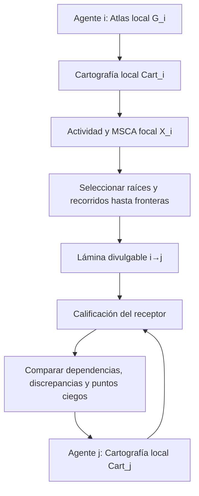

# Perspective Beyond / Atlas — Lámina cartográfica MSCA por agente y actividad

**Versión:** 0.1, borrador experimental · **Fecha:** 2026-11-04  
**Alcance acordado en esta iteración:** relación entre la cartografía epistemológica creada por el Atlas, la **selección de recorridos hasta sus fronteras D**, la **actividad/Objective Envelope** de un agente y la **lámina cartográfica que puede compartir** con otros. Se documenta *hasta esta interfaz*, sin fijar todavía el cálculo de porcentajes temáticos, un protocolo de señalización, una topología exhaustiva ni un motor de composición.  
**Naturaleza:** extensión instrumental propuesta para Atlas fase 2; **no redefine** la arquitectura canónica MSCA ni el baseline EA ni constituye adopción institucional.  
**Documentos relacionados:** [Procedimiento Atlas](./PROCEDIMIENTO_LENGUAJE_Y_RECORRIDOS_v0.2.md), [MSCA como capa adicional](./MSCA_CAPA_ADICIONAL_ATLAS_v0.1.md), [Composición y cartografía MSCA canónica](../../../standards/minimum-sufficient-control/03_MSCA_ECOSYSTEM_COMPOSITION_AND_CONTROL.md), [MSCA canónica](../../../standards/minimum-sufficient-control/00_CANONICAL_MSCA_ARCHITECTURE.md), [MSCA Role](../../../standards/minimum-sufficient-control/02_MSCA_ARCHITECTURAL_ROLE.md) y [Signalling 01J, anexo de trabajo no canónico](../../ecosystem-awareness/baseline/01J_ECOSYSTEM_SIGNALLING_SELECTIVE_DISCLOSURE_AND_CHOREOGRAPHED_REPOSITIONING_v0.1.md).

## 1. La corrección arquitectónica

**La lámina MSCA no es sólo una ficha `S/E/C/P/M`.** Esa ficha describe la arquitectura de control de **una actividad o proceso objetivo-vinculado**. La **lámina** contiene además una **proyección suficientemente amplia de la cartografía que el propio agente posee**, seleccionada desde posicionamientos relevantes y acompañada de recorridos, anclas, dependencias y fronteras epistemológicas.

Una lámina responde conjuntamente a tres preguntas, que deben permanecer separadas:

1. **Cartografía:** «¿Qué relaciones, funciones y límites conozco respecto de esta actividad?». La fuente es el Atlas local del agente, con ítems, nodos, aristas, recorridos, clústeres y temas.
2. **Control:** «¿Qué objetivo y condiciones me vinculan, qué puedo coordinar, cómo puedo intervenir y con qué medios?». La representación correspondiente es `X_i(d,t)=[S,E,C,P,M]`, dentro de un Objective Envelope legitimado o, si falta, como instancia **parcial y `UNASSESSED`**.
3. **Intercambio:** «¿Qué fragmento de mi cartografía y de mi situación de control es pertinente y legítimo transmitir a otro participante?». Es una **proyección selectiva**: no entrega la epistemología completa del emisor ni impone una verdad compartida al receptor.

**Definición operativa propuesta:** una *lámina cartográfica MSCA* es una **proyección de un grafo Atlas local**, cerrada o acotada explícitamente **hasta las fronteras epistémicas de los recorridos pertinentes**, vinculada al **MSCA/Architectural Role focal** y a una actividad/decisión/Objective Envelope determinados, con procedencia y cobertura verificables. Puede prepararse internamente y, después, emitirse una versión con divulgación autorizada.

El nombre **«lámina»** es un nombre de intercambio del Atlas, **no** un sexto elemento de MSCA ni sustituto del objeto canónico `Cart_i`.

## 2. Un agente posee su ecosistema cartografiado, no el ecosistema completo

El agente `i` puede elaborar un grafo local:

`G_i = (Items_i, Hooks_i, Nodes_i, EdgesL1_i, WalksL2_i, Clusters_i, Themes_i)`.

La construcción sigue el procedimiento existente:

1. **Ítems con hooks**: cualquier objeto o fragmento referible con fuente, versión y modo de reevaluación.
2. **Nodos**: posicionamientos y descripciones semiestructuradas, vinculados a ítems, con etiquetas de diccionario flexible.
3. **Aristas nivel 1**: vínculos conceptuales explicados, dirigidos o con inversa cuando proceda, **sin ABCD global**.
4. **Recorridos nivel 2**: desde cada posicionamiento `(nodo, actividad, pregunta, alcance, capacidad, fecha)` se siguen aristas, y **el prefijo acumulado** permite valorar A/B/C/D. D es terminal **de ese hilo**; B/C no son terminales obligatorios. Después se agregan los roles JF.F1–JF.F4, donde aporten información funcional.
5. **Clústeres conceptuales**: regiones con alcance A significativo **desde posicionamientos concretos**, no meros componentes conexos ni clústeres por palabra.
6. **Temas**: ejes reconocibles y distinguidos, introducidos tras los clústeres, con asociación ponderada a los nodos.

Este grafo es **la cartografía conceptual/epistémica local**. El corpus canónico MSCA también define `Cart_i(t)=[A_Cart,B_Cart,C_Cart,D_Cart]` como **Ecosystem Cartography local**, que representa composiciones de MSCAs, sus firmas semánticas, relaciones y dependencias, junto con soporte, reservas y residual. **No son objetos idénticos**:

| Objeto | Responsable conceptual | Qué contiene |
|---|---|---|
| `G_i` del **Atlas** (propuesta) | Minería y lectura del conocimiento | Ítems, nodos, aristas y recorridos con sus explicaciones, clústeres y temas; puede representar ideas ajenas a cualquier proceso de control. |
| `Cart_i` **MSCA canónico** | Ecosystem Composition & Control del participante | MSCAs representados en resolución variable, firmas de Objective Envelope, grafo de dependencias materiales, procedencia y cualificación A_Cart/B_Cart/C_Cart/D_Cart. |
| `X_i` **MSCA focal** | Objetivo/proceso de control | S/E/C/P/M de un solo Objective Envelope, con evaluación de suficiencia separada. |
| `Lamina_i` (**adaptador Atlas**, propuesta) | Selección para actividad y destinatario | Fragmento situado del grafo local, relación con `Cart_i` y `X_i`, rutas hasta sus fronteras y estado de divulgación. |

**Relación correcta:** `G_i` alimenta con evidencia/semántica relevante a la cartografía de Ecosystem Composition & Control. `Cart_i` puede enriquecerse además desde señales, observaciones directas, roles, permisos y resultados de RA. `X_i` da la **perspectiva operativa focal**. La lámina extrae una **proyección de ambos ámbitos**, no declara que el conocimiento total sea controlable.

## 3. De qué parte del mapa sale una lámina

Una misma hormiga/agente puede tener muchos clústeres y muchos Objective Envelopes representados, pero **una lámina empieza con una acción o actividad concreta**. No se exporta por defecto el Atlas íntegro.

### 3.1 Definir el posicionamiento operativo

Antes de seleccionar ramas se registra:

- **Agente emisor** y referencia/versionado de su cartografía local; no presupone que otros vean el mismo mapa.
- **Actividad, decisión o misión**: «en esta operación estoy haciendo X».
- **MSCA / Objective Envelope focal** y `Architectural Role`, cuando consten y sean legítimos; `UNBOUND/UNKNOWN` si todavía es ensayo o falta un mandato.
- **Pregunta y horizonte**: qué resultado o dependencia necesita comprender/transmitir, bajo qué medios/capacidad de evaluación y hasta cuándo es válido.
- **Destinatario y finalidad del intercambio**: no todos los receptores necesitan ni pueden recibir lo mismo.

### 3.2 Elegir los orígenes: clústeres y posicionamientos pertinentes

1. Desde la actividad y el MSCA focal se localizan los **clústeres conceptuales principales** que la describen o la condicionan.
2. Dentro de ellos se seleccionan los **nodos de inicio y recorridos posicionados** que realmente sirven a la actividad. Un clúster puede proporcionar varias raíces, y un nodo puede participar en distintos clústeres.
3. Se consideran **temas ponderados** y relaciones materiales. Por ahora el porcentaje temático es una **regla de selección futura**: se conserva la asociación/ponderación existente sin inventar un umbral global. Una dependencia material puede justificar incluir una rama de peso temático bajo.
4. Se establece el ámbito de la lámina: **qué preguntas/operaciones se incluyen y cuáles quedan fuera**. Sólo se promete cobertura respecto de esa selección declarada.

No es correcto elegir un clúster por nombre, sacar sus vecinos léxicos o aplicar un porcentaje temático sin pregunta y llamar a eso una lámina MSCA.

### 3.3 Seguir los hilos «hasta D» sin fingir completitud universal

Para cada raíz seleccionada se aprovechan los recorridos L2 del Atlas o se evalúan los nuevos recorridos necesarios **para esa actividad y capacidad**. Se conservan los pasos sucesivos con:

`(edge_id, from, to, direction, ABCD, ABCD_reason, JF_roles, item_hooks, position_id, version)`.

- Un **A** del recorrido se incluye como contenido operativo *para esa pregunta*, no como prueba de control suficiente.
- Un **B** lleva la reserva caracterizada: alternativa, revisión, observación o prueba realizable bajo condiciones identificadas; se puede seguir explorando otra rama.
- Un **C** lleva la frontera de exploración fundamentada, incluso si hay `C→C` o varios C interiores. No se obliga a reclasificarlo por recorrer otro paso.
- Un **D** marca la **primera frontera más allá de la capacidad de evaluación efectiva del recorrido acumulado**; la rama se **detiene allí**. El receptor debe conocer la condición de límite si se divulga esa parte del hilo. Un D no se describe como lista completa del mundo desconocido.

Si hay varias ramas relevantes, la lámina incluye sus respectivos recorridos y sus fronteras. **No basta encontrar un único D y cerrar todo el clúster**: D termina un hilo, no todos los posibles caminos. Si un camino termina por `END_OF_GRAPH`, `CUT_NO_RELEVANCE`, `BUDGET`, `CYCLE` o `REVIEW_PENDING`, se registra **esa causa**, no un D ficticio. Una lámina puede ser **parcial**.

**Regla propuesta de cobertura:** `closed_to_D` solo para las ramas seleccionadas realmente calificadas hasta D; `partial` en el resto. `coverage_summary` declara número de raíces, ramas revisadas, ramas hasta D y ramas cortadas. Las cifras son cobertura del **ensayo local**, jamás porcentaje de conocimiento universal.

### 3.4 Conservar dos grafos, no uno solo

La lámina puede transportar:

- **Relaciones conceptuales:** pertenencia, técnica, analogía, función o relación explicativa, con sus etiquetas y sentido.
- **Dependencias materiales:** un cambio en `X_j` puede afectar los supuestos, recursos, acciones o resultados de `X_i`. Requiere evidencia de dependencia, **no** solo proximidad conceptual.

El documento canónico de composición MSCA separa explícitamente **semantic representation** de **dependency graph**. Dos métodos pueden ser conceptualmente cercanos sin crear dependencia operativa; dos procesos lejanos semánticamente pueden compartir una dependencia crítica. La lámina debe mantener `conceptual_edge_refs` y `material_dependency_refs` distintos, incluso cuando una misma fuente sirva para ambos análisis.

## 4. Objective Envelopes como nodos dentro de una cartografía

El usuario propone que los Objective Envelopes que se intercambian **aparezcan como nodos, conectados con otros nodos de actividad, agentes, medios, resultados y dependencias**. Es una buena forma de volver navegable la lámina, con una distinción indispensable:

1. El Atlas puede representar un **nodo o firma de Objective Envelope** (`objective_node_ref`, `objective_envelope_signature`) y conectar sus relaciones semánticas con el proceso, los actores y las dependencias.
2. **S en MSCA** sigue siendo el **Objective Envelope declarado por un titular legítimo**, con restricciones, ámbito y reglas de compromiso. No nace un mandato porque el nodo exista o porque varios agentes compartan ese nodo.
3. Un nodo `objetivo` puede ser **candidato** o representar una **declaración histórica** sin ser el `S` vigente. Debe llevar `binding_status`, `owner_ref` y fuente/hook, o `UNKNOWN/UNBOUND` cuando corresponda.
4. Una lámina no convierte MSCAs vecinos en un único S. Diferentes agentes pueden poseer MSCAs pares con distintos objetivos; una **MSCA compuesta superior** solo existe con un envelope superior explícito y legítimamente instituido.

Así se preserva la intuición **«los envelopes viajan como nodos relacionados»** sin confundir una representación conceptual con autoridad. La unidad de intercambio puede representar varios *Objective-Envelope signatures* de procesos vecinos, pero la **MSCA focal** de una acción sigue vinculada a **un** envelope.

## 5. Anatomía concreta de una lámina

El contrato mínimo propuesto para el adaptador es:

| Parte | Campos indicativos | Función |
|---|---|---|
| **Identidad y productor** | `slice_id`, `producer.agent_id`, `as_of`, `version`, `cart_i_ref` | Atribuir la perspectiva; ninguna lámina anónima se convierte en conocimiento universal. |
| **Foco operativo** | `activity`, `decision`, `focal_msca_view_ref`, `objective_envelope_ref`, `architectural_role_ref` | Distinguir qué hace el agente de todo lo que sabe; conservar `UNBOUND` si procede. |
| **Selección** | `seed_cluster_refs`, `position_refs`, `theme_selection`, `selection_reason` | Explicar desde qué posicionamientos se comenzó y qué parte del mapa interesa. |
| **Grafo compartible** | `item_hooks`, `node_refs`, `conceptual_edge_refs`, `material_dependency_refs`, `walks` | Permitir al receptor volver a la fuente y seguir cada flecha, sin heredar una verdad global. |
| **Distancia y cierre** | `walks[].steps`, `walks[].terminal_kind`, `walks[].complete_to_D`, `coverage_summary`, `residual_notes` | Identificar A, B, C y la frontera D para la trayectoria concreta; señalar parciales. |
| **Control MSCA** | `msca_projection_ref`, `S/E/C/P/M`, `assessment_state`, `binding_status` | Relacionar conocimiento con una actividad y sus medios/condiciones de control. |
| **Validez y divulgación** | `evidence_status`, `freshness`, `validity_conditions`, `disclosure`, `receiver_scope`, `requalification_on_change` | Saber qué se afirma, qué se omite y qué debe reevaluarse al cambiar una fuente o el entorno. |

**Formato:** JSON semiestructurado con descripciones libres y **el mismo diccionario de etiquetas** para ítems/nodos y notas temáticas; las claves del contrato de intercambio son campos reservados, no etiquetas arbitrarias. Los ítems/hooks siguen siendo la unidad de anclaje para recalcular partes afectadas de la lámina. No se obliga a publicar el contenido bruto de una fuente con restricciones de acceso.

El [ejemplo JSON](./examples/msca-cartographic-slice-v01.json) se genera **sobre los IDs del piloto Atlas existente**. No afirma que haya una implantación MSCA real en Nestlé; muestra cómo un agente ficticio seleccionaría dos recorridos, uno que llega a D y otro que queda parcial.

## 6. Qué significa «varias láminas se juntan»

Una red de agentes `i`, `j`, `k` **no** necesita un Atlas maestro ni un objetivo global. Cada cual mantiene `G_i`, su composición `Cart_i`, uno o varios MSCAs/roles propios y, cuando corresponda, emite una proyección situada `Lamina_i`.

**Composición no es concatenación automática**. El receptor comprueba identidad, fuente, versión, semántica del Objective Envelope, pregunta y capacidad del emisor, validez temporal, ACL/permiso y correspondencias entre nodos. Puede:

- **Confirmar** una relación que ya tenía, conservando las fuentes y el ámbito de ambas.
- **Extender** su mapa con una arista o nodo nuevo, indicando que procede de un emisor y su nivel de cualificación.
- **Descubrir una discrepancia:** el emisor supone disponible una intervención que el receptor observa como bloqueada; no se promedia la discrepancia en una certeza artificial.
- **Descubrir un punto ciego:** la ruta de uno termina en un residual D o en un C todavía no caracterizado y el otro dispone de observaciones o reservas evaluables que podrían ayudar a reabrir una pregunta. El nuevo hallazgo exige **recalificación local**, no cambia automáticamente el C/D del emisor.
- **Mantener separación:** dos MSCAs cercanos semánticamente pueden no tener dependencia material; dos envelopes distintos no se fusionan por composición.

No se presume consenso, controlador global, confianza universal, estado compartido ni reconstrucción completa del ecosistema. El objetivo es **interoperar entre conocimientos locales parciales**, producir mejores preguntas y ver dónde la inferencia o el control dejan de ser defendibles.

### 6.1 Ejemplo sencillo: dos hormigas (metáfora didáctica, no descripción etológica)

- La **hormiga A** participa en una operación de búsqueda de alimento. Su posicionamiento inicial es «recorrido de aprovisionamiento»; puede documentar camino habitual **A**, alternativa de ruta **B**, nuevo acceso aún no caracterizado **C**, e influencia potencialmente material que no puede evaluar **D**.
- La **hormiga B** trabaja sobre una actividad distinta relacionada con el estado de un paso físico. Su mapa puede contener evidencia de una condición del acceso que la primera no observa. Su MSCA tiene un Objective Envelope propio; la proximidad física o conceptual no fusiona sus objetivos.
- A comunica una lámina **pertinente al aprovisionamiento**, no todo su cerebro. B puede conectar el punto C/D referido a ese acceso con una observación propia; A deberá revisar su ruta **desde el mismo posicionamiento o uno nuevo**, con fuentes y condiciones. Una observación de B **no elimina** automáticamente los demás residuales D.

Este ejemplo sólo explica el mecanismo de composición. No hay métricas, rutas reales ni validación biológica implícitas.

## 7. «Hasta D» internamente y divulgación selectiva hacia fuera

Aquí hay una tensión productiva que debe quedar documentada, no escondida:

- **Objetivo interno de minería:** cuando exista capacidad y relevancia, recorrer **cada rama seleccionada** hasta su D genuino y conservar las B/C interiores y el motivo. Esto maximiza la utilidad de la lámina para identificar límites.
- **Contrato externo canónico de Signalling 01J:** el agente **puede divulgar solo la parte pertinente y autorizada** de su posición epistémica y su MSCA; no tiene obligación de exponer toda su cartografía ni todos sus residuales a todos los receptores.

Por tanto hay que distinguir **`internal_slice`** de **`disclosed_projection`**. En la proyección externa, una parte no transmitida se registra como `NOT_DECLARED` / `WITHHELD` según corresponda, **no** como ausencia de D, ni como «D=0», ni como `SUPPORTED`. El receptor puede tener menos información de la que el emisor realmente posee, y debe conservar esa incertidumbre de traducción.

Una lámina interna completa **hasta D en los caminos elegidos** puede producir múltiples láminas externas selectivas según receptor, finalidad, confidencialidad, confianza y necesidad de decisión. **Señal no significa autoridad ni orden de ejecución.**

## 8. Procedimiento mínimo del bot emisor y del receptor

### Emisor: construir una lámina para su actividad

1. Cargar Atlas/diccionario y revisar ítems con hooks, aristas, recorridos y clústeres **actualizados**. Distinguir evidencia fuente, interpretación y ejemplo sintético.
2. Identificar agente, rol, actividad, pregunta y Objective Envelope; si el titular de S no está legitimado, conservar `UNBOUND` y `UNASSESSED`.
3. Seleccionar clústeres/posicionamientos de origen por **materialidad para la acción**; incluir temas ponderados cuando existan, sin inventar aún fórmula de porcentajes.
4. Extraer el subgrafo de ramas seleccionadas y **conservar recorridos completos hasta D**, o el cierre parcial y su causa. Respetar el sentido de cada flecha y el orden ABCD→JF.
5. Adjuntar las anclas, el modelo de dependencias **materiales** distinguido del conceptual y el estado de cobertura/residual.
6. Asociar la vista MSCA focal S/E/C/P/M y estado de evaluación sin deducir `SUPPORTED` de una región A grande.
7. Crear una proyección para cada destinatario con límites de divulgación; versionar ambos estados y las dependencias de invalidación de hooks.

### Receptor: componer sin apropiarse de las afirmaciones del emisor

1. Verificar identidad/permiso, versión, procedencia, frescura, vocabulario y finalidad de la lámina.
2. Leer el grafo recibido como **una posición ajena situada**, no como estado de verdad del ecosistema.
3. Alinear **firmas de Objective Envelope**, nodos y dependencias, manteniendo separados niveles de resolución y soporte.
4. Detectar coincidencia, incompatibilidad, dependencia nueva y posibles huecos; registrar `UNKNOWN` cuando falte contexto o haya contenido no declarado.
5. Recalificar su **propio** `Cart_j` y recorridos si el material es suficiente, solicitando ampliación/revisión cuando corresponda. No cambiar de objetivo ni ejecutar controles sin ACC/autoridad.

## 9. Cuestiones deliberadamente abiertas

1. **Ponderación temática/porcentajes:** conserva valores de asociación como datos y define en una fase posterior su cálculo, normalización, efecto de múltiples temas y excepciones por dependencia material. Los porcentajes no representan probabilidad de verdad ni «porcentaje del universo conocido».
2. **Política de selección de ramas:** el principio es materialidad y frontera D; faltan reglas precisas de presupuesto, sensibilidad, reexpansión y métricas de cobertura para grafos extensos. Un corte por presupuesto no es D.
3. **Resolución de la lámina:** el MSCA canónico permite R0 a R4 según relevancia/dependencia. El contrato Atlas deberá decidir cuándo incluir únicamente firmas y cuándo subgrafos de detalle.
4. **Comparación multiagente:** faltan reglas de equivalencia/contradicción de nodos, conflictos de fuentes, confianza y no doble contabilización de señales correlacionadas.
5. **Transporte/autorización:** 01J admite distintos perfiles y divulgación selectiva; aquí no se prescribe un formato de red ni se crean permisos nuevos.

## 10. Pruebas de coherencia de esta interfaz

- [ ] Las láminas parten de **agente + actividad + posicionamientos/clústeres seleccionados**, no de todas las fichas indiscriminadamente.
- [ ] Un recorrido que llega D se detiene ahí y conserva el prefijo A/B/C/D con sus fuentes.
- [ ] Otro recorrido legítimo pero todavía parcial **no** se declara completado hasta D.
- [ ] El mismo clúster puede aparecer en láminas de distintas actividades sin fusionar sus S.
- [ ] `ABCD.C`, `MSCA.C` y `C_Cart` no se identifican automáticamente; comparten vocabulario parcial pero objetos/preguntas diferentes.
- [ ] La similitud entre nodos no se promueve a dependencia material sin evidencia.
- [ ] Una relación a un nodo de Objective Envelope no equivale a contrato/mandato legítimo.
- [ ] Tema/porcentaje sin método documentado no decide automáticamente la inclusión o exclusión de una dependencia material.
- [ ] Parte no divulgada se trata como `WITHHELD/NOT_DECLARED`, nunca como D ausente o falso consenso.
- [ ] El receptor actualiza su propio mapa, sin reescribir automáticamente la calificación del emisor.

La prueba reproducible está en [ejemplo JSON](./examples/msca-cartographic-slice-v01.json) y [validador estructural](./scripts/validate-msca-cartographic-slice-v01.mjs). Su alcance es **integridad del vínculo y de los cierres**, no validación epistémica/operativa, calidad temática ni eficacia de la composición real.

## 11. Precedencia y fuentes

1. **Control y composición canónicos:** [MSCA Architecture 00](../../../standards/minimum-sufficient-control/00_CANONICAL_MSCA_ARCHITECTURE.md), [Architectural Role 02](../../../standards/minimum-sufficient-control/02_MSCA_ARCHITECTURAL_ROLE.md), [Ecosystem Composition 03](../../../standards/minimum-sufficient-control/03_MSCA_ECOSYSTEM_COMPOSITION_AND_CONTROL.md). En particular, *one Objective Envelope*, `Cart_i`, separación entre semántica y dependencia, resolución R0–R4 y cartografías locales no universales.
2. **Divulgación y receptor:** [01J Ecosystem Signalling](../../ecosystem-awareness/baseline/01J_ECOSYSTEM_SIGNALLING_SELECTIVE_DISCLOSURE_AND_CHOREOGRAPHED_REPOSITIONING_v0.1.md), **anexo público de trabajo**, no baseline canónico. Su proyección puede ser selectiva, con varios receptores y sin derecho automático a actuar.
3. **Límites epistémicos:** [00M v0.8](../../ecosystem-awareness/baseline/00M_ABCD_AND_MATHEMATICAL_PLAUSIBILITY_v0.8_RESEARCH_NOTE.md#abcd-canonical) y [procedimiento Atlas v0.2](./PROCEDIMIENTO_LENGUAJE_Y_RECORRIDOS_v0.2.md).
4. **Marco divulgativo:** [Tegrity.AI Structural Awareness Programme](https://tegrity.ai/structural-awareness-program/) explica la diferencia entre mapa de representación y flujo observado; no sustituye fuentes controladas o pruebas.

**Límite final:** una lámina mejora la interoperabilidad entre cartografías locales, pero **no crea una cartografía mundial completa, un Metaatlas soberano, un Objective Envelope compartido, una inferencia transitiva ilimitada ni una evaluación de suficiencia por el solo hecho de llegar a D**.
