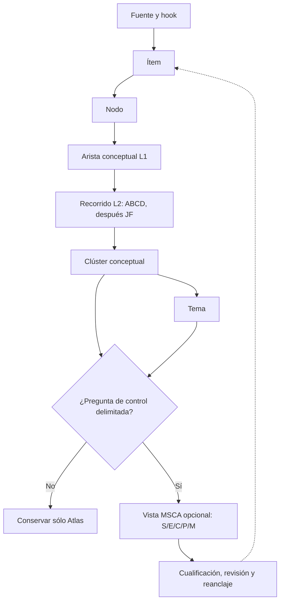

# Perspective Beyond / Atlas — MSCA como capa adicional de análisis

**Versión:** 0.1 experimental · **Fecha:** 2026-11-04  
**Estado:** propuesta de interfaz y piloto reproducible dentro de la fase 2 del Atlas. **No modifica ni sustituye la arquitectura canónica de MSCA**, no constituye una especificación de despliegue y no acredita suficiencia de control en ningún caso histórico.  
**Precedencia:** en semántica de control prevalecen los documentos canónicos de [MSCA](../../../standards/minimum-sufficient-control/README.md), en particular [00 — arquitectura](../../../standards/minimum-sufficient-control/00_CANONICAL_MSCA_ARCHITECTURE.md) y [04 — operación y reposicionamiento](../../../standards/minimum-sufficient-control/04_CANONICAL_MSCA_OPERATION_AND_REPOSITIONING.md). En minería, ítems, nodos, recorridos y temas prevalece el [procedimiento de Atlas v0.2](./PROCEDIMIENTO_LENGUAJE_Y_RECORRIDOS_v0.2.md).

## 1. Tesis: dos preguntas distintas, una interfaz útil

El Atlas construye un **mapa conceptual trazable** del pensamiento y de la evidencia. Desde un posicionamiento (`nodo + actividad + pregunta + alcance + capacidad + fecha`) sigue hilos dirigidos del grafo; clasifica cada paso, respecto del **recorrido acumulado**, como **A, B, C o D** y, *después*, puede indicar su función **JF.F1–JF.F4**. Encuentra regiones A y fronteras, propone **clústeres conceptuales**, y organiza **temas**. La estructura sirve para recuperar significados y saber qué se sostiene, qué está disponible, qué puede explorarse y dónde deja de existir una vía de evaluación eficaz.

MSCA responde otra pregunta:

> **¿Qué configuración de control autorizable y realmente evaluada basta para mantener un Objective Envelope declarado por su titular, bajo estas condiciones operativas, con la menor carga justificable entre las alternativas suficientes examinadas?**

Esa pregunta no se obtiene automáticamente de un clúster amplio ni de una etiqueta temática. Requiere **problema operativo delimitado, titular legítimo del objetivo, horizonte, condiciones, mecanismos, medios y pruebas**. Por ello MSCA se añade como **capa de proyección controlada y opcional** sobre determinadas porciones del Atlas. Ni el Atlas se convierte en una arquitectura de control universal ni MSCA se reduce a un conjunto de etiquetas.

| Capa | Pregunta | Unidad | Resultado | No autoriza inferir |
|---|---|---|---|---|
| Ítems, nodos y fichas | ¿Qué afirmación/objeto está anclado y cómo se describe? | Ítem, hook, nodo | Descripción y procedencia verificable | Que una conexión es causal o está implementada. |
| Relaciones nivel 1 | ¿Qué vínculo conceptual existe o merece ser candidato? | Arista con predicado, sentido y evidencia | Grafo sin clasificación global A/B/C/D | Que el vínculo sea obligatorio o transitivo. |
| Recorridos nivel 2 + JF | ¿Hasta dónde llega **este** hilo, para **esta** pregunta? ¿Qué papel cumple cada paso? | Recorrido orientado y calificado | A/B/C/D contextual y JF.F1–F4 si procede | Que exista un control suficiente o permiso de actuar. |
| Clústeres y temas | ¿Qué núcleos conceptuales dominan y desde qué ejes pueden leerse? | Clúster situado, tema distinguible | Organización intelectual | Que el clúster sea un proceso o su etiqueta, un objetivo legítimo. |
| **MSCA (capa adicional)** | ¿Qué control sería suficiente para un **objetivo legitimado**, en un **entorno determinado**? | Vista/instancia objetivo-vinculada `X=[S,E,C,P,M]` | Representación parcial, alternativas y evaluación independiente | Que tener una ficha MSCA implique suficiencia, autoridad, ejecución o efecto observado. |

### 1.1 Arquitectura de datos: añadir una *vista*, no reescribir los nodos



La flecha del Atlas a MSCA significa **selección de material cualificado**, nunca un mapeo semántico automático ni una cadena temporal obligatoria. MSCA puede abrir una nueva pregunta y llevar a **minar ítems adicionales**, introducir nodos, proponer relaciones o revisar recorridos. La vuelta es explícita y versionada; no se sobrescriben las calificaciones anteriores sin una nueva evaluación.

### 1.2 Corrección de integración: del conocimiento completo a una **lámina por agente**

La representación `X=[S,E,C,P,M]` desarrollada en este documento describe la **dimensión de control**. **No es toda la lámina que se comparte.** Un agente mantiene su propio grafo Atlas y una `Cart_i` local de composición MSCA; para su acción elige **posicionamientos y clústeres relevantes**, extrae sus recorridos **hasta D en cada rama donde pueda calificarse**, conserva ramas parciales, fuentes, temas y dependencias, y vincula el conjunto con su MSCA/Role focal.

El resultado propuesto se llama **lámina cartográfica MSCA** y se describe, paso a paso, en [LAMINA_CARTOGRAFICA_MSCA_AGENTES_v0.1.md](./LAMINA_CARTOGRAFICA_MSCA_AGENTES_v0.1.md). Incluye un [piloto JSON](./examples/msca-cartographic-slice-v01.json) y un [validador](./scripts/validate-msca-cartographic-slice-v01.mjs). Conecta expresamente el Atlas con la **Ecosystem Cartography `Cart_i`** de [Composición MSCA canónica](../../../standards/minimum-sufficient-control/03_MSCA_ECOSYSTEM_COMPOSITION_AND_CONTROL.md) y su emisión selectiva con [Signalling 01J](../../ecosystem-awareness/baseline/01J_ECOSYSTEM_SIGNALLING_SELECTIVE_DISCLOSURE_AND_CHOREOGRAPHED_REPOSITIONING_v0.1.md).

Por tanto se distinguen **tres objetos**: el *grafo epistémico del agente* (Atlas), su *cartografía local de ecosistemas MSCA* (`Cart_i`) y la *lámina seleccionada para una actividad/destinatario*. La vista S/E/C/P/M **forma parte del contexto de esa lámina**; no sustituye el subgrafo hasta las fronteras epistemológicas ni pretende describir todo el agente. La calificación A/B/C/D del hilo, `A_Cart/B_Cart/C_Cart/D_Cart` de cartografía y la posición propia `Π_MSCA` conservan objetos diferentes.


## 2. Condición de entrada: cuándo tiene sentido activar MSCA

Se considera una vista MSCA cuando al menos se puede **formular** una pregunta operativa realista, como «¿qué necesitamos observar, coordinar y poder modificar para sostener este resultado bajo estas condiciones?». La vista puede iniciarse *incompleta*. **No** se declara `SUPPORTED` por haberla creado.

1. **Anclaje conceptual:** uno o varios `cluster_refs`, más `node_refs`, `walk_refs` y fuentes de ítem relevantes. Un `theme_ref` es útil para delimitar la perspectiva, pero **no es una condición constitutiva de MSCA**: una pregunta de control puede aparecer antes de cerrar el catálogo temático.
2. **Actividad y límite:** proceso, decisión o misión concretos; qué queda dentro y fuera. Puede ser distribuido, con ciclos, intervención humana o múltiples agentes; no se presume una secuencia lineal.
3. **S — Objective Envelope:** declarar quién tiene legitimidad para fijar resultados, rangos y restricciones no compensables. Si el titular o S no están establecidos, `UNKNOWN`; cualquier formulación sugerida va a `candidate_questions`, no pasa a ser una orden ni un objetivo autorizado.
4. **E — condiciones:** situar ambiente, dependencias, versión de evidencia, condiciones de validez, contexto/horizonte temporal y factores materiales.
5. **C/P/M — arquitectura realizable o todavía por averiguar:** coordinación efectiva/legítima, intervenciones y medios con sus límites, precondiciones, capacidad y medida independiente del efecto.
6. **Estado de evaluación separado:** `UNASSESSED`, `SUPPORTED`, `FAILED` o `UNRESOLVED`; no derivarlo del número de campos poblados. Si falta prueba material, declarar carencia.
7. **Autoridad y ejecución separadas:** una opción técnicamente factible puede seguir siendo no autorizada, no ejecutada o no efectiva.

Se omite una vista cuando no añade una pregunta de suficiencia —por ejemplo, «gato → uña → pelo» como ejemplo de distancia conceptual, un tema historiográfico o «qué significa Focus ON» sin proceso/objetivo de control delimitado—. `not_applicable` es más honesto y barato que generar cinco casillas vacías para cada nodo del corpus.

### 2.1 Identidad de la vista y frontera entre objetivos

La clave de una vista experimental no es solo `cluster_id`, sino una **combinación contextual**:

`view_id → (objective_binding, process_scope, decision_scope, operating_context, time/version, source_refs)`.

Un clúster puede apoyar **muchas** vistas MSCA; cada vista representa **un Objective Envelope**, aunque dentro de este puedan existir objetivos que compiten con reglas legítimas de compromiso. Dos problemas de control no relacionados, aunque compartan nodos y temas, conservan **vistas/instancias separadas**; la reunificación solo cabe si un titular legítimo instituye de forma explícita un nuevo envelope conjunto.

En consecuencia, la zona A grande del clúster JUBAP **no** implica una única MSCA «JUBAP». Puede haber una vista para un programa de cambio de una organización y otra para una intervención humana distinta, con autoridades, E, P y evidencias incompatibles. La misma herramienta Focus ON podría ser un instrumento dentro de ambas y seguir sin constituir por sí misma un MSCA completo.

## 3. Núcleo canónico MSCA: `X_i(d,t)=[S,E,C,P,M]`

| Campo | Significado exacto y preguntas operativas | Qué buscar en el Atlas | Error que hay que impedir |
|---|---|---|---|
| **S — Objective Envelope** | ¿Quién declara el propósito? ¿Qué resultados/rangos son aceptables? ¿Qué restricciones no se negocian? ¿Qué compromisos son legítimos? | Ítems con mandato, contrato, declaración de objetivo o política y su titular; nodos de finalidad; recorridos JF.F3 como **pistas**. | Convertir el tema «transformación» o un JF.F3 hipotético en objetivo propietario; fusionar S distintos. |
| **E — Operating assumptions** | ¿Para qué población, lugar, régimen, demanda, dependencia, tiempo y calidad de información vale el análisis? | Hooks, contexto de caso, condiciones y límites de recorridos; dependencias, frontera C/D de exploración; posibles JF.F4. | Trasladar un caso documentado a otro entorno sin revalidarlo; llamar D a todo factor conocido pero difícil. |
| **C — Coordination scope** | ¿Qué actores, flujos, recursos y dominios podemos observar, coordinar, influir o controlar legítimamente? ¿Qué huecos quedan? | Relaciones entre nodos de roles, participantes y dependencias; ítems de responsabilidades, observabilidad y autoridad. | Confundir «relacionado conceptualmente» con «coordinable», o `MSCA.C` con `ABCD.C`. |
| **P — Intervention mechanisms** | ¿Qué medidas pueden intervenir de verdad? ¿Qué activadores, latencias, reversibilidad, capacidad y permisos requieren? | Nodos de métodos/herramientas; aristas de uso documentado; recorridos JF.F2 como **indicios funcionales**. | Confundir una herramienta concebible o una reserva B con una intervención disponible y ejecutable. |
| **M — Enabling means** | ¿Qué observación, comunicación, interoperabilidad, cómputo, capacidad humana, actuación y verificación independiente del resultado habilitan C y P? | Ítems de software, operadores, sistemas, mediciones, recursos y sus hooks; condiciones JF.F1 como **insumos candidatos**. | Tomar la mera existencia de tecnología como prueba de alcance, capacidad o efecto. |

S/E/C/P/M son **posiciones semánticas** en una arquitectura de control, no cinco aplicaciones, cinco fases de un método ni cinco etiquetas que todo nodo deba rellenar. Las condiciones de respuesta (umbrales, tiempo, escalado, legitimidad, revalidación) son **metadatos transversales de vínculo y operación**, no una sexta letra que pueda incorporarse por comodidad.

### 3.1 Diferenciar *representar* de *evaluar*

Cada campo material puede registrar:

- `POPULATED`: existe un valor **cualificado**, con fuentes, límites y alcance; es el nombre de serialización local para «poblado con valor cualificado» del documento canónico.
- `UNKNOWN`: elemento material, pero su contenido o validez aún no se ha establecido.
- `UNPOPULATED`: casilla válida todavía sin contenido aportado; no equivale a afirmar que no existe en la realidad.

En paralelo, una vista/candidato tiene **un estado de suficiencia independiente**:

| Estado | Afirmación permitida |
|---|---|
| `UNASSESSED` | Representación inicial; todavía no se ha establecido una prueba de suficiencia. |
| `SUPPORTED` | La evidencia sostiene **esa** configuración para S, E, alcance, versión y horizonte especificados. |
| `FAILED` | Hay evidencia de que la configuración no satisface un requisito material. |
| `UNRESOLVED` | Se intentó evaluar, pero el resultado material no puede determinarse. |

Una `M` con software y sensores listados puede estar `POPULATED`, mientras `assessment_state=UNASSESSED`. Un `S` sugerido por un analista con titular sin verificar permanece `UNKNOWN`; no nace un permiso. Si todas las posiciones están `UNPOPULATED`, la estructura sigue siendo válida para descubrimiento sin afirmar que el control existe.

## 4. Interfaz con A/B/C/D y Jumps & Falls: enriquecer sin confundir

Aquí reside una de las oportunidades más interesantes del Atlas: la frontera de un recorrido ofrece **preguntas de control priorizadas**, no automáticamente respuestas a la arquitectura de control.

### 4.1 Los cuatro polos del Atlas no son cinco campos MSCA

| Hallazgo en un hilo Atlas | Posible valor para MSCA | Límite de inferencia |
|---|---|---|
| **A**: función defendible para ese recorrido | Candidato a componente de contexto, mecanismo, medio o evidencia. | A en el Atlas **no significa** «control suficiente». |
| **B**: reserva caracterizada, evaluable/activable bajo condiciones | Inventario de una alternativa P/M o prueba conocida todavía sin desplegar. | Que exista una opción conocida no demuestra capacidad actual, permiso ni resultado. |
| **C**: frontera exploratoria fundada, evaluación aún no caracterizada | Pregunta de descubrimiento sobre límites de C/P/M o supuestos E/S. | C no autoriza proyectar causalidad ni rellenar `UNKNOWN` por intuición. |
| **D**: residual potencialmente material fuera de evaluación eficaz **del recorrido completo** | Explicita por qué no se puede extender el soporte a un contexto; puede hacer necesaria revisión de E, suspensión de afirmación o un nuevo proceso de descubrimiento. | **No** equivale a «concepto no relacionado» ni a «riesgo numérico conocido», y no se traslada automáticamente a otra vista. |

No hay conversión `A→SUPPORTED`, `B→uncontrolable`, `C→FAILED` ni `D→rechazado`. El valor de una frontera se guarda como `atlas_walk_ref` y `path_step_ref`, se interpreta para el problema concreto y se conserva el estado MSCA independiente.

### 4.2 JF.F1–JF.F4 aporta una lectura funcional, no un «traductor» de S/E/C/P/M

El **orden de minería** del Atlas es invariable: primero ABCD, **después** JF sobre las rutas donde proceda. Esta regla no impone un orden F1→F2→F3→F4 en un proceso real; F4 es transversal/colateral.

| Función del recorrido | Pregunta que sugiere a MSCA | Correspondencias **posibles**, no identidad de campos |
|---|---|---|
| **JF.F1** — entrada / Cost of Clarity | ¿Qué señales, datos, personas, dependencias o esfuerzo son necesarios para reconocer la situación? | E, M y, si la fuente lo justifica, ámbito de C. |
| **JF.F2** — procesamiento, actividad o transformación | ¿Qué mecanismo realiza o acompaña la intervención? ¿Cómo se decide y con qué precondiciones? | P, C, M, a veces dependencias E. |
| **JF.F3** — salida / resultado perseguido | ¿Qué producto/salida observable se considera, y quién puede declarar qué cuenta como éxito? | Candidato para S, medición M, o una salida intermedia; **no establece S por sí solo**. |
| **JF.F4** — efectos colaterales / otra dimensión | ¿Qué consecuencia, dependencia o externalidad podría cambiar el juicio de suficiencia? | E, restricciones duras de S, observabilidad M, respuesta P. Puede ser `ABCD.C`. |

Ejemplo crucial: `JUBAP → dinámica de roles → posible liberación emocional` puede estar marcado `JF.F4 / ABCD.C` en un recorrido **didáctico**. Ello permite formular «¿existe un efecto humano material que habría que detectar?»; **no prueba** que se produzca, ni obliga a incorporarlo como objetivo S de una transformación empresarial. Para ello hacen falta nuevas observaciones, delimitación, titularidad y métodos de evaluación.

### 4.3 Hay **dos** aplicaciones distintas de A/B/C/D

Los documentos canónicos MSCA admiten una posición cualificada propia `Π_MSCA=[A_X,B_X,C_X,D_X]` sobre una instancia `X=[S,E,C,P,M]`. Mantiene las semánticas compartidas de evidencia, reserva, exploración y residual, pero su **unidad y pregunta son distintas** de las del recorrido Atlas.

- `ABCD_Atlas` califica un **paso dentro de un hilo completo** desde una posición y capacidad declaradas. Es contextual, dirigido, secuencial y llega a D como terminal de **ese** hilo.
- `Π_MSCA` califica **la representación y sus límites de control** para **este** S/E/decisión/participante/tiempo. Es una evaluación de otro objeto y no se rellena copiando los pasos de `ABCD_Atlas`.
- `MSCA.C` es **coordinación**; `ABCD.C` es **exploración**; `JF.F4` es **función colateral**. La coincidencia de una letra o número no implica relación ontológica.

Por ejemplo, un C del Atlas puede llegar a ser B de una nueva posición tras caracterizar una prueba, pero esa reclasificación no aparece espontáneamente como `C_X` o `B_X` de un MSCA. Hay que producir otra evaluación, con el objetivo y la evidencia correspondientes.

## 5. Modelo semiestructurado: conservar el lenguaje y crear una entidad de vista

**Recomendación:** reutilizar el [diccionario de etiquetas](./TAG_DICTIONARY_v0.1.json) **para descripciones e índices** y añadir un **contrato mínimo fijo** para los campos que cambian el sentido de MSCA. Conservar texto libre en `description`, `notes`, `boundary_reason`, `evidence_rationale` y propuestas de etiquetas; la estructura evita confundir un relato con una evaluación. No exigir las categorías MSCA en las fichas de ítem, nodo, tema o clúster.

Una ficha MSCA tiene dos zonas:

1. **Identidad/semántica controlada:** `view_id`, `scope`, `objective_binding`, `conditions`, `msca`, `assessment`, `authority_boundary`, `source_refs`, `version` y sus estados enumerados. No son etiquetas de texto libre: son campos de contrato que un bot debe respetar.
2. **Lenguaje flexible:** `description`, `candidate_questions`, `etiquetas` reutilizables y notas explicativas. Una etiqueta **no crea** por sí sola la legitimidad de S ni altera una evaluación.

### 5.1 Contrato JSON propuesto (ejemplo mínimo, no esquema canónico MSCA)

```json
{
  "view_id": "MSCA-VIEW-001",
  "adapter_version": "0.1-experimental",
  "source_map": {
    "cluster_refs": ["CL-JUBAP"],
    "theme_refs": ["TH-TRANSFORMATION"],
    "node_refs": ["JFW", "KOT"],
    "walk_refs": ["W-JFW"],
    "item_refs": ["ITEM-NESTLE-CASE"]
  },
  "scope": {
    "activity": "Estudiar la configuración de cambio en un contexto delimitado",
    "decision": "¿Qué condiciones de control permiten sostener el objetivo?",
    "horizon": "No establecido",
    "as_of": "2026-11-04"
  },
  "objective_binding": {
    "owner_status": "UNKNOWN",
    "owner_ref": null,
    "envelope_ref": null,
    "binding_status": "UNBOUND"
  },
  "msca": {
    "S": {"state": "UNKNOWN", "value": null, "item_refs": []},
    "E": {"state": "POPULATED", "value": "Contexto histórico reportado, sin traslado automático al presente", "item_refs": ["ITEM-NESTLE-CASE"], "qualification": "historical_source_only"},
    "C": {"state": "UNKNOWN", "value": null, "item_refs": []},
    "P": {"state": "UNKNOWN", "value": null, "item_refs": [], "reason": "Herramientas históricas candidatas; sin prueba de disponibilidad o viabilidad operativa actual"},
    "M": {"state": "UNKNOWN", "value": null, "item_refs": []}
  },
  "assessment": {"state": "UNASSESSED", "configuration_refs": [], "rationale": "Sin titular de S ni prueba de suficiencia"},
  "authority_boundary": {"authorization_state": "NOT_ESTABLISHED", "execution_state": "NOT_ESTABLISHED", "effect_state": "NOT_ESTABLISHED"},
  "description": "Proyección retrospectiva para formular preguntas, no acreditación de un MSCA histórico.",
  "etiquetas": [],
  "status": "experimental_candidate"
}
```

Un ejemplo completo de **dos vistas independientes** está en [`examples/msca-view-v01.json`](./examples/msca-view-v01.json); el control estático local está en [`scripts/validate-msca-view-v01.mjs`](./scripts/validate-msca-view-v01.mjs). Sus validaciones impiden varios errores de estructura, pero **no pueden** probar causalidad, legitimidad material ni suficiencia operativa.

### 5.2 Candidatos múltiples y prueba de suficiencia

No basta con inventariar técnicas y declarar que «cuantas menos, mejor». Sobre el **mismo S y E**, el analista propone distintas configuraciones `x=(C,P,M)` y, **si hay evidencias**, contrasta su capacidad para mantener el Objective Envelope y su carga justificada.

- Si ninguna opción se ha evaluado, el resultado es **`UNASSESSED`**, no «óptimo por simplicidad».
- Si la evidencia es materialmente incompleta, puede ser **`UNRESOLVED`** tras el intento de evaluación.
- Si una opción incumple restricciones duras, es **`FAILED`** para ese S/E; no se compensa con un supuesto beneficio adicional no autorizado.
- Si varias son **`SUPPORTED`**, pueden conservarse varias: MSCA no necesita un coste escalar único ni un óptimo global universal. La selección depende de carga, latencia, recursos, redundancia, reversibilidad, riesgos y restricciones, en el contexto autorizado.

Los resultados y sus pruebas son **registros distintos** de la representación `S/E/C/P/M`. El Atlas puede almacenar o enlazar sus ítems, pero no los obtiene por densidad de nodos A ni por número de etiquetas concordantes.

## 6. Piloto JUBAP / Focus ON / Kotter: recorrido Atlas → preguntas MSCA

El [ejemplo Atlas v0.2](./examples/language-v02-pilot.json) conserva, con sus fuentes y límites:

- `ITEM-JUBAP-FRAMEWORK` identifica la descripción pública de JUBAP / Focus ON.
- `ITEM-NESTLE-CASE` ancla el relato de campo publicado de JUBAP articulado con Kotter y Nestlé Continuous Excellence; es **evidencia del relato histórico**, no una validación causal independiente del método.
- Desde `JFW` la arista a `KOT` es `A` en `W-JFW`; la extensión a otros contextos pasa `C→C→D` por hipótesis expresamente **sintéticas**.
- Desde `FON` la pertenencia a JUBAP es `A`, pero la relación indirecta con Kotter es `C` bajo la pregunta y capacidad **de Focus ON**. El grafo es el mismo; cambia el posicionamiento.
- `JF.F4/ABCD.C` en una posible consecuencia emocional proviene de otra ruta **sintética**; no se documenta que tal efecto ocurriera.

**Ahora cambia la pregunta, no el pasado:** «Si quisiéramos diseñar/controlar un programa de transformación en un entorno determinado, ¿cómo describiríamos la suficiencia?».

| Paso | Lo que el Atlas ya ofrece | Lo que MSCA todavía exige |
|---|---|---|
| Seleccionar `CL-JUBAP` + tema transformación | Mecanismos y conexiones defendibles, fronteras y reservas; rastros a fuentes. | Escoger actividad concreta y distinguir uso histórico de hipótesis presente. |
| Explorar posible S | La ruta JF.F3 sugiere tipos de salida que investigar. | Titular legítimo, umbrales, objetivos/rangos y restricciones. En el ejemplo **desconocidos**. |
| Reconocer E | Referencia a contexto Nestlé y límites documentales. | Estado del sistema, demanda, cultura, reglas, horizonte y dependencias del **nuevo** problema. |
| Preguntar C | Nodos de funciones, responsables y vínculos conceptuales. | Qué actores/recursos son **realmente** observables/coordinables y con qué mandato. |
| Proponer P | JUBAP, Focus ON, Kotter como pistas metodológicas. | Cuáles intervenciones son factibles, bajo qué precondiciones y con qué autoridad. |
| Averiguar M | Posibles actividades de diagnóstico y seguimiento. | Datos, personas, medios, comunicación y **medición independiente de efecto**. |
| Evaluar | Fronteras B/C/D y relaciones ayudan a localizar preguntas. | Comparar configuraciones para S/E; mientras no haya pruebas, `UNASSESSED`. |

### 6.1 Lectura de campo más concreta: qué encontraríamos en el relato Nestlé

El artículo público [Nestlé North America — Where JUBAP Was Named](https://jubap.eu/nestle-case-study-where-jubap-was-first-named/) contiene material útil **para formular** una representación MSCA retrospectiva, manteniendo la distinción entre *hecho relatado*, *interpretación arquitectónica* y *prueba de suficiencia*:

| Campo MSCA | Material de campo que podríamos vincular como ítems/nodos | Qué **no** se puede concluir aún |
|---|---|---|
| **S** | La fuente describe el encargo de conseguir que el cambio organizativo se materializara y sostuviera, preservando la capacidad internamente. Es una **descripción retrospectiva de finalidad**. | No tenemos aquí el documento del titular legítimo con rangos, restricciones duras, reglas de compromiso y periodo para instanciar un nuevo S. Se mantiene `UNKNOWN`/`UNBOUND` en el piloto. |
| **E** | Entorno industrial de Nestlé en México, dentro de Nestlé Continuous Excellence (NCE), Lean/TPM, procedimientos, auditorías y evaluaciones. | No sabemos que las condiciones sean reproducibles en otra planta, país, sector o fecha. |
| **C** | La fuente explica un tablero por proyecto con niveles de stakeholders y ocho pasos adaptados de Kotter; permite investigar qué se observaba y coordinaba en aquel sistema. | Mostrar actores en un tablero no prueba mandato, cobertura completa ni capacidad de coordinar fuera de ese proyecto. |
| **P** | Aparecen mecanismos relatados de apoyo a iniciativas, coaching, desbloqueo/escalado y adaptación del cambio al sistema existente. | No basta para establecer qué intervenciones estarían disponibles, autorizadas, reversibles o suficientemente rápidas **en una nueva misión**. |
| **M** | Se describe un dashboard con siete estados de evidencia y medidas/revisiones de progreso y competencias; posibles medios de observación y seguimiento. | No demuestra por sí solo que todos los efectos pertinentes se midan independientemente ni que los medios operen bajo el nuevo E/S. |

Este es exactamente el beneficio de la capa: **en lugar de volver a leer cientos de páginas desde cero**, el Atlas ofrece los *hooks* y recorridos pertinentes; MSCA obliga a preguntar «¿qué de esto constituye objetivo, condición, coordinación, intervención o medio, para quién y bajo qué condiciones?». En una investigación más profunda podrían aparecer **nuevos ítems** (mandato original, tableros, registros de medida, permisos, roles, revisiones de resultados) que sustenten nuevos valores o mantengan `UNKNOWN` si no están disponibles. **No se cambia el estado de suficiencia del caso histórico por haber encontrado una tabla bien organizada.**

Resultado correcto del piloto: una **vista MSCA parcial** que hace visibles los huecos concretos —sobre todo S, titular, C y M— y enlaza los lugares donde investigar. Resultado **incorrecto**: «JUBAP es suficiente porque está en A» o «Kotter tiene etiqueta F2, así que P está demostrado».

#### Por qué una segunda vista es necesaria

Si se abre una pregunta distinta sobre **efectos humanos/emocionales** del roleplay, ya no hay razón para integrarla por defecto en el mismo S que transformación de negocio. El Atlas deja seguir la relación conceptual `JFW→RPL→EMO`, pero la segunda vista MSCA tiene **otro problema de control hipotético**, otras medidas y posiblemente otro titular. Su `JF.F4 / ABCD.C` es una **señal de investigación**, no un resultado ni una obligación de perseguirlo.

Dos vistas pueden apuntar al mismo ítem y al mismo clúster **sin compartir mandato ni estado `SUPPORTED`**.

## 7. Procedimiento del bot: crear, usar y reevaluar una vista MSCA

**Primera pasada — lectura y selección**

1. Cargar las instrucciones/manifest de Atlas, el [diccionario vigente](./TAG_DICTIONARY_v0.1.json) y el corpus **canónico** MSCA (con versión y estado); confirmar que `profile:msca` es una capacidad descriptiva opcional, no un hecho de control.
2. Recuperar únicamente clústeres, temas, recorridos e ítems pertinentes a la pregunta. Comprobar hook, fecha, alcance y si la evidencia es histórica, interpretativa, experimental o sintética.
3. Formular la pregunta de suficiencia; si no hay proceso/objetivo delimitable, **no instanciar MSCA**. Mantener pregunta de exploración en Atlas.
4. Crear `view_id`, selección de referencias, texto libre y estado preliminar; **no copiar A/B/C/D sobre S/E/C/P/M**.

**Segunda pasada — delimitación y representación**

5. Identificar titular legítimo de S y condiciones de autoridad. Si no constan, `UNKNOWN` y `UNBOUND`; guardar pregunta al titular. Nunca autopromover una hipótesis JF.F3 a S autorizado.
6. Delimitar E, decisión, horizonte y población; registrar premisas/materiales `UNKNOWN` y referencias verificables. Separar historia de operación corriente.
7. Proponer C, P y M *por capacidad y mecanismo*, no simplemente por lista de nombres de técnicas. Distinguir «conceptualmente relacionado», «técnicamente posible», «actualmente disponible» y «legítimamente autorizado».
8. Completar campos parcialmente y conservar las descripciones libres. Toda etiqueta nueva se propone al diccionario con sinónimos/traducción y revisión; no se impone al resto de nodos.

**Tercera pasada — evaluación y vuelta**

9. Enumerar candidatos de configuración únicamente si hay información útil; registrar supuestos, restricciones duras, pruebas de suficiencia y carga. Sin pruebas o dueño legítimo, dejar `UNASSESSED`.
10. Comparar y decidir estados por candidato, sin confundir selección con autorización. La operación real requiere puertas externas de participación/ACC, autoridad, ejecución y medición del efecto. La documentación de [MSCA Operation & Repositioning](../../../standards/minimum-sufficient-control/04_CANONICAL_MSCA_OPERATION_AND_REPOSITIONING.md) gobierna su propio dominio; el Atlas no la automatiza.
11. Publicar **referencias de vuelta**: hallazgos/supuestos nuevos que ameriten un ítem, nodo, relación o revisión de recorrido. Mantener registro de decisión y no degradar un C o sustituir un D sin nueva justificación.
12. Crear dependencias de invalidación a nivel `view → campo S/E/C/P/M → evidencia/hook`, **más** alcance temporal, autoridad y resultados. Reevaluar solo vistas/candidatos afectados si un hook cambia; no trasladar automáticamente un estado `SUPPORTED` a otra vista ni otro horizonte.

### 7.1 Reglas de invalidez, cambio y escalado

| Cambio | Efecto mínimo responsable |
|---|---|
| Fuente/hook cambia un hecho citado en E o P | Marcar la vista/campos dependientes `needs_requalification`; verificar antes de reutilizar cualquier `SUPPORTED` que dependa del hecho. |
| Cambia el titular, mandato, restricciones de S o autoridad | Nueva vinculación/versión; no reutilizar permiso previo, no migrar S silenciosamente. |
| Cambia el entorno o régimen | Comprobar compatibilidad E; una configuración suficiente bajo E1 no hereda soporte bajo E2. |
| Se descubre un nuevo C del Atlas | Añadir pregunta/ítem candidato; no tocar `Π_MSCA` ni evaluación hasta analizar materialidad. |
| Se alcanza D de un recorrido | Cerrar **ese** hilo; conservar residual en el registro de fuentes y acotar afirmaciones. D no demuestra imposibilidad universal de control. |
| La ejecución devuelve recibo sin efecto medido | Mantener las tres capas separadas: suficiencia ≠ autorización ≠ ejecución ≠ efecto. |
| Se observa diferencia entre rol contratado y rol efectivo | Escalar a MSCA Role/Operation & Repositioning, evaluar deriva y autoridad; no improvisar un nuevo objetivo desde la ontología. |

## 8. Diez pruebas mínimas de aceptación

1. **No universalidad:** un nodo sin pregunta de control no contiene cinco campos MSCA obligatorios.
2. **Dos objetivos:** el mismo `cluster_id` admite dos vistas con problemas/titulares separados, sin fusionar S.
3. **S desconocido:** propietario no verificado ⇒ `UNBOUND`/`UNKNOWN` y `UNASSESSED`, aunque P/E estén poblados.
4. **ABCD no heredado:** `W-JFW` contiene A; la vista MSCA permanece `UNASSESSED`.
5. **C y F4 distinguidos:** el `ABCD.C/JF.F4` emocional abre una pregunta, no un resultado probado.
6. **D situado:** la transferencia sintética `C→C→D` impide extrapolar soporte desde ese hilo, pero no borra el caso histórico ni establece `FAILED` global.
7. **Campo vacío lícito:** `UNPOPULATED` no equivale a `FAILED`; `UNKNOWN` no es `SUPPORTED`.
8. **Configuraciones alternativas:** pueden coexistir varias `SUPPORTED` en el mismo S/E; no se declara «mínimo global».
9. **Puertas operativas:** `SUPPORTED` no produce por sí solo autorización, ejecución ni efecto.
10. **Hook y periodo:** al cambiar fuente, entorno o titular, se reevalúan dependencias afectadas y se conserva historial, sin modificación masiva por similitud léxica.

**Qué prueba el validador adjunto:** presencia de referencias, enum de estados, ausencia de S vinculado sin titular, separación de evaluación/autoridad, enlace a ítems del piloto, no duplicación de `view_id` y no colapso semántico explícito. **Qué no prueba:** juicio semántico, fuente canónica vigente, legitimidad del titular, adecuación de controles, resultados ni costo real de inferencia.

## 9. Qué gana el sistema y qué cuesta

**Valor concreto:** el mapa Atlas ya entrega, por posición, relaciones defendibles y reservas B/C/D sin volver a explorar todo el corpus. MSCA selecciona solo aquellas conexiones relevantes para una **decisión de control** y organiza la búsqueda de las piezas que faltan. Mejora la **precisión de preguntas**, la reutilización de evidencia, la identificación de medios/control y la capacidad de comparar alternativas sin confundir teoría, propuesta, despliegue y resultado.

**Coste controlado:** solo se materializan vistas MSCA al existir preguntas operativas. El minado exhaustivo de grafo, temas y distancias es un problema del Atlas; el trabajo S/E/C/P/M se activa **por demanda y objetivo**. Las mismas fuentes y etiquetas se reutilizan mediante referencias, no copiando textos largos a cada vista. La evaluación de control, cuando se solicita, sí requiere evidencia propia y puede ser costosa; el índice no reemplaza esa prueba.

**Indicadores para un piloto posterior (no resultados medidos aún):** tiempo/tokens para contestar una pregunta controlada con Atlas+MSCA frente a lectura directa; cobertura de hooks y fuente; tasa de extrapolaciones indebidas A→SUPPORTED; número de `UNKNOWN` identificados; cambios de estado incorrectos ante modificaciones del hook; utilidad de la comparación de alternativas para un responsable.

## 10. Límites del estado actual y decisiones abiertas

- **Sí documentado:** contrato conceptual de vista adicional, vinculaciones, estados, regla de no confusión, ejemplo JSON y validación estructural.
- **Aún no implementado:** proyección automática de un grafo completo, motor incremental de invalidación, reconciliación de autorizaciones/ACC, evaluación operativa real o medición de tokens sobre corpus completo.
- **No realizado:** revisión de todos los nodos de Perspective Beyond ni verificación empírica de suficiencia de JUBAP, Kotter o técnicas de roleplay.
- **Decisión propuesta:** mantener el MSCA **fuera** del esquema obligatorio de fichas de ítem/nodo/tema; establecer `MSCA View v0.1` como objeto opcional con contrato propio y el **mismo diccionario de etiquetas** para su parte descriptiva, sin reescribir la semántica canónica S/E/C/P/M.

## 11. Fuentes de referencia y trazabilidad

1. **Autoridad semántica de control:** [MSCA — router](../../../standards/minimum-sufficient-control/README.md), [00_CANONICAL_MSCA_ARCHITECTURE.md](../../../standards/minimum-sufficient-control/00_CANONICAL_MSCA_ARCHITECTURE.md), [04_CANONICAL_MSCA_OPERATION_AND_REPOSITIONING.md](../../../standards/minimum-sufficient-control/04_CANONICAL_MSCA_OPERATION_AND_REPOSITIONING.md) (leídos del repositorio; **no modificados por esta propuesta**).
2. **Autoridad operativa de minería Atlas en esta rama:** [PROCEDIMIENTO_LENGUAJE_Y_RECORRIDOS_v0.2.md](./PROCEDIMIENTO_LENGUAJE_Y_RECORRIDOS_v0.2.md), [diccionario](./TAG_DICTIONARY_v0.1.json), [piloto conceptual](./examples/language-v02-pilot.json).
3. **Fuente de campo pública:** https://jubap.eu/nestle-case-study-where-jubap-was-first-named/ y https://jubap.eu/the-jubap-framework/ — relato/descripcion de origen, **sin atribuirles validación MSCA**.

La jerarquía es deliberada: **MSCA canónico define control**; **Atlas define la extracción/recorridos**; **este documento propone exclusivamente su interfaz**.
